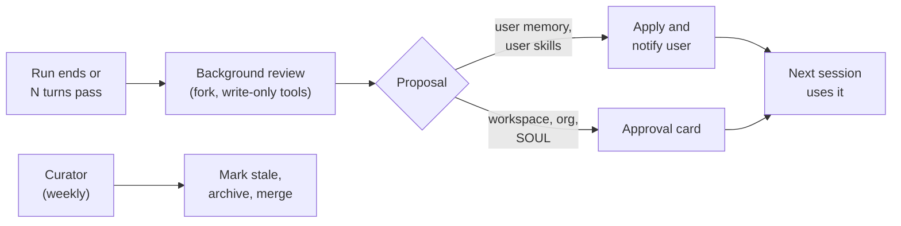

# Sama — Architecture and Design

| | |
|---|---|
| Status | Draft v0.3. The owner answered all open questions (Section 22). Connectors and databases added (Sections 10.3 to 10.7). No code yet. |
| Date | 2026-11-18 |
| Owner | Nikhil Mandhani |
| Companion docs | [`feature-map.md`](feature-map.md) (every Hermes feature and our plan for it), [`roadmap.md`](roadmap.md) (milestones and backlog) |

## Contents

1. [Summary](#1-summary)
2. [Goals, non-goals, and terms](#2-goals-non-goals-and-terms)
3. [Decisions](#3-decisions)
4. [System overview](#4-system-overview)
5. [Runtime adapter layer](#5-runtime-adapter-layer)
6. [Prompt assembly and context management](#6-prompt-assembly-and-context-management)
7. [Sessions](#7-sessions)
8. [Memory](#8-memory)
9. [Skills and the self-improvement loop](#9-skills-and-the-self-improvement-loop)
10. [Tools, toolsets, and integrations](#10-tools-toolsets-and-integrations)
11. [Channels: web, Slack, Telegram, Chrome](#11-channels-web-slack-telegram-chrome)
12. [Scheduler, cron jobs, and workflows](#12-scheduler-cron-jobs-and-workflows)
13. [Sub-agents and multi-agent work](#13-sub-agents-and-multi-agent-work)
14. [Browser use and the Chrome extension](#14-browser-use-and-the-chrome-extension)
15. [Code editing and self-modification](#15-code-editing-and-self-modification)
16. [Safety: approvals, sandbox, secrets](#16-safety-approvals-sandbox-secrets)
17. [Users, teams, and tenants](#17-users-teams-and-tenants)
18. [Observability and cost](#18-observability-and-cost)
19. [Technology stack and repository layout](#19-technology-stack-and-repository-layout)
20. [Milestones](#20-milestones)
21. [Risks](#21-risks)
22. [Resolved questions](#22-resolved-questions)
23. [References](#23-references)

---

## 1. Summary

Sama is a **cloud agent engine**. It gives an assistant the features of
[Hermes Agent](https://github.com/NousResearch/hermes-agent): skills, tools, memory, sessions,
context management, cron jobs, Slack and Telegram, sub-agents, code editing, and a
self-improvement loop. It adds browser control through a cloud browser and a Chrome extension.

Sama does not have its own agent loop. It runs two agent SDKs behind one contract:

- **Claude Agent SDK** (default). It is the Claude Code loop as a Python library: file edits,
  shell, search, sub-agents, compaction, session resume, hooks, and a permission callback.
- **OpenAI Agents SDK** (second). It gives handoffs, guardrails, `needs_approval` tools, a
  `SandboxAgent` with shell, file, skills, and compaction capabilities, and tracing.

Everything that makes the assistant "Hermes-like" lives **above** that contract, in sama:
memory, skills, session search, scheduling, channels, approvals, budgets, and audit. So each
feature works the same on both SDKs, and a third SDK needs only one more adapter.

Sama is the **core engine**. Our team uses it first. Customers use it later. Other products
build on top of it. The first planned product is
[vorflux](https://github.com/nikhilllmno/vorflux), the hotel agent harness. vorflux adds
hotel-specific parts (hotel repos, eval gate, hotel operations) and uses sama for the rest.

Five rules shape the design:

1. **Cloud only.** The API, channels, scheduler, and memory run 24/7 on Fly.io. Every session
   runs in its own **E2B** cloud sandbox. Browsers run in **Browserbase**. Nothing needs a
   local install. The Chrome extension is optional and connects out to the cloud.
2. **The sandbox is the security boundary.** The SDK loop, shell, files, and code run inside
   the sandbox. The sandbox holds no long-lived secrets. Model calls go through the sama
   **model proxy**, and sama tools go through the sama **MCP tool server**. Both accept only a
   short-lived run token.
3. **State is in Postgres** (Supabase), not in files. Every row has an `org_id`. Row-level
   security is on from the first table, so customers later need no data migration.
4. **The prompt prefix is frozen per session** (a Hermes rule). The system prompt, tool list,
   memory snapshot, and skill index do not change during a session. This keeps prompt caching
   cheap. Prompt changes apply from the next session. Compaction is the only exception.
   Authority is not frozen: a revoked permission or a lower budget applies at once.
5. **Self-improvement is bounded and reversible.** The agent can write memory, skills, cron
   jobs, and workflows. Each write is versioned. Changes to sama's own code go through a pull
   request that a human merges. The agent never changes the running service directly.

---

## 2. Goals, non-goals, and terms

### 2.1 Goals

- Give one assistant all the Hermes features listed in [`feature-map.md`](feature-map.md).
- Run on the Claude Agent SDK by default and on the OpenAI Agents SDK as a second runtime,
  with the same features on both.
- Talk to users in a web app, Slack, Telegram, and a Chrome side panel.
- Control a browser: a cloud browser for unattended work, and the user's own Chrome (through
  the extension) for sites where the user is logged in.
- Run scheduled jobs and multi-step workflows without a human present, and deliver results to
  any channel.
- Learn from use: curated memory, agent-written skills, and session search.
- Edit code in a sandbox and open pull requests, including pull requests to sama itself.
- Serve a team now and many customers later, with no change to the data model.
- Be a library and service that other products (vorflux first) build on.

### 2.2 Non-goals for v1

- No local install, terminal UI, or desktop app. (Hermes has these. Our users are in the
  cloud surfaces above.)
- No model providers other than Anthropic and OpenAI. (Owner decision for vorflux, kept here.)
- No own agent loop. We use the two SDKs.
- No third-party plugin code inside the control plane. Extensions come as MCP servers, skills,
  or Composio toolkits.
- No model training pipeline (Hermes batch trajectories). We keep transcripts so that we can
  add this later.
- No public skill marketplace in v1. We curate built-in skills in this repo.

### 2.3 Terms

| Term | Meaning |
|---|---|
| Org | A tenant: our team now, one customer account later. The billing and isolation unit. |
| Workspace | A unit of work inside an org, for example a project or a team. vorflux maps one hotel to one workspace. Memory, skills, jobs, and connections can be workspace-scoped. |
| User | A person in an org, with a role (`owner`, `admin`, `member`). |
| Agent profile | A named assistant configuration: SOUL, default runtime and model, toolsets, skills, approval policy, budgets. Like a Hermes profile, but stored as data. An org can have many profiles. |
| SOUL | The persona and standing instructions of an agent profile (Hermes `SOUL.md`). |
| Session | One conversation with an agent profile: messages, tool calls, and state. It can span many runs and stays on one runtime. |
| Run | One execution of agent turns for a session, in one sandbox, from a trigger to a stop. |
| Trigger | What starts a run: a user message, a cron job, a workflow step, a webhook, or a delegated task. |
| Runtime | An agent SDK that executes a run: `claude_agent_sdk` or `openai_agents_sdk`. |
| Adapter | Sama code that maps one runtime to the sama runtime contract (Section 5). |
| Runner | The sama process inside the sandbox that hosts the adapter and the runtime. |
| Sandbox | An isolated E2B microVM that holds the workspace files, the runner, and the shell for one session. |
| Toolset | A named group of tools. An agent profile enables toolsets. |
| Sama tools | Tools that sama implements once for both runtimes (memory, skills, cron, delegation, browser, connectors). They reach the runtime through the sama MCP tool server. |
| Native tools | Tools that a runtime ships (for example Claude `Read`, `Edit`, `Bash`). They run inside the sandbox. |
| Connector | A kind of external system that the agent can use as tools: a Composio toolkit, an MCP server, a database, an HTTP API, or a plugin (Section 10.3). |
| Connection | One configured account or endpoint of a connector, owned by a user or a workspace, with its credentials in the sama vault. |
| Channel | A surface where users talk to the agent: web, Slack, Telegram, Chrome side panel. |
| Skill | A versioned folder with a `SKILL.md` (agentskills.io format) that tells the agent how to do a task. |
| Memory | Small, curated notes that sama puts in every new session (Section 8). |
| Job | A scheduled trigger (cron expression or one time) with a prompt, skills, and a delivery target. |
| Workflow | A saved, versioned multi-step process with triggers, agent steps, tool steps, and approval steps (Section 12.3). |
| Approval | A human decision on one paused tool call. |

---

## 3. Decisions

### 3.1 Owner answers (2026-11-18)

| Question | Answer | Effect on the design |
|---|---|---|
| How does Sama relate to vorflux and `hermes_like_agent`? | Sama is the core engine. We build products on top of it later. | Sama is domain-neutral and has a public Python API and HTTP API. Hotel parts stay in vorflux. |
| Who uses it? | Our team now, customers later. | Multi-user from day one. `org_id` on every row and RLS. Sign-up and billing come later (M6). |
| Where does it run? | Only in the cloud. | Fly.io control plane, E2B sandboxes, Browserbase browsers. The Chrome extension connects out to the cloud. |
| Language? | Python core. TypeScript only for the Chrome extension and the web UI. | Python 3.12, uv, FastAPI. Next.js web UI. |
| First pull request? | Design doc only. | This document, the feature map, and the roadmap. |
| Runtimes? | Claude Agent SDK default, OpenAI Agents SDK second. | Two adapters behind one contract (D2). |

### 3.2 Key decisions

| # | Decision | Reason |
|---|---|---|
| D1 | Write our own Python code. Do not fork or embed Hermes. Copy ideas, prompts, and limits from Hermes with attribution (`THIRD_PARTY_NOTICES.md`). | Hermes is a single-user app with file-based state and its own agent loop. We need multi-user state and two SDK loops. Hermes uses the MIT license, so we may reuse small parts with the notice. |
| D2 | One runtime contract (`AgentRuntime`) with two adapters: `claude_agent_sdk` (default) and `openai_agents_sdk`. A `fake` runtime exists for tests. | The owner uses only Anthropic and OpenAI models. One contract keeps every sama feature runtime-neutral and makes a third runtime cheap. |
| D3 | Sama tools reach both runtimes through **one MCP server per run** (streamable HTTP), scoped by a run token. | Both SDKs are MCP clients. One implementation serves both. Tenant scope, approvals, and audit happen in one place. |
| D4 | The runner (adapter plus SDK) runs **inside the sandbox**, not in the API process. | The Claude Agent SDK starts the Claude Code CLI as a subprocess, and its native tools run where the CLI runs. The OpenAI `SandboxAgent` needs a sandbox too. The OS boundary is the only real boundary against a model that misbehaves (Hermes security policy). |
| D5 | **E2B** is the sandbox provider, behind a `SandboxProvider` interface. One sandbox per session. E2B pause and resume keep the workspace between runs. Docker is for local development and CI. | Owner chose cloud sandboxes with E2B. The OpenAI Agents SDK has an E2B sandbox client. The interface keeps a path to Fly Machines, which vorflux chose. Owner decision: E2B now, Fly Machines later only if needed (Q1). |
| D6 | **No long-lived secrets in the sandbox.** Model calls go to the sama **model proxy** (`ANTHROPIC_BASE_URL` / OpenAI `base_url`) with a run token. Integration calls go through sama tools on the control plane. | A prompt-injected agent cannot leak a key that it cannot read. The proxy also meters cost, enforces budgets, and sends traces. |
| D7 | **Supabase** is the system of record: Postgres with RLS, Auth, Storage, and pgvector. | Already in the owner's stack. RLS is a second tenant guard under the API. pgvector covers session search and memory recall. |
| D8 | **Postgres is the job queue** (`FOR UPDATE SKIP LOCKED` with leases) for runs, cron fires, workflow steps, and deliveries. No separate workflow engine in v1. | Fewer moving parts. vorflux made the same choice. The queue sits behind an interface. |
| D9 | The **prompt prefix is frozen per session**: SOUL, context files, tool list, memory snapshot, skill index. New memory and skills apply from the next session. A short note on the next user message tells the agent about new skills. | Hermes rule. It keeps prompt caching valid on both SDKs and makes runs reproducible (`RunConfig.fingerprint()`). |
| D10 | **Connectors use one model for all kinds**: Composio toolkits, remote MCP servers, hosted stdio MCP servers, databases, HTTP APIs, and plugins. Connections are per user or per workspace, with credentials in the sama vault. Rare tools sit behind `tool_search`. | The owner has Composio and any MCP server. This gives hundreds of apps without our own connector code, and keeps the tool list short. |
| D11 | **Channels** are adapters in one gateway: web (first-party), Slack (Bolt, Events API), Telegram (Bot API webhook), and the Chrome extension (WebSocket). Email and WhatsApp later. Chats bind to a user and an agent profile through pairing. | Same shape as the Hermes gateway: normalise inbound, send outbound, render approvals, map slash commands. Unpaired chats get no agent access. |
| D12 | **Browser control has one tool contract with two targets**: `cloud` (Browserbase) and `my_chrome` (the extension). The tools work on page snapshots with element refs, and a vision mode uses screenshots and coordinates. | The agent learns one set of tools. Unattended jobs use the cloud browser. Logged-in personal sites use the user's own Chrome with consent. |
| D13 | **Approvals fail closed.** Each tool call gets `allow`, `ask`, or `deny` from a policy. `ask` pauses the run and sends an approval card to the user's channel. Unattended runs (cron, workflows, webhooks) turn `ask` into `deny`, unless a human approved a pre-approval for that tool in that job version. A hardline deny list cannot be overridden. | Hermes three-layer model. A human is not present for unattended runs. |
| D14 | **Self-improvement writes are versioned data.** Memory, skills, cron jobs, workflows, and SOUL changes are rows with history and provenance. Changes to sama's own code are pull requests that a human merges. | The agent can learn and change its stack, but every change can be reviewed and reverted. |
| D15 | **Langfuse** traces both runtimes. The model proxy records tokens and cost per run. | One trace view for both SDKs. Both SDKs have Langfuse integrations. The proxy is the source of truth for cost. |
| D16 | **Sama is a library plus services.** Products import `sama` and register extra tools, skills, toolsets, channels, and policies through extension points. They do not patch sama code. | vorflux and later products build on the engine without a fork (Hermes rule: plugins never touch core). |
| D17 | **Databases use a sama database gateway, and stdio MCP servers run in connector hosts.** The gateway enforces read-only transactions, one statement per call, timeouts, row limits, and hidden columns at the driver. A connector host is a separate sandbox per connection that holds only that connection's secrets. | A prompt cannot remove a limit that the driver enforces. Many SQL MCP servers give full rights through one tool. Running stdio servers outside the agent sandbox keeps credentials out of the sandbox (D6) and still supports the Hermes MCP ecosystem. |

---

## 4. System overview


### 4.1 Components

| Component | Responsibility |
|---|---|
| **API** | Auth (Supabase JWT, API keys for services), REST and streaming endpoints, admin endpoints for profiles, skills, memory, jobs, workflows, and connections. The only holder of the database service key. |
| **Channel gateway** | Receives Slack, Telegram, and extension events. Checks pairing and access. Maps each chat or thread to a user, an agent profile, and a session. Streams replies, renders approval cards, and handles slash commands. Also routes `my_chrome` browser actions to the right extension connection. |
| **Run orchestrator** | Queues runs in Postgres with leases, one active run per session (Section 4.3). Enforces per-org concurrency, budgets, and rate limits. Creates or resumes the session sandbox, starts the runner, streams events, and handles cancel, timeout, crashed workers, and resume after approval. |
| **Scheduler** | Fires cron jobs and one-time jobs. Receives webhooks and Composio triggers. Creates runs or workflow instances. One leader at a time through a Postgres lease. |
| **Workflow engine** | Runs workflow instances step by step as queue items. Stores each step result. Pauses on approval steps. |
| **Sama MCP tool server** | The sama tools for both runtimes: memory, skills, session search, cron, workflows, delegation, browser, connectors (Composio and MCP proxy), todo, clarify, approvals, and change proposals. Each call carries the run token. |
| **Model proxy** | Holds the Anthropic and OpenAI keys. Accepts the run token, checks the model allowlist and budget, forwards the call, records usage and cost, and sends the trace. |
| **Approval service** | Stores pending approvals, routes them to the user's channel, records the decision, and resumes the run. |
| **Sandbox** | Runs the runner, the native shell and file tools, and code. Has no database access and no long-lived secrets. Egress is limited to the sama endpoints and an allowlist. |

### 4.2 A run, end to end

1. **Receive.** A user writes "Every Monday 9:00, send me a summary of open GitHub issues"
   in Telegram.
2. **Resolve.** The gateway finds the paired user, the default agent profile, and the
   session bound to this chat. It creates a session if none is open.
3. **Queue.** The API stores the message and queues a run.
4. **Prepare.** The orchestrator builds the frozen `RunConfig` for a new session: SOUL,
   context files, memory snapshot, skill index, toolsets, runtime, and model. For an open
   session it reuses the stored `RunConfig` (Section 6.1, M1.11).
5. **Provision.** The orchestrator resumes the session sandbox (or creates one from the sama
   E2B template) and issues a run token. The token is bound to `org_id`, `user_id`,
   `session_id`, and `run_id`, and expires after the run.
6. **Execute.** The runner starts the adapter. The SDK calls the model through the model
   proxy and calls sama tools through the MCP server. Here the agent calls
   `cronjob_manage(action="create", ...)`.
7. **Gate.** The tool gate checks the policy. Creating a job without pre-approved tools is
   `allow` for the owner of the chat, so the call runs. If the job asks for pre-approved
   tools, those tools stay off until the user approves them (Section 12.1). A risky call (send an email to a customer, push code) gets `ask`:
   the run pauses with `ApprovalRequired`, and an approval card goes to Telegram.
8. **Finish.** The run ends with `RunCompleted` or `RunFailed`. The sandbox pauses.
9. **Learn.** A background review may propose memory or skill updates (Section 9.4).
10. **Record.** Transcript, tool calls, usage, cost, and approvals are in Postgres. The trace
    is in Langfuse.

### 4.3 Run queue (M1.10)

The run orchestrator is a Postgres queue (`sama.orchestrator.queue.RunQueue`) and a worker
(`sama.orchestrator.worker.Worker`). Migration `0005` adds the queue columns to `runs` and
`sandbox_id` to `sessions`. It adds no table.

**Enqueue.** `RunQueue.enqueue` checks that the session is in the org and is `active`. In one
transaction it stores a `queued` run, with the runtime and the budget of the agent profile, and
the user message with the `run_id`.

**Claim.** `claim(owner)` takes the oldest `queued` run whose session has no active run and no
older queued run, with `FOR UPDATE SKIP LOCKED`. The run becomes `running` with a lease:
`lease_owner` and `lease_expires_at` (30 seconds). `attempts` goes up by 1. Thus:

- One session has at most one active run (`running` or `paused`). The partial unique index
  `ix_runs_one_active_per_session` makes this a database rule too.
- The messages of a session run in order. A new message during a run waits in the queue.
- Sessions run in parallel, and two workers never take the same run.

A new run gets the runtime state of the last completed run of the session with the same
runtime, so the adapter continues the session (Section 5.1).

**Lease.** While the run streams, the worker extends the lease every third of the lease time.
Each write (events, the result) checks that the worker still holds the lease of this attempt:
the same `lease_owner`, the same `attempts` value, and a lease that did not expire. Thus an old
attempt cannot write after a reap, also when the same worker claims the run again. A worker that
lost the lease cancels the runtime at once, reads no more events, and writes nothing more. Check constraints keep the state valid:
a `running` run has a lease and other runs have none, and a `paused` run has its approval id.

**Events.** The worker stores each event in `run_events` with an increasing `seq`, without the
runtime state. It writes text deltas in batches (at most 50 events or 0.25 seconds) and other
events at once. A resumed run continues the `seq` of the run.

**End.** `RunCompleted` stores the reply as an assistant message and the runtime state.
`RunFailed` stores the failure code and message; the code `cancelled` gives the status
`cancelled`. A stream with no terminal event fails with `internal`. When a run ends (not when it
pauses), the worker calls the run-end hooks, for example `ClarifyBroker.cancel_run`.

**Cancel.** `cancel(org_id, run_id)` ends a `queued` or `paused` run at once. For a `running`
run it sets `cancel_requested_at`. The worker sees it at the next lease extension and cancels
the runtime. If the runtime asks for an approval after a cancel request, `pause` locks the row,
sees the request, and ends the run as `cancelled`. `release_decided` never queues a run with a
cancel request. Thus a cancel always wins over an approval.

**Wall time.** The worker cancels the runtime when the run is longer than
`Budget.max_wall_time_s`. The run fails with `timeout`.

**Approvals.** `ApprovalRequired` pauses the run: the status is `paused`, `pending_approval_id`
is the approval id, and the runtime state is stored. If the tool gate did not store the
approval, the queue stores it with the same rules as the gate (Section 16.1). When the approval
is decided or expired, `release_decided` queues the run again with `resume_decision` and
`resume_reason`. An expired approval resumes as `reject`. The next claim takes the paused run
before the newer runs of the session and sends a `ResumeRequest`. Each approval resumes once,
because `release_decided` acts only on a `paused` run, and the run is not `paused` after it.

**Dispatch.** After the setup and before the worker starts the runtime, `dispatch` sets
`runs.dispatched_at`. From this point a runner can execute tools, also when no event or tool
call is stored yet.

**Crashed workers.** `reap()` handles a `running` run whose lease expired:

- If a cancel was requested, the run becomes `cancelled`.
- If the run is not dispatched and `attempts` is less than 3, the run goes back to the queue.
  No runner started, so a new attempt is safe.
- Otherwise the run fails with `internal`. A tool can have run, so the run does not start
  again.

A runner of an ended run can still be alive (for example, the worker process stopped but the
sandbox did not). The tool gate denies every call of a `completed`, `failed`, or `cancelled`
run, so such a runner cannot use a tool (Section 16.1).

**Maintenance.** Every 30 seconds each worker times out approvals (`GateService.expire`),
queues the decided runs, and reaps runs. The worker makes a `GateService` on the queue engine
when the caller gives none. `Worker.serve(stop, concurrency=n)` runs `n` runs at
the same time and the maintenance loop. When `stop` is set, the current runs end first.

**Migration.** Before migration `0005`, a `running` or `paused` run had no lease and no
approval id. No worker can continue such a run, so the upgrade ends each one as `failed` with
`internal`.

**Sandbox directory.** `PostgresSandboxDirectory` stores the sandbox of a session in
`sessions.sandbox_id`. With it, `SandboxedRuntime` in a new process finds the sandbox of the
session and does not create a new one (Section 16.2).

**Per-org limits (M1.12).** `orgs.limits` (JSON) sets three limits. A missing or bad value
uses the default (`sama.orchestrator.limits.QueueLimits`):

| Key | Default | Rule |
|---|---|---|
| `max_running_runs` | 5 | At most this many runs of the org are `running` at the same time. |
| `user_messages_per_minute` | 20 | At most this many messages of one user go into the queue in a rolling 60-second window. |
| `org_messages_per_minute` | 120 | At most this many runs of the org go into the queue in a rolling 60-second window, also from jobs. |

- `enqueue` counts the runs of the last 60 seconds under an advisory lock per org, so two
  messages at the same time cannot both take the last place. Over a limit it raises
  `RateLimitedError` with the seconds to wait. The API answers `429` with `Retry-After`. The
  count is of queued runs, not of started runs: a backlog can start faster than this rate. A
  cancelled run still counts, and a run that resumes after an approval does not count again.
- `claim` skips the orgs that are at `max_running_runs`. It takes an advisory lock per org and
  counts again before it starts the run, so two workers cannot both take the last place. A
  `paused` run does not count, because it holds no worker.
- Migration `0007` adds the index `runs (org_id, created_at)` for the rate count and the
  partial index `ix_runs_running_per_org` for the running count.

**Not in M1.10.** The clarify broker stays in memory (Section 16.7). Since M1.11, the worker gets the `RunConfig`
from the prompt assembler (Section 6.1). The worker stores the config fingerprint on the run
when it dispatches the run.

---

## 5. Runtime adapter layer

### 5.1 The contract

The contract lives in `src/sama/runtime/contract.py` (M1). It reuses the design of the runtime
contract v2 from `hermes_like_agent` and vorflux:

```python
class RuntimeKind(StrEnum):
    CLAUDE_AGENT_SDK = "claude_agent_sdk"  # default
    OPENAI_AGENTS_SDK = "openai_agents_sdk"
    FAKE = "fake"  # scripted, for tests


class AgentRuntime(Protocol):
    kind: RuntimeKind

    def capabilities(
        self,
    ) -> Capabilities: ...  # native_subagents, native_compaction, native_skills, ...
    def run(self, req: RunRequest) -> AsyncIterator[RunEvent]: ...
    def resume(
        self, req: ResumeRequest
    ) -> AsyncIterator[RunEvent]: ...  # after an approval decision
    async def cancel(self, run_id: str) -> None: ...


RunEvent = (
    TextDelta
    | ToolCallStarted
    | ToolCallFinished
    | ApprovalRequired
    | Compacted
    | SubagentEvent
    | RunCompleted
    | RunFailed
)
```

- `RunRequest` holds the `RunScope` (org, workspace, session, run, audience, and the user for
  a private session), the user input, the frozen `RunConfig`, the run `Budget`, and the
  runtime state from the previous run. `ResumeRequest` holds the approval id, the decision
  (`approve` or `reject`), and the runtime state from `ApprovalRequired`.
- `RunConfig` is frozen per session. It holds only what the model sees and what the cache
  needs: runtime, model, the sama system text, SOUL, context files, memory snapshot, skill
  index, the environment text, tool schemas, and MCP server configs. A context file path
  cannot have `"`, `<`, `>`, or a line break, so it cannot close its tag. It has `fingerprint()` (SHA-256 of canonical JSON, the same in every
  process) and `render_prefix()` (the tiers of Section 6.1). Remote MCP configs hide their
  bearer token in `repr`. The token changes per run, so it is not in the fingerprint.
  JSON objects in the contract (tool input schemas and tool call arguments) are read-only
  after validation, also in nested values, so the fingerprint cannot change during a session.
- **Authority is not frozen.** The control plane checks membership, connection access,
  approval policy, budgets, and revocations again at every tool call, model call, and
  approval resume. A newer `deny` or a lower budget applies at once, also to long-lived
  sessions. A tool that is still in the frozen schema but is no longer allowed gets `deny`
  from the tool gate.
- Every event carries running `Usage` for the whole run. The stream ends with exactly one of
  `ApprovalRequired`, `RunCompleted`, or `RunFailed` (with a `FailureCode`). Usage never goes
  down, also across an approval resume: the resumed stream starts from the usage of
  `ApprovalRequired`.
- One stream at a time per run. A runtime frees the run before it yields the terminal event,
  so the orchestrator can resume at once. Each approval resumes once, and only for its run.
  `cancel` stops an active stream and makes the approvals of a paused run invalid.
- The adapter saves the runtime's own resumable state as an opaque blob (`bytes`). In JSON it
  is base64, so any byte value can be stored. The orchestrator stores it with the run.

### 5.2 What sama owns and what the runtime owns

| Concern | Owner | Notes |
|---|---|---|
| Model calls, the tool loop, native compaction | Runtime | Sama does not write an agent loop. |
| Native shell and file tools | Runtime | Inside the sandbox only. |
| Sama tools (memory, skills, search, cron, workflows, delegation, browser, connectors) | Sama, through MCP | One implementation for both runtimes. |
| Approval policy and decisions | Sama | Adapters map SDK permission hooks to `ApprovalRequired`. |
| Prompt prefix (SOUL, memory, skill index) | Sama | Built once per session (Section 6). |
| Canonical transcript | Sama | Stored in Postgres. The runtime's own session state is a blob. |
| Tenant scope, budgets, audit | Sama | Enforced in the orchestrator, model proxy, and MCP server. |
| Sandbox lifecycle | Sama | The OpenAI `SandboxAgent` gets a client for the session sandbox. |

### 5.3 Mapping per runtime

| | Claude Agent SDK (default) | OpenAI Agents SDK (second) |
|---|---|---|
| Package | `claude-agent-sdk` (Python). It drives the bundled Claude Code CLI as a subprocess, so the sandbox image needs the CLI. | `openai-agents` (Python), in process. |
| Turn API | `ClaudeSDKClient.query()` and `receive_response()` | `Runner.run_streamed()` |
| Model routing | `ANTHROPIC_BASE_URL` points at the sama model proxy; the run token is the API key. | `AsyncOpenAI(base_url=<proxy>, api_key=<run token>)` |
| System prompt | `system_prompt` preset `claude_code` with the sama prefix appended, or a full custom prompt for non-coding profiles | `Agent.instructions` |
| Sama tools | `mcp_servers` with the sama MCP server (HTTP); `strict_mcp_config=True` | `MCPServerStreamableHttp` in `Agent.mcp_servers` |
| Approvals | `PreToolUse` hook calls the sama tool gate. `ask` returns a defer and the run pauses. Fallback: `can_use_tool` deny plus interrupt. | `needs_approval` on tools. `result.interruptions` become `ApprovalRequired`. `RunState.approve()` or `reject()` on resume. |
| Resume | `resume` with the SDK session id; `session_store` mirrors the transcript to sama. | Serialised `RunState` plus a sama `Session` (a `SessionABC` that reads and writes items through the control-plane API with the run token). The runner has no database credentials, so `SQLAlchemySession` is not used in the sandbox. |
| Sub-agents | `agents` option (`AgentDefinition`: prompt, tools, model, skills, MCP servers) | Agents as tools and handoffs |
| Skills | Native: sama writes the session's skills to `.claude/skills/` and sets the `skills` option. | `SandboxAgent` `Skills` capability with a sama skill source, or the sama `skill_view` tool. |
| Compaction | Native auto-compaction. The `PreCompact` hook lets sama archive the full transcript first. | `Compaction` capability or `OpenAIResponsesCompactionSession`. |
| Shell and files | Native `Bash`, `Read`, `Edit`, `Write`, `Glob`, `Grep` | `SandboxAgent` with `Shell` and `Filesystem` capabilities (with `apply_patch`). The runner is already inside the E2B sandbox, so it uses the local client (`UnixLocalSandboxClient`). The orchestrator owns the E2B lifecycle. The runner has no E2B API key. |
| Limits | `max_turns`, `max_budget_usd`, `task_budget` | `max_turns`; sama budget in the model proxy |
| Checkpoints | `enable_file_checkpointing` and `rewind_files()` | Sama git snapshot of the workspace (Section 15.3) |
| Tracing | Langfuse integration plus proxy usage | Agents SDK tracing processor to Langfuse plus proxy usage |
| Main risks | CLI subprocess and Node in the image. Fast option changes. Claude models only. | Fast-moving API surface (`SandboxAgent` is new). OpenAI models only. |

#### Claude adapter notes (M1.4)

The adapter is `src/sama/runtime/claude.py`. These rules come from live tests with
`claude-agent-sdk==0.2.184`:

- **Options.** `setting_sources=[]`, so no file settings from the sandbox apply.
  `strict_mcp_config=True`. Remote MCP servers are `http` servers with the run token in an
  `Authorization` header. `include_partial_messages=True` gives text deltas. The preset prompt
  uses `exclude_dynamic_sections=True`, so the prefix stays the same for the prompt cache.
- **Tool gate.** The `PreToolUse` hook calls the `ToolGate` with the tool use id (Section
  16.1). `allow` and `deny` go to the CLI.
  `ask` becomes `defer`. A sub-agent cannot pause the run, so `ask` inside a sub-agent becomes
  `deny`. If the gate fails, the call gets `deny`.
- **Pause.** On `defer`, the CLI ends the turn with `stop_reason` `tool_deferred` and
  `deferred_tool_use`. The adapter yields `ApprovalRequired`. The approval id is the tool use
  id. `runtime_state` holds the SDK session id, the run id, the usage, and the pending call.
- **Permission callback.** The adapter also sets `can_use_tool`. It allows only the tool use
  ids that the hook allowed or that a human approved. It denies all other calls. Without it,
  the CLI uses its own permission rules, and these can block a call that sama allowed.
- **Approve.** The adapter resumes the SDK session with no prompt. On resume the CLI checks
  the deferred call again. For most calls it asks `can_use_tool`. For some read-only calls it
  runs the `PreToolUse` hook again. Both allow the approved tool use id without a new gate
  check, so the orchestrator checks authority before it calls `resume` (Section 5.1). Then the
  CLI runs the call and the model continues.
- **Reject.** A deny from `can_use_tool` or the hook on resume is not a reliable reject: some
  read-only calls skip `can_use_tool`, and the model can try the call again. So the adapter
  first resumes with the tool in `disallowed_tools` and
  `CLAUDE_CODE_DROP_UNAVAILABLE_DEFERRED_TOOL=1`. The CLI drops the call
  (`stop_reason` `tool_deferred_unavailable`). Then the adapter resumes again with all tools
  and tells the model that the user rejected the call. If the CLI does not drop the call, the
  run fails with `internal`.
- **New message while paused.** A new run on a session with an unanswered approval drops the
  deferred call first, in the same way.
- **One deferred call per turn.** The CLI defers only one tool call per turn.
- **Usage.** Token counts come from each `ResultMessage`. The CLI reports cost for the whole
  SDK session, also after a resume, so the adapter adds only the difference. The model proxy
  record is the source of truth for billing (M1.7).
- **Cancel.** `cancel` calls `interrupt()`. If the CLI does not stop within
  `cancel_grace_s` (5 seconds by default), the adapter ends the stream and stops the CLI.
  The stream ends with `RunFailed(cancelled)` within 10 seconds. If the pump already queued
  `ApprovalRequired`, the stream gives `RunFailed(cancelled)` in its place.
- **CLI stop.** The SDK stops the CLI in steps (close stdin, terminate, kill). This can take
  about 20 seconds, and a cancel of that work can leave the CLI running. So the adapter runs
  `disconnect()` in a task of its own and never cancels it. The stream does not wait for it
  longer than `cancel_grace_s`. `ClaudeRuntime.aclose()` waits until all CLI processes stopped.
- **Limits.** `max_turns` and `max_cost_usd` map to `max_turns` and `max_budget_usd`. The CLI
  counts these limits per process, not per SDK session. So `runtime_state` keeps the turns
  and the wall time that the run used, and each resume gets only the rest of each limit. If a
  limit is used up, the run fails before the CLI starts. `max_wall_time_s` is a timer in the
  adapter. `max_tokens` is enforced by the model proxy.
- **Errors.** Failure messages are fixed text. CLI error strings and the text of SDK
  exceptions can hold raw tool data, so they do not go into `RunFailed`.
- **Sub-agents.** Messages with a `parent_tool_use_id` become `SubagentEvent`s.
  `compact_boundary` system messages become `Compacted`.

Versions at the time of writing: `claude-agent-sdk==0.2.184` and `openai-agents==0.25.0`.
Each adapter pins its SDK version in its own dependency group (`runtime-claude`,
`runtime-openai`). Exact option names are checked again when each adapter is built.

### 5.4 Choosing a runtime

- Each agent profile has a default runtime. The org default is `claude_agent_sdk`.
- A session keeps one runtime for its life (prompt cache rule). A different runtime means a
  new session or a delegated child run.
- Use the OpenAI Agents SDK when a task needs an OpenAI model, OpenAI hosted tools, or
  OpenAI-native patterns such as handoffs.

### 5.5 Conformance suite

Both adapters must pass one shared test suite before a profile can use them:

- Streams text and ends with exactly one terminal event.
- Calls a sama MCP tool and gets the result.
- Turns a gated tool call into `ApprovalRequired`, then resumes correctly on approve and on
  reject.
- Resumes a session after the sandbox paused and resumed.
- Honours `cancel()` within 10 seconds.
- Loads a skill and follows it.
- Reports token usage that matches the model proxy record.
- Makes no network call outside the sandbox egress allowlist.

CI runs the suite against a scripted model. A nightly job runs a small live suite with real
models and a low budget.

#### Suite design (M1.5)

The suite is `tests/conformance/`. Each test runs once per **target**:

| Target | Runtime | Model | Runs |
|---|---|---|---|
| `fake` | `FakeRuntime` with one script per scenario | none | CI |
| `claude-scripted` | `ClaudeRuntime` and the real Claude CLI | scripted Messages API | CI |
| `claude-live` | `ClaudeRuntime` and the real Claude CLI | `claude-haiku-4-5` | nightly, `-m live` |

- **Scripted model.** A small local server copies the Anthropic Messages API, also its
  streaming events. The CLI uses it through `ANTHROPIC_BASE_URL`, the same way as the model
  proxy (D6). Its rules answer on the last user text: `CALL <tool> <json>` calls a tool, a
  tool result gives `tool result: ...`, `SLOW n` streams slowly, and so on. So CI tests the
  real CLI, its hooks, its MCP client, and its limits at no cost.
- **Tool server.** A real streamable HTTP MCP server with a bearer token, like the sama MCP
  server. `lookup` is allowed. `send_note` is gated. The suite also gates the native `Bash`
  tool, because the CLI can send an approved native call through `can_use_tool` and an
  approved MCP call through the hook (Section 5.3).
- **Scenarios.** A target turns each scenario into input text. The tests check only contract
  events and the records of the tool server, so every target passes the same tests.
- **Covered now:** text streaming and one terminal event, session resume from
  `runtime_state`, an MCP tool call, approve and reject for an MCP tool and a native tool, an
  approval used once, cancel within 10 seconds, the `max_turns` budget stop, and a
  `Compacted` event.
- **Model proxy.** The `claude-runner` and `claude-docker` targets send their model calls
  through the model proxy (Section 16.6) to the scripted model. Two tests use the proxy
  record: the tokens of a run match the record, and the proxy stops a run at `max_tokens`
  with `402`, so the run ends with `budget_exceeded`.
- **Later items:** sandbox pause and resume (M1.6), skills (M2.2), and egress (M1.6). Each
  item adds its test to this suite.
- **Clean CLI config.** Each Claude target uses a new `CLAUDE_CONFIG_DIR`, so skills, memory,
  and settings of the host do not reach the run.
- **Live cost cap.** All live tests in one pytest process share one cap
  (`tests/live_budget.py`, `SAMA_LIVE_MAX_COST_USD`, default USD 0.50). Each live run gets the
  rest of the cap as its budget, and a test fails before it calls the model when the cap is
  used up. The CLI checks the budget after each model turn, so the total can pass the cap by
  one turn.
- **New adapters.** A new runtime adds a target (for example `openai-scripted` in M3.6) and
  must pass the suite.

---

## 6. Prompt assembly and context management

### 6.1 Prompt tiers

Sama builds the prompt prefix once per session, in three tiers, so that the longest part is
stable and cacheable (Hermes `agent/system_prompt.py`):

| Tier | Content | Changes |
|---|---|---|
| Stable | Sama identity and tool-use guidance, the agent profile SOUL, pinned skills | Only when the profile changes, from the next session |
| Context | Context files: workspace `AGENTS.md` / `CLAUDE.md` chain from cloned repos, profile instructions, channel formatting hints | Per session |
| Volatile | Skill index (name and description), memory snapshot, user profile block, date and time zone, environment hints | Per session |

Rules:

- Nothing in the prefix changes during a session. Compaction is the only exception.
- New skills or memory writes during a session appear as a one-line note on the next user
  message, not as a prompt change.
- Context files are capped (20,000 characters each, as in Hermes) and scanned for prompt
  injection patterns before use.

**Code (M1.11).** The package `src/sama/prompt/` builds the `RunConfig`.

- `render_prefix()` puts the parts in this order: the sama system text (`system`), the
  SOUL, the context files, the skill index, the memory snapshot, and the environment text
  (`environment`).
- `PromptAssembler(engine)` is the `ConfigBuilder` of the worker. It locks the session row.
  If `sessions.run_config` is set, it returns that config. If not, it builds the config and
  stores it with its fingerprint in `sessions.run_config` and `sessions.config_fingerprint`
  (migration `0006`). So all runs of a session use the same prefix, also when two runs start
  at the same time. A change to the profile SOUL, model, or runtime, or to a context file,
  applies from the next session.
- `RunQueue.enqueue` takes the runtime from the frozen config of the session, if there is
  one. So a session does not change its runtime. The assembler fails a run whose runtime is
  not the session runtime.
- The environment text has the session start time in UTC (`sessions.created_at`) and the
  audience. The time does not change during the session, so the prefix stays stable.
- Context files come from the table `context_files`. A file has no workspace (the whole org)
  or one workspace, and no profile (all profiles) or one profile. The order is: org files,
  workspace files, profile files, profile files of the workspace, and by path in each group.
  The prompt gets at most 20 files (`MAX_CONTEXT_FILES`). The table stores at most 100,000
  characters per file. Files of different scopes can have the same path. The first file
  keeps the path, and a later file gets its scope after the path, for example
  `AGENTS.md (workspace)`.
- RLS on `context_files`: a member reads a file if the member can see its workspace (if it
  has one) and its profile (if it has one). So a profile file without a workspace stays
  hidden when its profile is in a workspace that the member cannot see.
- `sama.prompt.scan` checks the path and the full text for these patterns: instructions that
  override earlier instructions, a new identity, text that hides things from the user,
  instructions in HTML comments, invisible Unicode characters (zero-width, bidi, and tag
  characters), commands that send secrets out (`curl` or `wget` with a key variable, `cat` of
  `.env` or `~/.ssh`), and fake role markers. If a pattern matches, the prompt gets a note in
  place of the file. Sama logs a warning and writes the audit action `context_file.blocked`
  with the finding ids. All checks take linear time, so a file of maximum size cannot block
  the worker. The scan is a filter for common attacks. It is not a full defence, so
  the system text also tells the model that file text is data.
- A file longer than 20,000 characters keeps its head (70%) and its tail (30%). A marker
  `[... N characters cut ...]` replaces the middle.
- Not in M1.11: channel formatting hints (M1.13), `AGENTS.md` files from cloned repos in the
  sandbox (M1.16), pinned skills, the skill index, the memory snapshot, and the user profile
  block (later milestones). The `RunConfig` fields for them exist, and they are empty.

### 6.2 Context management

| Mechanism | How |
|---|---|
| Compaction | Native in both SDKs (Section 5.3). Before compaction, sama archives the full transcript and links the compacted session to its parent (session lineage). |
| Tool output limits | Sama tools return at most 50 KB (head and tail kept). Larger output is written to a file in the sandbox, and the tool returns a preview plus the path (Hermes "spill", Section 16.7). |
| Tool search | Rare tools (most integrations, cron admin, image generation, TTS) are deferred. The model sees `tool_search`, `tool_describe`, and `tool_call` instead of their schemas. |
| Progressive skills | Only the skill index is in the prompt. The agent loads a full skill when it needs it. |
| Context pins | A user can pin a message or file so that compaction keeps it. |
| `@` references | `@file`, `@url`, and `@session` in a message attach that content (M4). |
| Budgets | Per run: max turns, max tokens, max cost, and wall time. Near the limit, sama tells the agent to wrap up. |

---

## 7. Sessions

- Tables: `sessions`, `messages`, `tool_calls`, `runs`, `run_events`, `session_bindings`.
  Every row has `org_id`.
- A **session binding** maps a channel thread to a session: a Telegram chat, a Slack thread,
  a web chat, or an extension tab. `/new` starts a new session in the same binding.
- **Resume** uses the runtime's resume (Section 5.3) and the session sandbox.
- **Lineage**: compaction, `/branch`, `/retry`, and delegation create child sessions linked to
  the parent. Nothing is overwritten.
- **Cross-channel continuity**: a user can continue a session from another channel with
  `/resume <id>` or a session link.
- **Search**: `session_search` uses Postgres full-text search plus pgvector embeddings,
  filtered to sessions that the user can see. It returns redacted snippets with links and
  makes no LLM call (Hermes design). The agent can then load one session summary.
- **Titles and summaries**: a small model writes a title after the first turn and a summary
  when the session goes idle. Summaries feed session search and the background review.
- **Retention**: per-org setting. Default: keep everything. Delete removes rows and sandbox
  data.

---

## 8. Memory

Sama copies the Hermes memory model, because the small caps force curation and keep the
prompt cheap.

| Store | Scope | Cap | Content |
|---|---|---|---|
| `agent` notes | Agent profile in a workspace | 2,200 characters | Facts about the environment, conventions, lessons, completed work |
| `user` profile | One user (across profiles in the org) | 1,375 characters | Preferences, role, style, recurring needs |
| `workspace` notes | Workspace | 2,200 characters | Shared team facts. Writes need `admin` or an approval. |

- **Tool**: one `memory` tool with `target` (`agent`, `user`, `workspace`) and actions `add`,
  `patch` (replace a unique substring), and `remove`. Batch form with `operations`. No `read`
  action, because the content is in the prompt.
- **Over the cap**: the write fails and returns the current entries and the characters to
  free. The agent must consolidate in one batch. Memory never compacts itself.
- **Frozen snapshot**: sama renders memory into the volatile tier at session start.
- **History**: every write is a row in `memory_revisions` with session, run, and author.
  Users can see, edit, and revert memory in the web app.
- **Long-term recall**: session search (Section 7) covers what does not fit in memory. A
  memory provider interface allows an external store (for example Mem0) later. Postgres plus
  pgvector is the default.
- **Safety**: delegated children and webhook-triggered runs cannot write memory. Memory
  content is scanned for secrets before it is saved.

---

## 9. Skills and the self-improvement loop

### 9.1 Format

A skill is a folder with `SKILL.md` (YAML frontmatter and Markdown) and optional
`references/`, `templates/`, `scripts/`, and `assets/`. This is the agentskills.io format
that both Claude and Hermes use. Frontmatter: `name`, `description` (one sentence, at most
60 characters, as in Hermes), `version`, `tags`, `requires_toolsets`, `requires_integrations`,
and `config` (settings that the user fills in once).

### 9.2 Library and scopes

| Scope | Who writes | Where |
|---|---|---|
| `builtin` | Our team, through pull requests to this repo | `skills/` in this repo, synced at deploy |
| `org` | Org admins; promotion from a lower scope | Postgres plus Supabase Storage |
| `workspace` | Members and the agent | Postgres plus Supabase Storage |
| `user` | The user and the agent | Postgres plus Supabase Storage |

- Every change is a new version with provenance (author, session, run). Old versions stay.
- A narrower scope overrides a wider scope with the same name.
- An agent profile chooses which skills and categories are on. The session gets the index
  of these skills.

### 9.3 Progressive disclosure and tools

- Level 0: the index (name and description) is in the prompt.
- Level 1: the agent loads `SKILL.md` (native Skill tool on Claude, `skill_view` or the
  Skills capability on OpenAI).
- Level 2: the agent reads a linked file or runs a script from the skill folder. Sama writes
  the session's skills into the sandbox at start, so scripts can run.
- `skills_list`, `skill_view`, and `skill_manage` (`create`, `patch`, `edit`, `write_file`,
  `remove_file`, `archive`) are sama tools. All writes go through `skill_manage`, so every
  write is versioned and scanned.
- Slash command per skill (`/<skill-name>`) in every channel.

### 9.4 Self-improvement loop



1. **Nudge.** Sama counts user turns and tool iterations per session. When a run ends, sama
   checks the counters. If either counter reached 10 since the last review (Hermes defaults),
   sama queues one **background review** and resets both counters. A session has at most
   one review running and one queued.
2. **Review.** A forked run reads the transcript with the Hermes review prompts ("should a
   skill or memory be saved or updated?"). It has only `memory` and `skill_manage`, and its
   own nudges are off, so it cannot recurse.
3. **Apply.** Writes to `user` scope apply at once, and the user sees a short note. Writes
   to `workspace` scope and SOUL changes need an approval from a workspace `admin` or the
   org `owner`. Writes to `org` scope need the org `owner` (Q5).
4. **Curate.** A weekly curator job tracks skill usage (views, uses, patches). It marks
   unused agent-written skills `stale`, then `archived`. It merges near-duplicates with an
   approval. It never deletes. Pinned skills and skills that jobs or workflows use are exempt.
5. **Check.** Every new or changed skill passes a linter (frontmatter, length, tool names)
   and a scan (secrets, network calls to unknown hosts, prompt-injection patterns) before it
   becomes active.
6. **Learn on request.** `/learn <url or topic>` makes the agent read sources and write a
   skill.

---

## 10. Tools, toolsets, and integrations

### 10.1 Rules

- Keep the core tool list short, because every tool schema is in every model call (Hermes
  "narrow waist"). Prefer, in this order: a skill, an integration behind `tool_search`, a
  sama tool that a service gates, a core tool.
- Tools that need a missing service or credential are hidden, not broken.
- There is no agent-callable "send a message to anyone" tool. Replies go to the trigger's
  channel. Outbound messages to other people go through integrations and need approval.

### 10.2 Tool catalog

| Toolset | Tools | Where they run |
|---|---|---|
| `core` (native) | Shell, read, write, edit, search files, web fetch | Runtime, in the sandbox |
| `todo` | `todo` (read and write the session task list). On Claude, the adapter also maps native `TodoWrite` calls to the same list with a `PostToolUse` hook. | Sama MCP |
| `web` | `web_search`, `web_extract` | Sama MCP (search provider key on the control plane) |
| `memory` | `memory` | Sama MCP |
| `skills` | `skills_list`, `skill_view`, `skill_manage` | Sama MCP |
| `sessions` | `session_search`, `session_read` | Sama MCP |
| `clarify` | `clarify` (1 to 5 questions, choices or free text, rendered per channel) | Sama MCP |
| `code_exec` | `execute_code` (Python that calls sama tools through a local RPC stub) | Sandbox, tools through MCP |
| `delegation` | `delegate_task`, `delegate_status` | Sama MCP |
| `cron` | `cronjob_manage` (create, list, update, pause, resume, remove, run, cancel) | Sama MCP |
| `workflows` | `workflow_manage`, `workflow_run` | Sama MCP |
| `browser` | `browser_open`, `browser_snapshot`, `browser_act`, `browser_screenshot`, `browser_extract`, `browser_tabs`, `browser_vault` (Section 14) | Sama MCP to Browserbase or the extension |
| `media` | `vision_analyze`, `image_generate`, `text_to_speech`, `transcribe` | Sama MCP |
| `connections` | `connections_list`, `connection_request` (sends the user a link or a form), `connection_test` | Sama MCP |
| `integrations` | Connector tools (Composio, MCP, database, HTTP API, plugin), behind `tool_search` (Section 10.3) | Sama MCP (Composio, MCP proxy, database gateway) |
| `github` | `repo_clone`, `pr_create`, `pr_comment` through the sama GitHub App | Sama MCP plus sandbox git |
| `self` | `change_propose` (SOUL, profile, toolsets), `sama_pr` (code change to sama, Section 15) | Sama MCP |
| `tool_search` | `tool_search`, `tool_describe`, `tool_call` | Sama MCP |

Agent profiles combine toolsets. Built-in presets: `assistant` (everything except `self`),
`coding` (core, web, skills, memory, sessions, github, delegation), `safe` (web, vision,
clarify; for webhook triggers), and `cron` (like `assistant` but no `cron` and no `clarify`).

### 10.3 Connectors: one model for apps, MCP servers, APIs, and databases

A **connector** is a kind of external system that sama can reach. A **connection** is one
configured account or endpoint of a connector, with its credentials in the sama vault.
Hermes has the same idea (`tools/connectors/`, the `optional-mcps/` catalog, and
`mcp_servers` in its config). Sama keeps the idea and moves it to a multi-user cloud.

**Connector kinds**

| Kind | What it connects | Examples | Where the calls run |
|---|---|---|---|
| `composio` | Managed app toolkits with managed OAuth and triggers | Gmail, Google Calendar, Drive, Sheets, GitHub, Linear, Notion, HubSpot, Slack | Control plane, through the Composio API |
| `mcp_remote` | A remote MCP server over streamable HTTP. Auth: OAuth 2.1 (with dynamic client registration and PKCE), a bearer token, or a custom header | Supabase, Neon, Sentry, Stripe, Atlassian, Notion, Linear, any vendor MCP | Control plane, through the sama MCP proxy |
| `mcp_hosted` | A stdio MCP server (`command` and `args`, for example an `npx` or `uvx` package) that sama runs for the user | Community MCP servers with no hosted version | A **connector host** (see below) |
| `database` | A database with a native sama driver | PostgreSQL (also Supabase, Neon, RDS), MySQL and MariaDB, Microsoft SQL Server, BigQuery, Snowflake, ClickHouse, MongoDB | Control plane, through the sama database gateway (Section 10.4) |
| `http_api` | A REST API from an OpenAPI document or from a list of endpoints. Auth: API key, bearer, basic, or OAuth 2 client credentials | Internal company APIs, a PMS, a CRM without a Composio toolkit | Control plane, through the sama HTTP client |
| `plugin` | Python code that a product registers through the extension points (D16) | vorflux: Beds24 PMS, hotel channel managers | Control plane, in the product's tool pack |

**Rules for every kind**

- **No credentials in the agent sandbox.** Every call runs on the control plane or in a
  connector host. The agent sandbox sees only tool results (D6).
- **One tool path.** Every connector tool goes through the sama MCP server and the tool gate
  (Section 16.1). Approvals, audit, budgets, and redaction work the same for all kinds.
- **The outbound URL policy applies** (Section 16.4). A connection to a private network
  needs an explicit network route (Section 10.6).
- **Results are untrusted content** (Section 16.5). A database row or an API response can
  contain a prompt injection.

**Connector catalog**

The catalog is a folder of YAML manifests in the sama repo, `connectors/catalog/<name>.yaml`,
one file per connector, like Hermes `optional-mcps/`. A manifest is added through a reviewed
pull request. A manifest holds:

- `name`, `kind`, `description`, `icon`, and `docs_url`.
- The transport: a URL (`mcp_remote`), a pinned package and command (`mcp_hosted`), a driver
  (`database`), or an OpenAPI URL (`http_api`).
- The auth type and the setup form fields. Secret fields are marked `secret: true`.
- Default tool policies (`allow`, `ask`, `deny` per tool or per pattern) and default tool
  filters (include and exclude lists).
- Keywords for suggestions, for example "the user mentioned Supabase".

An org admin can also add a custom connection that is not in the catalog (a URL, an OpenAPI
document, a database, or a stdio command). A custom `mcp_hosted` connection needs the org
`owner`.

**Connection record**

| Field | Meaning |
|---|---|
| `org_id`, `workspace_id` | Tenant scope (RLS) |
| `scope` | `personal` (one user) or `workspace` (shared) |
| `owner_user_id` | The user for a `personal` connection |
| `connector`, `kind` | Catalog entry or `custom` |
| `config` | Non-secret settings: URL, host, database name, schemas, read-only flag, tool filters |
| `secret_ref` | Reference to the vault entry. Never the secret value. |
| `state` | `pending`, `initiated`, `connected`, `failed`, `expired`, `disabled` |
| `tool_cache` | Tool names and schemas from the last discovery, with a hash |
| `policy_overrides` | Admin changes to the default tool policies |
| `last_health_at`, `last_error` | Health check result |

The state model follows Hermes `tools/connectors/contract.py`: only the backend can set
`connected` (an OAuth callback, a successful health check, or a successful discovery). The
model and the user's chat text cannot set it. A clock moves `initiated` to `expired`, and a
failed health check or a refused token moves `connected` to `expired` or `failed`. The owner
gets one notice per change.

**How a user connects something**

1. The user opens the Connections page in the web app, or types `/connect supabase` in any
   channel, or the agent calls `connection_request` when it needs a connector.
2. Sama shows a card with a link. OAuth connectors open the provider's consent page. Form
   connectors (databases, API keys, stdio servers) open a form in the web app. **Secrets are
   never typed in chat**, so they never enter a transcript.
3. Sama stores the secret in the vault, tests the connection, discovers the tools, and sets
   `connected`.
4. The tools are available at once in new and running sessions through `tool_search`, so the
   frozen prompt prefix does not change (D9). Hermes needs `/reload-mcp`, which breaks the
   prompt cache. Sama does not.

**Agent tools for connections** (toolset `connections`)

| Tool | Purpose |
|---|---|
| `connections_list` | Lists the connections that this session can use, with state and a short description |
| `connection_request` | Asks the user to connect a connector. Sends a card with the link or form. The agent cannot supply credentials. |
| `connection_test` | Runs the health check for one connection and returns the state |

**Tool naming and exposure**

- Connector tools have a prefix for the kind and the connection name, as in Hermes:
  `mcp_<connection>_<tool>` for MCP, `db_<connection>_<tool>` for databases, and
  `api_<connection>_<tool>` for HTTP APIs. Composio tools keep the Composio slug (for
  example `GMAIL_SEND_EMAIL`). If a name is longer than 64 characters, sama shortens it and
  adds a short hash. Each connection is also a toolset `conn-<connection>`.
- Connector tools are deferred behind `tool_search` by default. An agent profile can pin a
  connection so that its tools are always visible.
- Admins can include or exclude tools per connection, as in Hermes per-server filters.

**Who can use a connection**

- A `personal` connection runs as its owner. It is usable only in that user's private
  sessions (Section 11.3), and in that user's jobs and workflows.
- A `workspace` connection is usable by all workspace members and in shared sessions. Only a
  workspace `admin` or the org `owner` can create, change, or remove it.
- Default policies: read tools `allow`, write tools `ask`, destructive tools `ask` with a
  stronger warning. Admins can change this per tool. Unattended runs follow Section 12.1.

**Triggers**: Composio triggers (for example "new email", "new GitHub issue") and webhooks can
start runs or workflows (Section 12).

### 10.4 Database connections

Sama has its own database connector because many SQL MCP servers give the model one
`execute_sql` tool with full rights. The **sama database gateway** is a module of the sama MCP
tool server. It holds the drivers and the connection pools, and it enforces the limits below
at the driver, so a prompt cannot remove them.

**Tools** (for each database connection)

| Tool | What it does | Default policy |
|---|---|---|
| `db_<conn>_schema` | Lists schemas, tables, columns, types, keys, indexes, and comments. Filters by schema or table. Results are cached for 10 minutes. | `allow` |
| `db_<conn>_sample` | Returns up to 20 rows of one table | `allow` |
| `db_<conn>_query` | Runs one read statement (`SELECT`, `WITH`, `EXPLAIN`, or the equivalent for the engine) with bound parameters | `allow` |
| `db_<conn>_export` | Runs one read statement and writes the full result as CSV or Parquet to a file in the agent sandbox, for analysis with code | `allow` |
| `db_<conn>_execute` | Runs one write statement (`INSERT`, `UPDATE`, `DELETE`, `MERGE`). Only on connections with writes turned on. | `ask`, with the SQL and the estimated row count in the approval card |

**Limits**

- **Read-only by default.** Sama asks for a read-only database user in the setup form.
  Sama also opens every `query` and `export` in a read-only transaction (for example
  PostgreSQL `SET TRANSACTION READ ONLY`, MySQL `START TRANSACTION READ ONLY`).
- **One statement per call.** Sama parses the SQL (with `sqlglot`) and rejects more than one
  statement. A `query` call that contains a write is rejected. DDL (`CREATE`, `ALTER`, `DROP`,
  `TRUNCATE`, `GRANT`) is `deny` by default. An admin can allow it for one connection, and
  each DDL call is then `ask`.
- **Limits per call**: a 30-second statement timeout, at most 1,000 rows and 50 KB returned
  to the model (the rest spills to a file, as in Section 6.2), and a cost limit where the
  engine reports one (for example BigQuery maximum bytes billed).
- **Allowed schemas and tables**: an admin can limit a connection to some schemas or tables,
  and can hide columns (for example `email` or `phone`). Sama applies the hidden columns to
  `schema`, `sample`, `query`, and `export` results.
- **Pools**: a small connection pool per connection, with a limit per org, so that the agent
  cannot overload a production database.

**Other ways to reach a database**

- A vendor MCP server (for example Supabase or Neon) through `mcp_remote`. This is good for
  admin tasks such as branches or migrations. Its tools follow the tool gate.
- The agent can also use a database through code in its sandbox only if the user gives a
  connection string for a scratch database. Sama does not put production credentials in the
  sandbox.

### 10.5 Connector hosts for stdio MCP servers

Hermes starts stdio MCP servers as local processes. In the cloud, sama runs each
`mcp_hosted` connection in a **connector host**: a small, separate E2B sandbox (or Fly
Machine later) that the control plane owns.

- One connector host per connection. It holds only that connection's secrets, as
  environment variables. It is not the agent sandbox, and the agent cannot run commands in
  it.
- The host runs the pinned package from the manifest. Sama speaks MCP to it over a stdio
  bridge, and proxies its tools like a remote MCP server.
- The host has its own egress allowlist from the manifest (for example only `api.vendor.com`).
- The host starts on the first call, pauses when idle, and restarts if it uses too much
  memory (Hermes recycles stdio servers in the same way).
- Custom stdio commands that are not in the catalog need the org `owner` to approve them.

### 10.6 Private networks

Many databases and internal APIs are not on the public internet. Sama supports these routes,
per connection:

| Route | How |
|---|---|
| IP allowlist | The sama services that call connectors use static egress IP addresses (Fly.io). The customer allows these addresses in the database firewall. |
| SSH tunnel | Sama opens an SSH tunnel through the customer's bastion host. The SSH key is in the vault. |
| Private network agent (later) | A small sama relay that the customer runs inside the network. It connects out to sama over TLS, so no inbound port is open. |

The outbound URL policy (Section 16.4) blocks private addresses for normal requests. A
connection that uses a tunnel or a relay is the only way to reach a private address, and only
for that connection.

### 10.7 Sama as an MCP server (later)

Hermes can expose its own tools as an MCP server. Sama can expose an agent profile as a
remote MCP server later, so that other agents (for example Claude Code or Cursor) can call
sama tools and skills with an org token. This is not planned for M1 to M6.

---

## 11. Channels: web, Slack, Telegram, Chrome

### 11.1 Gateway

One gateway service hosts all channel adapters. Each adapter does five things:

1. **Inbound**: verify the request signature, normalise the event (text, files, voice notes,
   thread, sender), and drop duplicates.
2. **Access**: find the paired sama user. Unknown senders get a pairing prompt or nothing.
3. **Route**: find or create the session binding and queue a run.
4. **Outbound**: stream the reply (edit one message as text arrives), send files and images,
   and split long text by the channel's limits.
5. **Controls**: render approval cards and `clarify` questions as buttons, and map slash
   commands (`/new`, `/stop`, `/resume`, `/model`, `/skills`, `/memory`, `/cron`, `/approve`,
   `/deny`, `/<skill-name>`).

### 11.2 Adapters

| Channel | Transport | Notes |
|---|---|---|
| Web app | REST and server-sent events from the API | Full features: chat, approvals, settings, memory and skill editors, jobs, workflows, connections, run traces. |
| Slack | Slack Bolt for Python, Events API over HTTP, interactive components | One Slack app per org install (OAuth). DMs and mentions. A thread is a session. Approval buttons through Block Kit. |
| Telegram | Bot API webhook | One shared sama bot for our team now. One bot per org for customers later, with its token in the org vault (Q3). DMs and groups (mention or reply only in groups). Voice notes are transcribed. Inline keyboards for approvals. |
| Chrome extension | WebSocket from the extension to the gateway | Side panel chat bound to the current tab. Also the `my_chrome` browser target (Section 14). |
| Later | Email (inbound address per agent), WhatsApp, Discord, Microsoft Teams | Same adapter shape. |

### 11.3 Pairing and access

- A user links a Telegram or Slack identity from the web app. The app shows a short code,
  and the user sends it to the bot. Codes are single-use and expire after 10 minutes. Rate
  limits and lockout follow Hermes `gateway/pairing.py` (5 failed tries lock the identity for
  1 hour). Codes are never logged.
- A Slack workspace or Telegram group can bind to a workspace and an agent profile. Only
  paired members can start runs there.
- Group messages are untrusted input. In groups the agent uses the profile's group toolset
  (default: no shell, no code edits, no outbound writes). M1.13 does not apply the group
  toolset yet. Until it does, the tool gate asks for approval as in a private session, and a
  group shares the session and the approvals of its workspace (Section 11.5).
- **Audience and principal.** Each session has an audience: `private` (one user, for
  example a DM) or `shared` (a Slack channel or thread, a Telegram group). A private session
  runs as its user. A shared session runs as the workspace and uses only shared context:
  SOUL, `agent` and `workspace` memory, workspace skills, and workspace connections. It does
  not load `user` memory, user skills, or personal connections. A user who wants personal
  data uses a private session, or shares one item on purpose with an approval.
- The same audience rule applies to `session_search`, `session_read`, resume, and delivery.
  A user finds only sessions whose audience includes the user. A job delivers to a shared
  target only output from a shared-audience run.

### 11.4 HTTP API and minimal web page (M1.12)

`sama.api.SamaApi` is the FastAPI app of the control plane. `python -m sama.api` starts it.

**Auth.** Each request except `/`, `/static/*`, `/config`, and `/healthz` needs a Supabase Auth
access token in `Authorization: Bearer`. `JwtVerifier` checks it:

- `HS256` only with the legacy JWT secret of the project (`SAMA_SUPABASE_JWT_SECRET`). `ES256`
  and `RS256` only with a key of the project JWKS
  (`<supabase>/auth/v1/.well-known/jwks.json`), found by `kid`. Thus a token cannot choose an
  HMAC check with a public key. Other algorithms, also `none`, are refused.
- The token needs `exp`, `sub` (a UUID), `aud = authenticated`, `role = authenticated`, and the
  issuer `<supabase>/auth/v1`. An anonymous user (`is_anonymous`) is refused.
- The JWKS is cached for 10 minutes. An unknown `kid` fetches it again, so a key rotation works
  without a restart. The verifier fetches at most once in 30 seconds, also after a failed
  fetch, so forged key ids cannot make a fetch for each request. If a fetch fails, the old keys
  stay. A token with a known key does not wait for a fetch that runs at that time.

**Two guards.** For each session the API reads as the user (`sama.db.as_user`), so RLS applies.
In the same transaction it finds the user row of the token in the org of the session and
checks the memberships with `sama.tenancy.access.Grants`, the code copy of the RLS helpers.
A session that the user cannot read gets `404`, the same answer as a session that does not
exist. Writes go through `RunQueue` and `GateService`, after both checks. The tests repeat the
cross-org check of Section 17.1 through the API.

| Method and path | Purpose |
|---|---|
| `GET /config` | The Supabase URL and the public anon key, for the web page. |
| `GET /me` | The orgs, workspaces, and agent profiles that the user can see. |
| `GET /sessions`, `POST /sessions` | List the active sessions that the user can read (at most 100). Create a `private` or `shared` session with a profile of the workspace. The audit row is `session.created`. |
| `GET /sessions/{id}` | The session, its last 20 runs, and `last_event_id`. |
| `GET /sessions/{id}/messages` | The messages by `seq`, after `?after=`. |
| `POST /sessions/{id}/messages` | Queue a run (`202` with `run_id`). At most 32,000 characters. `429` over a rate limit. `409` for an archived session. |
| `GET /sessions/{id}/events` | Server-sent events (below). |
| `POST /runs/{id}/cancel` | `RunQueue.cancel`. |
| `GET /sessions/{id}/approvals` | The pending approvals. |
| `POST /approvals/{id}/approve`, `/deny` | `GateService.decide_approval`, then `RunQueue.release_decided`. `always_allow` writes the user rule. `409` if the approval is decided or expired. |
| `GET /sessions/{id}/questions`, `POST .../questions/{request_id}/answer` | The open `clarify` questions of the session, when the process has a `ClarifyBroker` (Section 16.7). |

**Event stream.** `GET /sessions/{id}/events` sends `text/event-stream`:

- `run_event`: one row of `run_events` (`run_id`, `seq`, `type`, `payload`). The SSE `id` is
  `run_events.id`. One worker writes the events of a session at a time, so the ids of a session
  grow in the order of the commits. A client continues with `Last-Event-ID` or `?after=`.
  Without a cursor the stream starts after the last stored event.
- `runs`: the first event of each stream. The status of every open run and of the 20 most
  recent runs. A client that connects again uses it to correct the runs that it shows as open:
  a status change while the client was not connected is not lost.
- `run`: the status of a run changed (`status`, `failure_code`, `failure_message`). A run that
  the stream saw open stays in the poll until the stream sends its end status, also when more
  than 20 newer runs are in the session.
- `end`: the user cannot read the session any more. The stream ends.

The stream reads new rows every 0.5 seconds, sends `: ping` every 15 seconds, and checks the
access again at each read. It ends after one hour, or when the access token expires if that is
earlier. The time limit covers the whole response, also a slow database read or a send to a
client that does not read: the response stops at most one second after it. The client then
connects again with a fresh token. One process has at most 1,000 open
streams, and one user at most 8 (`ApiSettings`). One more stream gets `429`. The limits are per
process.

**Web page.** The API serves a minimal page at `/` (`src/sama/api/static/`): sign-in, a session
list, new session, chat with streamed text, approval cards (Approve, Always allow, Deny),
`clarify` answers, and a stop button. It has no build step and no third-party code:

- Sign-in uses the Supabase Auth REST API: email and password
  (`/auth/v1/token?grant_type=password`), a sign-in link, and token refresh. A form for an
  access token helps in development. The tokens stay in `sessionStorage`.
- The sign-in link uses PKCE (`/auth/v1/otp` with `code_challenge`, then
  `/auth/v1/token?grant_type=pkce`). The page that asks for the link keeps the verifier in
  `localStorage` for at most one hour. A link that another person sends cannot sign this browser
  in to the account of that person. The page never takes tokens from the URL fragment.
- The stream uses `fetch`, because `EventSource` cannot send the `Authorization` header.
- The page sets text with `textContent` only. The Content Security Policy allows scripts only
  from the API origin and connections only to the API and the Supabase project.

The Next.js app in `web/` replaces this page in M3. The web app keeps the same API.

**Telegram pairing.** `POST /channels/telegram/pairing-codes` with `workspace_id`,
`agent_profile_id`, and `kind` (`user` or `group`) makes a pairing code (Section 11.5). It does
the same access checks as `POST /sessions`. It returns `409` when `SAMA_TELEGRAM_BOT_USERNAME`
is not set and `429` when the user has 5 open codes. `GET /channels/telegram/identities` lists
the Telegram accounts of the user, and `DELETE /channels/telegram/identities/{id}` unlinks
one. `/config` gives `telegram_bot_username` to the page.

**Not in M1.12.** `python -m sama.api` runs only the API. The deploy (M1.15) puts the API, the
worker, and the tool server in one control plane process, so that the API answers the
`clarify` questions of the tool server. API keys for services come later.

### 11.5 Telegram gateway (M1.13)

`sama.gateway.telegram.TelegramGateway` is the Telegram adapter. `python -m sama.gateway`
starts it on port 8081. It needs `SAMA_DATABASE_URL`, `SAMA_TELEGRAM_BOT_TOKEN`, and
`SAMA_TELEGRAM_WEBHOOK_SECRET`. `SAMA_PUBLIC_URL` registers the webhook at start, and
`OPENAI_API_KEY` turns on voice notes. A worker must run too: the gateway only queues runs and
reads their events.

**Tables (migration `0008`).**

| Table | Key columns |
|---|---|
| `channel_identities` | `org_id`, `user_id`, `channel`, `external_id` (the Telegram user id, unique per channel), `workspace_id`, `agent_profile_id` |
| `channel_groups` | `org_id`, `channel`, `external_id` (the chat id, unique per channel), `workspace_id`, `agent_profile_id`, `created_by_user_id` |
| `pairing_codes` | `org_id`, `user_id`, `channel`, `kind` (`user` or `group`), `code_hash` (SHA-256, unique), `workspace_id`, `agent_profile_id`, `expires_at`, `used_at` |

RLS: a user reads only their own identities and codes. A member of the workspace reads its
groups. Only the control plane writes these tables.

**Pairing.**

1. The user picks a workspace and an agent profile on the web page and makes a code. The code
   has 8 characters without `0`, `O`, `1`, and `I`. It expires after 10 minutes and works once.
   The table keeps only the SHA-256 digest. A user has at most 5 open codes. A row lock on
   the user keeps this cap when two requests come at the same time.
2. A `user` code: the user sends `/start <code>` (or only the code) to the bot in a direct chat.
   The Telegram account then links to the user, the workspace, and the profile. One Telegram
   account links to one org. A new code moves the link.
3. A `group` code: the user adds the bot to a group and sends `/pair <code>` there. Only the
   linked Telegram account of the user who made the code can use it. The group then links to
   the workspace and the profile of the code.
4. Each use checks again that the user sees the workspace and that the profile is in it.
   Links and unlinks write `channel_identity.linked`, `channel_group.linked`, and
   `channel_identity.unlinked` to the audit log.
5. Five wrong codes from one Telegram account lock it for one hour. All accounts together get
   at most 60 tries a minute. The gateway counts each try as wrong before it checks the code,
   and clears the count of the account when the code is right. Thus tries at the same time
   cannot pass the limit. The counts are in memory, per gateway process.

**Inbound.** Telegram sends each update to `POST /telegram/webhook` with the secret in
`X-Telegram-Bot-Api-Secret-Token`. The gateway compares it in constant time, drops a repeated
`update_id`, answers at once, and handles the update in the background. Updates of one chat
run one at a time. Messages from bots and from other chat types are dropped. In a group the
bot reacts only to a command, an `@` mention of the bot, or a reply to a bot message. A voice
note of at most 5 minutes and 10 MB is downloaded and transcribed (OpenAI `whisper-1`).

**Access.** An unknown sender gets a pairing prompt in a direct chat and nothing in a group.
For each message the gateway loads the grants of the user again. A user who lost the workspace
gets a refusal. In a group, the sender must be linked in the org of the group.

**Sessions.** A direct chat is a `private` session of the user. A group is a `shared` session
of the group workspace. The binding is `session_bindings` with `channel = telegram` and
`external_key = chat:<chat id>`. The gateway reuses the bound session only when it is active,
in the same org, workspace, and audience, and visible to the user. Otherwise it makes a new
session (audit `session.created` with `channel: telegram`). Sessions that Telegram made get a
channel hint in the volatile prompt tier (Section 6.1).

**Commands.** `/new` starts a new session with the same profile. `/stop` cancels the open runs
of the session. `/model` lists the profiles of the workspace. `/model <name>` starts a child
session (`lineage = branch`) with that profile and binds the chat to it. `/help` lists the
commands.

**Outbound.** For each run the gateway reads the run status and then the new `run_events`.
Text deltas go into one reply message that the gateway edits at most once in 1.5 seconds.
After 4,000 characters the reply goes on in a new message, cut at a line end or a space.
Replies are plain text, without `parse_mode`. When the run pauses, the gateway sends one
approval card per pending approval, with the tool name, the reason, the arguments (cut at
1,500 characters), and the buttons Approve and Deny. A failed run gets its failure message.
A stopped run gets a notice. A run without text deltas gets its stored answer.

Before each Bot API call that sends or edits output of a run, the gateway checks the chat
again. A direct chat must still
link to the user and org of the run, and the user must still see the workspace. A group must
still link to the org and workspace of the run. If a check fails, the gateway stops the
delivery. Thus an unlink or a new group link stops the output of runs that are open.

When Telegram answers `429 Too Many Requests`, the gateway waits `retry_after` seconds and
tries again, at most 3 times and only for waits of 30 seconds or less. For run output, the
gateway checks the chat again after each wait.

One gateway process follows at most 200 runs. When all places are in use, the gateway does not
queue the message and asks the chat to send it again later. A message takes its place before
it queues the run.

**Approval buttons.** The callback data is `ap:<approval id>:y` or `ap:<approval id>:n`. The
gateway finds the linked user of the presser, checks that the user can see the session, calls
`GateService.decide_approval`, releases the run, and edits the card to show the decision and
the person.

**Limits of M1.13.**

- The lockout, the repeat filter, and the run followers are in memory. A restart of the gateway
  loses the followers: the runs go on, but their replies do not reach Telegram.
- The group toolset (Section 11.3) is not applied yet.
- `clarify` questions do not show in Telegram yet.
- The OpenAI key for voice notes is an environment variable of the gateway until the vault
  (M1.17). It never goes to a sandbox.
- `httpx` logs request URLs, and a Telegram URL holds the bot token. `python -m sama.gateway`
  sets the `httpx` logger to `WARNING`.

---

## 12. Scheduler, cron jobs, and workflows

### 12.1 Jobs

| Field | Meaning |
|---|---|
| `schedule` | Cron expression with a time zone, an interval, or one time. The agent turns natural language ("every weekday 9am") into this form, and sama validates it. |
| `prompt`, `skills` | What the run does. |
| `agent_profile`, `model` | Pins. The default is the profile default when the job fires. |
| `deliver` | `origin` (the chat that created it), a channel target (`slack:#ops`, `telegram:<chat>`, `email:<address>`), or `none`. Plus `failure_deliver`. |
| `mode` | `agent` (an LLM run) or `script` (run a script in the sandbox and deliver its output, no LLM). |
| `preapproved_tools` | Tools that may run without a human in this job, each bound to a connection and optional argument limits (for example "Slack post to `#eng` only"). Everything else that needs `ask` is denied. Adding or widening a pre-approval needs a human approval, which is bound to that job version. A change to the job's prompt, schedule, or target creates a new version, and write pre-approvals then need approval again. |
| `attach_to_session` | Run inside one long-lived session (heartbeat) instead of a fresh session. |

Execution:

- The scheduler ticks every 60 seconds (as in Hermes) with a leader lease and claims due fires with
  `FOR UPDATE SKIP LOCKED`. Each fire has a unique id, so a fire runs once.
- Each fire is a run with the `cron` toolset. **A job run cannot create jobs** (Hermes
  recursion guard).
- Deliveries have receipts. A delivery with an unknown result is not retried, so a message is
  never sent twice.
- Repeated failures pause the job and alert the owner once.
- The `cronjob_manage` tool, `/cron` commands, and the web app all edit the same rows.

### 12.2 Event triggers

Webhooks (signed, one URL per trigger), Composio triggers, and channel events (for example "a
message in #support that matches a pattern") can start a run or a workflow. Event payloads
are untrusted. Event-triggered runs use the `safe` toolset unless the trigger says otherwise.

### 12.3 Workflows

A workflow is a saved, versioned definition of steps. It turns a task that works into a
repeatable process.

```yaml
name: weekly-github-digest
triggers:
  - cron: "0 9 * * MON"
    tz: Asia/Kolkata
steps:
  - id: fetch
    tool: composio.GITHUB_LIST_REPOSITORY_ISSUES   # tool step: no LLM
    args: { owner: nikhilllmno, repo: Nikhil_claw, state: open }
  - id: summarise
    agent: { profile: assistant, prompt: "Summarise {{steps.fetch.output}} by priority." }
  - id: approve
    approval: { prompt: "Post this digest to #eng?", approvers: [owner] }
  - id: post
    tool: composio.SLACK_SEND_MESSAGE
    args: { channel: "#eng", text: "{{steps.summarise.output}}" }
```

- Step types: `tool` (one tool call, no LLM), `agent` (a run with a prompt and skills),
  `approval`, `branch` (a condition), `parallel` (fan out), `wait` (time or event), and
  `workflow` (a sub-workflow).
- The workflow engine runs each step as a queue item and stores its output. A crash
  resumes from the last finished step.
- Each step has a stable operation id. Sama passes it as an idempotency key where the
  provider supports one, and writes a receipt before and after the external call.
- A step that failed for sure (for example a 4xx response) retries with backoff. A
  non-idempotent write with an unknown result (for example a crash after the call) is not
  retried. Sama tries to check the result (reconcile). If it cannot, the instance waits for
  a human.
- The agent can write workflows with `workflow_manage`. "Turn this session into a workflow"
  is a built-in skill. New or changed workflows that write to external systems need an
  approval before their first run.
- The web app shows each workflow instance with its steps, outputs, and approvals.

### 12.4 Task board

For multi-agent work, a `tasks` table holds cards with a status, an assignee (an agent
profile or a human), dependencies, and comments (Hermes kanban). A dispatcher turns ready
cards into runs. Agents use `task_*` tools to complete, block, comment, and create child
cards. This is M4.

---

## 13. Sub-agents and multi-agent work

| Kind | When | How |
|---|---|---|
| Native sub-agents | Short side tasks inside one run (search a codebase, review a diff) | Claude `agents` option. OpenAI agents as tools or handoffs. Same sandbox, same run. |
| `delegate_task` | Parallel or long tasks, a different runtime or model, or a clean context | Sama creates a child session and run, in its own sandbox, linked to the parent. Only the child's summary (and file paths) return to the parent. |
| Task board | Multi-step projects with many agents and humans | Section 12.4. |

Limits for `delegate_task` (Hermes defaults): depth 1 unless the profile allows more, at most
10 children at a time per run, a turn and cost budget per child, and blocked tools for
children (`delegate_task`, `memory` writes, `cronjob_manage`, `clarify`, and outbound
messages). Children inherit the parent's approval policy and can only narrow it.

---

## 14. Browser use and the Chrome extension

### 14.1 One tool contract, two targets

| Target | Engine | Use |
|---|---|---|
| `cloud` (default) | Browserbase session controlled with Playwright over CDP from the sama MCP server | Unattended work, research, forms, scraping. Each user has a Browserbase context, so logins persist. |
| `my_chrome` | The sama Chrome extension in the user's own browser | Sites where the user is logged in, and tasks where the user wants to watch. Needs the extension to be online. |

Tools:

- `browser_open(url, target)` and `browser_tabs` manage tabs.
- `browser_snapshot` returns an accessibility-tree snapshot with element refs (`e12`), not raw
  HTML. This is cheap and reliable.
- `browser_act(action, ref | x,y, text)` performs `click`, `type`, `select`, `hover`,
  `scroll`, `press`, `drag`, `upload`.
- `browser_screenshot` returns an image. **Vision mode**: when a page has no usable
  accessibility tree (canvas apps), the agent uses screenshots and coordinates, like
  computer use.
- `browser_extract(schema)` returns structured data from the page.
- `browser_vault(action)` lists saved logins and fills a login form. The model never sees the
  password.
- Optional `browser_task(goal)` hands a whole goal to a browser sub-agent (for example the
  `browser-use` library on the cloud target) and returns the result.

### 14.2 Chrome extension

- Manifest V3, TypeScript. A side panel for chat, a background service worker, and content
  scripts.
- **Connection**: the user signs in once. The extension opens a WebSocket to the gateway.
  The gateway routes `my_chrome` tool calls for that user to this connection.
- **Actions**: the `chrome.debugger` API (CDP `Input.dispatchMouseEvent` and
  `Input.insertText`) gives real clicks and typing. A visible overlay shows the agent cursor
  and the element it acts on.
- **Context**: "Ask about this page" sends the page text and a screenshot to the session.
- **Consent**: per-site permission (ask, allow for this site, never). Sensitive actions
  (submit a form, purchase, send, delete) always need a click from the user. The user can
  stop the agent at any time, and the agent pauses when the user takes over.
- **Limits**: no access to `chrome://` pages or other extensions. Banking and password
  manager sites are blocked by default.

---

## 15. Code editing and self-modification

### 15.1 Editing code

- The sandbox has no GitHub token. Git traffic goes through the **sama git proxy** on the
  control plane, which holds the GitHub App installation tokens. The sandbox authenticates
  to the proxy with the run token. The org allowlist decides which repos.
- The agent clones with `repo_clone`, edits with native tools (Claude `Edit`, OpenAI
  `apply_patch`), runs tests in the sandbox, commits to a `sama/<slug>` branch, pushes
  through the proxy, and opens a pull request with `pr_create`.
- The proxy checks every push: the target repo is on the allowlist, every ref is a
  `sama/*` branch, there is no force-push and no ref delete, and changed protected paths
  (for example `.github/workflows`) have an approval.
- The agent never merges. Sama has no merge tool, and no GitHub token reaches the sandbox.
  A GitHub App with `contents: write` can merge through the API, so the permission alone
  does not stop a merge. Repos also need branch rules (rulesets) on the default branch that
  require a reviewed pull request and give the sama App no bypass.
- Repo `AGENTS.md` and `CLAUDE.md` load as context files for that session.

### 15.2 Changing its own stack

"Make changes to the current agent stack" has two levels:

| Level | What | How it applies |
|---|---|---|
| Configuration (data) | SOUL, agent profiles, toolsets, approval rules, skills, memory, jobs, workflows, connections | Through sama tools and the web app. Versioned rows. Low-risk changes apply at once (user skills, user memory). Others create a `change_propose` card and apply after approval. Prompt content (SOUL, memory, skills) applies from the next session. Restrictions (deny rules, removed tools, revoked connections, lower budgets) apply at once (Section 5.1). Every change can be reverted from the history view. |
| Code | Sama itself (and later products such as vorflux) | The agent uses `sama_pr`: it clones the sama repo in its sandbox, makes the change, runs the tests, and opens a pull request. A human reviews and merges. CI deploys. Changes to protected paths (auth, tenancy, approvals, model proxy, sandbox, CI) need the owner's review. |

The agent never edits the running service, its database schema, or its secrets directly.

### 15.3 Checkpoints

Before file changes in a session workspace, sama takes a git snapshot in a shadow repository
inside the sandbox (Hermes checkpoints), or uses Claude file checkpointing. `/undo` and
`/rollback` are channel commands for the user, not model tools, so the agent cannot roll
back the user's view of its own work.

---

## 16. Safety: approvals, sandbox, secrets

### 16.1 Tool gate

Every tool call passes one gate, in this order. Each tool call id gets exactly one verdict.

1. **Toolset**: the tool must be in the run's toolsets. Otherwise `deny`.
2. **Hardline**: a fixed deny list that nothing overrides (for example `rm -rf /`, fork
   bombs, disk wipes, piping a remote script to a shell as root).
3. **Recorded decision**: a one-time human decision for this call id, if any.
4. **Policy**: rules per org, profile, and tool give `allow`, `ask`, or `deny`. An optional
   classifier (a small model) can approve low-risk shell commands, as in Hermes `smart`
   mode. The default for unknown tools is `ask`.
5. **Context**: in unattended runs, `ask` becomes `deny` unless a human approved a
   pre-approval for this tool in this job version, and the call fits its connection and
   argument limits (Section 12.1).

Approvals time out after 24 hours (configurable) and then count as `deny`. Decisions are in
the audit log. A user can choose "always allow this tool for me", which writes a policy rule.

**Code (M1.9).**

| Part | Where | What it does |
|---|---|---|
| Verdict | `src/sama/gate/decide.py` | `decide(context, tool_name, arguments)` is a pure function. It runs the five steps and returns a `Verdict` (`action`, `step`, `reason`). |
| Hardline | `src/sama/gate/hardline.py` | The fixed deny list for shell commands (`Bash`). |
| Service | `src/sama/gate/service.py` | `GateService` loads the gate context of a run from Postgres, calls `decide`, and records each verdict. It also decides and times out approvals. A run that is unknown or ended (`completed`, `failed`, `cancelled`) gets `deny` with no audit row (Section 4.3). |
| Wire | `src/sama/gate/wire.py` | `GateRequest` and `GateAnswer`, the body of `POST /gate`. |
| Endpoint | `src/sama/tools/server.py` | `POST /gate` on the sama tool server. The runner sends the run token. |
| Runner | `src/sama/runtime/remote_gate.py` | `RemoteGate` is the `ToolGate` of the runner. It posts each call to `/gate`. |

Flow:

1. The `PreToolUse` hook of the runner calls `RemoteGate.check` with the tool use id.
2. The tool server checks the run token and calls `GateService.check`.
3. `GateService` loads the run, its profile, the policy rules, the tool call row, and the
   approval of this call id in one transaction. It records the verdict and returns it. A
   transaction-level advisory lock on the run and the call id puts concurrent checks of one
   call id in a sequence, so only one of them creates the approval.
4. On `ask`, the adapter pauses the run (Section 5.3). The approval row already exists.

If the control plane does not answer, or `GateService` fails, the call gets `deny`. Without
a database the tool server has no gate: `/gate` answers `503`, so the runner denies every call.
A static `GatePolicy` stays for tests and local development. A job cannot set both.

Rules of the steps:

- **Tool names.** `mcp__sama__X` is the sama tool `X`. Another MCP tool
  (`mcp__server__tool`) is in no toolset until integrations add toolsets (Section 10), so it
  gets `deny`.
- **Toolsets.** `core` (`Bash`, `Read`, `Write`, `Edit`, `MultiEdit`, `NotebookEdit`, `Glob`,
  `Grep`, `WebFetch`), `todo` (`todo`, `TodoWrite`), `web` (`web_search`, `web_extract`),
  and `clarify`. They come from `agent_profiles.toolsets`. An unknown name has no tools. The
  default is an empty list, so a new profile can use no tool until an admin sets its toolsets.
- **Hardline.** Recursive deletes of `/`, `~`, `$HOME`, or a top-level system folder;
  `--no-preserve-root`; fork bombs; `mkfs`, `wipefs`, `blkdiscard`; `dd`, `shred`, or `>` to
  a disk device; a remote script piped to a root shell; and recursive `chmod`, `chown`, or
  `chgrp` of `/`. A delete target is normalized first, so `/etc/../usr` is `/usr`. A
  command longer than 32,000 characters is on the list too. The check takes linear time,
  because it runs in the event loop of the tool server for all orgs: no pattern has a gap
  that can follow many start positions, and each check with a gap scans each command segment
  a fixed number of times. The
  list is a guard against accidents, not a sandbox. The sandbox is the real boundary
  (Section 16.2).
- **Call identity.** The first check of a call id binds the id to the tool name and the
  SHA-256 digest of the arguments (canonical JSON) in `tool_calls`. A later check of the
  same id with another tool or other arguments gets `deny` and does not change the row. A
  retry of the same call gets a verdict again.
- **Recorded decision.** An approval holds the tool name and the digest of the arguments.
  If the call does not match, it gets `deny`. `approved` gives
  `allow`. `rejected` and `expired` give `deny`. `pending` gives `ask`.
- **Policy.** `tool_policies` rows have a level: org (no profile, no user), profile, or user.
  The user is the user who started the run, else the user of the run token. A rule matches an
  exact tool name or a prefix that ends with `*`. At one level an exact name wins over a
  prefix. A `deny` at any level wins. An org or profile `ask` holds over a user rule. Else
  the user rule wins, then the profile rule, then the org rule. Without a rule, read-only
  tools are allowed (`Read`, `Glob`, `Grep`, `todo`, `TodoWrite`, `web_search`,
  `web_extract`, `clarify`) and every other tool gets `ask`. The classifier comes later.
- **Context.** `runs.unattended` marks a run with no human. In such a run `clarify` gets
  `deny`, and `ask` becomes `deny`. Job pre-approvals come with jobs (M3); until then the set
  is empty.

Records, all in the transaction of the verdict:

- `tool_calls`: one row per call id, with the tool name, the arguments, `arguments_digest`
  (migration `0004`), `decision`, and `status` (`started` or `denied`).
- `approvals` (migration `0004`): one row per `ask`, keyed by `(run_id, call_id)`. The
  approval id is the tool use id. Columns: the tool name, the arguments (cut at 8,000
  characters), the digest, the reason, the status, `expires_at`, and the decider. RLS follows
  the session.
- `tool_policies` (migration `0004`): the rules. Unique per org, profile, user, and tool.
  Members read the org and profile rules and their own user rules. Admins read all rules.
- `audit_log`: `tool_gate.verdict` for each verdict, `approval.requested`,
  `approval.approved`, `approval.rejected`, `approval.expired`, and `tool_policy.set`.
  `tool_gate.screen` records a deny of the tool server check (below).

Approvals:

- `GateService.decide_approval` records a human decision. Only a user who can read the session
  decides (the rule of `session_visible`). A decision after `expires_at` raises
  `ApprovalExpiredError` and the approval becomes `expired`.
- With "always allow", it writes a user rule (`allow`) for the tool and the run profile, and
  the audit row `tool_policy.set`.
- `GateService.expire()` times out due approvals in batches of 500. The worker maintenance
  calls it (Section 4.3). The gate also times out an approval when it reads it.
- The API (M1.12, Section 11.4) and the channels (M1.13) call `decide_approval` and then
  `RunQueue.release_decided(org_id, run_id)`, which queues the run for its resume. The API
  also calls it after `ApprovalExpiredError`, so the run resumes as `reject` at once. The worker
  maintenance also queues decided runs, so a missed call only delays the resume.

**Tool server check.** Before each sama MCP tool call, the tool server calls
`GateService.screen`, which runs the same steps without a call id. The server refuses
`deny`. It lets `ask` through, because the hook of the runner asked already.

**Known gaps (M1.18).** A process in the sandbox has the run token, so it can call an `ask`
tool of the sama MCP server directly in an attended run. On resume the Claude adapter allows
the approved call without a new gate check, so the server has no ticket for that call. Live
authority checks and per-call tickets close both gaps in M1.18.

### 16.2 Sandbox and runner (M1.6)

- One E2B sandbox per session, from the sama template `sama-runner`. It pauses when idle and
  resumes on the next run, and the files stay.
- Default limits: 2 vCPU, 4 GB RAM, 1 hour per run, 15 minutes of idle before E2B pauses the
  sandbox. Later, 24 hours of pause before the workspace is archived to Supabase Storage.
- Egress: the sama API endpoints, package registries, GitHub, and a per-org allowlist. E2B
  blocks every other host (`deny_out` is all traffic, `allow_out` is the list). An empty
  list blocks all egress. Only `SandboxSpec.open_egress` turns the block off, and only for
  development. The Docker provider does not block egress. We track this as a risk (R4).
- The sandbox has no database credentials, no provider keys, and no integration tokens. It
  has only the run token. Git goes through the sama git proxy (Section 15.1).

**Code.**

| Part | Where | What it does |
|---|---|---|
| Interface | `src/sama/sandbox/base.py` | `SandboxProvider` (`create`, `resume`), `Sandbox` (`exec`, `start`, files, `keep_alive`, `pause`, `kill`), `SandboxProcess` (stdin, stdout lines, exit code). `SandboxSpec` holds the org, the session, the template, the limits, and `allow_out`. |
| E2B | `src/sama/sandbox/e2b.py` | `lifecycle.on_timeout = "pause"`. Metadata `sama.org_id` and `sama.session_id`. `resume` connects and checks the metadata. |
| Docker | `src/sama/sandbox/docker.py` | For local development and CI. One container per session. `pause` stops the container and `resume` starts it. A process runs under `setsid` in its own process group, and `kill` kills that group in the container, then the `docker exec` client on the host. The group kill also runs when the client has already ended. |
| Local | `src/sama/sandbox/local.py` | A folder on the host, for tests only. No isolation, only a clean environment. |
| Image | `sandbox/Dockerfile` | Python 3.12, git, ripgrep, the runner, and the Claude runtime (the SDK bundles the Claude CLI). Docker uses it, and `python -m sama.sandbox.template` builds the E2B template from it. |
| Run token | `src/sama/tenancy/run_token.py` | HS256 JWT, issuer `sama`, audience `sama-run`. Claims: run, org, workspace, session, and user (private runs only). Lifetime at most 2 hours. |
| Runner | `src/sama/runtime/runner.py` | `python -m sama.runtime.runner` in the sandbox. One process per run or resume. |
| Orchestrator | `src/sama/orchestrator/sandboxed.py` | `SandboxedRuntime` implements `AgentRuntime`. It gets the session sandbox, issues the run token, starts the runner, and streams its events. |

**Runner protocol.** One JSON object per line.

- stdin, line 1: a `RunnerJob` with a `RunRequest` or a `ResumeRequest`, and `gate_url`, the
  gate endpoint of the control plane (Section 16.1). Tests and local development can send a
  static tool policy (`ask`, `deny`) instead.
- stdin, later lines: `{"op": "cancel"}` cancels the run. The end of stdin also cancels it, so
  a runner never outlives its orchestrator.
- stdout: one `RunEvent` per line. The last line is the terminal event. stderr: logs only.
- The environment has `SAMA_RUN_TOKEN`, `SAMA_MODEL_URL` (the model proxy, Section 16.6), and
  `SAMA_WORKDIR`. The runner uses the run token as the bearer of every MCP server and as the
  model key for the proxy. It refuses to start if a provider key, a database URL, or another
  long-lived secret is in its environment.

**Rules in the control plane.** The runner is a new process for each invocation, so
`SandboxedRuntime` enforces the contract rules that span invocations: one stream per run id,
each approval resumes once, and a cancelled run cannot resume. The runtime state of the
adapter (for Claude, the session id and the transcript) goes back to the caller in the
terminal event, as in Section 5.1, so the next runner continues the session. For now the
session-to-sandbox map and these rules are in memory. The run queue (Section 4.3) enforces
the same rules across processes: one active run per session, one resume per approval, and no
resume after a cancel. With `PostgresSandboxDirectory`, the session-to-sandbox map is in
`sessions.sandbox_id`.

If a resume fails before the orchestrator writes the job (for example, the sandbox does not
start), the approval is not used. The run waits for approval again, and the caller can retry.
If the job write fails, the runner can have the job, so the approved call can run. The
approval is then used, and the error is not retryable. This prevents a second run of the
approved call.

**Idle timeout.** Before a run, the orchestrator sets the idle timeout of the sandbox to the
wall time of the run plus 10 minutes. After the last run of the session, it sets the timeout
back to the idle limit (15 minutes), so an idle sandbox pauses on time.

**Cancel.** A worker task does the sandbox work of each invocation and puts the events in a
queue. The stream reads only the queue, so a slow provider call cannot hold the stream. The
orchestrator writes a cancel line. The runner gives the Claude CLI 4 seconds.
After 7 seconds the orchestrator kills the runner. The stream ends with `RunFailed`
(`cancelled`) within 9 seconds of the cancel, also if the runner does not answer. This fits in
the 10-second cancel limit of the contract. A cancel while the sandbox or the runner starts,
or while the job write hangs, ends the stream at once. The start continues in the background, and the orchestrator then
stops the late runner and sets the idle timeout back. A cancel also wins over an
`ApprovalRequired` that the runner wrote before the cancel.

**Failures.** If the sandbox does not start, the connection to the runner fails, or the runner
ends with no terminal event, the stream ends with `RunFailed` (`sandbox_error`, `retryable`). If the provider lost the session
sandbox, the orchestrator creates a new one. The files of the old one are then lost.

**Start time.** Each `create` and `resume` logs its duration (`sama.sandbox`), and the
orchestrator logs the time to the first runner event (`sama.orchestrator`). On E2B we measured
0.34 s for a create, 0.2 s for a pause, and 0.24 s for a resume (2026-11, `ap-south-1` client).

**Tests.** `tests/sandbox/` runs the same provider tests on `local`, `docker` (with
`SAMA_DOCKER_IMAGE`), and `e2b` (live). The conformance suite has two more targets:
`claude-runner` (local provider) and `claude-docker` (sama image). The tool server of the
suite accepts only run tokens that it signed. CI builds the image and runs the Docker tests.
The nightly job builds the E2B template from `main` and runs the E2B tests.

### 16.3 Secrets

- The **sama vault** holds provider keys, integration tokens, bot tokens, and browser
  logins. It uses encrypted columns in Postgres (Supabase Vault or envelope encryption with a
  KMS key).
- Secrets never enter prompts, transcripts, or tool output. Sama redacts known secret
  patterns from tool output and logs.
- Each org can bring its own Anthropic and OpenAI keys later. Our keys are the default for
  our team.

### 16.4 Outbound requests from the control plane

Some requests start on the control plane, not in the sandbox: `web_extract`, connector
discovery and calls (MCP, HTTP API, database), OAuth flows, skill imports, webhook deliveries, and browser
navigation. Sandbox egress rules do not cover them. One outbound HTTP client enforces a URL
policy for all of them:

- Only `https` (and `http` where the org allows it) to public addresses.
- Sama resolves the host, checks every resolved address, and connects to the checked
  address, so DNS rebinding cannot change the target. It blocks private, loopback,
  link-local, and cloud metadata addresses.
- Sama checks every redirect hop again, with a limit on the number of hops.
- Org allowlists and block lists apply. Response size and time limits apply.
- A connection that has a private network route (SSH tunnel or relay, Section 10.6) may reach
  the private addresses of that route only. No other request can use the route.

**Code (M1.8).** `src/sama/tools/outbound.py` has `UrlPolicy` and `OutboundClient`.

- The URL must be `https` (`http` only if `UrlPolicy.allow_http` is set). A URL with a user
  name or a password is refused.
- The client resolves the host and refuses the request if one of the addresses is not a
  public unicast address: private, loopback, link-local, shared (`100.64.0.0/10`), reserved,
  multicast, or unspecified. IPv4 addresses inside IPv6 (mapped, 6to4, Teredo) get the same
  check. Known cloud metadata addresses and names (`169.254.169.254`, `fd00:ec2::254`,
  `100.100.100.200`, `metadata.google.internal`) have their own error text.
- The client connects to the checked address. The `Host` header and the TLS server name are
  the original host, so the certificate check is unchanged. The client keeps no open
  connections between requests, so two hosts on one address cannot share a TLS connection.
- Redirects are not followed by the HTTP library. The client checks each `Location` as a new
  URL, at most 5 hops.
- Limits: 5 MB of response body, 10 seconds for each hop, and 20 seconds for all hops. The
  client asks for no compression and ignores proxy variables of the environment. It reads the
  body as raw bytes and refuses a body with a `Content-Encoding` other than `identity`, so a
  small compressed body cannot expand past the size limit.
- The client keeps no cookies and sends no cookies. It sends requests to IP addresses, so a
  kept cookie could go to another host on the same address, also for another tenant.
- `allow_hosts` (only these hosts and their subdomains) and `block_hosts` are the org lists.
  They apply to every hop. The client compares host names in their IDNA (punycode) form, in
  lower case, without a final dot. So `bücher.de` and `xn--bcher-kva.de` match the same entry.
  The org settings that fill the lists come with the vault (M1.17).

### 16.5 Untrusted content

- Content from the web, email, webhooks, other people in groups, and files is untrusted.
  Sama marks it as untrusted in tool results.
- A run triggered by untrusted input uses a narrow toolset by default.
- Context files and skills are scanned for prompt-injection patterns before use.

### 16.6 Model proxy (M1.7)

The model proxy is the only path from a sandbox to a model provider (D6). It holds the
Anthropic and OpenAI keys, accepts only a run token, checks the model and the budgets,
forwards the call, and records the usage and the cost of each call. The code is in
`src/sama/modelproxy/`. `python -m sama.modelproxy` starts it.

| Route | Upstream | Recorded |
|---|---|---|
| `POST /anthropic/v1/messages` | Anthropic Messages API, streaming or not | yes |
| `POST /anthropic/v1/messages/count_tokens` | Anthropic token count (free) | no |
| `POST /openai/v1/responses` | OpenAI Responses API, streaming or not | yes |
| `POST /openai/v1/chat/completions` | OpenAI Chat Completions, streaming or not | yes |
| `GET /healthz` | none | no |

Other routes get `404`. `SAMA_MODEL_URL` in the sandbox is the root URL of the proxy. The
runner gives the Claude CLI `ANTHROPIC_BASE_URL=<root>/anthropic` and the run token as
`ANTHROPIC_API_KEY`. The OpenAI adapter (M3.6) uses `<root>/openai/v1` as `base_url`.

**One call.**

1. **Token.** The proxy reads the run token from `x-api-key` or `Authorization: Bearer`. A
   token that is not valid gets `401`. The tenant scope comes from the token only.
2. **Request.** The body is JSON of at most 32 MB. The `model` must be in the price table, so
   a model with no known price gets `400`. A dated id (`claude-haiku-4-5-20251001`,
   `gpt-6-luna-2026-05-01`) uses the price of its base id. Options with a cost that the
   table does not have also get `400`: Anthropic `speed` other than `standard`,
   Anthropic `inference_geo` other than `global`, OpenAI `background`, and an OpenAI
   `service_tier` other than `auto` or `default`. The proxy sends every OpenAI call with
   `service_tier: default`, because `auto` can use a project tier with other prices.
3. **Budget.** The proxy adds the recorded calls and refuses the call if one limit is used up:
   - the run: `max_tokens` and `max_cost_usd` of the run `Budget`. The orchestrator puts them
     in the run token, so the sandbox cannot change them;
   - the org: `model_usd_per_month` in `orgs.limits` (calendar month, UTC);
   - the user: `model_usd_per_user_day` in `orgs.limits` (calendar day, UTC), for runs whose
     token names a user (private sessions).

   A refused call gets `402` with the error type `budget_exceeded`, in the error format of
   the provider. The check fails closed: if the store cannot read the spend, or a record of
   the org is not written yet, the call gets `503`. The SDKs do not retry `402`. The Claude adapter maps it to
   `RunFailed(budget_exceeded)`. A call that is in progress always ends, so the total can pass
   a limit by the calls that were in progress at the same time.
4. **Forward.** The proxy sends the body unchanged with the provider key and an allowlist of
   headers (`anthropic-version`, `anthropic-beta`, `openai-beta`, `content-type`). It never
   forwards the run token. For a streaming Chat Completions call it sets
   `stream_options.include_usage`, so the last chunk has the usage. The response goes back
   unchanged, also as a stream. Upstream errors go back with their status. If the provider
   cannot be reached, the call gets `502`.
5. **Record.** The proxy reads the usage from the response or from the stream events
   (`message_start` and `message_delta`, `response.completed`, or the last chunk). It
   computes the cost and writes one row to `model_calls` before the response ends.

**Missing usage is never free.** A pump task reads the provider response, separately from
the client. It holds at most 16 chunks for a slow client, then it waits, so a slow client
does not make the proxy keep the whole response. If the client stops reading, also before
the body starts, the pump drops the held chunks and reads on for at most 10 minutes
(`drain_s`) to get the final usage. If
the provider stream breaks, the client stream ends with an error, not with a clean end. If the final usage still is not known (the stream
stopped, or a stream event is larger than 16 MB), the proxy records a high estimate and sets
`usage_estimated`: one input token for each 2 bytes of the request, and the output limit of
the request (64,000 tokens if the request has none). The seen counts stay if they are higher.

**A lost record blocks the org.** Each record has a `call_id`, and a second write of the
same record does nothing, so a retry cannot count a call twice. The proxy tries a record
write 3 times. If all fail, it keeps the record in memory and refuses new calls of that org
with `503`. The next call of any org tries the write again, under a lock. The record stays
in the block list until its write succeeds.

**Stop.** When the proxy stops, open streams get 5 seconds to end. Then each pump stops
reading and writes its record, with an estimate if the usage is not final. The proxy builds
each record before it closes the provider stream, so a cancel during the cleanup or the
write keeps the record in the block list. The last writes have 10 seconds. A record that
still is not written goes to the log as JSON, for a manual fix. A durable queue for records
that wait is in the backlog.

**Price table.** `src/sama/modelproxy/prices.toml` has USD per million tokens for input,
output, cache reads, short cache writes (Anthropic 5 minutes, OpenAI 30 minutes), and long
cache writes (Anthropic 1 hour, OpenAI 12 hours), and USD per 1,000 Anthropic web searches. A
model can have a long-context tier: a call whose prompt (input, cache reads, and cache writes)
is more than the threshold uses the second set of prices (Claude Haiku 5.5 above 100,000
tokens, OpenAI above 272,000 tokens). The table names its source pages and the date of the
prices. A price change is a pull request.

**Usage and cost.** Anthropic `input_tokens` does not include the cache. OpenAI
`input_tokens` includes the cached tokens and the cache writes, so the proxy subtracts them.
The `Usage` in the run events is what the adapter sees. The `model_calls` record is the source
of truth for cost (D15). The conformance suite checks that the tokens of a run match the
proxy record.

**`model_calls`** (migration `0002`): `call_id` (unique), `org_id`, `workspace_id`, `session_id`, `run_id`,
`user_id`, `provider`, `model`, `endpoint`, `status_code`, the five token counts,
`web_search_requests`, `usage_estimated`, `cost_usd`, `duration_ms`, and `created_at`. The row points to its run
with `(org_id, session_id, run_id)`. RLS follows the session, as for `run_events`. The run
queue writes the `runs` rows (Section 4.3). Local runs and tests without a database use the
in-memory store.

**Not in M1.7.** The keys come from the environment of the proxy process. The vault replaces
this in M1.17. Langfuse traces come in M1.14. The live checks of membership and revocations
come in M1.18. The proxy prices only the costs that the table lists. For example, OpenAI
hosted tools are not priced yet.

### 16.7 Sama MCP tool server (M1.8)

The sama tools reach both runtimes through one MCP server (D3). The code is in
`src/sama/tools/`. Start it with `python -m sama.tools`.

**Transport and scope.** The server speaks streamable HTTP at `/mcp`, without MCP sessions
(stateless, JSON responses). Every request carries a run token as the bearer. A request
without a valid run token gets `401` before MCP reads it. Each tool call takes the tenant
scope (org, workspace, session, run, user) from the token, never from its arguments. So the
server acts as one server per run: the token selects the run. The token is the only guard,
so the MCP check of the `Host` header (DNS rebinding) is off: a browser cannot add the token.
`GET /healthz` returns `ok`. If the client disconnects before the answer, the server cancels
the tool call. So a `clarify` call that nobody waits for ends.

**Tools in M1.8.**

| Tool | What it does | Needs |
|---|---|---|
| `web_search(query, limit)` | Searches the web and returns up to 10 results: title, URL, and snippet. | A search key (`BRAVE_API_KEY`, Brave Search API). Without a key the tool is hidden. |
| `web_extract(urls)` | Gets 1 to 5 pages through the outbound client (Section 16.4) and returns their text. HTML becomes plain text. Text, Markdown, JSON, XML, and CSV stay as they are. Other types get an error for that URL. | Nothing. |
| `clarify(questions)` | Asks the user 1 to 5 questions. Each question has 2 to 6 choices, or none for a free answer. The call waits for the answers, at most 10 minutes. If nobody answers, the tool tells the agent to continue and state its assumptions. | A clarify broker. Without one the tool is hidden. |
| `todo(todos, merge)` | Reads or writes the task list of the session. With no `todos` it reads. `merge=false` replaces the list. `merge=true` changes items by `id` and adds new items. Items have `id`, `content`, and `status` (`pending`, `in_progress`, `completed`, `cancelled`). At most 100 items. | Nothing. |

**Untrusted content.** `web_search` and `web_extract` put their results in an
`<untrusted_content source="web">` block (Section 16.5). The tool escapes a closing tag in the
content, so a page cannot end the block early.

**Output cap and spill.** Each tool result is at most 50,000 bytes of UTF-8. A larger result
goes to a file in the session sandbox, `.sama/spill/<tool>-<id>.txt` under the work folder. The
tool returns the first 30,000 bytes, a note with the size and the path, and the last 10,000
bytes. The agent reads the file with its native file tools. If the session has no sandbox or
the write fails, the note says that the full output was not kept. The spill uses
`SandboxedRuntime.session_sandbox`. Error results do not spill. The MCP SDK makes some errors
itself, for example for arguments that are not valid. The server cuts each error text to
2,000 characters.

**Clarify broker.** `ClarifyBroker` keeps the open questions in memory. The API (M1.12, Section
11.4) and the channels (M1.13) list them with `pending(org_id, session_id)` and answer them with
`answer(request_id, answers)`. A cancel of the run or a timeout ends the wait. A run waits on
one `clarify` call at a time: a new call of the same run ends the open call of that run, and
the old call returns "no answer". When a run ends, the orchestrator calls
`cancel_run(org_id, run_id)` as a run-end hook (Section 4.3). At most 5 questions of one
session can be open. The broker is in the process of the tool server, so the API, the tool
server, and the worker run in one process for now. A move of the questions to Postgres is in
the backlog. In unattended runs the tool gate denies `clarify` (Section 16.1).

**Task list storage.** `session_todos` (migration `0003`) has one row per session: `org_id`,
`workspace_id`, `session_id`, `items` (JSON), `run_id` of the last change, and `updated_at`. A
change runs in one transaction with a row lock, so two changes at the same time do not lose an
item. RLS follows the session, as for `model_calls`. Local runs and tests without a database
use the in-memory store.

**Audit.** The server logs each tool call with the org, session, run, tool, result size, and
time (`sama.tools`). Arguments and results are not in the log, because they can contain
personal data. An unexpected error in `web_extract` logs only the error type. The HTTPX and
MCP SDK loggers log full URLs and error texts at `INFO`, so `python -m sama.tools` keeps only
their warnings. The tool gate writes the audit log rows (Section 16.1).

**Gate.** With a database, the server checks each call with the tool gate and refuses a
`deny` (Section 16.1). It still lists every tool that it can serve.

**Not in M1.8.** The Claude adapter does not yet map the native `TodoWrite` tool
to `todo`. The search key comes from the environment of the server process. The vault replaces
this in M1.17.

---

## 17. Users, teams, and tenants

| Table | Purpose |
|---|---|
| `orgs` | Tenant, plan, limits, region |
| `workspaces` | Units inside an org |
| `users`, `memberships` | Users and their role per org and workspace (`owner`, `admin`, `member`) |
| `agent_profiles` | SOUL, runtime, model, toolsets, skills, policy, budgets |
| `channel_identities`, `channel_groups`, `pairing_codes`, `session_bindings` | Paired Slack and Telegram identities and groups, pairing codes, chat-to-session bindings |
| `vault_secrets`, `connections`, `connector_hosts` | Encrypted secrets, connections of all kinds (Section 10.3), connector host state (Section 10.5) |

- Every table has `org_id`, and most have `workspace_id`. RLS policies check membership from
  the Supabase JWT. The API also checks scope in code (two guards).
- **Now (team)**: one org for our team, invite-only sign-up.
- **Later (customers, M6)**: self-serve sign-up, plans and usage billing (Stripe), quotas,
  org-level keys, data export and delete, and a region per org.
- **Products on top**: vorflux creates one sama workspace per hotel and adds its own tables
  and tools through the extension points (D16).

### 17.1 Data model and row-level security (M1.2)

The first Alembic migration (`migrations/versions/0001_tenancy_and_sessions.py`) creates
these tables in the `public` schema of the Supabase project `sama` (`ap-south-1`). The
SQLAlchemy models are in `src/sama/db/models.py`. A test compares the models with the
migrated schema.

| Table | Key columns |
|---|---|
| `orgs` | `name`, `slug` (unique), `plan`, `region`, `limits` |
| `users` | `org_id`, `auth_user_id` (the Supabase Auth user), `email`, `display_name` |
| `workspaces` | `org_id`, `name`, `slug` (unique per org) |
| `memberships` | `org_id`, `user_id`, `workspace_id` (null for the org), `role` |
| `agent_profiles` | `org_id`, `workspace_id` (null for the org), `name`, `soul`, `runtime`, `model`, `toolsets`, `skills`, `policy`, `budget` |
| `sessions` | `org_id`, `workspace_id`, `agent_profile_id`, `audience`, `owner_user_id`, `parent_session_id`, `lineage`, `title`, `status`, `sandbox_id` (migration `0005`), `run_config`, `config_fingerprint` (migration `0006`, Section 6.1) |
| `messages` | `org_id`, `session_id`, `run_id`, `seq`, `role`, `author_user_id`, `content` |
| `runs` | `org_id`, `session_id`, `agent_profile_id`, `status`, `runtime`, `config_fingerprint`, `budget`, `usage`, `runtime_state`, `failure_code`, `unattended` (migration `0004`), the queue columns `lease_owner`, `lease_expires_at`, `attempts`, `cancel_requested_at`, `pending_approval_id`, `resume_decision`, `resume_reason` (migration `0005`, Section 4.3) |
| `run_events` | `org_id`, `session_id`, `run_id`, `seq`, `type`, `payload` |
| `tool_calls` | `org_id`, `session_id`, `run_id`, `call_id`, `tool_name`, `arguments`, `decision`, `status`, `result_preview` |
| `session_bindings` | `org_id`, `workspace_id`, `session_id`, `channel`, `external_key` (unique per channel) |
| `audit_log` | `org_id`, `workspace_id`, `actor_kind`, `actor_user_id`, `action`, `target_type`, `target_id`, `run_id`, `details` |
| `model_calls` | One row per model proxy call (migration `0002`, Section 16.6) |
| `session_todos` | The task list of a session, one row per session (migration `0003`, Section 16.7) |
| `approvals` | One row per tool call that asks a human (migration `0004`, Section 16.1) |
| `tool_policies` | Tool gate rules per org, profile, and user (migration `0004`, Section 16.1) |
| `context_files` | Context files per org, workspace, and profile (migration `0006`, Section 6.1) |
| `channel_identities`, `channel_groups`, `pairing_codes` | Telegram links and pairing codes (migration `0008`, Section 11.5) |

Rules:

- **`org_id` on every row.** `orgs.id` is the org id. A user row belongs to one org. A
  person in two orgs has two user rows with the same `auth_user_id`.
- **No cross-org links.** Each parent has a unique key on `(org_id, id)`. Each child points
  to its parent with a composite foreign key on `(org_id, parent_id)`. So a session in org A
  cannot point to a workspace, profile, or user in org B.
- **No mixed scopes.** A message, run event, or tool call points to its run with
  `(org_id, session_id, run_id)`, so the run always belongs to the same session. A session
  binding points to its session with `(org_id, workspace_id, session_id)`, so the binding
  workspace is always the session workspace. RLS on a child row follows its session, so a
  mixed row could show private data to a shared audience.
- **Roles.** A membership with `workspace_id` null gives the org role. A membership with a
  `workspace_id` gives access to that workspace. Org `owner` and `admin` can see every
  workspace of the org.
- **Audience.** A `private` session has an `owner_user_id`. Only that user can read it, and
  only while the user can see its workspace. A `shared` session can be read by every user who
  can see its workspace (Section 11.3).
- **Append-only audit.** Triggers reject `UPDATE`, `DELETE`, and `TRUNCATE` on `audit_log`.
  To delete an org, the control plane sets `sama.audit_purge = 'on'` in the transaction
  first. The purge allows only the row deletes of that org delete.
- **Private objects.** The policy helpers and the Alembic version table are in the schema
  `sama_private`. The Data API does not expose it.

Row-level security:

- RLS is on for every table. The policies are for the Supabase role `authenticated` and use
  `auth.uid()` from the user's JWT. Helper functions in the schema `sama_private` (not
  exposed by the Data API) find the user rows of `auth.uid()` and check membership.
- `authenticated` gets `SELECT` only. A user reads:
  - the orgs, users, and memberships of the orgs where the user is a member;
  - the workspaces and agent profiles that the user can see;
  - the sessions whose audience includes the user, and the messages, runs, run events, tool
    calls, and bindings of those sessions;
  - the audit log only as an org `owner` or `admin`.
- `anon` gets no access. All writes go through the control plane. The control plane
  connects as the table owner, which RLS does not limit, and checks scope in code.
- **Closed by default.** Supabase gives `anon` and `authenticated` all rights on new objects
  in `public`. The first migration takes these default rights away for the role that runs
  the migrations. A later migration that adds a table, view, or sequence must grant rights and
  add RLS policies itself. Postgres still gives `EXECUTE` on new functions to `PUBLIC`, so a
  migration that adds a function in `public` must revoke it. A view must use
  `security_invoker = true`, or it reads the tables without RLS.
- `sama.db.as_user()` runs a transaction as `authenticated` with the claims of one user.
  The API uses it for user reads, so RLS is the second guard under the code check. The role
  and the claims are `LOCAL` to the transaction, so a pooled connection does not keep them.
- **Migrations are append-only after merge.** Do not edit a merged migration. A schema change
  gets a new revision that upgrades the existing schema and its data. Before the merge of this
  PR, `0001` was edited and the `sama` project was rebuilt with it (it had no data).
- Tests: `tests/db/` runs the migration and the RLS tests on a local Postgres with a small
  Supabase Auth shim (`tests/db/supabase_shim.sql`). CI runs them with a Postgres service.
  A live test (`-m live`) checks isolation on the Supabase project through the Data API and
  through SQL. The sama HTTP API repeats the check in code and reads with RLS (Section 11.4).

---

## 18. Observability and cost

- **Traces**: Langfuse for both runtimes, one trace per run, with session and user ids.
- **Usage**: the model proxy records input, output, and cache tokens and the cost per call.
  Runs, sessions, users, and orgs roll this up.
- **Budgets**: hard limits per run, per user per day, and per org per month. The proxy
  rejects calls over the limit, and the run ends with `RunFailed(budget_exceeded)`
  (Section 16.6).
- **Audit log**: append-only rows for tool calls with side effects, approvals, configuration
  changes, logins, and admin actions.
- **Health**: structured logs, metrics (queue depth, run latency, sandbox start time, error
  rate), and alerts to a Slack channel.

---

## 19. Technology stack and repository layout

| Layer | Choice |
|---|---|
| Language | Python 3.12, uv, Ruff, mypy (strict), pytest |
| API and services | FastAPI, Pydantic v2, SQLAlchemy 2 (async) with asyncpg, Alembic |
| Runtimes | `claude-agent-sdk`, `openai-agents` (separate dependency groups) |
| MCP | Official `mcp` Python SDK (streamable HTTP server) |
| Database and storage | Supabase: Postgres, RLS, pgvector, Storage, Auth |
| Hosting | Fly.io: `api`, `gateway`, `worker`, `scheduler` process groups |
| Sandboxes | E2B (custom template), Docker for local development |
| Browser | Browserbase plus Playwright; Chrome extension (TypeScript, MV3) |
| Connectors | Composio, remote MCP servers, hosted stdio MCP servers (E2B), database drivers (`asyncpg`, `aiomysql`, and others) with `sqlglot`, OpenAPI |
| Channels | Slack Bolt for Python, Telegram Bot API |
| Web UI | Next.js on Vercel |
| Observability | Langfuse, OpenTelemetry |

Repository layout (planned):

```text
src/sama/
  api/            # HTTP API, Supabase Auth tokens, minimal web page (M1.12)
  gateway/        # channel adapters: web, slack, telegram, extension
  orchestrator/   # run queue, sandbox lifecycle, events (M1.6: sandboxed.py)
  sandbox/        # sandbox providers: base, e2b, docker, local, template build
  runtime/        # contract, claude adapter, openai adapter, fake, runner entry point
  tools/          # sama MCP server and tool packs (M1.8: server, web, todo, clarify, outbound)
  memory/  skills/  sessions/  scheduler/  workflows/  browser/  approvals/
  modelproxy/  vault/  tenancy/ (run tokens, access rules)  observability/
skills/           # builtin skills (SKILL.md folders)
extension/        # Chrome extension (TypeScript)
web/              # Next.js app
sandbox/          # Dockerfile of the sama image (Docker and the E2B template)
migrations/       # Alembic
tests/            # unit, conformance, integration
docs/
```

---

## 20. Milestones

[`roadmap.md`](roadmap.md) has the backlog with acceptance criteria. Summary:

| Milestone | Outcome |
|---|---|
| M0 | This design (doc only). |
| M1 Core engine | Repo foundations and CI. Runtime contract, Claude adapter, fake runtime, conformance suite. E2B sandbox and runner. Model proxy. Sessions in Postgres. SOUL and context files. Vault and redaction. Sama MCP tool server with output caps and spill. Outbound URL policy. Tool gate with approvals in the web chat and Telegram. HTTP chat API and a minimal web chat page. Telegram. Langfuse. Code editing in the sandbox (no pull requests yet). |
| M2 Learning loop | Memory, skills library and tools, session search, background review, context management (tool search, pins). |
| M3 Reach | Slack with shared-session rules. Approver rules per role. Connections: connection framework, Composio, remote MCP, and PostgreSQL. OpenAI Agents SDK adapter passes the conformance suite. GitHub pull request flow. Web app v1 for the team. |
| M4 Automation | Cron jobs and delivery, event triggers, workflows, `delegate_task`, task board, `@` references. Hosted stdio MCP, HTTP API connections, more databases, and SSH tunnels. |
| M5 Browser | Cloud browser tools, vision mode, browser vault, Chrome extension. |
| M6 Self-change and customers | `change_propose` and `sama_pr`, curator, checkpoints, customer sign-up, billing, quotas, org keys, regions, customer-ready web app. |

---

## 21. Risks

| # | Risk | Mitigation |
|---|---|---|
| R1 | The two SDKs change fast and break adapters. | Pin versions. Conformance suite in CI. Nightly live suite. Upgrade on purpose, one SDK at a time. |
| R2 | Sandbox start time makes chat feel slow. | Pause and resume per session. Keep a small pool of warm sandboxes. Measure the start time from M1. A "lite" run mode without a sandbox for chat-only profiles is a later option. |
| R3 | Feature parity between runtimes drifts. | Sama tools carry the features. Capabilities flags show the gaps. The feature map tracks parity. |
| R4 | E2B egress controls are not strict enough for an allowlist. | Secrets stay out of the sandbox (D6), so leaks are limited. Log connections. Keep the `SandboxProvider` path to Fly Machines. |
| R5 | Prompt injection through web pages, email, or skills makes the agent act against the user. | Untrusted-content marking, narrow toolsets for untrusted triggers, approvals for writes, skill and context scans. |
| R6 | Self-improvement makes the agent worse over time (bad skills, noisy memory). | Caps, versioning, approvals for shared scopes, curator, and easy revert. |
| R7 | The Chrome extension can act on sensitive sites. | Per-site consent, user click for sensitive actions, block list, visible overlay, stop button. |
| R8 | Cost grows with background reviews, sub-agents, and jobs. | Budgets at every level, cheap models for reviews and titles, prompt caching. |
| R9 | Scope is very large. | Milestones deliver a usable assistant at M1 and add features in order of value. |

---

## 22. Resolved questions

The owner answered these questions on 2026-11-18. The answers are binding for M1. Section
3.1 lists the earlier owner answers.

| # | Question | Decision |
|---|---|---|
| Q1 | vorflux chose Fly Machines for sandboxes. Sama uses E2B. Should sama support both? | Sama uses E2B now, behind the `SandboxProvider` interface (D5). Sama adds a Fly Machines provider later only if a product needs it. vorflux decides when it adopts sama. |
| Q2 | Python package and service name? | Package `sama`. Services `sama-api`, `sama-gateway`, `sama-worker`, and `sama-scheduler`. |
| Q3 | Telegram: one shared bot or one bot per org? | One shared sama bot for our team now. One bot per org for customers later (M6), with its token in the org vault. |
| Q4 | Which region? | Supabase in `ap-south-1` (Mumbai), the same as vorflux. Fly.io in the region nearest to it. |
| Q5 | Who may approve changes to workspace memory, workspace skills, and SOUL? | Workspace `admin` and org `owner`. Org-scope changes need the org `owner`. |
| Q6 | When do we build the web app? | A minimal web chat and approvals page in M1. Web app v1 for the team in M3. The customer-ready web app in M6. |
| Q7 | How do we start M1? | Foundations first. The first pull request has M1.1 (repo foundations) and M1.3 (runtime contract and fake runtime). Then one pull request per item or per small group. |
| Q8 | Which Supabase project does sama use? | A new Supabase project for sama in `ap-south-1`. Sama tables do not share a project with other apps. |
| Q9 | Which service keys does sama use? | The existing E2B, Anthropic, OpenAI, and Langfuse keys. Keys for the Telegram bot and for connectors are added later, when those items are ready. |
| Q10 | Where does sama deploy? | Fly.io. The owner adds `FLY_API_TOKEN` at M1.15. |
| Q11 | What is the name of the app? | Sama. The product, the Python package (`sama`), and the services (`sama-api`, `sama-gateway`, `sama-worker`, `sama-scheduler`) use this name. The earlier working name was claw. The GitHub repository keeps the name `Nikhil_claw`. |

No questions are open now.

---

## 23. References

- Hermes Agent: https://github.com/NousResearch/hermes-agent (MIT). Reviewed at commit
  `0e8e4216`. Docs: https://hermes-agent.nousresearch.com/docs/
- Hermes learning path: https://hermes-agent.nousresearch.com/docs/getting-started/learning-path
- Claude Agent SDK: https://docs.claude.com/en/api/agent-sdk/overview and
  https://github.com/anthropics/claude-agent-sdk-python
- OpenAI Agents SDK: https://openai.github.io/openai-agents-python/ and
  https://github.com/openai/openai-agents-python
- Agent Skills format: https://agentskills.io
- Model Context Protocol: https://modelcontextprotocol.io
- E2B: https://e2b.dev/docs
- Browserbase: https://docs.browserbase.com
- Composio: https://docs.composio.dev
- Langfuse: https://langfuse.com/docs
- vorflux architecture (hotel harness on top of sama): https://github.com/nikhilllmno/vorflux/blob/main/docs/architecture.md
