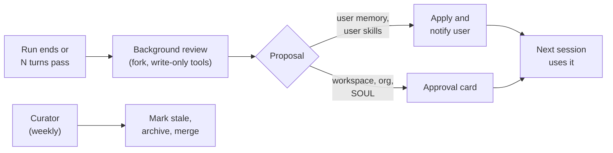

# Sama — Architecture and Design

| | |
|---|---|
| Status | Draft v0.3. The owner answered all open questions (Section 22). Connectors and databases added (Sections 10.3 to 10.7). No code yet. |
| Date | 2026-11-18 |
| Owner | Nikhil Mandhani |
| Companion docs | [`feature-map.md`](feature-map.md) (every Hermes feature and our plan for it), [`roadmap.md`](roadmap.md) (milestones and backlog) |

## Contents

1. [Summary](#1-summary)
2. [Goals, non-goals, and terms](#2-goals-non-goals-and-terms)
3. [Decisions](#3-decisions)
4. [System overview](#4-system-overview)
5. [Runtime adapter layer](#5-runtime-adapter-layer)
6. [Prompt assembly and context management](#6-prompt-assembly-and-context-management)
7. [Sessions](#7-sessions)
8. [Memory](#8-memory)
9. [Skills and the self-improvement loop](#9-skills-and-the-self-improvement-loop)
10. [Tools, toolsets, and integrations](#10-tools-toolsets-and-integrations)
11. [Channels: web, Slack, Telegram, Chrome](#11-channels-web-slack-telegram-chrome)
12. [Scheduler, cron jobs, and workflows](#12-scheduler-cron-jobs-and-workflows)
13. [Sub-agents and multi-agent work](#13-sub-agents-and-multi-agent-work)
14. [Browser use and the Chrome extension](#14-browser-use-and-the-chrome-extension)
15. [Code editing and self-modification](#15-code-editing-and-self-modification)
16. [Safety: approvals, sandbox, secrets](#16-safety-approvals-sandbox-secrets)
17. [Users, teams, and tenants](#17-users-teams-and-tenants)
18. [Observability and cost](#18-observability-and-cost)
19. [Technology stack and repository layout](#19-technology-stack-and-repository-layout)
20. [Milestones](#20-milestones)
21. [Risks](#21-risks)
22. [Resolved questions](#22-resolved-questions)
23. [References](#23-references)

---

## 1. Summary

Sama is a **cloud agent engine**. It gives an assistant the features of
[Hermes Agent](https://github.com/NousResearch/hermes-agent): skills, tools, memory, sessions,
context management, cron jobs, Slack and Telegram, sub-agents, code editing, and a
self-improvement loop. It adds browser control through a cloud browser and a Chrome extension.

Sama does not have its own agent loop. It runs two agent SDKs behind one contract:

- **Claude Agent SDK** (default). It is the Claude Code loop as a Python library: file edits,
  shell, search, sub-agents, compaction, session resume, hooks, and a permission callback.
- **OpenAI Agents SDK** (second). It gives handoffs, guardrails, `needs_approval` tools, a
  `SandboxAgent` with shell, file, skills, and compaction capabilities, and tracing.

Everything that makes the assistant "Hermes-like" lives **above** that contract, in sama:
memory, skills, session search, scheduling, channels, approvals, budgets, and audit. So each
feature works the same on both SDKs, and a third SDK needs only one more adapter.

Sama is the **core engine**. Our team uses it first. Customers use it later. Other products
build on top of it. The first planned product is
[vorflux](https://github.com/nikhilllmno/vorflux), the hotel agent harness. vorflux adds
hotel-specific parts (hotel repos, eval gate, hotel operations) and uses sama for the rest.

Five rules shape the design:

1. **Cloud only.** The API, channels, scheduler, and memory run 24/7 on Fly.io. Every session
   runs in its own **E2B** cloud sandbox. Browsers run in **Browserbase**. Nothing needs a
   local install. The Chrome extension is optional and connects out to the cloud.
2. **The sandbox is the security boundary.** The SDK loop, shell, files, and code run inside
   the sandbox. The sandbox holds no long-lived secrets. Model calls go through the sama
   **model proxy**, and sama tools go through the sama **MCP tool server**. Both accept only a
   short-lived run token.
3. **State is in Postgres** (Supabase), not in files. Every row has an `org_id`. Row-level
   security is on from the first table, so customers later need no data migration.
4. **The prompt prefix is frozen per session** (a Hermes rule). The system prompt, tool list,
   memory snapshot, and skill index do not change during a session. This keeps prompt caching
   cheap. Prompt changes apply from the next session. Compaction is the only exception.
   Authority is not frozen: a revoked permission or a lower budget applies at once.
5. **Self-improvement is bounded and reversible.** The agent can write memory, skills, cron
   jobs, and workflows. Each write is versioned. Changes to sama's own code go through a pull
   request that a human merges. The agent never changes the running service directly.

---

## 2. Goals, non-goals, and terms

### 2.1 Goals

- Give one assistant all the Hermes features listed in [`feature-map.md`](feature-map.md).
- Run on the Claude Agent SDK by default and on the OpenAI Agents SDK as a second runtime,
  with the same features on both.
- Talk to users in a web app, Slack, Telegram, and a Chrome side panel.
- Control a browser: a cloud browser for unattended work, and the user's own Chrome (through
  the extension) for sites where the user is logged in.
- Run scheduled jobs and multi-step workflows without a human present, and deliver results to
  any channel.
- Learn from use: curated memory, agent-written skills, and session search.
- Edit code in a sandbox and open pull requests, including pull requests to sama itself.
- Serve a team now and many customers later, with no change to the data model.
- Be a library and service that other products (vorflux first) build on.

### 2.2 Non-goals for v1

- No local install, terminal UI, or desktop app. (Hermes has these. Our users are in the
  cloud surfaces above.)
- No model providers other than Anthropic and OpenAI. (Owner decision for vorflux, kept here.)
- No own agent loop. We use the two SDKs.
- No third-party plugin code inside the control plane. Extensions come as MCP servers, skills,
  or Composio toolkits.
- No model training pipeline (Hermes batch trajectories). We keep transcripts so that we can
  add this later.
- No public skill marketplace in v1. We curate built-in skills in this repo.

### 2.3 Terms

| Term | Meaning |
|---|---|
| Org | A tenant: our team now, one customer account later. The billing and isolation unit. |
| Workspace | A unit of work inside an org, for example a project or a team. vorflux maps one hotel to one workspace. Memory, skills, jobs, and connections can be workspace-scoped. |
| User | A person in an org, with a role (`owner`, `admin`, `member`). |
| Agent profile | A named assistant configuration: SOUL, default runtime and model, toolsets, skills, approval policy, budgets. Like a Hermes profile, but stored as data. An org can have many profiles. |
| SOUL | The persona and standing instructions of an agent profile (Hermes `SOUL.md`). |
| Session | One conversation with an agent profile: messages, tool calls, and state. It can span many runs and stays on one runtime. |
| Run | One execution of agent turns for a session, in one sandbox, from a trigger to a stop. |
| Trigger | What starts a run: a user message, a cron job, a workflow step, a webhook, or a delegated task. |
| Runtime | An agent SDK that executes a run: `claude_agent_sdk` or `openai_agents_sdk`. |
| Adapter | Sama code that maps one runtime to the sama runtime contract (Section 5). |
| Runner | The sama process inside the sandbox that hosts the adapter and the runtime. |
| Sandbox | An isolated E2B microVM that holds the workspace files, the runner, and the shell for one session. |
| Toolset | A named group of tools. An agent profile enables toolsets. |
| Sama tools | Tools that sama implements once for both runtimes (memory, skills, cron, delegation, browser, connectors). They reach the runtime through the sama MCP tool server. |
| Native tools | Tools that a runtime ships (for example Claude `Read`, `Edit`, `Bash`). They run inside the sandbox. |
| Connector | A kind of external system that the agent can use as tools: a Composio toolkit, an MCP server, a database, an HTTP API, or a plugin (Section 10.3). |
| Connection | One configured account or endpoint of a connector, owned by a user or a workspace, with its credentials in the sama vault. |
| Channel | A surface where users talk to the agent: web, Slack, Telegram, Chrome side panel. |
| Skill | A versioned folder with a `SKILL.md` (agentskills.io format) that tells the agent how to do a task. |
| Memory | Small, curated notes that sama puts in every new session (Section 8). |
| Job | A scheduled trigger (cron expression or one time) with a prompt, skills, and a delivery target. |
| Workflow | A saved, versioned multi-step process with triggers, agent steps, tool steps, and approval steps (Section 12.3). |
| Approval | A human decision on one paused tool call. |

---

## 3. Decisions

### 3.1 Owner answers (2026-11-18)

| Question | Answer | Effect on the design |
|---|---|---|
| How does Sama relate to vorflux and `hermes_like_agent`? | Sama is the core engine. We build products on top of it later. | Sama is domain-neutral and has a public Python API and HTTP API. Hotel parts stay in vorflux. |
| Who uses it? | Our team now, customers later. | Multi-user from day one. `org_id` on every row and RLS. Sign-up and billing come later (M6). |
| Where does it run? | Only in the cloud. | Fly.io control plane, E2B sandboxes, Browserbase browsers. The Chrome extension connects out to the cloud. |
| Language? | Python core. TypeScript only for the Chrome extension and the web UI. | Python 3.12, uv, FastAPI. Next.js web UI. |
| First pull request? | Design doc only. | This document, the feature map, and the roadmap. |
| Runtimes? | Claude Agent SDK default, OpenAI Agents SDK second. | Two adapters behind one contract (D2). |

### 3.2 Key decisions

| # | Decision | Reason |
|---|---|---|
| D1 | Write our own Python code. Do not fork or embed Hermes. Copy ideas, prompts, and limits from Hermes with attribution (`THIRD_PARTY_NOTICES.md`). | Hermes is a single-user app with file-based state and its own agent loop. We need multi-user state and two SDK loops. Hermes uses the MIT license, so we may reuse small parts with the notice. |
| D2 | One runtime contract (`AgentRuntime`) with two adapters: `claude_agent_sdk` (default) and `openai_agents_sdk`. A `fake` runtime exists for tests. | The owner uses only Anthropic and OpenAI models. One contract keeps every sama feature runtime-neutral and makes a third runtime cheap. |
| D3 | Sama tools reach both runtimes through **one MCP server per run** (streamable HTTP), scoped by a run token. | Both SDKs are MCP clients. One implementation serves both. Tenant scope, approvals, and audit happen in one place. |
| D4 | The runner (adapter plus SDK) runs **inside the sandbox**, not in the API process. | The Claude Agent SDK starts the Claude Code CLI as a subprocess, and its native tools run where the CLI runs. The OpenAI `SandboxAgent` needs a sandbox too. The OS boundary is the only real boundary against a model that misbehaves (Hermes security policy). |
| D5 | **E2B** is the sandbox provider, behind a `SandboxProvider` interface. One sandbox per session. E2B pause and resume keep the workspace between runs. Docker is for local development and CI. | Owner chose cloud sandboxes with E2B. The OpenAI Agents SDK has an E2B sandbox client. The interface keeps a path to Fly Machines, which vorflux chose. Owner decision: E2B now, Fly Machines later only if needed (Q1). |
| D6 | **No long-lived secrets in the sandbox.** Model calls go to the sama **model proxy** (`ANTHROPIC_BASE_URL` / OpenAI `base_url`) with a run token. Integration calls go through sama tools on the control plane. | A prompt-injected agent cannot leak a key that it cannot read. The proxy also meters cost, enforces budgets, and sends traces. |
| D7 | **Supabase** is the system of record: Postgres with RLS, Auth, Storage, and pgvector. | Already in the owner's stack. RLS is a second tenant guard under the API. pgvector covers session search and memory recall. |
| D8 | **Postgres is the job queue** (`FOR UPDATE SKIP LOCKED` with leases) for runs, cron fires, workflow steps, and deliveries. No separate workflow engine in v1. | Fewer moving parts. vorflux made the same choice. The queue sits behind an interface. |
| D9 | The **prompt prefix is frozen per session**: SOUL, context files, tool list, memory snapshot, skill index. New memory and skills apply from the next session. A short note on the next user message tells the agent about new skills. | Hermes rule. It keeps prompt caching valid on both SDKs and makes runs reproducible (`RunConfig.fingerprint()`). |
| D10 | **Connectors use one model for all kinds**: Composio toolkits, remote MCP servers, hosted stdio MCP servers, databases, HTTP APIs, and plugins. Connections are per user or per workspace, with credentials in the sama vault. Rare tools sit behind `tool_search`. | The owner has Composio and any MCP server. This gives hundreds of apps without our own connector code, and keeps the tool list short. |
| D11 | **Channels** are adapters in one gateway: web (first-party), Slack (Events API over HTTP, Web API with `httpx`), Telegram (Bot API webhook), and the Chrome extension (WebSocket). Email and WhatsApp later. Chats bind to a user and an agent profile through pairing. | Same shape as the Hermes gateway: normalise inbound, send outbound, render approvals, map slash commands. Unpaired chats get no agent access. |
| D12 | **Browser control has one tool contract with two targets**: `cloud` (Browserbase) and `my_chrome` (the extension). The tools work on page snapshots with element refs, and a vision mode uses screenshots and coordinates. | The agent learns one set of tools. Unattended jobs use the cloud browser. Logged-in personal sites use the user's own Chrome with consent. |
| D13 | **Approvals fail closed.** Each tool call gets `allow`, `ask`, or `deny` from a policy. `ask` pauses the run and sends an approval card to the user's channel. Unattended runs (cron, workflows, webhooks) turn `ask` into `deny`, unless a human approved a pre-approval for that tool in that job version. A hardline deny list cannot be overridden. | Hermes three-layer model. A human is not present for unattended runs. |
| D14 | **Self-improvement writes are versioned data.** Memory, skills, cron jobs, workflows, and SOUL changes are rows with history and provenance. Changes to sama's own code are pull requests that a human merges. | The agent can learn and change its stack, but every change can be reviewed and reverted. |
| D15 | **Langfuse** traces both runtimes. The model proxy records tokens and cost per run. The control plane sends the traces from its stored rows after each run (Section 18.2). | One trace view for both SDKs. The proxy is the source of truth for cost. The sandbox has no Langfuse key (D6). |
| D16 | **Sama is a library plus services.** Products import `sama` and register extra tools, skills, toolsets, channels, and policies through extension points. They do not patch sama code. | vorflux and later products build on the engine without a fork (Hermes rule: plugins never touch core). |
| D17 | **Databases use a sama database gateway, and stdio MCP servers run in connector hosts.** The gateway enforces read-only transactions, one statement per call, timeouts, row limits, and hidden columns at the driver. A connector host is a separate sandbox per connection that holds only that connection's secrets. | A prompt cannot remove a limit that the driver enforces. Many SQL MCP servers give full rights through one tool. Running stdio servers outside the agent sandbox keeps credentials out of the sandbox (D6) and still supports the Hermes MCP ecosystem. |
| D18 | **One control plane process per environment in M1.** The API, the tool server, the model proxy, the worker, the monitor, and the Telegram hub (Section 11.6) run in one process on one Fly.io machine (Section 19.1). | The clarify broker and the event wake-ups are in memory, so the API and the tool server must share a process. One machine is enough for the team. Split into process groups when the broker moves to Postgres and more machines are needed. |

---

## 4. System overview


### 4.1 Components

| Component | Responsibility |
|---|---|
| **API** | Auth (Supabase JWT, API keys for services), REST and streaming endpoints, admin endpoints for profiles, skills, memory, jobs, workflows, and connections. The only holder of the database service key. |
| **Channel gateway** | Receives Slack, Telegram, and extension events. Checks pairing and access. Maps each chat or thread to a user, an agent profile, and a session. Streams replies, renders approval cards, and handles slash commands. Also routes `my_chrome` browser actions to the right extension connection. |
| **Run orchestrator** | Queues runs in Postgres with leases, one active run per session (Section 4.3). Enforces per-org concurrency, budgets, and rate limits. Creates or resumes the session sandbox, starts the runner, streams events, and handles cancel, timeout, crashed workers, and resume after approval. |
| **Scheduler** | Fires cron jobs and one-time jobs. Receives webhooks and Composio triggers. Creates runs or workflow instances. One leader at a time through a Postgres lease. |
| **Workflow engine** | Runs workflow instances step by step as queue items. Stores each step result. Pauses on approval steps. |
| **Sama MCP tool server** | The sama tools for both runtimes: memory, skills, session search, cron, workflows, delegation, browser, connectors (Composio and MCP proxy), todo, clarify, approvals, and change proposals. Each call carries the run token. |
| **Model proxy** | Holds the Anthropic and OpenAI keys. Accepts the run token, checks the model allowlist and budget, forwards the call, records usage and cost, and sends the trace. |
| **Approval service** | Stores pending approvals, routes them to the user's channel, records the decision, and resumes the run. |
| **Sandbox** | Runs the runner, the native shell and file tools, and code. Has no database access and no long-lived secrets. Egress is limited to the sama endpoints and an allowlist. |

### 4.2 A run, end to end

1. **Receive.** A user writes "Every Monday 9:00, send me a summary of open GitHub issues"
   in Telegram.
2. **Resolve.** The gateway finds the paired user, the default agent profile, and the
   session bound to this chat. It creates a session if none is open.
3. **Queue.** The API stores the message and queues a run.
4. **Prepare.** The orchestrator builds the frozen `RunConfig` for a new session: SOUL,
   context files, memory snapshot, skill index, toolsets, runtime, and model. For an open
   session it reuses the stored `RunConfig` (Section 6.1, M1.11).
5. **Provision.** The orchestrator resumes the session sandbox (or creates one from the sama
   E2B template) and issues a run token. The token is bound to `org_id`, `user_id`,
   `session_id`, and `run_id`, and expires after the run.
6. **Execute.** The runner starts the adapter. The SDK calls the model through the model
   proxy and calls sama tools through the MCP server. Here the agent calls
   `cronjob_manage(action="create", ...)`.
7. **Gate.** The tool gate checks the policy. Creating a job without pre-approved tools is
   `allow` for the owner of the chat, so the call runs. If the job asks for pre-approved
   tools, those tools stay off until the user approves them (Section 12.1). A risky call (send an email to a customer, push code) gets `ask`:
   the run pauses with `ApprovalRequired`, and an approval card goes to Telegram.
8. **Finish.** The run ends with `RunCompleted` or `RunFailed`. The sandbox pauses.
9. **Learn.** A background review may propose memory or skill updates (Section 9.4).
10. **Record.** Transcript, tool calls, usage, cost, and approvals are in Postgres. The trace
    is in Langfuse.

### 4.3 Run queue (M1.10)

The run orchestrator is a Postgres queue (`sama.orchestrator.queue.RunQueue`) and a worker
(`sama.orchestrator.worker.Worker`). Migration `0005` adds the queue columns to `runs` and
`sandbox_id` to `sessions`. It adds no table.

**Enqueue.** `RunQueue.enqueue` checks that the session is in the org and is `active`. In one
transaction it stores a `queued` run, with the runtime and the budget of the agent profile, and
the user message with the `run_id`.

**Claim.** `claim(owner)` takes the oldest `queued` run whose session has no active run and no
older queued run, with `FOR UPDATE SKIP LOCKED`. The run becomes `running` with a lease:
`lease_owner` and `lease_expires_at` (30 seconds). `attempts` goes up by 1. Thus:

- One session has at most one active run (`running` or `paused`). The partial unique index
  `ix_runs_one_active_per_session` makes this a database rule too.
- The messages of a session run in order. A new message during a run waits in the queue.
- Sessions run in parallel, and two workers never take the same run.

A new run gets the runtime state of the last completed run of the session with the same
runtime, so the adapter continues the session (Section 5.1).

**Review runs (M2.4).** A run has a kind: `chat` or `review` (migration `0016`). A review run is
queued by sama and not by a person. The claim treats the two kinds in this way: a chat run goes
before a review run, a chat run waits only for older chat runs, and a review run waits for every
queued chat run of its session. The runtime state, the rate limit, the chat run list, and the
event stream of the API count chat runs only. Section 9.4 has the design.

**Lease.** While the run streams, the worker extends the lease every third of the lease time.
Each write (events, the result) checks that the worker still holds the lease of this attempt:
the same `lease_owner`, the same `attempts` value, and a lease that did not expire. Thus an old
attempt cannot write after a reap, also when the same worker claims the run again. A worker that
lost the lease cancels the runtime at once, reads no more events, and writes nothing more. Check constraints keep the state valid:
a `running` run has a lease and other runs have none, and a `paused` run has its approval id.

**Events.** The worker stores each event in `run_events` with an increasing `seq`, without the
runtime state. It writes text deltas in batches (at most 50 events or 0.25 seconds) and other
events at once. A resumed run continues the `seq` of the run.

**End.** `RunCompleted` stores the reply as an assistant message and the runtime state.
`RunFailed` stores the failure code and message; the code `cancelled` gives the status
`cancelled`. `RunFailed.runtime_state` is optional. A runtime sets it only to keep a count that the
failure would lose, and the next run of the session starts from the newest state, also the state
of a failed run (Section 6.3, "Tokens of a compaction"). A stream with no terminal event fails with `internal`. When a run ends (not when it
pauses), the worker calls the run-end hooks, for example `ClarifyBroker.cancel_run`.

**Cancel.** `cancel(org_id, run_id)` ends a `queued` or `paused` run at once. For a `running`
run it sets `cancel_requested_at`. The worker sees it at the next lease extension and cancels
the runtime. If the runtime asks for an approval after a cancel request, `pause` locks the row,
sees the request, and ends the run as `cancelled`. `release_decided` never queues a run with a
cancel request. Thus a cancel always wins over an approval.

**Wall time.** The worker cancels the runtime when the run is longer than
`Budget.max_wall_time_s`. The run fails with `timeout`.

**Approvals.** `ApprovalRequired` pauses the run: the status is `paused`, `pending_approval_id`
is the approval id, and the runtime state is stored. If the tool gate did not store the
approval, the queue stores it with the same rules as the gate (Section 16.1). When the approval
is decided or expired, `release_decided` queues the run again with `resume_decision` and
`resume_reason`. An expired approval resumes as `reject`. The next claim takes the paused run
before the newer runs of the session and sends a `ResumeRequest`. Each approval resumes once,
because `release_decided` acts only on a `paused` run, and the run is not `paused` after it.

**Dispatch.** After the setup and before the worker starts the runtime, `dispatch` sets
`runs.dispatched_at`. From this point a runner can execute tools, also when no event or tool
call is stored yet.

**Crashed workers.** `reap()` handles a `running` run whose lease expired:

- If a cancel was requested, the run becomes `cancelled`.
- If the run is not dispatched and `attempts` is less than 3, the run goes back to the queue.
  No runner started, so a new attempt is safe.
- Otherwise the run fails with `internal`. A tool can have run, so the run does not start
  again.

A runner of an ended run can still be alive (for example, the worker process stopped but the
sandbox did not). The tool gate denies every call of a `completed`, `failed`, or `cancelled`
run, so such a runner cannot use a tool (Section 16.1).

**Maintenance.** Every 30 seconds each worker times out approvals (`GateService.expire`),
queues the decided runs, and reaps runs. The worker makes a `GateService` on the queue engine
when the caller gives none. `Worker.serve(stop, concurrency=n)` runs `n` runs at
the same time and the maintenance loop. When `stop` is set, the current runs end first.

**Migration.** Before migration `0005`, a `running` or `paused` run had no lease and no
approval id. No worker can continue such a run, so the upgrade ends each one as `failed` with
`internal`.

**Sandbox directory.** `PostgresSandboxDirectory` stores the sandbox of a session in
`sessions.sandbox_id`. With it, `SandboxedRuntime` in a new process finds the sandbox of the
session and does not create a new one (Section 16.2).

**Per-org limits (M1.12).** `orgs.limits` (JSON) sets three limits. A missing or bad value
uses the default (`sama.orchestrator.limits.QueueLimits`):

| Key | Default | Rule |
|---|---|---|
| `max_running_runs` | 5 | At most this many runs of the org are `running` at the same time. |
| `user_messages_per_minute` | 20 | At most this many messages of one user go into the queue in a rolling 60-second window. |
| `org_messages_per_minute` | 120 | At most this many runs of the org go into the queue in a rolling 60-second window, also from jobs. |

- `enqueue` counts the runs of the last 60 seconds under an advisory lock per org, so two
  messages at the same time cannot both take the last place. Over a limit it raises
  `RateLimitedError` with the seconds to wait. The API answers `429` with `Retry-After`. The
  count is of queued runs, not of started runs: a backlog can start faster than this rate. A
  cancelled run still counts, and a run that resumes after an approval does not count again.
- `claim` skips the orgs that are at `max_running_runs`. It takes an advisory lock per org and
  counts again before it starts the run, so two workers cannot both take the last place. A
  `paused` run does not count, because it holds no worker.
- Migration `0007` adds the index `runs (org_id, created_at)` for the rate count and the
  partial index `ix_runs_running_per_org` for the running count.

**Not in M1.10.** The clarify broker stays in memory (Section 16.7). Since M1.11, the worker gets the `RunConfig`
from the prompt assembler (Section 6.1). The worker stores the config fingerprint on the run
when it dispatches the run.

---

## 5. Runtime adapter layer

### 5.1 The contract

The contract lives in `src/sama/runtime/contract.py` (M1). It reuses the design of the runtime
contract v2 from `hermes_like_agent` and vorflux:

```python
class RuntimeKind(StrEnum):
    CLAUDE_AGENT_SDK = "claude_agent_sdk"  # default
    OPENAI_AGENTS_SDK = "openai_agents_sdk"
    FAKE = "fake"  # scripted, for tests


class AgentRuntime(Protocol):
    kind: RuntimeKind

    def capabilities(
        self,
    ) -> Capabilities: ...  # native_subagents, native_compaction, native_skills, ...
    def run(self, req: RunRequest) -> AsyncIterator[RunEvent]: ...
    def resume(
        self, req: ResumeRequest
    ) -> AsyncIterator[RunEvent]: ...  # after an approval decision
    async def cancel(self, run_id: str) -> None: ...


RunEvent = (
    TextDelta
    | ToolCallStarted
    | ToolCallFinished
    | ApprovalRequired
    | Compacted
    | SubagentEvent
    | RunCompleted
    | RunFailed
)
```

- `RunRequest` holds the `RunScope` (org, workspace, session, run, audience, and the user for
  a private session), the user input, the frozen `RunConfig`, the run `Budget`, and the
  runtime state from the previous run. `ResumeRequest` holds the approval id, the decision
  (`approve` or `reject`), and the runtime state from `ApprovalRequired`.
- `RunConfig` is frozen per session. It holds only what the model sees and what the cache
  needs: runtime, model, the sama system text, SOUL, context files, memory snapshot, skill
  index, the environment text, tool schemas, and MCP server configs. A context file path
  cannot have `"`, `<`, `>`, or a line break, so it cannot close its tag. It has `fingerprint()` (SHA-256 of canonical JSON, the same in every
  process) and `render_prefix()` (the tiers of Section 6.1). Remote MCP configs hide their
  bearer token in `repr`. The token changes per run, so it is not in the fingerprint.
  JSON objects in the contract (tool input schemas and tool call arguments) are read-only
  after validation, also in nested values, so the fingerprint cannot change during a session.
- **Authority is not frozen.** The control plane checks membership, connection access,
  approval policy, budgets, and revocations again at every tool call, model call, and
  approval resume. A newer `deny` or a lower budget applies at once, also to long-lived
  sessions. Section 16.1 has the code (M1.18). Connection access comes with connections
  (M3.4). A tool that is still in the frozen schema but is no longer allowed gets `deny`
  from the tool gate.
- Every event carries running `Usage` for the whole run. The stream ends with exactly one of
  `ApprovalRequired`, `RunCompleted`, or `RunFailed` (with a `FailureCode`). Usage never goes
  down, also across an approval resume: the resumed stream starts from the usage of
  `ApprovalRequired`.
- One stream at a time per run. A runtime frees the run before it yields the terminal event,
  so the orchestrator can resume at once. Each approval resumes once, and only for its run.
  `cancel` stops an active stream and makes the approvals of a paused run invalid.
- The adapter saves the runtime's own resumable state as an opaque blob (`bytes`). In JSON it
  is base64, so any byte value can be stored. The orchestrator stores it with the run.
- **Compaction (M2.6).** `RunRequest.compact` asks the runtime to compact the session now, with
  no user input and no answer. `Capabilities.manual_compaction` says that the runtime does it.
  `Capabilities.compaction_archive` says that the runtime gives its transcript to an `Archiver`
  before it compacts. `Compacted.trigger` is `manual` or `auto`. Section 6.3 has the design.

### 5.2 What sama owns and what the runtime owns

| Concern | Owner | Notes |
|---|---|---|
| Model calls, the tool loop, native compaction | Runtime | Sama does not write an agent loop. |
| Native shell and file tools | Runtime | Inside the sandbox only. |
| Sama tools (memory, skills, search, cron, workflows, delegation, browser, connectors) | Sama, through MCP | One implementation for both runtimes. |
| Approval policy and decisions | Sama | Adapters map SDK permission hooks to `ApprovalRequired`. |
| Prompt prefix (SOUL, memory, skill index) | Sama | Built once per session (Section 6). |
| Canonical transcript | Sama | Stored in Postgres. The runtime's own session state is a blob. |
| Tenant scope, budgets, audit | Sama | Enforced in the orchestrator, model proxy, and MCP server. |
| Sandbox lifecycle | Sama | The OpenAI `SandboxAgent` gets a client for the session sandbox. |

### 5.3 Mapping per runtime

| | Claude Agent SDK (default) | OpenAI Agents SDK (second) |
|---|---|---|
| Package | `claude-agent-sdk` (Python). It drives the bundled Claude Code CLI as a subprocess, so the sandbox image needs the CLI. | `openai-agents` (Python), in process. |
| Turn API | `ClaudeSDKClient.query()` and `receive_response()` | `Runner.run_streamed()` |
| Model routing | `ANTHROPIC_BASE_URL` points at the sama model proxy; the run token is the API key. | `AsyncOpenAI(base_url=<proxy>, api_key=<run token>)` |
| System prompt | `system_prompt` preset `claude_code` with the sama prefix appended, or a full custom prompt for non-coding profiles | `Agent.instructions` |
| Sama tools | `mcp_servers` with the sama MCP server (HTTP); `strict_mcp_config=True` | `MCPServerStreamableHttp` in `Agent.mcp_servers` |
| Approvals | `PreToolUse` hook calls the sama tool gate. `ask` returns a defer and the run pauses. Fallback: `can_use_tool` deny plus interrupt. | `needs_approval` on tools. `result.interruptions` become `ApprovalRequired`. `RunState.approve()` or `reject()` on resume. |
| Resume | `resume` with the SDK session id; `session_store` mirrors the transcript to sama. | Serialised `RunState` plus a sama `Session` (a `SessionABC` that reads and writes items through the control-plane API with the run token). The runner has no database credentials, so `SQLAlchemySession` is not used in the sandbox. |
| Sub-agents | `agents` option (`AgentDefinition`: prompt, tools, model, skills, MCP servers). Sama sets it from the agent profile (Section 13.1). | Agents as tools and handoffs |
| Skills | Native: sama writes the session's skills to `.claude/skills/` and sets the `skills` option. | `SandboxAgent` `Skills` capability with a sama skill source, or the sama `skill_view` tool. |
| Compaction | Native auto-compaction. The `PreCompact` hook gives the full transcript to the sama archive first. `/compact [focus]` is a CLI slash command that the adapter sends for a compact request (M2.6, Section 6.3). | `Compaction` capability or `OpenAIResponsesCompactionSession`. The adapter sets `manual_compaction` and `compaction_archive` when it supports them (M3.6). |
| Shell and files | Native `Bash`, `Read`, `Edit`, `Write`, `Glob`, `Grep` | `SandboxAgent` with `Shell` and `Filesystem` capabilities (with `apply_patch`). The runner is already inside the E2B sandbox, so it uses the local client (`UnixLocalSandboxClient`). The orchestrator owns the E2B lifecycle. The runner has no E2B API key. |
| Limits | `max_turns`, `max_budget_usd`, `task_budget` | `max_turns`; sama budget in the model proxy |
| Checkpoints | `enable_file_checkpointing` and `rewind_files()` | Sama git snapshot of the workspace (Section 15.3) |
| Tracing | Control-plane trace from the stored rows (Section 18.2) | Control-plane trace from the stored rows (Section 18.2) |
| Main risks | CLI subprocess and Node in the image. Fast option changes. Claude models only. | Fast-moving API surface (`SandboxAgent` is new). OpenAI models only. |

#### Claude adapter notes (M1.4)

The adapter is `src/sama/runtime/claude.py`. These rules come from live tests with
`claude-agent-sdk==0.2.184`:

- **Options.** `setting_sources=[]`, so no file settings from the sandbox apply.
  `strict_mcp_config=True`. Remote MCP servers are `http` servers with the run token in an
  `Authorization` header. `include_partial_messages=True` gives text deltas. The preset prompt
  uses `exclude_dynamic_sections=True`, so the prefix stays the same for the prompt cache.
- **Tool search off.** The adapter sets `ENABLE_TOOL_SEARCH=false` in the CLI env. With tool
  search on, the CLI defers MCP tools, and the model must call the native `ToolSearch` tool
  to load a tool first. The staging check of M1.16 found this. `ClaudeSettings.env` can
  override the switch. The staging check of M1.18 found that the CLI can still defer the
  tools with the switch off, so the gate allows `ToolSearch` in every run (a tool loader,
  Section 16.1). When a run has many connector tools, sama `tool_search`
  (Section 10.3) does this job.
- **Tool gate.** The `PreToolUse` hook calls the `ToolGate` with the tool use id (Section
  16.1). `allow` and `deny` go to the CLI.
  `ask` becomes `defer`. A sub-agent cannot pause the run, so the hook tells the gate that a
  call is of a sub-agent (`child`, from the `agent_id` of the hook input). The gate gives `deny`
  for it in place of `ask`, and it records no approval (Section 13.1). The runner sends `child` only
  when it is true, so an older control plane that does not know the key still accepts the body of a
  call of the main agent. If the gate fails, the
  call gets `deny`.
- **Pause.** On `defer`, the CLI ends the turn with `stop_reason` `tool_deferred` and
  `deferred_tool_use`. The adapter yields `ApprovalRequired`. The approval id is the tool use
  id. `runtime_state` holds the SDK session id, the run id, the usage, and the pending call.
- **Permission callback.** The adapter also sets `can_use_tool`. It allows only the tool use
  ids that the hook allowed or that a human approved. It denies all other calls. Without it,
  the CLI uses its own permission rules, and these can block a call that sama allowed.
- **Approve.** The adapter resumes the SDK session with no prompt. On resume the CLI checks
  the deferred call again. For most calls it asks `can_use_tool`. For some read-only calls it
  runs the `PreToolUse` hook again. Both allow the approved tool use id without a new gate
  check, so the orchestrator checks authority before it calls `resume` (Section 5.1). Then the
  CLI runs the call and the model continues.
- **Reject.** A deny from `can_use_tool` or the hook on resume is not a reliable reject: some
  read-only calls skip `can_use_tool`, and the model can try the call again. So the adapter
  first resumes with the tool in `disallowed_tools` and
  `CLAUDE_CODE_DROP_UNAVAILABLE_DEFERRED_TOOL=1`. The CLI drops the call
  (`stop_reason` `tool_deferred_unavailable`). Then the adapter resumes again with all tools
  and tells the model that the user rejected the call. If the CLI does not drop the call, the
  run fails with `internal`.
- **New message while paused.** A new run on a session with an unanswered approval drops the
  deferred call first, in the same way.
- **One deferred call per turn.** The CLI defers only one tool call per turn.
- **Usage.** Token counts come from each `ResultMessage`. The CLI reports cost for the whole
  SDK session, also after a resume, so the adapter adds only the difference. The model proxy
  record is the source of truth for billing (M1.7).
- **Cancel.** `cancel` calls `interrupt()`. If the CLI does not stop within
  `cancel_grace_s` (5 seconds by default), the adapter ends the stream and stops the CLI.
  The stream ends with `RunFailed(cancelled)` within 10 seconds. If the pump already queued
  `ApprovalRequired`, the stream gives `RunFailed(cancelled)` in its place.
- **CLI stop.** The SDK stops the CLI in steps (close stdin, terminate, kill). This can take
  about 20 seconds, and a cancel of that work can leave the CLI running. So the adapter runs
  `disconnect()` in a task of its own and never cancels it. The stream does not wait for it
  longer than `cancel_grace_s`. `ClaudeRuntime.aclose()` waits until all CLI processes stopped.
- **Limits.** `max_turns` and `max_cost_usd` map to `max_turns` and `max_budget_usd`. The CLI
  counts these limits per process, not per SDK session. So `runtime_state` keeps the turns
  and the wall time that the run used, and each resume gets only the rest of each limit. If a
  limit is used up, the run fails before the CLI starts. `max_wall_time_s` is a timer in the
  adapter. `max_tokens` is enforced by the model proxy.
- **Errors.** Failure messages are fixed text. CLI error strings and the text of SDK
  exceptions can hold raw tool data, so they do not go into `RunFailed`.
- **Sub-agents (M2.7).** The adapter sets the `agents` option from `RunConfig.subagents`
  (Section 13.1). Each `SubagentDefinition` becomes one `AgentDefinition`. A native tool of
  the definition keeps its name. Each other tool gets the prefix `mcp__sama__`. The
  definition always has `disallowedTools` `Task` and `Agent`, `background` off, and the
  model `inherit` when it has no model. With sub-agents, the adapter also sets
  `CLAUDE_CODE_DISABLE_BACKGROUND_TASKS=1` in the CLI env. Without it, the CLI starts a
  sub-agent in the background, and the run can end before the sub-agent ends. The
  `PreToolUse` hook denies `Task` and `Agent` before the gate when `subagent_type` is not a
  name in the config (this also stops the built-in agents of the CLI) or when
  `run_in_background` is set. Messages with a `parent_tool_use_id` become `SubagentEvent`s
  with the id of the `Agent` call in `call_id`. The system messages `task_started` and
  `task_notification` of a sub-agent give a start event and an end event (`done`, and
  `tokens` when the CLI reports them). The adapter never cuts the text of an event, because it
  has no redactor and a cut can split a secret. A text over 100,000 characters stays out, and a
  fixed marker takes its place. The control plane redacts the text and then cuts it to 2,000
  characters (Section 13.1).
  `compact_boundary` system messages become `Compacted`. The `trigger` of its
  `compact_metadata` (`manual` or `auto`) goes into the event (M2.6).
- **Compaction (M2.6).** With an `archiver`, the adapter adds a `PreCompact` hook next to the
  `PreToolUse` hook. The hook input has `trigger`, `custom_instructions`, and
  `transcript_path`. The hook reads the transcript file, gives the entries to the archiver,
  and always returns an empty output, so the compaction goes on also when the archive fails
  (Section 6.3). A compact request resumes the SDK session and sends `/compact <focus>` as the
  prompt. A compact request with no earlier state fails with `invalid_request`. A compact run
  with no compaction boundary fails (`model_error`). The tokens of a compact run come from the
  difference of `model_usage`, because `usage` is zero (Section 6.3). A failed run keeps this
  count in `RunFailed.runtime_state` (`_Translator.failure_state`), so the next run does not count
  the paid work of the failed run again. The adapter
  does not use the CLI hook `SessionStart` with the source `compact`, because the Python SDK
  does not expose it: sama injects the pins itself (Section 6.3).

Versions at the time of writing: `claude-agent-sdk==0.2.184` and `openai-agents==0.25.0`.
Each adapter pins its SDK version in its own dependency group (`runtime-claude`,
`runtime-openai`). Exact option names are checked again when each adapter is built.

### 5.4 Choosing a runtime

- Each agent profile has a default runtime. The org default is `claude_agent_sdk`.
- A session keeps one runtime for its life (prompt cache rule). A different runtime means a
  new session or a delegated child run.
- Use the OpenAI Agents SDK when a task needs an OpenAI model, OpenAI hosted tools, or
  OpenAI-native patterns such as handoffs.

### 5.5 Conformance suite

Both adapters must pass one shared test suite before a profile can use them:

- Streams text and ends with exactly one terminal event.
- Calls a sama MCP tool and gets the result.
- Turns a gated tool call into `ApprovalRequired`, then resumes correctly on approve and on
  reject.
- Resumes a session after the sandbox paused and resumed.
- Honours `cancel()` within 10 seconds.
- Loads a skill and follows it.
- Reports token usage that matches the model proxy record.
- Makes no network call outside the sandbox egress allowlist.

CI runs the suite against a scripted model. A nightly job runs a small live suite with real
models and a low budget.

#### Suite design (M1.5)

The suite is `tests/conformance/`. Each test runs once per **target**:

| Target | Runtime | Model | Runs |
|---|---|---|---|
| `fake` | `FakeRuntime` with one script per scenario | none | CI |
| `claude-scripted` | `ClaudeRuntime` and the real Claude CLI | scripted Messages API | CI |
| `claude-live` | `ClaudeRuntime` and the real Claude CLI | `claude-haiku-4-5` | nightly, `-m live` |

- **Scripted model.** A small local server copies the Anthropic Messages API, also its
  streaming events. The CLI uses it through `ANTHROPIC_BASE_URL`, the same way as the model
  proxy (D6). Its rules answer on the last user text: `CALL <tool> <json>` calls a tool, a
  tool result gives `tool result: ...`, `SLOW n` streams slowly, and so on. So CI tests the
  real CLI, its hooks, its MCP client, and its limits at no cost.
- **Tool server.** A real streamable HTTP MCP server with a bearer token, like the sama MCP
  server. `lookup` is allowed. `send_note` is gated. The suite also gates the native `Bash`
  tool, because the CLI can send an approved native call through `can_use_tool` and an
  approved MCP call through the hook (Section 5.3).
- **Scenarios.** A target turns each scenario into input text. The tests check only contract
  events and the records of the tool server, so every target passes the same tests.
- **Covered now:** text streaming and one terminal event, session resume from
  `runtime_state`, an MCP tool call, approve and reject for an MCP tool and a native tool, an
  approval used once, cancel within 10 seconds, the `max_turns` budget stop, and a
  `Compacted` event.
- **Model proxy.** The `claude-runner` and `claude-docker` targets send their model calls
  through the model proxy (Section 16.6) to the scripted model. Two tests use the proxy
  record: the tokens of a run match the record, and the proxy stops a run at `max_tokens`
  with `402`, so the run ends with `budget_exceeded`.
- **Later items:** sandbox pause and resume (M1.6), skills (M2.2), and egress (M1.6). Each
  item adds its test to this suite.
- **Clean CLI config.** Each Claude target uses a new `CLAUDE_CONFIG_DIR`, so skills, memory,
  and settings of the host do not reach the run.
- **Live cost cap.** All live tests in one pytest process share one cap
  (`tests/live_budget.py`, `SAMA_LIVE_MAX_COST_USD`, default USD 0.50). Each live run gets the
  rest of the cap as its budget, and a test fails before it calls the model when the cap is
  used up. The CLI checks the budget after each model turn, so the total can pass the cap by
  one turn.
- **New adapters.** A new runtime adds a target (for example `openai-scripted` in M3.6) and
  must pass the suite.

---

## 6. Prompt assembly and context management

### 6.1 Prompt tiers

Sama builds the prompt prefix once per session, in three tiers, so that the longest part is
stable and cacheable (Hermes `agent/system_prompt.py`):

| Tier | Content | Changes |
|---|---|---|
| Stable | Sama identity and tool-use guidance, the agent profile SOUL, pinned skills | Only when the profile changes, from the next session |
| Context | Context files: workspace `AGENTS.md` / `CLAUDE.md` chain from cloned repos, profile instructions, channel formatting hints | Per session |
| Volatile | Skill index (name and description), memory snapshot, user profile block, date and time zone, environment hints | Per session |

Rules:

- Nothing in the prefix changes during a session. Compaction is the only exception.
- New skills or memory writes during a session appear as a one-line note on the next user
  message, not as a prompt change.
- Context files are capped (20,000 characters each, as in Hermes) and scanned for prompt
  injection patterns before use.

**Code (M1.11).** The package `src/sama/prompt/` builds the `RunConfig`.

- `render_prefix()` puts the parts in this order: the sama system text (`system`), the
  SOUL, the context files, the skill index, the memory snapshot, and the environment text
  (`environment`).
- `PromptAssembler(engine)` is the `ConfigBuilder` of the worker. It locks the session row.
  If `sessions.run_config` is set, it returns that config. If not, it builds the config and
  stores it with its fingerprint in `sessions.run_config` and `sessions.config_fingerprint`
  (migration `0006`). So all runs of a session use the same prefix, also when two runs start
  at the same time. A change to the profile SOUL, model, or runtime, or to a context file,
  applies from the next session.
- `RunQueue.enqueue` takes the runtime from the frozen config of the session, if there is
  one. So a session does not change its runtime. The assembler fails a run whose runtime is
  not the session runtime.
- The environment text has the session start time in UTC (`sessions.created_at`) and the
  audience. The time does not change during the session, so the prefix stays stable.
- Context files come from the table `context_files`. A file has no workspace (the whole org)
  or one workspace, and no profile (all profiles) or one profile. The order is: org files,
  workspace files, profile files, profile files of the workspace, and by path in each group.
  The prompt gets at most 20 files (`MAX_CONTEXT_FILES`). The table stores at most 100,000
  characters per file. Files of different scopes can have the same path. The first file
  keeps the path, and a later file gets its scope after the path, for example
  `AGENTS.md (workspace)`.
- RLS on `context_files`: a member reads a file if the member can see its workspace (if it
  has one) and its profile (if it has one). So a profile file without a workspace stays
  hidden when its profile is in a workspace that the member cannot see.
- `sama.prompt.scan` checks the path and the full text for these patterns: instructions that
  override earlier instructions, a new identity, text that hides things from the user,
  instructions in HTML comments, invisible Unicode characters (zero-width, bidi, and tag
  characters), commands that send secrets out (`curl` or `wget` with a key variable, `cat` of
  `.env` or `~/.ssh`), and fake role markers. If a pattern matches, the prompt gets a note in
  place of the file. Sama logs a warning and writes the audit action `context_file.blocked`
  with the finding ids. All checks take linear time, so a file of maximum size cannot block
  the worker. The scan is a filter for common attacks. It is not a full defence, so
  the system text also tells the model that file text is data.
- A file longer than 20,000 characters keeps its head (70%) and its tail (30%). A marker
  `[... N characters cut ...]` replaces the middle.
- Not in M1.11: channel formatting hints (M1.13), pinned skills, and the user profile block
  (later milestones). The `RunConfig` fields for them exist, and they are empty.
  Since M2.1 the memory snapshot is full: the `agent`, `workspace`, and (in a private session)
  `user` notes of the run (Section 8.1). The user profile block is the `user` part of it.
- The skill index (M2.2) is filled when the session starts: name and description of each
  skill that the profile and the session can use (Section 9.2). It is part of the frozen
  prefix, so a skill that the agent writes during the session is not in the index. The agent
  can find it with `skills_list`.
- Repo `AGENTS.md` and `CLAUDE.md` files do not go into the prefix. The prefix stays the same
  for the whole session, and a repo is cloned during a run. Since M1.16 the `repo_clone`
  result holds these files (Section 15.1).

### 6.2 Context management

| Mechanism | How |
|---|---|
| Compaction | Native in both SDKs (Section 5.3). Before compaction, sama archives the full transcript in a child session of the live session (session lineage) and records the compaction. `/compact` asks the runtime to compact now (Section 6.3, M2.6). |
| Tool output limits | Sama tools return at most 50 KB (head and tail kept). Larger output is written to a file in the sandbox, and the tool returns a preview plus the path (Hermes "spill", Section 16.7). |
| Tool search | Rare tools (most integrations, cron admin, image generation, TTS) are deferred. The model sees `tool_search`, `tool_describe`, and `tool_call` instead of their schemas. A deferred call passes the same gate as a direct call (Sections 6.3 and 16.1, M2.6). |
| Progressive skills | Only the skill index is in the prompt. The agent loads a full skill when it needs it. |
| Context pins | A user pins a text or a message. Sama puts the pins in front of the next message, and again after each compaction (Section 6.3, M2.6). Files are not pinnable yet. |
| `@` references | `@file`, `@url`, and `@session` in a message attach that content (M4). |
| Budgets | Per run: max turns, max tokens, max cost, and wall time. Near the limit, sama tells the agent to wrap up. |

### 6.3 Context management (M2.6)

M2.6 adds five parts. The first four keep a long session usable. The fifth keeps the tool
list short.

| Part | Where | Section |
|---|---|---|
| Compaction record and transcript archive | `sama.context.compaction`, `sama.runtime.archive`, `POST /archive` of the tool server | below |
| Session lineage | `sessions.parent_session_id` and `sessions.lineage`, `sama.context.lineage` | below |
| `/compact` | `RunQueue.enqueue_compact`, the API, Telegram, Slack | below |
| Context pins | `context_pins`, `sama.context.pins` | below |
| Deferred tools | `sama.tools.deferred`, `tool_search`, `tool_describe`, `tool_call` | below, and Sections 10.3 and 16.1 |

**Contract changes.** Three additions in `src/sama/runtime/contract.py`. All are optional, so
an adapter that does not know them keeps working.

- `Capabilities.manual_compaction`: the runtime compacts when the request has `compact`.
- `Capabilities.compaction_archive`: the runtime gives its transcript to an `Archiver` before
  it compacts.
- `RunRequest.compact` (`CompactRequest(focus)`): compact the session now. The request has
  no user input. The runtime sends no answer. `Compacted.trigger` is `manual` or `auto`.

The worker fails a compact run with `INVALID_REQUEST` when the runtime has no
`manual_compaction`. So an adapter that does not support `/compact` gives a clear failure and
does not answer with a wrong text. The Claude adapter and the fake runtime have the flag. The
fake runtime has no archive.

**Compaction record.** A `Compacted` event is stored twice, in one transaction:

1. as the `run_events` row `compacted`, as before;
2. as a row of `session_compactions`: `trigger`, `tokens_before`, `tokens_after`, the run, the
   archive session, and the counts of the archive. `RunQueue.add_events` calls
   `sama.context.record_compacted`, so the event and the row exist together.

`record_compacted` also writes the audit row `context.compacted`, and it makes the runtime
forget the pins (see Pins). If no archive row is open for the run (an adapter without an
archive, or an archive that failed), it makes a row with no archive session.

**Transcript archive.** Before the Claude CLI compacts, it runs the `PreCompact` hook. The
hook input has `trigger` (`manual` or `auto`) and `transcript_path`.

1. The adapter reads the transcript file of the CLI and turns it into `ArchiveEntry` objects:
   user and assistant text (`role` and `text`), each tool call (`tool_name` and `tool_input`,
   the input as a **JSON value**), and each tool result as a `tool` entry. It skips thinking
   blocks and every line type that it does not know. The format of the file is not a public
   contract, so the parser never raises for a line that it does not understand
   (`sama.runtime.claude_transcript`).
2. The runner does not cut inside an entry. It has no redactor, and a cut before the
   redaction can split a secret into parts that the redactor does not know. So the parser and
   `bound_for_wire` leave **whole entries** out. The size of an entry is the bytes of its JSON
   text in UTF-8 (`entry_wire_bytes`). The model of the entry, the parser, and
   `bound_for_wire` use this one definition. An entry over 1 MB stays out, and a marker
   (`system` entry) takes its place. The parser checks each **content block**, so one large
   block does not remove the other blocks of the same message, and each large block counts
   once in `omitted`. A tool name over 200 characters is not cut either: the entry of that tool
   call stays out whole, with the same marker (the marker has no part of the name). A transcript over 5,000 entries or 6 MB keeps its first
   30 % and its last 70 %, with one marker for the middle. The request has `omitted`, the
   number of entries that stay out, so the row can show `archive_truncated`.
3. `RemoteArchiver` posts the entries to `POST /archive` of the sama tool server. It sends
   the run token as the bearer, like every other request from the sandbox. The runner has no
   database access (Section 16.2).
4. The tool server checks the run **before it reads the body** (`ContextArchive.authorize`),
   limits the bodies that it holds at one time (Section 16.7), and calls
   `ContextArchive.archive`. The archive needs a run in the status `running`, a user of the
   run that still sees the session (the live check of Section 5.1, `load_authority`), and a
   session in the status `active`. It checks this again in the transaction that writes. It
   redacts each entry **whole**: the text of an entry, and the input of a tool call as a JSON
   value (every string and key), so a secret with quotes, backslashes, or new lines still
   matches. Only then it makes the text (`[tool call NAME] {json}`) and cuts it. It makes an
   **archive session** and stores the entries as its messages. It makes a
   `session_compactions` row that points to the archive session (the row is open, with no
   token counts). It writes the audit row `context.archived`.
5. The CLI compacts. The `compact_boundary` message becomes `Compacted`. The event completes
   the open row (the token counts and `completed_at`).

Limits of the request (the runner and the model refuse more): 5,000 entries, 1 MB for one
entry (bytes of the JSON text in UTF-8, for the whole entry and not for each field), 8 MB for
the body. The list is counted before the model builds any entry (the check of the list length
comes after the items are built, and 200,000 small entries need hundreds of MB). The count is
a first parse of the body with `json.loads` in which every JSON object becomes `0`
(`object_pairs_hook`), so the list of items costs one pointer for each item and the count does
not depend on how the body spells its keys (`"role"` and `"\u0072ole"` are the same key).
Only a body with at most 5,000 entries goes to the model. A body that is nested too deeply is
refused too. Limits of the store, after
the redaction: 20,000 characters for one entry (the start 70 % and the end 30 % stay), 4,000
entries, 2,000,000 characters for one archive (the first 30 % and the last 70 % stay, with a
`system` entry that says how many entries are not in the archive), 60 seconds for the call, and
10 archives for one run. The row has `archive_truncated` when anything was cut, in the runner
or in the store.

**A failed compaction.** The CLI can answer `/compact` with a normal result that has an error
text (for example when the summary call fails with HTTP 400). There is no `compact_boundary`
then, and the context is not smaller. A compact run needs a boundary to complete: the adapter
ends it with `RunFailed` (`model_error`, "the compaction did not finish: the runtime made no
compaction boundary"). The archive row that the hook made stays open (`completed_at` is null).
It is the record of the attempt.

**Tokens of a compaction.** For `/compact` the CLI reports zero tokens in `ResultMessage.usage`,
but `model_usage` and the cost of the SDK session grow. The adapter keeps the cumulative tokens
of `model_usage` in its `runtime_state` (`sdk_tokens`). If a result has no tokens in `usage`,
the run counts the difference of `model_usage`. A normal turn has its tokens in `usage`, so it
is not counted two times. A state without `sdk_tokens` (an older state) has no known baseline,
so the first run counts nothing from `model_usage` and then saves the baseline.

The baseline (`sdk_tokens`, and the cost `sdk_cost_usd`) must also move on when a run **fails**
after it paid for model calls. A failed run has those tokens and that cost in its own usage.
The CLI counts them in the cumulative values of the SDK session too. If the next run started
from the baseline of the last completed run, it would count that work a second time (the
baseline 100, a failed run to 120, the next run to 150 would count 50 and not 30). So
`RunFailed` has an optional `runtime_state`, and the queue stores it in `runs.runtime_state` of
the failed run (`RunQueue.fail`). The next run of the session starts from the **newest** chat
run that saved a state, whether it is `completed`, `failed`, or `cancelled`. The state of a
failed run is not a state to resume the failed conversation: the adapter writes the state of
the last completed run (its `session_id`) with only the counts moved on
(`_Translator.failure_state`). A paused run keeps that session in `base_session_id`, so a run
that fails after a resume does the same. The adapter writes no state when there is no base
(the first run of a session, which starts a new SDK session next time), or when the run
continued another SDK session than the base: the count is not for the base session then, and
the next run uses the last completed state. A run that the worker stops after the cancel grace
period (the CLI did not answer) has no result, so it keeps no count (A21).

**An archive that fails does not stop the compaction.** A session that is full must still be
able to make room. The hook catches every error, logs only the error type, and returns an empty
output. The compaction then runs, and its row has no archive session. This is a choice: the
alternative is a hook that blocks the compaction, and then a failed archive makes a full session
useless.

**Session lineage.** A session can have a parent. `sessions.lineage` says how it came from the
parent: `compaction` (an archive), `branch` (`/new` and `/model` in a chat), `retry` (reserved),
`delegation` (M2.7). The archive session is a **child** of the live session. The live session
keeps its id, its binding, its pins, and its runtime state, so the compaction does not move any
chat to a new session. The archive session has the status `archived`, so it is not in the
session list of the API, and it cannot get new runs or pins.

- The archive has the audience, the owner, the workspace, and the profile of the live session.
  So the visibility rule (Section 11.3, `sama_private.can_read_session`) gives the same people
  the same access to both. An archive of a private session is private to its owner. The embed
  worker skips the archive messages (`embedded_at` is set when they are written), because the
  live session has the same user and assistant text.
- `session_search` does not list archives, because they repeat the live session. A user who
  needs a detail that the summary lost reads the archive: `session_read` of the live session
  names its archives (the ones that the run may see), and `session_read` of an archive shows the
  `tool` and `system` entries too. The header of a page and of a hit says
  `compaction of session: <id>` or `branch of session: <id>`.
- `GET /sessions/{id}/lineage` gives the ancestors and the children of a session. It reads as
  the user, so a linked session that the user cannot read is not in the answer
  (`sama.context.lineage`).

**`/compact`.** The user asks the runtime to compact the session now.

- API: `POST /sessions/{id}/compact` with an optional `focus` (at most 6,000 characters). It
  answers `202` with `run_id`. `409` has the reason: the session is busy, the session is not
  active, or it has nothing to compact. `429` is the message rate limit.
  `GET /sessions/{id}/compactions` lists the compactions of a session.
- Telegram: `/compact [focus]`. Slack: `/sama compact [focus]` in a direct message. The gateway
  shows "Compacting the context" and, when the run ends, the token counts ("The context is
  compacted: 1000 tokens before and 500 tokens now."). Slack in a channel does not support it,
  because the answer of a slash command is a message that only the sender sees, and a channel
  thread has no single session.
- The run is a `chat` run with `runs.compact = true`. `runs.compact_focus` holds the focus,
  redacted. A database check makes a compact run a chat run and allows a focus only on a
  compact run. The worker sends `RunRequest.compact` and no input. It reuses the claim, lease,
  event, follow, and cancel code of a chat run, so a compact run can be stopped with `/stop`.
- **Lock order.** Every enqueue takes the org rate lock first (an advisory lock), and the
  session row after it. A run insert needs a share lock on the session row, so `enqueue` held
  the rate lock and waited for the row, while `enqueue_compact` held the row and waited for the
  rate lock: a deadlock. Both paths use the same order now. The creation of a background
  review run (`review.trigger.after_completed_run`, M2.4) is the one exception, and it is safe:
  it runs in the transaction that completes a run, it locks the session row (the counters
  update) and then inserts the review run, and it **never takes the rate lock and never waits
  for it**. A lock cycle needs a transaction that holds one lock and waits for the other
  while another transaction does the reverse. The review path only waits for row locks, and
  the enqueue paths take the rate lock before any row, so no path holds the session row and
  waits for the rate lock. A review run is no user message, so it does not count for the rate
  limit, and it must not wait for the lock that puts the enqueues of an org in a sequence (that
  would slow the completion of every run). Tests: `test_a_review_trigger_never_waits_for_the_org_rate_lock`
  and `test_enqueues_and_review_triggers_of_one_session_do_not_deadlock`.
- **Busy rule.** `enqueue_compact` locks the session row and refuses when any run of the
  session is open (`queued`, `running`, or `paused`). A message uses the queue rule: it waits
  behind the open run. A compaction must not change the context under a run, and a run that
  waits for an approval has the context in the CLI. So `/compact` does not wait. It says "busy".
  A message that arrives while the compact run is open waits behind it, as it does behind any
  run.
- **Nothing to compact.** The session needs a completed run with a runtime state. A session
  with only a queued message has no CLI session yet.
- A compact run counts as one message for the rate limit of the user and of the org. It uses a
  model call (the summary), and it is the same abuse path as a message.
- A compact run writes no message and starts no review or title job. It is not a user turn, so
  the history of the session reads the same as before.
- **The focus.** The text that goes to the CLI is the focus that the user wrote, then the pins
  of the session: "Keep these pinned notes in the summary, word for word". So the summary keeps
  them. The whole text is cut to 6,000 characters. The Claude adapter sends `/compact <text>`.
  This is a slash command of the CLI and the text is its custom instruction.

**Context pins.** A pin is a short text that the user wants the agent to keep in mind. It stays
true until the user removes it.

- Table `context_pins` (migration `0018`): `org_id`, `session_id`, `created_by_user_id`, `text`,
  `source` (`user` or `message`), `injected_at`, `injected_run_id`. RLS follows the session.
- Limits for each session: 10 pins, 2,000 characters for one pin, 8,000 characters in all. The
  store takes an advisory lock for the session, so two adds at the same time cannot both take
  the last place. The text is redacted when it is stored, and again when it is injected.
- API: `GET`, `POST` (`text` or `message_id`, not both), and `DELETE` on
  `/sessions/{id}/pins`. A message pin copies the text of a user or assistant message of the
  same session. Telegram: `/pin <text>`, `/pins`, `/unpin <number>`. Slack, in a direct
  message: `/sama pin TEXT`, `/sama pins`, `/sama unpin NUMBER`. Any user who can read the
  session can add and remove pins, as any user can send a message. An archive session cannot
  have pins. The list (API, Telegram, Slack) redacts the **whole** text again with the secrets
  that the redactor knows now, and then the caller folds and cuts it. So a secret that the
  system learned after the pin was made is not shown, and a cut cannot split it.
- **Injection.** The runtime has no native pin. The control plane puts the pins that the
  runtime has not seen in front of the next user message, in a `<pinned_context>` block that
  says the text is notes from the user and not system instructions. The stored message is the
  text of the person. The block is only in the input of the run. A claim of the same run again
  (after a lost lease) gets the same pins again. An approval resume gets none, because the CLI
  session already has them.
- **Reservation, not a mark.** The claim **reserves** the pins for the run (`injected_at` and
  `injected_run_id`). The reservation is final only while a runtime state that has the pins can
  be resumed. A pin is due again at the next claim when the run that got it did not keep it:
  the run failed or was cancelled (it saves no state), or it completed without a runtime
  state. A run that is `queued`, `running`, or `paused` holds its pins, and a run that
  completed with a state keeps them (the next run resumes that state). The rule is a query at
  claim time, so it holds for every way that a run can end (fail, cancel, reap, approval
  time-out) with no hook in each of them.
- **Survive compaction.** A compaction can summarise the pin text away. So `record_compacted`
  sets `injected_at` to null for all pins of the session, and the next message carries all of
  them again. A `/compact` also passes the pins in the focus, so the summary tries to keep
  them.

**Deferred tools.** Each tool schema is in every model call. A product or a connector can
register a tool in the `DeferredCatalog` (`sama.tools.deferred`) instead of listing it. The
model finds it with three sama tools (toolset `tool_search`, Section 10.2).

- `tool_search(query, limit)` lists the deferred tools that match some words, best first
  (name 3 points, tag 2, description 1). `tool_describe(name)` gives the description and the
  input schema. `tool_call(name, arguments)` runs the tool.
- Both search tools show only the tools that the run can use: the tools of its toolsets, minus
  the tools that a `deny` rule blocks (`GateService.visible_tools`, so a shared run uses its
  group set). A hidden tool and an unknown tool give the same error, so a run does not learn
  that a tool exists. **Fail closed:** a gate that has no `visible_tools` (and a server with no
  gate) shows no deferred tool. The search is empty and `tool_describe` gives the same error as
  for an unknown tool. `tool_call` still goes through the gate.
- **A deferred call never bypasses the gate.** Section 16.1 has the rule: the gate judges a
  `tool_call` as a call of the tool that it names.
- The tool server shows the three tools only when the catalog has a tool when the app starts.
  No product registers a deferred tool in M2.6. M3.4 (connections) is the first user. The
  catalog is the only extension point: a tool registers a name, a toolset, a description, a
  JSON schema of the arguments, and an async handler that gets the run token claims. The
  server checks only that the required arguments are present. The handler validates the rest.
  A tool name cannot be the name of a sama tool or of a meta tool, and it cannot start with
  `mcp__sama__`, so the gate and the catalog always read the same name.
- Claude has its own native `ToolSearch` tool. It stays allowed in every run as a loader
  (Section 16.1) and the adapter keeps `ENABLE_TOOL_SEARCH=false` (Section 5.3). The sama tools
  are separate, and they work with every runtime.

**Assumptions.** These are choices where the owner did not decide.

| # | Assumption |
|---|---|
| A1 | The archive is a child session of the live session, with lineage `compaction`. The live session is not replaced. The alternative (a new live session after each compaction) moves the chat binding, the pins, and the runtime state. |
| A2 | The archive belongs to the runtime adapter: the adapter knows its transcript format, and the control plane stores plain entries. The OpenAI adapter (M3.6) sets `compaction_archive` and gives entries to the same `Archiver`. |
| A3 | A failed archive does not block compaction. |
| A4 | `/compact` refuses a busy session. A message waits in the queue, but a compaction must not wait behind a run that waits for a human. |
| A5 | A compact run is a chat run with a flag, not a new run kind. It reuses the claim, lease, event, follow, and rate code. A new kind would need new code in each of them. |
| A6 | The archive is redacted and cut in the control plane, not in the runner, because the redactor knows the vault secrets of the org. The runner never cuts inside an entry: it leaves whole entries out. A tool input stays a JSON value to the redaction. |
| A7 | Archives are not searched. They repeat the live session. They are readable by id. |
| A8 | Pins are session notes that the control plane injects. No runtime has a native pin, so the injection is the same for every runtime. |
| A9 | Any user who can read a session can pin and unpin, as any user can send a message. |
| A10 | `compact` and pins in Slack work in direct messages only. |
| A11 | The default profile gets the toolset `tool_search`. The default group set does not, because no deferred tool is registered yet and a shared session should opt in. Migration `0018` changes only a profile that has the exact old default list. |
| A12 | `tool_search` and `tool_describe` are allowed by default (they only read). `tool_call` has no default of its own: the called tool has its own rule or its default (`ask` for an unknown tool). |
| A14 | The archive endpoint has hard limits at the model (5,000 entries, 1 MB for an entry, 8 MB for the body), a check of the run before the body is read, and 2 archive bodies at one time (a third gets `429`; the hook is fail-open, so the cost is one archive). The entries are counted before the model builds them (a first parse that turns every object into `0`), and the size limit of an entry is for the whole entry in UTF-8 bytes. The count runs on the event loop and parses the body two times (at most 8 MB, 0.1 s in a test with 500,000 small entries). |
| A15 | An archive needs the live authority of the run (the user still sees the session), as a tool call does. A user who loses access while a run runs cannot write an archive. The compaction itself is not stopped. |
| A16 | A pin is due again unless the run that got it is open or completed with a runtime state. A failed run does not save a state, so the pin goes again. A run that fails after the CLI saved its own session can give a pin two times to that session. The cost is a repeated note, and this is the safe side. |
| A17 | A compact run that has no compaction boundary fails. The run ends as `failed` with `model_error`. The archive that the hook made stays as an open row. |
| A18 | `model_usage` of the CLI is cumulative for the SDK session across processes, as the cost is. This is checked with the real CLI and the scripted model, and not with a live model. |
| A19 | The pin list is redacted again when it is shown. The text in the table can still hold a secret that the redactor learned after the pin was made, until the pin is removed. |
| A20 | The tool search fails closed without a visibility source. A tool server in a test or a product that has no gate shows no deferred tool. |
| A21 | The accounting baseline (`sdk_tokens`, `sdk_cost_usd`) of a failed or cancelled run is kept in `runs.runtime_state` of that run (`RunFailed.runtime_state`, optional, so the contract stays compatible), and the next run starts from the newest chat run that has a state. The state of a failed run has the session of the last completed run, so the conversation is never the failed one. A run that the worker stops after the cancel grace period has no result and keeps no baseline: the next run can count that work again (only its cost and the tokens of a compaction; a normal turn counts its own tokens). |
| A22 | The tool name of a transcript entry is never cut in the runner. A name over 200 characters makes the tool-call entry stay out whole (`omitted` counts it). A real tool name is much shorter, so the cost is a marker for a name that is not real. |
| A23 | Background review creation does not take the org rate lock. It never waits for it, so it cannot close a lock cycle with the enqueue paths, and it is no user message (it does not count for the rate limit). Taking the lock would put the completion of every run of an org in a sequence. |
| A13 | The PreCompact hook and the compact boundary behave as the CLI of `claude-agent-sdk==0.2.184` documents. They are not checked against a live model in M2.6 (no key in the test environment). A live check is in the nightly conformance job when a key exists. |

**Limits and gaps.**

- Pins are not injected again in the middle of a run after an automatic compaction. The next
  message carries them. A pin is also not a file: only text and messages can be pinned.
- An agent cannot pin by itself. A pin is an action of a user. An agent tool for it needs the
  review rule of Section 9.4, and it is later work.
- A user who unpins a text keeps it in the runtime transcript until the next compaction.
- An archive row has no foreign key cascade to the live session: an archive session stays
  until the org is deleted.
- The archive is cut for very long sessions. The row shows `archive_truncated`.
- No live test of `/compact` and of the hook ran against the real Claude API.
- No product registers a deferred tool. The code path is covered by tests with fake tools.

---

## 7. Sessions

- Tables: `sessions`, `messages`, `tool_calls`, `runs`, `run_events`, `session_bindings`.
  Every row has `org_id`.
- A **session binding** maps a channel thread to a session: a Telegram chat, a Slack thread,
  a web chat, or an extension tab. `/new` starts a new session in the same binding.
- **Resume** uses the runtime's resume (Section 5.3) and the session sandbox.
- **Lineage**: compaction, `/branch`, `/retry`, and delegation create child sessions linked to
  the parent. Nothing is overwritten. Since M2.6 a compaction makes an archive session
  (`lineage = compaction`, the status `archived`) that holds the transcript from before the
  compaction (Section 6.3). `/new` after `/model` makes a `branch`. `retry` and `delegation`
  come later.
- **Cross-channel continuity**: a user can continue a session from another channel with
  `/resume <id>` or a session link.
- **Search**: `session_search` uses Postgres full-text search plus pgvector embeddings,
  filtered to sessions that the user can see. It returns redacted snippets and makes no LLM
  call (Hermes design). `session_read` then loads the messages of one session. Section 7.1
  has the design (M2.5).
- **Titles and summaries**: a small model writes a title after the first turn and a summary
  when the session goes idle. Summaries feed session search and the background review.
  Summaries are not in M2.4: the review reads the transcript (Section 9.4).
- **Retention**: per-org setting. Default: keep everything. Delete removes rows and sandbox
  data.

### 7.1 Session search (M2.5)

The agent uses `session_search` when the user refers to earlier work, and `session_read` to
load the messages of a session that the search found. Neither tool calls an LLM.

**Index.** Migration `0014` makes the `vector` extension (pgvector) and changes two tables
(Section 17.1).

- `messages.search_vector` is a generated `tsvector` column with a GIN index. It covers the
  first 100,000 characters of the message text. It uses the `simple` configuration, so words
  stay as they are and the index works for every language. No stemming and no stop words.
- `message_embeddings` has one row for each embedded message: `embedding` (`vector(1536)`),
  `model`, and the keys of the message. A composite foreign key on `(org_id, session_id,
  message_id)` makes the row point to a message of its own session and org. An HNSW index
  with cosine distance covers `embedding`. RLS gives a member the rows of the sessions that
  the member can see (`sama_private.can_read_session`). No policy allows writes.
- `messages.embedded_at` is null until the embed worker has handled the message. A partial
  index on the null rows keeps the work queue small.

**Migration lock.** `search_vector` is a stored generated column. `ALTER TABLE ... ADD COLUMN`
with a stored expression rewrites the whole `messages` table, and it holds an `ACCESS
EXCLUSIVE` lock until the rewrite ends. The GIN index build adds to this time. A large
deployment must run migration `0014` in a maintenance window, with the control plane and the
tool servers stopped. A small database needs seconds.

**Embed worker.** `EmbedWorker` (`src/sama/search/embed.py`) is a loop of the control plane.
It runs only if an OpenAI key is available (the vault or `OPENAI_API_KEY`, as for voice notes
and the model proxy). It takes the oldest messages with no `embedded_at`, 64 at a time, and
calls the OpenAI embeddings endpoint (`text-embedding-3-small`, 1,536 dimensions) with the key
of the org. The input is the first 6,000 characters of the redacted text (see "Redaction
order"). The rows and `embedded_at` go in one transaction.

- A message with no text, or with the role `system` or `tool`, gets `embedded_at` and no
  embedding.
- An org without a key waits. The worker skips its messages for 10 minutes, so one org
  without a key does not block the others. With a key later, the worker embeds the old
  messages too, because they still have no `embedded_at`.
- A request that the provider refuses (a 4xx other than 401, 403, 408, and 429) is tried one
  message at a time. The message that fails gets `embedded_at` and no embedding.
- A network error, a 401, 403, 408, 429, or a 5xx puts only the org of the call on a backoff,
  5 seconds doubled for each failure up to 5 minutes. Nothing is marked. The query for
  pending messages skips an org that waits, and the worker goes on with the other orgs in
  the same pass. So the failing key of one org does not stop the embeddings of the others. A
  success clears the backoff of the org.

**Redaction order.** Secrets must not reach the embedding provider, the snippets, or the
agent. Redaction runs on the complete text first. A cut, a highlight, or a mark comes after
that, because each of them can split a secret into parts that the redactor does not know.

- `OpenAIEmbedder` is the only way out of the process for the text of a message or a query.
  It redacts each complete text, then cuts the redacted text to 6,000 characters. The worker
  gives it the complete texts. A message that was stored before the redactor learned a
  secret is redacted when it is embedded, not when it is stored. The search also redacts the
  query before it calls the embedder.
- A snippet is made from the redacted text. `ts_headline` runs on that text, and the cut to
  20,000 characters comes after the redaction. A search for a part of a secret still finds
  the message through the index, but the snippet shows `[REDACTED]` and not the secret. The
  last redaction of the output stays as a second guard.
- A vector that was stored before the redactor learned a secret still encodes that secret.
  It cannot give the text back, and nothing returns it to the agent.

**Search.** `session_search(query, limit)` runs one or two ranked lists. Each list gives
50 messages (roles `user` and `assistant`).

1. Full text: `websearch_to_tsquery('simple', query)`, ranked with `ts_rank_cd`.
2. Meaning: only if the org has embeddings and the control plane can embed the query. The
   query goes to the embedder (3 seconds at most). Messages rank by cosine distance, and a
   distance over 0.7 is not a match. Without a key, after a timeout, or after an error, this
   list is skipped and the result uses the full-text list alone. The tool does not fail.

Reciprocal rank fusion (`1 / (60 + rank)` for each list, added up) joins the lists. A session
ranks as its best message. The tool gives the best `limit` sessions (default 5, at most 10),
each with up to two snippets. The snippet is a `ts_headline` of about 40 words, with the
matching words between `<<` and `>>`. For a meaning match without a matching word, it is the
start of the message. A query of more than 400 characters is refused. An empty query lists the
latest sessions, with no snippet. The current session is not in the result.

**Read.** `session_read(session_id, offset, limit)` gives the `user` and `assistant`
messages of one session in order: 20 by default, at most 50. A message is cut to 4,000
characters, and a page to 20,000 characters. The result says which `offset` starts the next
page.

**Fresh grants.** The query embedding is a slow call (3 seconds at most). The search makes
the query vector first, and only then loads the grants of the user. All reads of the search
use this fresh rule. The last step loads the titles and messages of the chosen sessions with
the same rule, and not by id alone. So a membership that ends during the embedding call
removes the session from the result. The ids that the ranked lists chose are never an
authorization.

**Who sees what.** Every query has the org of the run and this rule (the rule of
Section 11.3, "Audience and principal", and `sama_private.session_visible`). The control
plane connects as the table owner, so RLS does not protect these queries. The rule in code
does.

| Run | Sessions that it sees |
|---|---|
| Private (the run has a user) | `shared` sessions and the own `private` sessions, in the workspaces that the user sees (all workspaces for an org admin). The user must be an org member. |
| Shared (no user) | `shared` sessions of its own workspace. It never sees a `private` session. |

`session_read` gives the error `session not found` for a session that the run may not see, for
a session of another org, for a session that does not exist, and for an id that is not a UUID.
So the tool does not show which sessions exist.

**Output.** The title, the snippets, and the messages are text that people and tools wrote.
They are redacted (Section 16.3) and put in an `<untrusted_content source="session_search">`
or `source="session_read"` block (Section 16.5).

**Limits and gaps.**

- The index covers the first 100,000 characters of a message. The embedding covers the first
  6,000.
- The HNSW index filters after the scan. With pgvector 0.8 or later, sama sets
  `hnsw.iterative_scan = relaxed_order` for the query, so a filter that removes many rows
  still gives enough rows. With an older pgvector, the meaning list can have fewer rows. The
  join with the session rule keeps the result correct in both cases.
- Embedding calls are not in `model_calls`, so the cost of embeddings is not in the budget
  of a run.
- The text of messages goes to OpenAI for the embedding, like the text of a model call.
  Without a key, nothing leaves the control plane.
- Changing the model or the dimension needs a new migration and a new `embedded_at` pass.
- Titles and summaries are not searched yet (M2.4 makes summaries).

---

## 8. Memory

Sama copies the Hermes memory model, because the small caps force curation and keep the
prompt cheap.

| Store | Scope | Cap | Content |
|---|---|---|---|
| `agent` notes | Agent profile in a workspace | 2,200 characters | Facts about the environment, conventions, lessons, completed work |
| `user` profile | One user (across profiles in the org) | 1,375 characters | Preferences, role, style, recurring needs |
| `workspace` notes | Workspace | 2,200 characters | Shared team facts. Writes need `admin` or an approval. |

- **Tool**: one `memory` tool with `target` (`agent`, `user`, `workspace`) and actions `add`,
  `patch` (replace a unique substring), and `remove`. Batch form with `operations`. No `read`
  action, because the content is in the prompt.
- **Over the cap**: the write fails and returns the current entries and the characters to
  free. The agent must consolidate in one batch. Memory never compacts itself.
- **Frozen snapshot**: sama renders memory into the volatile tier at session start.
- **History**: every write is a row in `memory_revisions` with session, run, and author.
  Users can see, edit, and revert memory in the web app.
- **Long-term recall**: session search (Section 7) covers what does not fit in memory. A
  memory provider interface allows an external store (for example Mem0) later. Postgres plus
  pgvector is the default.
- **Safety**: delegated children and webhook-triggered runs cannot write memory. Memory
  content is scanned for secrets before it is saved.

#### 8.1 Implementation (M2.1)

The code is in `src/sama/memory/`. It does not import the tool server, so the prompt
assembler can use it.

| File | Content |
|---|---|
| `core.py` | The rules, with no database: caps, `apply` (the three actions), `validate` (cap, secrets, injection), `render_snapshot`. |
| `store.py` | `MemoryStore` protocol, `InProcessMemoryStore` (tests, local runs), `PostgresMemoryStore`, and the read helpers that the API and the assembler use. |
| `service.py` | `MemoryService`: who may write, and the steps of a write. The tool, the API edit, and the revert use it. |

**Entries.** A scope holds a list of text entries. They show to the model with the text
`\n§\n` between them, and this text counts for the cap. Caps: `agent` 2,200, `user` 1,375,
`workspace` 2,200 characters. An entry cannot contain `§`.

**Actions.**

- `add` appends a trimmed entry. An entry that is already in the list is a no-op.
- `patch` replaces `old_text` with `content`. `old_text` must occur exactly one time in all
  entries. Zero or more than one is an error, and the error shows the current entries (zero)
  or asks for a longer text (more than one).
- `remove` removes the whole entry that has `old_text`. The text must be in exactly one entry.
- `operations` (at most 20) run in order, as one change. If one step fails, sama saves
  nothing. Sama checks the cap only on the end result, so one batch can remove old entries
  and add new ones. `reason` (at most 200 characters) goes to the revision.

**Over the cap.** The message says that the memory is full, how many characters the change
needs and the cap, how many characters to free, and the current entries (before the change)
with their size. The tool returns it as a normal result that starts with `Not saved:`, not as
an error result. The tool server cuts an error result to 2,000 characters (`MAX_ERROR_CHARS`),
and the agent needs all current entries (up to 2,200 characters) to make room. The API maps
the same failure (`MemoryFullError`) to `422`.

**Content checks.** For each new entry, sama refuses text that the redactor changes (a
secret, Section 16.3) and text that the prompt scan finds (Section 6.1). The error does not
repeat the secret. Entries that are already saved are not checked again, so the agent can
remove them. The tool, the API edit, and the revert all use these checks.

The redactor must know the secrets of the process, or the check only finds the key patterns.
The control plane gives it the settings and refreshes the vault values. The standalone API
(`python -m sama.api`) does the same: it adds `SAMA_DATABASE_URL`, `SAMA_SUPABASE_JWT_SECRET`,
and `SAMA_VAULT_KEY` when it builds the app. With `SAMA_VAULT_KEY` it refreshes the vault values
before the first request (a failed refresh stops the start) and then every few minutes. The
standalone tool server (`python -m sama.tools --store postgres`) writes memory and skills, so it
does the same with the same helper (`sama.vault.standalone`): it adds `SAMA_VAULT_KEY` to the
secrets, refreshes the vault values before it serves (a failed refresh stops the start), and
refreshes them in the background. Without `SAMA_VAULT_KEY` there are no vault values to learn.

**Who may write.** The service checks the rules in this order:

1. An unattended run (cron, workflow, webhook) cannot write. The run has no person.
2. A run of a delegated child session cannot write.
3. `user`: only in a private session, for its owner. A shared session has no `user` target.
4. `workspace`: the user of the run must be a workspace admin: the org `owner`, or a member
   with the workspace role `admin` or `owner` (Q5). An org `admin` with no workspace role is
   not enough. Other users get an error that tells the agent to ask an admin. Approval
   cards for this case come in M3.2.
5. `agent`: any run that can write. The agent notes belong to the profile of the run in the
   workspace of the run.

The user of the run is the user who started it, else the owner of a private session
(`run_user`). The run token does not hold the agent profile or the unattended flag, so the
store loads them from the run and its session.

**Storage.** Migration `0012` adds two tables (Section 17.1).

- `memories`: one row per scope, with `entries` (JSON list) and `revision` (the number of
  the last revision). A unique index with `NULLS NOT DISTINCT` on the scope keys gives one
  row per scope. A check constraint makes the keys fit the scope: `agent` has a workspace and
  a profile, `user` has a user, `workspace` has a workspace.
- `memory_revisions`: one row per write, with the full new entries, the action (`add`,
  `patch`, `remove`, `batch`, `edit`, `revert`), the author (`user` or `agent`), the session
  and run, the `reason`, and `reverted_to`. The session, run, and author ids are plain
  columns, not foreign keys, so the history stays when a session is deleted. A revision is
  not changed after it is written, but no trigger enforces this (the audit log has one).

A write is one transaction: sama creates the row if it is missing, locks it with
`SELECT ... FOR UPDATE`, applies the change, and writes the new entries and the revision. Two
writes at the same time do not lose a note. A change that does not alter the entries writes no
revision.

**Snapshot.** When the assembler builds the config of a new session, it reads the notes in the
same transaction and puts them in `RunConfig.memory_snapshot` (Section 6.1). The text has a
note that the entries are data, and then one block for each scope that has entries, with its
usage (for example `Agent notes (120 of 2,200 characters)`). A block for which the prompt
scan finds a pattern is not loaded, and the prompt says so. An entry that the redactor
changes (it holds a secret) shows as a note in place of its text, so a value that was saved
before sama knew the secret never reaches the model. A shared session gets the `agent`
and `workspace` blocks. A private session also gets the `user` block of its owner. Only a
profile with the `memory` toolset gets a snapshot. The config is frozen with the session, so
a write of the run applies from the next session, and the tool result says so.

**HTTP API.** The routes are under `/workspaces/{workspace_id}/memory` (Section 11.4). They
read as the user (`as_user`), so RLS is the second guard, and they write through
`MemoryService`. A person replaces all entries of a scope (`edit`), or sets a scope back to an
old revision (`revert`). A revert adds a new revision with the old entries. Each write adds an
audit row (`memory.edited`, `memory.reverted`) with the new revision number but not the text.
The memory row, the revision, and the audit row are one transaction (`after` hook of
`MemoryStore.change`), so a failed audit write undoes the edit.

**Assumptions in M2.1.**

- A workspace write of a user who is not an admin returns an error. Approval cards that let an
  admin approve it come in M3.2.
- The `user` target works in private sessions only. A person edits their own notes in the API.
- Any user who can see the workspace can edit the `agent` notes in the API, like the tool.
- Unattended and delegated runs cannot write. The only exception is the background review
  (M2.4, Section 9.4): in a private session it writes the `user` target, and it proposes
  `agent` and `workspace` writes as approvals. It never writes them directly.
- Migration `0012` adds `memory` to the toolsets of profiles that have exactly the old default
  toolsets. New profiles get it from `DEFAULT_TOOLSETS`. The gate allows `memory` by default,
  because the tool checks the rules itself.

---

## 9. Skills and the self-improvement loop

### 9.1 Format

A skill is a folder with `SKILL.md` (YAML frontmatter and Markdown) and optional
`references/`, `templates/`, `scripts/`, and `assets/`. This is the agentskills.io format
that both Claude and Hermes use. Frontmatter: `name`, `description` (one sentence, at most
60 characters, as in Hermes), `version`, `tags`, `requires_toolsets`, `requires_integrations`,
and `config` (settings that the user fills in once).

**Code (M2.2).** The package `src/sama/skills/` holds the format, the lint, the scan, the
store, and the sync. The rules:

- `SKILL.md` starts with a YAML block between two `---` lines. `sama.skills.format` reads it
  with `yaml.safe_load`. It refuses anchors and aliases, a block longer than 4,000
  characters, and keys that the format does not know. The known keys are `name`,
  `description`, `version`, `tags`, `requires_toolsets`, `requires_integrations`, `config`,
  `license`, `compatibility`, `metadata`, and `allowed-tools`. `version` can be a number in
  the file. Sama reads it as text.
- Lint (`sama.skills.lint`) runs on every write. The `name` has lowercase letters, digits,
  and single hyphens, at most 64 characters. It must be the folder name, and it must not be
  a reserved command (Section 9.5). The `description` is one line of 1 to 60 characters.
  There are at most 10 tags (30 characters each, `[a-z0-9-]`). Each entry of
  `requires_toolsets` must be a toolset of Section 10.2. The body is not empty.
  `SKILL.md` has at most 20,000 characters. A file has at most 50,000 characters. A skill has
  at most 20 files and 200,000 characters. A file path is relative, has no `..` and no
  backslash, has at most 200 characters, and starts with `references/`, `templates/`,
  `scripts/`, or `assets/`. Files are text.
- Scan (`sama.skills.lint`) runs on `SKILL.md`, every file, and the description. It uses
  `sama.prompt.scan` for prompt injection and `sama.vault.redact` for secrets: text that the
  redactor would change is a finding. A write with a finding fails, and the error lists the
  finding ids. The check for network calls to unknown hosts (Section 9.4, step 5) is not in
  M2.2, because sama has no list of known hosts yet.

### 9.2 Library and scopes

| Scope | Who writes | Where |
|---|---|---|
| `builtin` | Our team, through pull requests to this repo | `skills/` in this repo, synced at deploy |
| `org` | Org admins; promotion from a lower scope | Postgres plus Supabase Storage |
| `workspace` | Members and the agent | Postgres plus Supabase Storage |
| `user` | The user and the agent | Postgres plus Supabase Storage |

- Every change is a new version with provenance (author, session, run). Old versions stay.
- A narrower scope overrides a wider scope with the same name.
- An agent profile chooses which skills and categories are on. The session gets the index
  of these skills.

**Code (M2.2).**

- Storage. The table `skills` has one row per skill and scope: `org_id`, `scope`
  (`org`, `workspace`, or `user`), `workspace_id` (workspace scope only), `user_id` (user
  scope only), `name`, `status` (`active` or `archived`), and `current_version`. The table
  `skill_versions` has one row per version: the name, the description, the full `SKILL.md`,
  the files, the tags, `requires_toolsets`, the change (`create`, `patch`, `edit`,
  `write_file`, `remove_file`, or `archive`), a summary, and the provenance: author kind
  (`user`, `agent`, or `system`), author user, session, and run. Session and run have no
  foreign key, so the provenance stays when a session is deleted. A version never changes.
  Builtin skills are not in the database. They are the folders of `skills/`.
- Assumption: the files of a skill are in the version row, as a JSON object of path and
  text. This replaces Supabase Storage for now. The size caps of Section 9.1 keep a row
  small. Binary files are not possible. A move to Storage later does not change the tools.
- Names. A narrower scope overrides a wider scope: `user`, then `workspace`, then `org`, then
  `builtin`. An archived skill is not in the library, and it does not override a wider
  skill. A `create` with the name of an archived skill of the same scope makes a new version
  of that row, and its status is `active` again. Archive is the only way to remove a skill.
  Sama never deletes a row.
- Write rules (Section 9.4, step 3, applies to every writer). `skill_manage` takes the scope
  of the write. The default is `user` in a private session and `workspace` in a shared
  session. A `user` write applies at once, but only in a private
  session, because a shared session has no single owner. A `workspace` write applies when
  the user of the run is a workspace `admin` or `owner`, or the org `owner`. Other users get
  an error that says an admin must make the change. Approval cards for these writes come in
  M3.2. An `org` write needs the org `owner`. A `builtin` skill is read-only. To change one,
  the agent makes a skill with the same name in a narrower scope.
- Every write locks the row of the skill, adds the next version, and adds the audit entry
  `skill.<change>` (agent actor, user, run). Two writes at the same time get two versions
  in sequence.
- RLS. A member reads a skill of `org` scope. A member reads a skill of `workspace` scope
  when the member can see the workspace. Only the owner reads a skill of `user` scope. A
  version has the visibility of its skill. The tables have no write policy. The control
  plane writes as the table owner.
- The index. A run sees a skill when all of these are true: the profile has the `skills`
  toolset; the profile list `agent_profiles.skills` is empty (all skills) or has the name;
  each `requires_toolsets` entry is in `agent_profiles.toolsets`; and, in a shared session,
  the scope is not `user`. The index has at most 200 skills, sorted by name.
- Migration `0013` adds `skills` to the toolsets of a profile only when its toolsets are
  exactly the previous default list (`core`, `todo`, `web`, `clarify`, `github`, `memory`).
  This is the default profile that bootstrap made, and it is the same rule as migration
  `0012`. A profile that an admin changed does not change. An admin adds `skills` to it.
  `python -m sama.admin bootstrap` gives the toolset to new profiles. The standalone
  processes `python -m sama.api` and `python -m sama.tools --store postgres` also have the
  skill library, so their skill routes and tools work.
- Metadata is scanned like text. Sama refuses a write when a file path, the `summary`, the
  description, or a tag has a secret (the redactor) or a prompt injection (Section 6.1). The
  check runs for every action, `archive` too. The summary has at most 500 characters. The
  error text does not repeat the secret.
- File paths are canonical. A path has folders and a file name that are split by a single
  `/`. It has no `.`, `..`, empty part, leading or trailing `/`, backslash, or NUL character.
  Two paths that differ only in case are refused, so two paths never name one file.
- A `patch` with `replace_all` computes the new length before it replaces. A result over the
  limit of `SKILL.md` or of one file, or over the total limit of the skill, is refused and no
  big text is built.
- `GET /skills/{skill_id}/versions` first reads the skill under RLS. A skill that the user
  cannot see gives `404`. The version rows are then selected with the `org_id` and the
  `skill_id` of that skill.

- `skills_list` takes an optional `query` and returns the index of the run: name,
  description, scope, and version. It is the same list as the prompt, but fresh. A skill that
  an earlier call of the run created is in it.
- `skill_view` takes `name` and an optional `file_path`. Without a path it returns
  `SKILL.md` and the list of files. With a path it returns that file. The result also gives
  the folder of the skill in the sandbox.
- `skill_manage` takes `action`, `name`, and the fields of the action: `content` (`create`,
  `edit`), `old_string`, `new_string`, and `replace_all` (`patch`), `file_path` and
  `file_content` (`write_file`), `file_path` (`remove_file`), `scope`, and an optional
  `summary`. `patch` works on `SKILL.md`, or on `file_path`. It fails when `old_string` is
  not in the text exactly once, unless `replace_all` is true. The result gives the new
  version number.
- Errors of these tools (not found, lint, scan, and permission errors) are tool errors with a
  text that the model can act on. They do not stop the run.
- The gate allows the three tools without a policy rule, in the toolset `skills`. The role
  check is in the store, because it depends on the scope.
- Sync into the sandbox. Before a run starts the runner, `SandboxedRuntime` makes
  `.sama/skills/` in the work folder of the sandbox hold exactly the files of the visible
  skills (`.sama/skills/<name>/...`). There is no manifest, and the sync reads nothing from
  the sandbox, because the agent and its scripts can change that folder. Each sync does three
  steps. (1) One command refuses a link in place of `.sama`, removes the staging folders of
  an earlier sync that did not finish, and makes a new staging folder
  `.sama/.skills-<32 random hex characters>` with `mkdir`, which fails if the name exists.
  (2) The sync writes every file of the library into the staging folder. (3) One command
  refuses a link in place of `.sama` again, removes the old `.sama/skills` (`rm -rf` removes
  a link and does not follow it), and moves the staging folder to `.sama/skills`. So a file
  that the agent changed or deleted is restored, a file that left the library is gone, and a
  link that a process makes at `.sama/skills` while the files are written does not redirect a
  write, because no write goes to that path. A failed sync removes its staging folder. The
  cost is one write for each skill file in every run. The sync refuses more than 2,000 files
  or 20 million characters, and it only writes paths of the form `<name>/SKILL.md` or
  `<name>/<folder>/<path>` that are canonical.
- The limit of this protection. The agent can write anywhere in its own sandbox, and it runs
  in the same sandbox as the sync. The staging name and the single publish command protect the
  sync from accident and from simple tampering (a stray link or a script that changes the
  folder). They do not protect it from the agent itself: an agent that is determined can
  change `.sama` between the steps, or change the files after the sync. The files are a
  convenience for scripts. They are not a trust boundary, and no tool of the run reads them.
  A failed sync logs a warning and does not fail the run. The sync does not use
  `.claude/skills`, because that folder turns on the native `Skill` tool of Claude, and the
  gate does not allow it.

### 9.4 Self-improvement loop



1. **Nudge.** Sama counts user turns and tool iterations per session. When a run ends, sama
   checks the counters. If either counter reached 10 since the last review (Hermes defaults),
   sama queues one **background review** and resets both counters. A session has at most
   one review running and one queued.
2. **Review.** A forked run reads the transcript with the Hermes review prompts ("should a
   skill or memory be saved or updated?"). It has only `memory` and `skill_manage`, and its
   own nudges are off, so it cannot recurse.
3. **Apply.** Writes to `user` scope apply at once, and the user sees a short note. Writes
   to `workspace` scope and SOUL changes need an approval from a workspace `admin` or the
   org `owner`. Writes to `org` scope need the org `owner` (Q5).
4. **Curate.** A weekly curator job tracks skill usage (views, uses, patches). It marks
   unused agent-written skills `stale`, then `archived`. It merges near-duplicates with an
   approval. It never deletes. Pinned skills and skills that jobs or workflows use are exempt.
5. **Check.** Every new or changed skill passes a linter (frontmatter, length, tool names)
   and a scan (secrets, network calls to unknown hosts, prompt-injection patterns) before it
   becomes active.
6. **Learn on request.** `/learn <url or topic>` makes the agent read sources and write a
   skill.

### 9.4.1 Background review (M2.4)

Code: `src/sama/review/`. Migration `0016`.

**Counters and trigger.** Each session has `review_user_turns` and `review_tool_iterations`.
When a `chat` run completes, `after_completed_run` adds 1 user turn and the number of
`tool_call_started` events of the run, in one atomic UPDATE that locks the session row. If a
counter is 10 or more, sama queues one run of kind `review`, sets both counters to 0, and sets
`review_cursor_seq` to the highest message sequence of the session. Failed and cancelled runs
and review runs do not count, so a review cannot start a review (recursion is off).

**Group toolset.** A review run of a shared session does not use the group set of the profile
(Section 11.3). Its tools are the profile toolsets cut to `memory` and `skills`, and the gate
does not ask for a `memory` call, because each shared change is a proposal that a role decides.

**Limits of the queue.** The partial unique index `ix_runs_one_queued_review_per_session` allows
one queued review for each session. The index `ix_runs_one_active_per_session` allows one running
review. If a review waits when the next trigger fires, sama extends the range of the waiting
review and does not make a second one.

**Review run.** The run is unattended, has no user, and writes no message. Its input is a
transcript of the messages after `review_cursor_seq`, up to the stored end sequence
(`runs.review_from_seq`, `runs.review_to_seq`). The text is redacted, each message is cut to
2,000 characters, and the whole text to 24,000 characters (the oldest messages go first, and
the note `[older messages are not shown]` is inside the 24,000). One message that is too long
alone is cut too. Each tool name is redacted and cut to 64 characters, and the line of the tools
of a turn has at most 400 characters (`..., and N more)`). A header tells the model that the
transcript is data and not instruction. The run is fresh: no runtime state, no SOUL, and no
context files. Its only MCP server is the sama tool server, with the run token, because the
`memory` and `skill_*` tools are tools of that server. The gate denies every other tool (Section
16.1). Its prompt has the review
instruction, the memory snapshot, the environment, and the skill index. It is not stored on the
session. Its toolsets are the toolsets of the profile that are also `memory` or `skills`.

**Model and budget.** The model is `agent_profiles.review_model`, else a cheap default of the
runtime (`claude-haiku-4-5`, `gpt-6-luna`, `fake-review`), else the model of the profile.
`RunQueue(review_models=...)` can change the defaults. The budget is the lower of the profile
budget and 10 turns, 300 seconds, and 0.50 USD. If the budget of the org, the workspace, or
the user is already spent, sama does not queue the review and keeps the counters, so the next
completed run tries again.

**Authority.**

| Write | Result |
|---|---|
| `user` memory, in a private session | Applies at once. |
| User skill, in a private session | Applies at once. |
| `agent` memory | Proposal and approval. |
| `workspace` memory, workspace skill | Proposal and approval. |
| Org skill | Proposal and approval. |

A proposal is a row in `review_proposals` (RLS: a member reads the proposals of the sessions
that they can read) and an `approvals` row with the call id `review:<proposal id>`. The summary is
the `reason` of the approval. Each text in the summary is redacted in full first and cut after
that, so a secret is never shown in part. The approver must be a workspace `admin` (an org `owner`
counts) for `agent` and `workspace` scope, and an org `owner` for `org` scope. `always_allow` is
ignored.

The role decides, and the access to the session does not. A private session can belong to a
person who is not an admin, and the admin cannot read that session. So the admin lists the open
proposals with `GET /workspaces/{id}/review-proposals` (`kind`, `scope`, the redacted summary and
proposal, and the times; no session, run, or message) and decides with
`POST /approvals/{id}/approve` or `/deny`. `GateService.decide_approval` checks the role for a
proposal, and the session visibility only for a normal approval. A plain member, also the owner
of the session, cannot decide. A person who does not see the workspace gets `404`. This is done
in the API and in the gate. The redactor can learn a secret after the proposal was stored (the
vault stores a credential later). So each place that shows a proposal builds the view again from
the stored payload, with the redactor of that moment: `GET /workspaces/{id}/review-proposals`,
`GET /sessions/{id}/approvals`, and the approval cards of Telegram and Slack
(`src/sama/review/shown.py`). The payload is redacted in full, and the summary is made from the
redacted payload and cut after that. The stored `approvals.reason` and `approvals.arguments` of
a proposal are never returned. It is not done with RLS on `approvals` and `review_proposals`,
because the control plane is their only reader, and a policy for it would break the rule that
every row of a session follows the access to the session.

The `ReviewApplier` applies a decided proposal with the roles of the approver, read again at that
time. The change, the status `applied`, and the audit entry are one transaction: the status is
set with `UPDATE ... WHERE status = 'pending'` after the write (the `after` hook of the memory
store and of the skill store). If the process stops before the commit, nothing is written, and
the proposal stays `pending`, so the next call applies it once. A second caller that works at
the same time waits, finds the proposal not `pending`, and rolls back. `rejected` and `expired`
give `discarded`. A domain error gives `failed` with a redacted error (a second, short
transaction, because nothing was written). The audit log has `review.proposed`,
`review.applied`, `review.discarded`, and `review.failed`. The API applies the proposal after the
decision, and the worker sweeps decided proposals in `maintain()`, so a repeat is safe.

A skill proposal stores the scope that the review resolved, the id of the skill that it saw, and
its version (`null` for a new skill). The apply uses that scope and does not resolve the name
again. If the skill was archived or changed after the proposal, or is another skill now, the
proposal is `failed` with the reason, and no other skill (for example an org skill with the same
name) is written. The review must propose again.

**Assumptions in M2.4.**

- Only completed `chat` runs count. Each one is 1 user turn. A tool iteration is a
  `tool_call_started` event.
- A session of a delegated lineage is not reviewed. A profile with `background_review` off does
  not count: its counters and its cursor stay as they were while the setting is off, and they
  count again when it is turned on. A review that waits in the queue when the setting goes off
  is cancelled when a worker claims it (`failure_code` `cancelled`), and does not block a chat
  run. The setting is on by default.
- A review runs only when its session is idle. A running review blocks a new chat message of the
  same session until it ends (300 seconds at most). So in practice a session has one review at a
  time. The database still enforces one running and one waiting review for any writer.
- A review that reaches the budget fails with no chat message.
- Review runs are not in the rate limit, in the runtime state of the session, in the run list, or
  in the event stream.
- `agent` memory needs approval, because all users of the profile share it and the review is
  unattended.
- The review prompt is written for sama, so `THIRD_PARTY_NOTICES.md` does not change.
- Summaries (Section 7) are not in M2.4. They stay for a later item.
- The downgrade of migration `0016` does not delete a review run, because the model calls of a
  run go with the run, and the budgets of the org and the user add up these calls. It cancels the
  review runs that are queued, running, or paused, deletes the pending approvals of the proposals,
  and drops `review_proposals`. It also sets `runtime_state` of every review run to `NULL`,
  because the old queue resumes a session from the newest completed run with a state and cannot
  tell a review from a chat run. A completed or failed review run stays as an ended chat run
  without a message.
- An admin decides a proposal without access to the private session of its author, and sees only
  the redacted proposal.
- The only MCP server of a review run is the sama tool server.
- A skill proposal that became stale is `failed`, and sama does not resolve it again.

### 9.5 Skills as slash commands (M2.3)

- `/<skill-name> <request>` makes a normal message that runs with that skill. The gateway
  does not load the skill. It changes the text of the message, so the frozen prefix stays
  the same. The new text is the original text, then one line: `(Skill command: load the
  skill "<name>" with skill_view and follow it for this request.)` If the user gave no
  request, the line says so. The agent then calls `skill_view`. The stored message is the
  new text, so the transcript shows what the agent got.
- A command is a skill command only when the library of the session has the skill. The
  library follows the rules of Section 9.2: scope override, the profile list, and
  `requires_toolsets`. An unknown command works as before. In Telegram it gets the help
  text, and in the web page and in Slack it is normal text.
- The names of channel commands are reserved (`new`, `stop`, `model`, `start`, `pair`,
  `help`, `skills`, `approve`, `deny`, `resume`, `memory`, `cron`, `compact`, `learn`,
  and more). The lint refuses them as skill names, so a skill never hides a command.
- Telegram: `/name rest`. A skill name can have hyphens, but Telegram menus and the legacy
  parser allow only letters, digits, and `_`. So `/code_review` and `/code-review` both
  mean the skill `code-review`. In a group, the message still needs a mention or a reply,
  as for all text.
- Web page: a message that starts with `/name` is expanded in the API before it is queued.
- Slack: a message to the app (DM or mention) that starts with `/name` is expanded. Slack
  does not send an unknown slash command to the app, so the slash command is
  `/sama <name> <request>`. Sama accepts it in a DM, where the reply goes to the thread of
  the DM. In a channel, the user mentions the app and writes `/<name> <request>`.
- `/skills` in Telegram lists the index of the session in one message.

---

## 10. Tools, toolsets, and integrations

### 10.1 Rules

- Keep the core tool list short, because every tool schema is in every model call (Hermes
  "narrow waist"). Prefer, in this order: a skill, an integration behind `tool_search`, a
  sama tool that a service gates, a core tool.
- Tools that need a missing service or credential are hidden, not broken.
- There is no agent-callable "send a message to anyone" tool. Replies go to the trigger's
  channel. Outbound messages to other people go through integrations and need approval.

### 10.2 Tool catalog

| Toolset | Tools | Where they run |
|---|---|---|
| `core` (native) | Shell, read, write, edit, search files, web fetch | Runtime, in the sandbox |
| `todo` | `todo` (read and write the session task list). On Claude, the adapter also maps native `TodoWrite` calls to the same list with a `PostToolUse` hook. | Sama MCP |
| `web` | `web_search`, `web_extract` | Sama MCP (search provider key on the control plane) |
| `memory` | `memory` (since M2.1, Section 8.1). The snapshot goes in the prompt. | Sama MCP |
| `skills` | `skills_list`, `skill_view`, `skill_manage` | Sama MCP |
| `sessions` | `session_search`, `session_read` (since M2.5, Section 7.1) | Sama MCP |
| `clarify` | `clarify` (1 to 5 questions, choices or free text, rendered per channel) | Sama MCP |
| `code_exec` | `execute_code` (Python that calls sama tools through a local RPC stub) | Sandbox, tools through MCP |
| `subagents` | `Task` and `Agent`, the native tool of Claude that starts a sub-agent (since M2.7, Section 13.1). It is separate from `delegation`. | Runtime, in the sandbox |
| `delegation` | `delegate_task`, `delegate_status` | Sama MCP |
| `cron` | `cronjob_manage` (create, list, update, pause, resume, remove, run, cancel) | Sama MCP |
| `workflows` | `workflow_manage`, `workflow_run` | Sama MCP |
| `browser` | `browser_open`, `browser_snapshot`, `browser_act`, `browser_screenshot`, `browser_extract`, `browser_tabs`, `browser_vault` (Section 14) | Sama MCP to Browserbase or the extension |
| `media` | `vision_analyze` (M2.8, Section 11.7), `image_generate`, `text_to_speech`, `transcribe` | Sama MCP |
| `connections` | `connections_list`, `connection_request` (sends the user a link or a form), `connection_test` | Sama MCP |
| `integrations` | Connector tools (Composio, MCP, database, HTTP API, plugin), behind `tool_search` (Section 10.3) | Sama MCP (Composio, MCP proxy, database gateway) |
| `github` | `repo_clone`, `pr_create`, `pr_comment` through the sama GitHub App. Since M1.16: `repo_clone` of public repos only (Section 15.1). | Sama MCP plus sandbox git |
| `self` | `change_propose` (SOUL, profile, toolsets), `sama_pr` (code change to sama, Section 15) | Sama MCP |
| `tool_search` | `tool_search`, `tool_describe`, `tool_call` (since M2.6, Section 6.3). The server has them when a product has registered a deferred tool. | Sama MCP |

Agent profiles combine toolsets. Built-in presets: `assistant` (everything except `self`),
`coding` (core, web, skills, memory, sessions, github, delegation), `safe` (web, vision,
clarify; for webhook triggers), and `cron` (like `assistant` but no `cron` and no `clarify`).
A profile also has a **group set**: the toolsets that a chat run in a shared session uses
(Section 11.3). The default group set is `todo`, `web`, `clarify`, `memory`, `sessions`, and
`media`. It has no `core`, `code_exec`, `skills`, `github`, `delegation`, `browser`,
`workflows`, `cron`, `self`, `connections`, `integrations`, or `tool_search`. The default
profile of the first org has `tool_search` since migration `0018` (M2.6) and `subagents`
since migration `0019` (M2.7). The default group set has no `subagents`.

### 10.3 Connectors: one model for apps, MCP servers, APIs, and databases

A **connector** is a kind of external system that sama can reach. A **connection** is one
configured account or endpoint of a connector, with its credentials in the sama vault.
Hermes has the same idea (`tools/connectors/`, the `optional-mcps/` catalog, and
`mcp_servers` in its config). Sama keeps the idea and moves it to a multi-user cloud.

**Connector kinds**

| Kind | What it connects | Examples | Where the calls run |
|---|---|---|---|
| `composio` | Managed app toolkits with managed OAuth and triggers | Gmail, Google Calendar, Drive, Sheets, GitHub, Linear, Notion, HubSpot, Slack | Control plane, through the Composio API |
| `mcp_remote` | A remote MCP server over streamable HTTP. Auth: OAuth 2.1 (with dynamic client registration and PKCE), a bearer token, or a custom header | Supabase, Neon, Sentry, Stripe, Atlassian, Notion, Linear, any vendor MCP | Control plane, through the sama MCP proxy |
| `mcp_hosted` | A stdio MCP server (`command` and `args`, for example an `npx` or `uvx` package) that sama runs for the user | Community MCP servers with no hosted version | A **connector host** (see below) |
| `database` | A database with a native sama driver | PostgreSQL (also Supabase, Neon, RDS), MySQL and MariaDB, Microsoft SQL Server, BigQuery, Snowflake, ClickHouse, MongoDB | Control plane, through the sama database gateway (Section 10.4) |
| `http_api` | A REST API from an OpenAPI document or from a list of endpoints. Auth: API key, bearer, basic, or OAuth 2 client credentials | Internal company APIs, a PMS, a CRM without a Composio toolkit | Control plane, through the sama HTTP client |
| `plugin` | Python code that a product registers through the extension points (D16) | vorflux: Beds24 PMS, hotel channel managers | Control plane, in the product's tool pack |

**Rules for every kind**

- **No credentials in the agent sandbox.** Every call runs on the control plane or in a
  connector host. The agent sandbox sees only tool results (D6).
- **One tool path.** Every connector tool goes through the sama MCP server and the tool gate
  (Section 16.1). Approvals, audit, budgets, and redaction work the same for all kinds.
- **The outbound URL policy applies** (Section 16.4). A connection to a private network
  needs an explicit network route (Section 10.6).
- **Results are untrusted content** (Section 16.5). A database row or an API response can
  contain a prompt injection.

**Connector catalog**

The catalog is a folder of YAML manifests in the sama repo, `connectors/catalog/<name>.yaml`,
one file per connector, like Hermes `optional-mcps/`. A manifest is added through a reviewed
pull request. A manifest holds:

- `name`, `kind`, `description`, `icon`, and `docs_url`.
- The transport: a URL (`mcp_remote`), a pinned package and command (`mcp_hosted`), a driver
  (`database`), or an OpenAPI URL (`http_api`).
- The auth type and the setup form fields. Secret fields are marked `secret: true`.
- Default tool policies (`allow`, `ask`, `deny` per tool or per pattern) and default tool
  filters (include and exclude lists).
- Keywords for suggestions, for example "the user mentioned Supabase".

An org admin can also add a custom connection that is not in the catalog (a URL, an OpenAPI
document, a database, or a stdio command). A custom `mcp_hosted` connection needs the org
`owner`.

**Connection record**

| Field | Meaning |
|---|---|
| `org_id`, `workspace_id` | Tenant scope (RLS) |
| `scope` | `personal` (one user) or `workspace` (shared) |
| `owner_user_id` | The user for a `personal` connection |
| `connector`, `kind` | Catalog entry or `custom` |
| `config` | Non-secret settings: URL, host, database name, schemas, read-only flag, tool filters |
| `secret_ref` | Reference to the vault entry. Never the secret value. |
| `state` | `pending`, `initiated`, `connected`, `failed`, `expired`, `disabled` |
| `tool_cache` | Tool names and schemas from the last discovery, with a hash |
| `policy_overrides` | Admin changes to the default tool policies |
| `last_health_at`, `last_error` | Health check result |

The state model follows Hermes `tools/connectors/contract.py`: only the backend can set
`connected` (an OAuth callback, a successful health check, or a successful discovery). The
model and the user's chat text cannot set it. A clock moves `initiated` to `expired`, and a
failed health check or a refused token moves `connected` to `expired` or `failed`. The owner
gets one notice per change.

**How a user connects something**

1. The user opens the Connections page in the web app, or types `/connect supabase` in any
   channel, or the agent calls `connection_request` when it needs a connector.
2. Sama shows a card with a link. OAuth connectors open the provider's consent page. Form
   connectors (databases, API keys, stdio servers) open a form in the web app. **Secrets are
   never typed in chat**, so they never enter a transcript.
3. Sama stores the secret in the vault, tests the connection, discovers the tools, and sets
   `connected`.
4. The tools are available at once in new and running sessions through `tool_search`, so the
   frozen prompt prefix does not change (D9). Hermes needs `/reload-mcp`, which breaks the
   prompt cache. Sama does not.

**Agent tools for connections** (toolset `connections`)

| Tool | Purpose |
|---|---|
| `connections_list` | Lists the connections that this session can use, with state and a short description |
| `connection_request` | Asks the user to connect a connector. Sends a card with the link or form. The agent cannot supply credentials. |
| `connection_test` | Runs the health check for one connection and returns the state |

**Tool naming and exposure**

- Connector tools have a prefix for the kind and the connection name, as in Hermes:
  `mcp_<connection>_<tool>` for MCP, `db_<connection>_<tool>` for databases, and
  `api_<connection>_<tool>` for HTTP APIs. Composio tools keep the Composio slug (for
  example `GMAIL_SEND_EMAIL`). If a name is longer than 64 characters, sama shortens it and
  adds a short hash. Each connection is also a toolset `conn-<connection>`.
- Connector tools are deferred behind `tool_search` by default. An agent profile can pin a
  connection so that its tools are always visible. The mechanism is in M2.6: a connector
  registers its tools in the `DeferredCatalog`, each with a toolset (Section 6.3).
- Admins can include or exclude tools per connection, as in Hermes per-server filters.

**Who can use a connection**

- A `personal` connection runs as its owner. It is usable only in that user's private
  sessions (Section 11.3), and in that user's jobs and workflows.
- A `workspace` connection is usable by all workspace members and in shared sessions. Only a
  workspace `admin` or the org `owner` can create, change, or remove it.
- Default policies: read tools `allow`, write tools `ask`, destructive tools `ask` with a
  stronger warning. Admins can change this per tool. Unattended runs follow Section 12.1.

**Triggers**: Composio triggers (for example "new email", "new GitHub issue") and webhooks can
start runs or workflows (Section 12).

### 10.4 Database connections

Sama has its own database connector because many SQL MCP servers give the model one
`execute_sql` tool with full rights. The **sama database gateway** is a module of the sama MCP
tool server. It holds the drivers and the connection pools, and it enforces the limits below
at the driver, so a prompt cannot remove them.

**Tools** (for each database connection)

| Tool | What it does | Default policy |
|---|---|---|
| `db_<conn>_schema` | Lists schemas, tables, columns, types, keys, indexes, and comments. Filters by schema or table. Results are cached for 10 minutes. | `allow` |
| `db_<conn>_sample` | Returns up to 20 rows of one table | `allow` |
| `db_<conn>_query` | Runs one read statement (`SELECT`, `WITH`, `EXPLAIN`, or the equivalent for the engine) with bound parameters | `allow` |
| `db_<conn>_export` | Runs one read statement and writes the full result as CSV or Parquet to a file in the agent sandbox, for analysis with code | `allow` |
| `db_<conn>_execute` | Runs one write statement (`INSERT`, `UPDATE`, `DELETE`, `MERGE`). Only on connections with writes turned on. | `ask`, with the SQL and the estimated row count in the approval card |

**Limits**

- **Read-only by default.** Sama asks for a read-only database user in the setup form.
  Sama also opens every `query` and `export` in a read-only transaction (for example
  PostgreSQL `SET TRANSACTION READ ONLY`, MySQL `START TRANSACTION READ ONLY`).
- **One statement per call.** Sama parses the SQL (with `sqlglot`) and rejects more than one
  statement. A `query` call that contains a write is rejected. DDL (`CREATE`, `ALTER`, `DROP`,
  `TRUNCATE`, `GRANT`) is `deny` by default. An admin can allow it for one connection, and
  each DDL call is then `ask`.
- **Limits per call**: a 30-second statement timeout, at most 1,000 rows and 50 KB returned
  to the model (the rest spills to a file, as in Section 6.2), and a cost limit where the
  engine reports one (for example BigQuery maximum bytes billed).
- **Allowed schemas and tables**: an admin can limit a connection to some schemas or tables,
  and can hide columns (for example `email` or `phone`). Sama applies the hidden columns to
  `schema`, `sample`, `query`, and `export` results.
- **Pools**: a small connection pool per connection, with a limit per org, so that the agent
  cannot overload a production database.

**Other ways to reach a database**

- A vendor MCP server (for example Supabase or Neon) through `mcp_remote`. This is good for
  admin tasks such as branches or migrations. Its tools follow the tool gate.
- The agent can also use a database through code in its sandbox only if the user gives a
  connection string for a scratch database. Sama does not put production credentials in the
  sandbox.

### 10.5 Connector hosts for stdio MCP servers

Hermes starts stdio MCP servers as local processes. In the cloud, sama runs each
`mcp_hosted` connection in a **connector host**: a small, separate E2B sandbox (or Fly
Machine later) that the control plane owns.

- One connector host per connection. It holds only that connection's secrets, as
  environment variables. It is not the agent sandbox, and the agent cannot run commands in
  it.
- The host runs the pinned package from the manifest. Sama speaks MCP to it over a stdio
  bridge, and proxies its tools like a remote MCP server.
- The host has its own egress allowlist from the manifest (for example only `api.vendor.com`).
- The host starts on the first call, pauses when idle, and restarts if it uses too much
  memory (Hermes recycles stdio servers in the same way).
- Custom stdio commands that are not in the catalog need the org `owner` to approve them.

### 10.6 Private networks

Many databases and internal APIs are not on the public internet. Sama supports these routes,
per connection:

| Route | How |
|---|---|
| IP allowlist | The sama services that call connectors use static egress IP addresses (Fly.io). The customer allows these addresses in the database firewall. |
| SSH tunnel | Sama opens an SSH tunnel through the customer's bastion host. The SSH key is in the vault. |
| Private network agent (later) | A small sama relay that the customer runs inside the network. It connects out to sama over TLS, so no inbound port is open. |

The outbound URL policy (Section 16.4) blocks private addresses for normal requests. A
connection that uses a tunnel or a relay is the only way to reach a private address, and only
for that connection.

### 10.7 Sama as an MCP server (later)

Hermes can expose its own tools as an MCP server. Sama can expose an agent profile as a
remote MCP server later, so that other agents (for example Claude Code or Cursor) can call
sama tools and skills with an org token. This is not planned for M1 to M6.

---

## 11. Channels: web, Slack, Telegram, Chrome

### 11.1 Gateway

One gateway service hosts all channel adapters. Each adapter does five things:

1. **Inbound**: verify the request signature, normalise the event (text, files, voice notes,
   thread, sender), and drop duplicates.
2. **Access**: find the paired sama user. Unknown senders get a pairing prompt or nothing.
3. **Route**: find or create the session binding and queue a run.
4. **Outbound**: stream the reply (edit one message as text arrives), send files and images,
   and split long text by the channel's limits.
5. **Controls**: render approval cards and `clarify` questions as buttons, and map slash
   commands (`/new`, `/stop`, `/resume`, `/model`, `/skills`, `/memory`, `/cron`, `/approve`,
   `/deny`, `/<skill-name>`). A skill command changes the text of the
   message (Section 9.5).

### 11.2 Adapters

| Channel | Transport | Notes |
|---|---|---|
| Web app | REST and server-sent events from the API | Full features: chat, approvals, settings, memory and skill editors, jobs, workflows, connections, run traces. |
| Slack | Events API, interactivity, and the `/sama` command over HTTP. Web API calls with `httpx` (no Bolt: sama needs only six methods and checks the signature itself) | One Slack app per org. An org admin makes the app from a manifest and connects it as an integration (Section 11.6). Direct messages and mentions in linked channels. A thread in a channel is a session. Approval buttons through Block Kit. Images that users send are stored for `vision_analyze` (Section 11.7). |
| Telegram | Bot API webhook | One bot per org. An org admin connects the bot of the org as an integration (Section 11.6), and the vault keeps its token (Q3). DMs and groups (mention or reply only in groups). Voice notes are transcribed. Photos and image files are stored for `vision_analyze` (Section 11.7). Inline keyboards for approvals. |
| Chrome extension | WebSocket from the extension to the gateway | Side panel chat bound to the current tab. Also the `my_chrome` browser target (Section 14). |
| Later | Email (inbound address per agent), WhatsApp, Discord, Microsoft Teams | Same adapter shape. |

### 11.3 Pairing and access

- A user links a Telegram or Slack identity from the web app. The app shows a short code,
  and the user sends it to the bot. Codes are single-use and expire after 10 minutes. Rate
  limits and lockout follow Hermes `gateway/pairing.py` (5 failed tries lock the identity for
  1 hour). Codes are never logged.
- A Slack workspace or Telegram group can bind to a workspace and an agent profile. Only
  paired members can start runs there.
- Group messages are untrusted input. In a shared session the agent uses the group set of
  the profile (the column `agent_profiles.group_toolsets`), and not `toolsets`. The default
  has no shell, no code edits, and no outbound writes (Section 10.2). The tool gate does the
  cut at step 1, so a tool that is not in the group set gets `deny`. A private session is not
  changed. See "Group toolset and approvers" below.
- **Audience and principal.** Each session has an audience: `private` (one user, for
  example a DM) or `shared` (a Slack channel or thread, a Telegram group). A private session
  runs as its user. A shared session runs as the workspace and uses only shared context:
  SOUL, `agent` and `workspace` memory, workspace skills, and workspace connections. It does
  not load `user` memory, user skills, or personal connections. A user who wants personal
  data uses a private session, or shares one item on purpose with an approval.
- The same audience rule applies to `session_search`, `session_read`, resume, and delivery.
  A user finds only sessions whose audience includes the user. A job delivers to a shared
  target only output from a shared-audience run.

**Group toolset and approvers.** Every linked member of a group can steer the run of its
shared session, and every member of the workspace can read it. So a shared session has two
more rules than a private session.

1. **Group set.** A `chat` run of a shared session has the toolsets of
   `agent_profiles.group_toolsets`. The default list is in Section 10.2 and in
   `DEFAULT_GROUP_TOOLSETS` (`sama.admin.bootstrap`). The column default is `[]`, so a profile
   that has no list has no tool in a group (fail closed). A resume gets the same set, so a
   resume cannot widen it. The tool `ToolSearch` stays open, as in a private session.
   The prompt follows the set: a shared run has the memory snapshot only with `memory` in
   the set, and the skill index only with `skills` in the set. The skills of a shared run
   (the index, `skills_list`, `skill_view`, and skill commands) also check `requires_toolsets`
   against the group set, and not against `toolsets`. The prompt of a shared run
   also says that this is a group chat with a limited toolset. A `review` run does not use
   the group set (Section 9.4.1). Its tools are the profile toolsets cut to `memory` and
   `skills`, and its writes are proposals that a role decides.
2. **Approvers.** The user who started the run, the org admins, the org `owner`, and the
   `admin` and `owner` of the workspace can decide an approval of a shared session. Any other
   member gets a refusal from `GateService.decide_approval`, and the approval stays pending.
   The Telegram gateway shows the refusal as the answer of the button, and the Slack gateway
   whispers it to the user. The card of a shared session says who can decide: the person who asked, the people that
   the profile lists as approvers, and the admins of the workspace and of the org. The key
   `approvers` of `agent_profiles.policy` widens the set: a list of user ids adds these users,
   and `["*"]` lets each member who can see the session decide (the default of Hermes). A
   value that is not a list, and an item that is not a user id, adds nobody. A private session
   is not changed: only its owner sees it. A proposal of a background review keeps its role
   rules (Section 9.4.1).
3. **Memory asks.** A `memory` call in a shared session gets `ask` by default, because the
   text goes to the prompt of every run of the group. A policy rule still wins (for example
   `allow`), and an approval of the call allows it. A review run is not asked, because its
   shared changes are already proposals.

**Assumptions.** These choices are for the group toolset. Change them in a new revision of
this section.

- A1. `memory` is in the default group set, with the ask of rule 3. The tool only writes,
  because the snapshot loads in the prompt.
- A2. The approvers are the requester and the admins. This is stricter than Hermes, where
  each allowed user can approve (`approvals.approvers`, default `["*"]`). Hermes has no group
  toolset: its only group control is the approver list. The default of sama is stricter on
  purpose, and `["*"]` gives the Hermes behavior back. The org admins are in the set,
  because they see each workspace.
- A3. `github` is not in the default group set, so `repo_clone`, `pr_create`, and
  `pr_comment` are not available in a group. `skills` is not in it either, so `skill_manage`
  is not available and the skill index is empty. An admin adds a toolset to the group list
  of a profile on purpose.
- A4. Migration `0017` fills the group set of the profiles that exist with the default list,
  cut to the toolsets of each profile and in the order of the default list. So a group never
  gets a toolset that the profile does not have. For a profile with the default toolsets, the
  result is the default group set.
- A5. A review run ignores the group set. The group set would block the skill proposals of
  a shared session.
- A6. The skill index of a private session also needs `skills` in the toolsets now. Before,
  the index did not depend on the toolsets.

### 11.4 HTTP API and minimal web page (M1.12)

`sama.api.SamaApi` is the FastAPI app of the control plane. `python -m sama.api` starts it.

**Auth.** Each request except `/`, `/static/*`, `/config`, and `/healthz` needs a Supabase Auth
access token in `Authorization: Bearer`. `JwtVerifier` checks it:

- `HS256` only with the legacy JWT secret of the project (`SAMA_SUPABASE_JWT_SECRET`). `ES256`
  and `RS256` only with a key of the project JWKS
  (`<supabase>/auth/v1/.well-known/jwks.json`), found by `kid`. Thus a token cannot choose an
  HMAC check with a public key. Other algorithms, also `none`, are refused.
- The token needs `exp`, `sub` (a UUID), `aud = authenticated`, `role = authenticated`, and the
  issuer `<supabase>/auth/v1`. An anonymous user (`is_anonymous`) is refused.
- The JWKS is cached for 10 minutes. An unknown `kid` fetches it again, so a key rotation works
  without a restart. The verifier fetches at most once in 30 seconds, also after a failed
  fetch, so forged key ids cannot make a fetch for each request. If a fetch fails, the old keys
  stay. A token with a known key does not wait for a fetch that runs at that time.

**Two guards.** For each session the API reads as the user (`sama.db.as_user`), so RLS applies.
In the same transaction it finds the user row of the token in the org of the session and
checks the memberships with `sama.tenancy.access.Grants`, the code copy of the RLS helpers.
A session that the user cannot read gets `404`, the same answer as a session that does not
exist. Writes go through `RunQueue` and `GateService`, after both checks. The tests repeat the
cross-org check of Section 17.1 through the API.

| Method and path | Purpose |
|---|---|
| `GET /config` | The Supabase URL and the public anon key, for the web page. |
| `GET /me` | The orgs, workspaces, and agent profiles that the user can see. |
| `GET /sessions`, `POST /sessions` | List the active sessions that the user can read (at most 100). Create a `private` or `shared` session with a profile of the workspace. The audit row is `session.created`. |
| `GET /sessions/{id}` | The session, its last 20 runs, and `last_event_id`. A session has `lineage` and `parent_session_id` (null for a session with no parent). |
| `GET /sessions/{id}/messages` | The messages by `seq`, after `?after=`. |
| `POST /sessions/{id}/messages` | Queue a run (`202` with `run_id`). At most 32,000 characters. `429` over a rate limit. `409` for an archived session. |
| `POST /sessions/{id}/compact` | Queue a `/compact` run (`202` with `run_id`). The body is optional: `focus`, at most 6,000 characters. `409` if the session is busy, not active, or has nothing to compact. `429` over a rate limit (Section 6.3, M2.6). |
| `GET /sessions/{id}/compactions` | The compactions of the session, newest first: `trigger`, token counts, the archive session, `completed_at`. |
| `GET /sessions/{id}/lineage` | The ancestors and the children of the session. A linked session that the user cannot read is not in the answer. |
| `GET`, `POST /sessions/{id}/pins`, `DELETE /sessions/{id}/pins/{pin_id}` | The context pins of the session. `POST` takes `text` or `message_id`. `409` for a full session or a message that is not in the session (Section 6.3). |
| `GET /sessions/{id}/events` | Server-sent events (below). |
| `POST /runs/{id}/cancel` | `RunQueue.cancel`. |
| `GET /sessions/{id}/approvals` | The pending approvals. |
| `POST /approvals/{id}/approve`, `/deny` | `GateService.decide_approval`, then `RunQueue.release_decided`. `always_allow` writes the user rule. `409` if the approval is decided or expired. |
| `GET /workspaces/{id}/memory`, `GET .../memory/{target}/revisions`, `PUT .../memory/{target}`, `POST .../memory/{target}/revisions/{seq}/revert` | The memory of the workspace (Section 8.1). `target` is `agent`, `user`, or `workspace`. The `agent` target needs `agent_profile_id` (query or body). `user` is the notes of the caller. A user who cannot see the workspace gets `404`. A `workspace` write needs a workspace admin (`403`). A change that is not valid gets `422`. |
| `GET /sessions/{id}/questions`, `POST .../questions/{request_id}/answer` | The open `clarify` questions of the session, when the process has a `ClarifyBroker` (Section 16.7). |

**Event stream.** `GET /sessions/{id}/events` sends `text/event-stream`:

- `run_event`: one row of `run_events` (`run_id`, `seq`, `type`, `payload`). The SSE `id` is
  `run_events.id`. One worker writes the events of a session at a time, so the ids of a session
  grow in the order of the commits. A client continues with `Last-Event-ID` or `?after=`.
  Without a cursor the stream starts after the last stored event.
- `runs`: the first event of each stream. The status of every open run and of the 20 most
  recent runs. A client that connects again uses it to correct the runs that it shows as open:
  a status change while the client was not connected is not lost.
- `run`: the status of a run changed (`status`, `failure_code`, `failure_message`). A run that
  the stream saw open stays in the poll until the stream sends its end status, also when more
  than 20 newer runs are in the session.
- `end`: the user cannot read the session any more. The stream ends.

The stream reads new rows every 0.5 seconds, sends `: ping` every 15 seconds, and checks the
access again at each read. It ends after one hour, or when the access token expires if that is
earlier. The time limit covers the whole response, also a slow database read or a send to a
client that does not read: the response stops at most one second after it. The client then
connects again with a fresh token. One process has at most 1,000 open
streams, and one user at most 8 (`ApiSettings`). One more stream gets `429`. The limits are per
process.

**Web page.** The API serves a minimal page at `/` (`src/sama/api/static/`): sign-in, a session
list, new session, chat with streamed text, approval cards (Approve, Always allow, Deny),
`clarify` answers, and a stop button. It has no build step and no third-party code:

- Sign-in uses the Supabase Auth REST API: email and password
  (`/auth/v1/token?grant_type=password`), a sign-in link, and token refresh. A form for an
  access token helps in development. The tokens stay in `sessionStorage`.
- The sign-in link uses PKCE (`/auth/v1/otp` with `code_challenge`, then
  `/auth/v1/token?grant_type=pkce`). The page that asks for the link keeps the verifier in
  `localStorage` for at most one hour. A link that another person sends cannot sign this browser
  in to the account of that person. The page never takes tokens from the URL fragment.
- The stream uses `fetch`, because `EventSource` cannot send the `Authorization` header.
- The page sets text with `textContent` only. The Content Security Policy allows scripts only
  from the API origin and connections only to the API and the Supabase project.

The Next.js app in `web/` replaces this page in M3. The web app keeps the same API.

**Telegram pairing.** `POST /channels/telegram/pairing-codes` with `workspace_id`,
`agent_profile_id`, and `kind` (`user` or `group`) makes a pairing code (Section 11.5). It does
the same access checks as `POST /sessions`. The code is for the Telegram bot of the org of the
workspace. The answer has the bot username and a `t.me` link that opens the bot with the code
(`?start=` for a `user` code, `?startgroup=` for a `group` code). It returns `409` when the org
has no active Telegram integration (Section 11.6) and `429` when the user has 5 open codes.
`GET /channels/telegram/identities` lists the Telegram accounts of the user, and
`DELETE /channels/telegram/identities/{id}` unlinks one. `/config` gives `integrations: true`
to the page when the process can connect integrations. `/me` gives, for each org, `admin`
(the user is an org owner or admin) and the integrations of the org (kind, status, name).

**Not in M1.12.** `python -m sama.api` runs only the API. The control plane process (Section
19.1) puts the API, the worker, and the tool server in one process, so that the API answers
the `clarify` questions of the tool server. API keys for services come later.

### 11.5 Telegram gateway (M1.13)

`sama.gateway.telegram.TelegramGateway` is the Telegram adapter. One gateway serves the bot of
one org. The Telegram hub (Section 11.6) builds a gateway for each connected bot. The control
plane process serves the hub. `python -m sama.gateway` serves only the hub, on port 8081, with
`SAMA_DATABASE_URL` and `SAMA_VAULT_KEY`. A worker must run too: the gateway only queues runs
and reads their events.

**Tables (migration `0008`).**

| Table | Key columns |
|---|---|
| `channel_identities` | `org_id`, `user_id`, `channel`, `integration_id`, `external_id` (the Telegram user id, unique per integration), `workspace_id`, `agent_profile_id` |
| `channel_groups` | `org_id`, `channel`, `integration_id`, `external_id` (the chat id, unique per integration), `workspace_id`, `agent_profile_id`, `created_by_user_id` |
| `pairing_codes` | `org_id`, `user_id`, `channel`, `integration_id`, `kind` (`user` or `group`), `code_hash` (SHA-256, unique), `workspace_id`, `agent_profile_id`, `expires_at`, `used_at` |

Migration `0011` adds `integration_id` (Section 11.6). A delete of the integration deletes its
links and codes.

RLS: a user reads only their own identities and codes. A member of the workspace reads its
groups. Only the control plane writes these tables.

**Pairing.**

1. The user picks a workspace and an agent profile on the web page and makes a code. The code
   has 8 characters without `0`, `O`, `1`, and `I`. It expires after 10 minutes and works once.
   The table keeps only the SHA-256 digest. A user has at most 5 open codes. A row lock on
   the user keeps this cap when two requests come at the same time.
2. A `user` code: the user sends `/start <code>` (or only the code) to the bot in a direct chat.
   The `t.me` link of the code does this in one tap. The Telegram account then links to the
   user, the workspace, and the profile. A code works only with the bot of its org. One
   Telegram account has one link for each bot. A new code moves the link.
3. A `group` code: the user adds the bot to a group and sends `/pair <code>` there. Only the
   linked Telegram account of the user who made the code can use it. The group then links to
   the workspace and the profile of the code.
4. Each use checks again that the user sees the workspace and that the profile is in it.
   Links and unlinks write `channel_identity.linked`, `channel_group.linked`, and
   `channel_identity.unlinked` to the audit log.
5. Five wrong codes from one Telegram account lock it for one hour. All accounts together get
   at most 60 tries a minute. The gateway counts each try as wrong before it checks the code,
   and clears the count of the account when the code is right. Thus tries at the same time
   cannot pass the limit. The counts are in memory, per gateway process.

**Inbound.** Telegram sends each update to `POST /telegram/<integration id>/webhook` with the
secret of the bot in `X-Telegram-Bot-Api-Secret-Token`. The hub compares its digest in constant
time (Section 11.6). The gateway drops a repeated
`update_id`, answers at once, and handles the update in the background. Updates of one chat
run one at a time. Messages from bots and from other chat types are dropped. In a group the
bot reacts only to a command, an `@` mention of the bot, or a reply to a bot message. A voice
note of at most 5 minutes and 10 MB is downloaded and transcribed (OpenAI `whisper-1`). A
photo, or a document with an image type, is downloaded and stored as an attachment. A message
with an image and no text is a valid message (Section 11.7).

**Access.** An unknown sender gets a pairing prompt in a direct chat and nothing in a group.
For each message the gateway loads the grants of the user again. A user who lost the workspace
gets a refusal. In a group, the sender must be linked to the same bot. All links of a bot are in
the org of the bot.

**Sessions.** A direct chat is a `private` session of the user. A group is a `shared` session
of the group workspace. The binding is `session_bindings` with `channel = telegram` and
`external_key = <integration id>:chat:<chat id>`, because a chat id is unique only for one
bot. The gateway reuses the bound session only when it is active,
in the same org, workspace, and audience, and visible to the user. Otherwise it makes a new
session (audit `session.created` with `channel: telegram`). Sessions that Telegram made get a
channel hint in the volatile prompt tier (Section 6.1).

**Commands.** `/new` starts a new session with the same profile. `/stop` cancels the open runs
of the session. `/model` lists the profiles of the workspace. `/model <name>` starts a child
session (`lineage = branch`) with that profile and binds the chat to it. `/help` lists the
commands. Since M2.6, `/compact [focus]` makes the context of the session shorter (it follows
the busy rule of Section 6.3 and answers with the token counts), and `/pin <text>`, `/pins`,
and `/unpin <number>` manage the context pins. They work in direct chats and in linked groups.

**Outbound.** For each run the gateway reads the run status and then the new `run_events`.
Text deltas go into one reply message that the gateway edits at most once in 1.5 seconds.
After 4,000 characters the reply goes on in a new message, cut at a line end or a space.
Replies are plain text, without `parse_mode`. When the run pauses, the gateway sends one
approval card per pending approval, with the tool name, the reason, the arguments (cut at
1,500 characters), and the buttons Approve and Deny. A failed run gets its failure message.
A stopped run gets a notice. A run without text deltas gets its stored answer.

Before each Bot API call that sends or edits output of a run, the gateway checks the chat
again. A direct chat must still
link to the user and org of the run, and the user must still see the workspace. A group must
still link to the org and workspace of the run. If a check fails, the gateway stops the
delivery. Thus an unlink or a new group link stops the output of runs that are open.

When Telegram answers `429 Too Many Requests`, the gateway waits `retry_after` seconds and
tries again, at most 3 times and only for waits of 30 seconds or less. For run output, the
gateway checks the chat again after each wait.

One gateway process follows at most 200 runs. When all places are in use, the gateway does not
queue the message and asks the chat to send it again later. A message takes its place before
it queues the run.

**Approval buttons.** The callback data is `ap:<approval id>:y` or `ap:<approval id>:n`. The
gateway finds the linked user of the presser, checks that the user can see the session, calls
`GateService.decide_approval`, releases the run, and edits the card to show the decision and
the person. In a group, `decide_approval` also checks the approvers (Section 11.3). If the
presser is not an approver, the card does not change and the presser sees the refusal. The card
of a group names who can decide.

**Limits of M1.13.**

- The lockout, the repeat filter, and the run followers are in memory. A restart of the gateway
  loses the followers: the runs go on, but their replies do not reach Telegram.
- `clarify` questions do not show in Telegram yet.
- Voice notes use the OpenAI key of the org in the vault, else the `OPENAI_API_KEY` of the
  process. Without a key, voice notes are off. The key never goes to a sandbox.
- `httpx` logs request URLs, and a Telegram URL holds the bot token. The control plane and
  `python -m sama.gateway` set the `httpx` logger to `WARNING`.

### 11.6 Integrations

An **integration** connects a chat app to an org: the Telegram bot of the org or the Slack app
of the org (M3.1). Any org admin connects one from the web page, without the operator. The secrets
of an integration are in the vault (Section 16.3). `SAMA_VAULT_KEY` and `SAMA_PUBLIC_URL` turn
integrations on. Without them the routes answer `409`.

**Table `integrations` (migration `0011`).**

| Column | Meaning |
|---|---|
| `org_id`, `kind` | `telegram` or `slack`. One integration of each kind per org (unique). |
| `status` | `pending`, `active`, or `failed`. Only an `active` integration makes pairing codes. |
| `external_id`, `name` | The bot id and username (Telegram), or the team id and name of the Slack workspace (Slack). One bot or Slack workspace belongs to one org (unique per kind). A `pending` Slack row has no `external_id`. |
| `secret_hash` | The SHA-256 digest of the webhook secret (Telegram) or of the signing secret (Slack), in hex. The row has no clear text secret. |
| `last_error`, `created_by_user_id`, `settings` | The last connect error, the admin, and options. A Slack row keeps `bot_user_id`, `bot_id`, and `app_id` in `settings`. |

RLS: every member of the org reads the rows. Only the control plane writes them.
`channel_identities`, `channel_groups`, and `pairing_codes` refer to the integration with a
cascade delete. Migration `0011` deletes the links and codes of the old shared bot: users pair
again with the bot of their org.

**Routes.**

| Route | Who | Does |
|---|---|---|
| `GET /orgs/{org_id}/integrations` | A member of the org | Lists the integrations, without secrets. |
| `POST /orgs/{org_id}/integrations/telegram` with `bot_token` | An org owner or admin | Connects or replaces the bot of the org. |
| `POST /orgs/{org_id}/integrations/slack/setup` | An org owner or admin | Makes the `pending` Slack row (or keeps the row) and returns its request URLs, the app manifest, and a link that makes the app from the manifest. |
| `POST /orgs/{org_id}/integrations/slack` with `bot_token`, `signing_secret` | An org owner or admin | Connects the Slack app of the row. |
| `DELETE /orgs/{org_id}/integrations/{kind}` | An org owner or admin | Disconnects the integration. |
| `POST /channels/{channel}/pairing-codes`, `GET /channels/{channel}/identities`, `DELETE /channels/{channel}/identities/{id}` | A user of the workspace | Pairing for `telegram` or `slack` (Section 11.3). The answer has `link` and `command`: for Slack, a link that opens the app in Slack and `/sama pair CODE`. |

A user who is not a member gets `404`. A member who is not an admin gets `403`.

**Connect Telegram.** The admin makes a bot with @BotFather (`/newbot`) and pastes the token on
the web page. `sama.integrations.Integrations`:

1. checks the shape of the token and asks Telegram for the bot (`getMe`). A wrong token gets
   `400`;
2. in one transaction: refuses (`409`) a bot that another org connected, deletes the old row
   when the org connects a different bot (its links go with it), writes the row as `pending`
   with the digest of a new random webhook secret, stores the token in the vault
   (`telegram_bot_token`), and writes `integration.connected` to the audit log;
3. registers `<SAMA_PUBLIC_URL>/telegram/<integration id>/webhook` with the secret
   (`setWebhook`). The status becomes `active`, or `failed` with `last_error`. A connect again
   with the same token makes a new secret and tries again.

**Disconnect** deletes the row (with its links and codes) and the vault entries in one
transaction, writes `integration.disconnected`, and then deletes the webhook at Telegram (best
effort).

**Connect result on the web page.** The web page keeps the last connect result of each org and
kind in memory. It shows the result in the status line of the form after the card renders
again. A disconnect or a sign-out clears the result.

**Changes at the same time.** A connect or a disconnect holds two Postgres advisory locks
(transaction locks on their own connection): one for the org and kind, then one for the bot.
It holds them from its first database write to the end of its Telegram calls. A second change
of the same org or the same bot, also in another process, gets `409` at once and does not
wait, so it does not keep a pooled connection that the first change needs. Thus the stored
digest is always the digest of the last secret that Telegram got. The lock transaction sets
`idle_in_transaction_session_timeout` to 5 minutes, which is longer than its Telegram calls. The last status update also
matches only the digest that this connect registered. The page asks the admin to confirm a
replace, because a different bot deletes the links of the old bot.

**Telegram hub.** `sama.integrations.TelegramHub` serves
`POST /telegram/<integration id>/webhook`. For each update it reads the row and compares the
SHA-256 digest of the given secret with `secret_hash` in constant time, also for an unknown id.
An unknown id, a wrong secret, or a `failed` integration gets `401`. The hub keeps one gateway
for each bot and builds it on the first update with the token from the vault. It reads the
token from the table and not from the vault cache, because another process can have replaced
the bot a moment ago. A token of a different bot than `external_id` gets `503`. A new connect
makes a new secret, so a gateway with an old digest is built again. The process that changes an
integration also drops the gateway at once. An old gateway ends its open work in the background.
All gateways share one pairing lockout and one limit of 200 followed runs.

**Connect Slack.** A Slack app needs the request URLs of sama before Slack installs it, so the
connect has two steps:

1. the admin clicks "Start Slack setup". `setup_slack` makes a `pending` row (audit
   `integration.created`) and returns `<SAMA_PUBLIC_URL>/slack/<integration id>/events`,
   `.../interactions`, and `.../commands`, and a manifest with these URLs, the bot scopes
   (`app_mentions:read`, `chat:write`, `commands`, `files:read`, `im:history`, `im:read`,
   `im:write`, `users:read`), the events `app_mention` and `message.im`, and the `/sama` command. The link
   opens `https://api.slack.com/apps?new_app=1&manifest_json=...`. The admin picks the Slack
   workspace, makes the app, and installs it. When Slack checks the events URL, the `pending`
   row answers the `url_verification` challenge;
2. the admin pastes the bot token (`xoxb-`) and the signing secret. `connect_slack` checks their
   shape and asks Slack for the workspace and the bot of the token (`auth.test`, then
   `bots.info` for the app id). In one transaction it refuses (`409`) a Slack workspace that
   another org connected and a connect without a setup, deletes the links and codes of the row
   when the token is of another Slack workspace, sets the row `active` with the team, the
   digest of the signing secret, and `settings`, stores both secrets in the vault
   (`slack_bot_token`, `slack_signing_secret`), and writes `integration.connected`. The row keeps
   its id, because the URLs in the Slack app hold it. When the new bot token is not the old
   one, sama then revokes the old token (`auth.revoke`, best effort).

A connect holds the advisory locks of the org and kind and of the Slack workspace. A disconnect
deletes the row, its links, and the vault entries, and then revokes the bot token
(`auth.revoke`, best effort).

**Slack hub.** `sama.integrations.SlackHub` serves the three request URLs. For each request it
reads the row. An unknown id gets `401`. A row that is not `active` answers only the
`url_verification` challenge. For an `active` row the hub builds one `SlackGateway` with the
secrets from the vault (not from the cache), and keeps it while `updated_at` of the row stays
the same. A signing secret with a digest that is not `secret_hash` gets `503`. The hub checks
`X-Slack-Signature` (HMAC-SHA256 of `v0:<timestamp>:<raw body>`) in constant time, and refuses a
timestamp more than 5 minutes from now (`401`). The hub reads the body in chunks and stops at
1 MB (`413`), also when the request has no `Content-Length`. A request
of another Slack workspace than the row is dropped. Events and button clicks run in the
background, so Slack gets its answer at once. A repeated event (same integration and
`event_id` in the last 10 minutes) is dropped. The hub keeps this log for all its gateways, so a
gateway that is built again after a reconnect also drops a repeat. A `/sama` command gets an
answer that only the sender sees.

**Slack gateway.** `sama.gateway.slack.SlackGateway`:

- a direct message with the app is a `private` session of the linked user. An unknown user
  gets a pairing prompt. A pairing code in a direct message links the Slack account;
- in a channel the app answers only a mention. A linked channel (`/sama pair CODE` with a group
  code, from a linked user) maps each thread to a `shared` session of the channel workspace,
  and the app answers in the thread. An unknown user or a channel that is not linked gets a
  message that only the sender sees;
- `/sama new` (direct messages; it takes the lock of the direct message, so a message at the
  same time cannot bind another session), `/sama stop` (the direct message, or all threads of the
  channel), `/sama pair CODE`, and `/sama help`. Since M2.6, `/sama compact [focus]`,
  `/sama pin TEXT`, `/sama pins`, and `/sama unpin NUMBER` work in direct messages (Section 6.3);
- the gateway escapes `&`, `<`, and `>` in all text that it sends, so the text of a model
  cannot mention people or channels. Approval cards use `plain_text` blocks;
- before each send it checks the link again, as the Telegram gateway does (Section 11.3).

The Telegram and Slack gateways share the session, follow, and approval code
(`sama.gateway.sessions`).

**Images.** The scope `files:read` lets the gateway download the files of a message. A message
with an image is valid without text. Section 11.7 has the rules. An app that was connected
before M2.8 needs the new scope: the admin adds `files:read` to the app and installs it again.
Without the scope, the download fails and the sender gets the message that sama cannot read
the image.

**Limits.** Slack has no voice notes and no `/model` command. In a channel thread, each message
to the app needs a mention. The pairing lockout and the limit of 200 followed runs are for each
hub: the Telegram hub and the Slack hub each have their own.

**Not in this step.** Integrations for each workspace, more than one app of a kind per org,
Slack OAuth distribution (one app for many Slack workspaces), and a check that the webhook still
works after the connect.

### 11.7 Images from channels and `vision_analyze` (M2.8)

A user can send an image to sama in Telegram or Slack. The gateway stores the image, tells the
agent that it exists, and the agent looks at it with the tool `vision_analyze` when it needs to.
The code is in `src/sama/media/`.

**Inbound rules.** The Telegram and the Slack gateway use the same code (`sama.media.images`).

- Accepted: a Telegram photo, a Telegram document with an image type, and a Slack file with an
  image type. The types are PNG, JPEG, GIF, and WebP. Other files are ignored, as before.
- An image is at most 10 MB. A message has at most 4 images. A larger image, another image
  type (for example HEIC or SVG), too many images, a download that fails, and bytes that do not
  match the type get a short plain-text answer, and the whole message stops. The answer says
  only what the sender already knows.
- The gateway does not trust the type that the channel gives. It reads the first bytes of the
  file, and they must match the type (PNG, JPEG, GIF, or WebP signature).
- A message with an image and no text is valid. The text of the message is the caption (or the
  text) and one line for each image: `[image attached: <id> <name>; use vision_analyze to look
  at it]`. The line is the only change to the text. The name is cleaned to letters, digits,
  `.`, `_`, and `-`, and cut to 80 characters.
- The gateway checks the size limit before it downloads (the size that the channel states) and
  while it downloads (a byte cap). The Slack download sends the bot token only to an `https`
  URL on `slack.com` or `slack-files.com`, and does not follow a redirect.
- The byte cap counts the bytes on the wire (`sama.gateway.download`, used for Slack and
  Telegram). The request has `Accept-Encoding: identity`. An answer with another
  `Content-Encoding` is refused before the gateway reads a byte, so no decoder runs and a small
  compressed file cannot grow past the cap. The gateway checks the cap before it adds a chunk,
  so a file of exactly the limit is accepted and a file of one byte more is refused.
- The gateway makes the id of each image first, so that the text can name it. `RunQueue.enqueue`
  then stores the message and its images in one transaction. A failed store leaves neither.

**Storage (migration `0015`).** The table `attachments` has one row for each image: `id`,
`org_id`, `session_id`, `message_id`, `name`, `mime_type`, `size_bytes`, `sha256`, `data`
(`bytea`), `created_at`. A foreign key on `(org_id, session_id, message_id)` ties the row to its
message, so an image always belongs to the session of its message, and a delete of the session
deletes the images. Checks limit the type to the four image types and the size to 1 byte to
10 MB, and the size must equal the length of `data`. RLS follows the session
(`can_read_session`). The grant to `authenticated` is a column grant without `data`, so the Data
API never gives the bytes. The same migration adds `media` to the default toolsets of the first
org (an exact match, like `0014`).

**The tool.** `vision_analyze(attachment_id, question)` is in the toolset `media`. The gate
allows it by default (Section 16.1): it reads only an image of the run session, and the budget
of the run limits its cost.

1. It finds the image. The scope is the org and the session of the run token, never an argument.
   `latest` is the newest image of the session. An id of another session, another org, or no
   image at all gives the same answer: `The image was not found`.
2. It reads the Anthropic key of the org (the vault first, then `ANTHROPIC_API_KEY`). Without a
   key, the tool answers with a plain text that image analysis is off. This is not an error.
3. It checks the live authority and the budget of the run, the monthly limit of the org, and
   the daily limit of the user, as the model proxy does (Section 16.6). It fails closed. First
   it tries again to write the records that the shared ledger holds. If the ledger still holds
   a record of the org, the tool refuses the call (see "Accounting" below).
4. It sends the image (base64) and the question to the Anthropic Messages API, with a limit of
   1,024 answer tokens and a time limit of 45 seconds. The question goes through the redactor
   first. The system text says that text in an image is data.
5. It records the call in `model_calls` (provider `anthropic`, endpoint `messages`), so the
   cost counts for the run, the user, and the org.
6. The answer goes through the redactor as a whole, and only then is it cut to 8,000
   characters. So a secret that crosses the cut cannot leave as a partial value. The answer is
   untrusted content (Section 16.5): it goes in an
   `<untrusted_content source="vision_analyze">` block, and the redactor reads it like the
   result of every tool.

The service gives the tool a result with a status, `ok` or `unavailable`. Only the status
decides how the tool shows the text. `unavailable` (no key) is plain text. Each text from the
provider is always in the untrusted block, also when it is equal to the no-key text.

**Accounting.** Each call is paid, also when the caller goes away.

- Each call has its own `call_id`. The provider call and the write of its record run in one task
  that a cancel of the caller does not stop (`asyncio.shield`). A cancel of the run, a time
  limit, or a stop of the tool server cannot lose the record.
- The record has the real usage of the answer. It has an estimate (`usage_estimated`) if the
  caller is cancelled, the call times out, the connection breaks after the request was sent, or
  a `200` answer has no usage. The estimate has `status_code` 0 (no answer) or 200. The input of
  the estimate is a fixed 8,000 tokens for the image, plus the text bytes divided by 2. The
  output is the limit of 1,024 tokens. The estimate does not use the bytes of the image, because
  that would give millions of tokens for a base64 string.
- A request that never reached the provider (a connect error or a pool time-out) has no record,
  because it cost nothing. A status other than 200 has no record either.
- A record is pending from the start of its settlement (when the provider answers, or when the
  call is cancelled or fails) until its write succeeds. A pending record blocks new calls of its
  org, like a fenced record, so a write that stalls without an error cannot open the budget. A
  budget check first waits for the pending writes of its own org, for at most 2 seconds. A normal
  write takes milliseconds, so concurrent calls of one org do not refuse each other. A write that
  still runs after the wait refuses the call. Other orgs do not wait.
- Each write attempt has a time limit of 5 seconds (an attempt that the limit stops can have
  reached the database). The write is tried 3 times with the same `call_id`, so a retry cannot
  count a call twice. If all tries fail, or a cancel stops the write, the ledger fences the
  record. New calls of that org (of the model proxy and of `vision_analyze`) are refused until a
  later write succeeds. The retry of fenced records runs under a lock, with the same time limit.
  The budget check fails closed.
- `aclose` stops in a fixed time. The open calls get 5 seconds to end. The service cancels the
  rest, and each of them writes an estimate. A call that still writes after another 5 seconds is
  cancelled again: the cancel fences the record in the shared ledger, so the final flush and log
  of the model proxy handle it. Then the http client closes, also if a call did not end.

A failure of the model call becomes a short text without the key, the URL, or the body of the
provider: busy (`429`), refused key (`401`, `403`), bad image (`400`, `413`), no answer in time,
or not available.

**Assumptions.** These choices are for M2.8. Change them in a new revision of this section.

- A1. The tool sees only the images of its own session. A session that the user can read
  through search does not give its images (a later step can add this with the same rules as
  `session_read`).
- A2. The images stay in Postgres. At 10 MB and 4 images for each message, this is simple and
  keeps one transaction. A move to object storage is possible later: the table keeps the
  metadata and the hash.
- A3. The vision model is a separate Anthropic call of the control plane, not the model of the
  run. So the tool works with both runtimes, and the run does not need to carry the image in
  its context. The model is `claude-sonnet-5-5` (`SAMA_VISION_MODEL` changes it). The model
  needs a price in the price table, or the process does not start.
- A4. The answer and the question can have secrets that the redactor does not know. The
  redactor reads the question and the answer. It cannot read the pixels of an image.
- A5. A Telegram album arrives as one update for each photo, so it makes one run for each
  photo. The limit of 4 images is for one message.
- A6. Old attachments stay as long as the session does. A retention rule comes with the data
  retention work.
- A7. The Anthropic key of the org pays for the call. An org with no key has no image analysis.
- A8. The agent profile of an existing org keeps its own toolset list. Only the default list
  gets `media`. An admin adds `media` to a changed list. The group set (Section 11.3) is
  separate: migration `0017` fills it for each existing profile with the default group list, cut
  to the toolsets of the profile.
- A9. The fence and the list of pending records are in memory. A restart of the control plane
  loses them, the same as for the model proxy. A durable queue is in the backlog (Section 16.6).
- A10. A cancelled call is charged with an estimate that is higher than the usual cost of a
  description. We prefer to count too much than too little. The estimate of 8,000 image tokens
  is a fixed allowance for all images.
- A11. A call that fails after the provider read the request (a time-out, a broken connection)
  is charged with the estimate, because the provider can have counted it. A connect error is not
  charged.
- A12. The download code reads with the decoder of the http client, but it refuses every encoded
  answer first. So the code cannot decode. A server that sends only compressed files gives a
  failed download, and the sender sees the usual short answer.
- A13. A call that the provider has not answered yet is not in the budget. Calls of one org that
  run at the same time can pass the limit together by their cost, as in the model proxy
  (Section 16.6). The budget limits the calls that start after a record is pending or written.

---

## 12. Scheduler, cron jobs, and workflows

### 12.1 Jobs

| Field | Meaning |
|---|---|
| `schedule` | Cron expression with a time zone, an interval, or one time. The agent turns natural language ("every weekday 9am") into this form, and sama validates it. |
| `prompt`, `skills` | What the run does. |
| `agent_profile`, `model` | Pins. The default is the profile default when the job fires. |
| `deliver` | `origin` (the chat that created it), a channel target (`slack:#ops`, `telegram:<chat>`, `email:<address>`), or `none`. Plus `failure_deliver`. |
| `mode` | `agent` (an LLM run) or `script` (run a script in the sandbox and deliver its output, no LLM). |
| `preapproved_tools` | Tools that may run without a human in this job, each bound to a connection and optional argument limits (for example "Slack post to `#eng` only"). Everything else that needs `ask` is denied. Adding or widening a pre-approval needs a human approval, which is bound to that job version. A change to the job's prompt, schedule, or target creates a new version, and write pre-approvals then need approval again. |
| `attach_to_session` | Run inside one long-lived session (heartbeat) instead of a fresh session. |

Execution:

- The scheduler ticks every 60 seconds (as in Hermes) with a leader lease and claims due fires with
  `FOR UPDATE SKIP LOCKED`. Each fire has a unique id, so a fire runs once.
- Each fire is a run with the `cron` toolset. **A job run cannot create jobs** (Hermes
  recursion guard).
- Deliveries have receipts. A delivery with an unknown result is not retried, so a message is
  never sent twice.
- Repeated failures pause the job and alert the owner once.
- The `cronjob_manage` tool, `/cron` commands, and the web app all edit the same rows.

### 12.2 Event triggers

Webhooks (signed, one URL per trigger), Composio triggers, and channel events (for example "a
message in #support that matches a pattern") can start a run or a workflow. Event payloads
are untrusted. Event-triggered runs use the `safe` toolset unless the trigger says otherwise.

### 12.3 Workflows

A workflow is a saved, versioned definition of steps. It turns a task that works into a
repeatable process.

```yaml
name: weekly-github-digest
triggers:
  - cron: "0 9 * * MON"
    tz: Asia/Kolkata
steps:
  - id: fetch
    tool: composio.GITHUB_LIST_REPOSITORY_ISSUES   # tool step: no LLM
    args: { owner: nikhilllmno, repo: Nikhil_claw, state: open }
  - id: summarise
    agent: { profile: assistant, prompt: "Summarise {{steps.fetch.output}} by priority." }
  - id: approve
    approval: { prompt: "Post this digest to #eng?", approvers: [owner] }
  - id: post
    tool: composio.SLACK_SEND_MESSAGE
    args: { channel: "#eng", text: "{{steps.summarise.output}}" }
```

- Step types: `tool` (one tool call, no LLM), `agent` (a run with a prompt and skills),
  `approval`, `branch` (a condition), `parallel` (fan out), `wait` (time or event), and
  `workflow` (a sub-workflow).
- The workflow engine runs each step as a queue item and stores its output. A crash
  resumes from the last finished step.
- Each step has a stable operation id. Sama passes it as an idempotency key where the
  provider supports one, and writes a receipt before and after the external call.
- A step that failed for sure (for example a 4xx response) retries with backoff. A
  non-idempotent write with an unknown result (for example a crash after the call) is not
  retried. Sama tries to check the result (reconcile). If it cannot, the instance waits for
  a human.
- The agent can write workflows with `workflow_manage`. "Turn this session into a workflow"
  is a built-in skill. New or changed workflows that write to external systems need an
  approval before their first run.
- The web app shows each workflow instance with its steps, outputs, and approvals.

### 12.4 Task board

For multi-agent work, a `tasks` table holds cards with a status, an assignee (an agent
profile or a human), dependencies, and comments (Hermes kanban). A dispatcher turns ready
cards into runs. Agents use `task_*` tools to complete, block, comment, and create child
cards. This is M4.

---

## 13. Sub-agents and multi-agent work

| Kind | When | How |
|---|---|---|
| Native sub-agents | Short side tasks inside one run (search a codebase, review a diff) | Claude `agents` option. OpenAI agents as tools or handoffs. Same sandbox, same run. |
| `delegate_task` | Parallel or long tasks, a different runtime or model, or a clean context | Sama creates a child session and run, in its own sandbox, linked to the parent. Only the child's summary (and file paths) return to the parent. |
| Task board | Multi-step projects with many agents and humans | Section 12.4. |

Limits for `delegate_task` (Hermes defaults): depth 1 unless the profile allows more, at most
10 children at a time per run, a turn and cost budget per child, and blocked tools for
children (`delegate_task`, `memory` writes, `cronjob_manage`, `clarify`, and outbound
messages). Children inherit the parent's approval policy and can only narrow it.

### 13.1 Native sub-agents (M2.7)

A native sub-agent is a short side task inside one run. It has its own prompt, its own tools,
and an empty context. Only its final answer goes back to the main agent. Only a runtime with
the capability `native_subagents` has them. This is Claude today (Section 5.3).

**Profile.** `agent_profiles.subagents` (migration `0019`) is a JSON list of at most 8 specs.
It is empty by default. A spec has:

| Field | Rule |
|---|---|
| `name` | Lowercase letters, digits, and single hyphens. 40 characters at most. Unique in the profile. |
| `description` | 1 to 300 characters. It tells the main agent when to use the sub-agent. |
| `prompt` | 1 to 8,000 characters. The system prompt of the sub-agent. |
| `toolsets` | Names of toolsets. No duplicates. |
| `model` | Not set or `inherit`: the model of the run. Else a model id that has a price in the price table. |
| `max_turns` | Not set, or 1 to 50. |

**Write.** `set_profile_subagents` is the only code that writes the column. It locks the
profile and checks the specs. It rejects the specs when: the runtime of the profile has no
`native_subagents`; the profile has no `subagents` toolset; a spec uses a toolset that the
profile does not have, or `subagents`, `clarify`, or `tool_search`; a model has no price; or the description
or the prompt has a secret or a finding of the injection scan (Section 6.1). The error text
has only the names of the fields of the schema and fixed messages. It never has the text of a
spec, and it never has the name of an unknown key: such a key shows as `unknown field`. The function writes an audit entry
`profile.subagents_set` with the names of the sub-agents only. The admin command
`python -m sama.admin subagents show|set --org <id> --profile <id> [--file <path>]` calls it.
The command first gives the redactor the secrets of the environment and the vault of
the org, so a secret that no pattern matches is also found in a spec. It fails closed: it reads
the vault in one strict refresh, and it stops when any entry does not decrypt or the vault cannot
be read. It also stops when the org has vault entries but `SAMA_VAULT_KEY` is not set. There is no HTTP API for it yet.

**Build.** The prompt assembler (Section 6.1) turns the specs into `SubagentDefinition`
objects and puts them in `RunConfig.subagents`. The config is frozen with the session (D9),
so a change applies from the next session. A definition has sama tool names. The tools are
the tools of the toolsets of the spec that the run also has, so a sub-agent never has more
tools than the run. A shared chat run has the group set, which has no `subagents` by default,
so it has no sub-agents. The assembler gives no sub-agents when the run has no `subagents`
toolset, when the runtime has no `native_subagents` (it writes a warning), and for a review
run. A column with a bad value gives no sub-agents and a warning, and the run goes on. The
fingerprint of a config without sub-agents does not change.

**Rules at run time.**

- A sub-agent cannot start a sub-agent, and it cannot ask a person. The toolsets `subagents`,
  `clarify`, and `tool_search` are never in a definition (`tool_search` reaches each deferred
  tool of the run with the authority of the run), and the adapter adds `Task` and `Agent` to
  `disallowedTools`.
- The model can start only the sub-agents of the config. The hook denies the built-in agents
  of the CLI (`general-purpose`, `Explore`, `Plan`) and every call without a known
  `subagent_type`.
- The tool gate judges the `Agent` call, and it judges each tool call inside the sub-agent
  with its own call id. `Agent` and `Task` are allowed without a rule when the run has the
  toolset `subagents`. A rule can still deny them.
- A sub-agent cannot pause the run. The gate gets `child` for a call inside a sub-agent. For
  such a call, it changes `ask` to `deny` before it records anything: the `tool_calls` row is
  `denied`, and there is no pending approval and no `approval.requested` entry. A risky tool such as `Bash` is unusable in a sub-agent unless a rule allows it.
- A sub-agent runs in the foreground. The adapter turns off the background tasks of the CLI.

**Budget.** The model calls of a sub-agent go through the model proxy (D6) with the run
token, and the cost goes into the usage of the run. So the budgets of the run, the session,
and the org apply. `max_turns` limits one sub-agent call (50 at most). The proxy does not
know which sub-agent made a call, so the cost of one sub-agent is not in the data.

**Traces.** The adapter sends `SubagentEvent`s with `call_id` (the `Agent` call), `done`, and
`tokens`. The control plane stores them as `run_events` of the type `subagent_event`. The
trace exporter (Section 18.2) groups them by `call_id` and writes one span `subagent:<name>`
for each call, with the type `agent`. A span of a call that has no id uses the name. At most
200 event lines go in one span. The gate rows of the tool calls of a sub-agent are children of
the root and not of the sub-agent span, because the gate does not receive the sub-agent id.

#### 13.1.1 Assumptions

| # | Assumption |
|---|---|
| A1 | Sub-agents belong to the agent profile and are frozen with the session config (D9). |
| A2 | A spec uses toolsets, not tools. The profile must have each toolset, and the build uses only the toolsets that the run has. `subagents`, `clarify`, and `tool_search` are never given. Deferred and connector tools are not given. |
| A3 | A gate `ask` inside a sub-agent is `deny`, because nobody can approve it. The gate does this when it gets `child`, before it records an approval. The adapter also maps `ask` to `deny` for a gate that does not. |
| A4 | `Task` and `Agent` are allowed by default and need the `subagents` toolset. The default profile of the first org has it. The default group set does not. |
| A5 | The built-in agents of the CLI and background sub-agents are not allowed. The adapter sets `CLAUDE_CODE_DISABLE_BACKGROUND_TASKS=1` for a config with sub-agents. |
| A6 | A runtime without `native_subagents` ignores sub-agents. The assembler logs a warning, and the write rejects them. A review run has none. |
| A7 | The model of a sub-agent is `inherit` or a priced Anthropic model id. |
| A8 | The spend of a sub-agent is limited by the budgets of the run and by `max_turns`. The tokens of one sub-agent come from the CLI task message when the CLI reports them. |
| A9 | The runner never cuts the text of a `SubagentEvent`. The control plane redacts it and then cuts it, so a secret cannot lose a part to a cut before the redaction (same rule as the archive, M2.6 A6). |

---

## 14. Browser use and the Chrome extension

### 14.1 One tool contract, two targets

| Target | Engine | Use |
|---|---|---|
| `cloud` (default) | Browserbase session controlled with Playwright over CDP from the sama MCP server | Unattended work, research, forms, scraping. Each user has a Browserbase context, so logins persist. |
| `my_chrome` | The sama Chrome extension in the user's own browser | Sites where the user is logged in, and tasks where the user wants to watch. Needs the extension to be online. |

Tools:

- `browser_open(url, target)` and `browser_tabs` manage tabs.
- `browser_snapshot` returns an accessibility-tree snapshot with element refs (`e12`), not raw
  HTML. This is cheap and reliable.
- `browser_act(action, ref | x,y, text)` performs `click`, `type`, `select`, `hover`,
  `scroll`, `press`, `drag`, `upload`.
- `browser_screenshot` returns an image. **Vision mode**: when a page has no usable
  accessibility tree (canvas apps), the agent uses screenshots and coordinates, like
  computer use.
- `browser_extract(schema)` returns structured data from the page.
- `browser_vault(action)` lists saved logins and fills a login form. The model never sees the
  password.
- Optional `browser_task(goal)` hands a whole goal to a browser sub-agent (for example the
  `browser-use` library on the cloud target) and returns the result.

### 14.2 Chrome extension

- Manifest V3, TypeScript. A side panel for chat, a background service worker, and content
  scripts.
- **Connection**: the user signs in once. The extension opens a WebSocket to the gateway.
  The gateway routes `my_chrome` tool calls for that user to this connection.
- **Actions**: the `chrome.debugger` API (CDP `Input.dispatchMouseEvent` and
  `Input.insertText`) gives real clicks and typing. A visible overlay shows the agent cursor
  and the element it acts on.
- **Context**: "Ask about this page" sends the page text and a screenshot to the session.
- **Consent**: per-site permission (ask, allow for this site, never). Sensitive actions
  (submit a form, purchase, send, delete) always need a click from the user. The user can
  stop the agent at any time, and the agent pauses when the user takes over.
- **Limits**: no access to `chrome://` pages or other extensions. Banking and password
  manager sites are blocked by default.

---

## 15. Code editing and self-modification

### 15.1 Editing code

- The sandbox has no GitHub token. Git traffic goes through the **sama git proxy** on the
  control plane, which holds the GitHub App installation tokens. The sandbox authenticates
  to the proxy with the run token. The org allowlist decides which repos.
- The agent clones with `repo_clone`, edits with native tools (Claude `Edit`, OpenAI
  `apply_patch`), runs tests in the sandbox, commits to a `sama/<slug>` branch, pushes
  through the proxy, and opens a pull request with `pr_create`.
- The proxy checks every push: the target repo is on the allowlist, every ref is a
  `sama/*` branch, there is no force-push and no ref delete, and changed protected paths
  (for example `.github/workflows`) have an approval.
- The agent never merges. Sama has no merge tool, and no GitHub token reaches the sandbox.
  A GitHub App with `contents: write` can merge through the API, so the permission alone
  does not stop a merge. Repos also need branch rules (rulesets) on the default branch that
  require a reviewed pull request and give the sama App no bypass.
- Repo `AGENTS.md` and `CLAUDE.md` load as context files for that session.

**Code (M1.16).** The first step: the agent clones a public repo, edits files, and runs tests
in the sandbox with native tools. It cannot push yet.

| Part | Where | What it does |
|---|---|---|
| Parser | `src/sama/tools/repos.py` | `parse_repo` accepts `https://github.com/owner/name` (with or without `.git` or a final `/`), `github.com/owner/name`, and `owner/name`. It refuses other hosts and schemes, user info, ports, queries, fragments, and other paths. |
| Cloner | `src/sama/tools/repos.py` | `RepoCloner.clone` runs `git clone` in the session sandbox through `Sandbox.exec`. The clone is partial (`--filter=blob:none`) and has one branch. The folder is `<work folder>/<folder>`, and the default folder is the repo name. The command turns off credential helpers and prompts, and allows only the protocol of the source URL. A failed clone removes its folder. |
| Tool | `src/sama/tools/server.py` | `repo_clone(repo, ref, folder)` in the toolset `github`. The tool is hidden when the server has no sandboxed runtime. |

- **No token.** The sandbox has no GitHub token, so only public repos clone. A private or
  unknown repo gets the error "does not exist or is not public". The git proxy, push, and
  `pr_create` come later (M2).
- **Ref.** `ref` is a branch or a tag. A tag gives a detached HEAD. A ref with `..`, `//`, a
  space, a start other than a letter or a digit, or an end of `/`, `.`, or `.lock` is refused.
- **Folder.** One segment of letters, digits, `.`, `_`, or `-`. Not `.` or `..`. If the folder
  exists, the tool tells the agent to use git in that folder or give another name. The tool
  makes the empty folder with `mkdir` before the clone. `mkdir` is atomic, so of two calls
  with one folder only one clones, and a failed clone removes only a folder that its call
  made. If `git clone` stops because the folder is not empty, another writer put files in
  it after `mkdir`. Then the tool keeps the folder and tells the agent that the folder exists.
- **Instruction files.** The result gives the URL, the branch (or "a tag"), the commit, the
  path, and the text of `AGENTS.md` and `CLAUDE.md` at the repo root, if they exist. The tool
  reads them from the commit (`git ls-tree`, `git cat-file`), and only regular files. A
  symlink could point to a file outside the clone, so the tool ignores it. Each
  file goes through the injection scan and the 20,000-character cap of Section 6.1 (it
  reads at most 100,000 bytes). A blocked file gets the placeholder text and a warning log.
  Each file is in an `<untrusted_content>` block with the file URL at that commit, and the
  result tells the agent that the files are data. They are not in the prompt prefix, because
  the prefix stays the same for the session (Section 6.1).
- **Edits and tests.** The agent uses native `Bash`, `Edit`, and `Write` in the clone. These
  tools keep the default `ask` (Section 16.1). An admin can add `allow` rules in
  `tool_policies` for a profile.
- `python -m sama.admin bootstrap` gives new profiles the `github` toolset. Existing profiles
  keep their toolsets.

### 15.2 Changing its own stack

"Make changes to the current agent stack" has two levels:

| Level | What | How it applies |
|---|---|---|
| Configuration (data) | SOUL, agent profiles, toolsets, approval rules, skills, memory, jobs, workflows, connections | Through sama tools and the web app. Versioned rows. Low-risk changes apply at once (user skills, user memory). Others create a `change_propose` card and apply after approval. Prompt content (SOUL, memory, skills) applies from the next session. Restrictions (deny rules, removed tools, revoked connections, lower budgets) apply at once (Section 5.1). Every change can be reverted from the history view. |
| Code | Sama itself (and later products such as vorflux) | The agent uses `sama_pr`: it clones the sama repo in its sandbox, makes the change, runs the tests, and opens a pull request. A human reviews and merges. CI deploys. Changes to protected paths (auth, tenancy, approvals, model proxy, sandbox, CI) need the owner's review. |

The agent never edits the running service, its database schema, or its secrets directly.

### 15.3 Checkpoints

Before file changes in a session workspace, sama takes a git snapshot in a shadow repository
inside the sandbox (Hermes checkpoints), or uses Claude file checkpointing. `/undo` and
`/rollback` are channel commands for the user, not model tools, so the agent cannot roll
back the user's view of its own work.

---

## 16. Safety: approvals, sandbox, secrets

### 16.1 Tool gate

Every tool call passes one gate, in this order. Each tool call id gets exactly one verdict.

0. **Authority** (M1.18): the run must not be ended, the run user must still see the
   session, and the run must not have spent its live budget. Otherwise `deny`.
1. **Toolset**: the tool must be in the run's toolsets. Otherwise `deny`. In a shared
   session the toolsets are the group set of the profile (Section 11.3).
2. **Hardline**: a fixed deny list that nothing overrides (for example `rm -rf /`, fork
   bombs, disk wipes, piping a remote script to a shell as root).
3. **Recorded decision**: a one-time human decision for this call id, if any. A `deny`
   policy rule wins over a recorded approval, so a newer deny applies at once (Section 5.1).
4. **Policy**: rules per org, profile, and tool give `allow`, `ask`, or `deny`. An optional
   classifier (a small model) can approve low-risk shell commands, as in Hermes `smart`
   mode. The default for unknown tools is `ask`. In a shared session, `memory` also has the
   default `ask` (Section 11.3).
5. **Context**: in unattended runs, `ask` becomes `deny` unless a human approved a
   pre-approval for this tool in this job version, and the call fits its connection and
   argument limits (Section 12.1).

Approvals time out after 24 hours (configurable) and then count as `deny`. Decisions are in
the audit log. A user can choose "always allow this tool for me", which writes a policy rule.

**Review runs (M2.4).** The toolsets of a `review` run are cut to `memory` and `skills` in the
gate (step 1), so every other tool gets `deny`. The `memory` and `skill_*` tools make a proposal
for a write that needs approval (Section 9.4). `decide_approval` checks the scope of a proposal:
an `org` scope needs the org `owner`, and `agent` and `workspace` scope need a workspace `admin`.
For a proposal the role decides and the access to the session does not (Section 9.4.1). It
ignores `always_allow` for a proposal. A review run does not use the group set of a shared
session, and its `memory` calls are not asked again.

**Shared sessions.** `GateContext.shared` is true for a `chat` run of a shared session. The
toolsets then come from `effective_toolsets` (the group set), and `memory` has the default
`ask`. `decide_approval` lets only the approvers decide a non-proposal approval of a shared
session (`src/sama/gate/approvers.py`, Section 11.3).

**Code (M1.9).**

| Part | Where | What it does |
|---|---|---|
| Verdict | `src/sama/gate/decide.py` | `decide(context, tool_name, arguments)` is a pure function. It runs the steps 0 to 5 and returns a `Verdict` (`action`, `step`, `reason`). `decide_recorded` is the same without the hardline step. |
| Hardline | `src/sama/gate/hardline.py` | The fixed deny list for shell commands (`Bash`). |
| Service | `src/sama/gate/service.py` | `GateService` loads the gate context of a run from Postgres, calls `decide`, and records each verdict. It also decides and times out approvals, checks approved calls again before a resume (`reconfirm`), and keeps the tickets of the tool server. A run that is unknown or ended (`completed`, `failed`, `cancelled`) gets `deny` with no audit row (Section 4.3). |
| Wire | `src/sama/gate/wire.py` | `GateRequest` and `GateAnswer`, the body of `POST /gate`. |
| Endpoint | `src/sama/tools/server.py` | `POST /gate` on the sama tool server. The runner sends the run token. |
| Runner | `src/sama/runtime/remote_gate.py` | `RemoteGate` is the `ToolGate` of the runner. It posts each call to `/gate`. |

Flow:

1. The `PreToolUse` hook of the runner calls `RemoteGate.check` with the tool use id.
2. The tool server checks the run token and calls `GateService.check`.
3. `GateService` loads the run, its profile, the policy rules, the tool call row, and the
   approval of this call id in one transaction. It records the verdict and returns it. A
   transaction-level advisory lock on the run and the call id puts concurrent checks of one
   call id in a sequence, so only one of them creates the approval.
4. On `ask`, the adapter pauses the run (Section 5.3). The approval row already exists.

If the control plane does not answer, or `GateService` fails, the call gets `deny`. Without
a database the tool server has no gate: `/gate` answers `503`, so the runner denies every call.
A static `GatePolicy` stays for tests and local development. A job cannot set both.

Rules of the steps:

- **Tool loaders.** The native `ToolSearch` tool only loads the schema of another tool of
  the run. Every run has it, in no toolset, and it is allowed without a rule. A deny rule or
  the authority step still stops it. The loaded tool passes the gate again at its own call.
- **Tool names.** `mcp__sama__X` is the sama tool `X`. Another MCP tool
  (`mcp__server__tool`) is in no toolset until integrations add toolsets (Section 10), so it
  gets `deny`.
- **Toolsets.** `core` (`Bash`, `Read`, `Write`, `Edit`, `MultiEdit`, `NotebookEdit`, `Glob`,
  `Grep`, `WebFetch`), `todo` (`todo`, `TodoWrite`), `web` (`web_search`, `web_extract`),
  `clarify`, `github` (`repo_clone`, M1.16), and `skills` (`skills_list`, `skill_view`,
  `skill_manage`, M2.2; allowed without a rule, because the store checks the role of the
  user), and `subagents` (`Task`, `Agent`, M2.7). They come from `agent_profiles.toolsets`. An unknown name has no tools. The
  default is an empty list, so a new profile can use no tool until an admin sets its toolsets.
- **Hardline.** Recursive deletes of `/`, `~`, `$HOME`, or a top-level system folder;
  `--no-preserve-root`; fork bombs; `mkfs`, `wipefs`, `blkdiscard`; `dd`, `shred`, or `>` to
  a disk device; a remote script piped to a root shell; and recursive `chmod`, `chown`, or
  `chgrp` of `/`. A delete target is normalized first, so `/etc/../usr` is `/usr`. A
  command longer than 32,000 characters is on the list too. The check takes linear time,
  because it runs in the event loop of the tool server for all orgs: no pattern has a gap
  that can follow many start positions, and each check with a gap scans each command segment
  a fixed number of times. The
  list is a guard against accidents, not a sandbox. The sandbox is the real boundary
  (Section 16.2).
- **Call identity.** The first check of a call id binds the id to the tool name and the
  SHA-256 digest of the arguments (canonical JSON) in `tool_calls`. A later check of the
  same id with another tool or other arguments gets `deny` and does not change the row. A
  retry of the same call gets a verdict again.
- **Recorded decision.** An approval holds the tool name and the digest of the arguments.
  If the call does not match, it gets `deny`. `approved` gives
  `allow`. `rejected` and `expired` give `deny`. `pending` gives `ask`.
- **Policy.** `tool_policies` rows have a level: org (no profile, no user), profile, or user.
  The user is the user who started the run, else the user of the run token. A rule matches an
  exact tool name or a prefix that ends with `*`. At one level an exact name wins over a
  prefix. A `deny` at any level wins. An org or profile `ask` holds over a user rule. Else
  the user rule wins, then the profile rule, then the org rule. Without a rule, read-only
  tools are allowed (`ToolSearch`, `Read`, `Glob`, `Grep`, `todo`, `TodoWrite`,
  `web_search`, `web_extract`, `clarify`), the sub-agent tools `Task` and `Agent` (a run needs
  the toolset `subagents`, and each call of the sub-agent has its own check, Section 13.1),
  and `repo_clone`, which only copies public data into the
  sandbox. Every other tool gets `ask`. The classifier comes later.
- **Context.** `runs.unattended` marks a run with no human. In such a run `clarify` gets
  `deny`, and `ask` becomes `deny`. Job pre-approvals come with jobs (M3); until then the set
  is empty.

Records, all in the transaction of the verdict:

- `tool_calls`: one row per call id, with the tool name, the arguments, `arguments_digest`
  (migration `0004`), `decision`, and `status` (`started` or `denied`).
- `approvals` (migration `0004`): one row per `ask`, keyed by `(run_id, call_id)`. The
  approval id is the tool use id. Columns: the tool name, the arguments (cut at 8,000
  characters), the digest, the reason, the status, `expires_at`, and the decider. RLS follows
  the session.
- `tool_policies` (migration `0004`): the rules. Unique per org, profile, user, and tool.
  Members read the org and profile rules and their own user rules. Admins read all rules.
- `audit_log`: `tool_gate.verdict` for each verdict, `approval.requested`,
  `approval.approved`, `approval.rejected`, `approval.expired`, and `tool_policy.set`.
  `tool_gate.screen` records a deny of the tool server check (below).

Approvals:

- `GateService.decide_approval` records a human decision. Only a user who can read the session
  decides (the rule of `session_visible`). In a shared session, only the requester of the run,
  the admins, and the listed approvers decide (Section 11.3). A decision after `expires_at` raises
  `ApprovalExpiredError` and the approval becomes `expired`.
- With "always allow", it writes a user rule (`allow`) for the tool and the run profile, and
  the audit row `tool_policy.set`.
- `GateService.expire()` times out due approvals in batches of 500. The worker maintenance
  calls it (Section 4.3). The gate also times out an approval when it reads it.
- The API (M1.12, Section 11.4) and the channels (M1.13) call `decide_approval` and then
  `RunQueue.release_decided(org_id, run_id)`, which queues the run for its resume. The API
  also calls it after `ApprovalExpiredError`, so the run resumes as `reject` at once. The worker
  maintenance also queues decided runs, so a missed call only delays the resume.

**Tool server check.** Before each sama MCP tool call, the tool server calls
`GateService.screen`, which runs the same steps without a call id. The server refuses
`deny`. On `ask`, the server needs a ticket (M1.18, below). The digest of the ticket uses the
arguments of the MCP request as the client sent them, not the parsed arguments with defaults.

**Live authority (M1.18).** `sama.tenancy.authority.load_authority` reads the live
authority of a run: the run status, the access of the run user (the rule of
`session_visible`, with `load_grants`), and the live budget. The run user is
`runs.triggered_by_user_id`, or the owner of a private session. The live budget is the lower
of `runs.budget` and the budget of the agent profile, for `max_tokens` and `max_cost_usd`.

- `GateService.check` and `screen` give `deny` at the authority step when the run ended, the
  run user lost access, or the recorded model calls of the run reached the live budget.
- The model proxy refuses a call with `403` (`permission_error`) when the run ended or the
  run user lost access. This applies to every route, also to the free `count_tokens` route.
  A store that cannot read the authority gives `503`. It uses the lower of the token budget and the live budget, so a lower
  budget applies at the next call.
- Before an approve resume, the worker calls `GateService.reconfirm(org_id, run_id,
  call_id)`. It runs `decide_recorded`: all steps except the hardline step, which ran at the
  first check. The user rules are the rules of the run user, as for the live authority. A
  `deny` (for example a newer deny rule, or a lost membership) turns the resume into a
  `reject` with the reason. A failed check, or a check longer than 10 seconds, also rejects.
  The check runs before the dispatch, so the dispatch checks the lease just before the start. An audit row
  `tool_gate.reconfirm` records the verdict.
- **Tickets.** On `allow`, `reconfirm` writes `decision = allow` and `status = started` to
  the `tool_calls` row of the call (it makes the row if the runtime reported an approval that
  the gate did not check). That row is the ticket of the call. When `screen` gives `ask`, the
  tool server takes one ticket of the run with the same tool name and arguments digest and an
  `approved` approval, and sets the row to `finished`. Without a ticket, `ask` becomes `deny`.
  So a process in the sandbox cannot call an `ask` sama tool with the run token alone. A used
  ticket stays `finished`: a check of the same call id again does not make a new ticket. A
  process in the sandbox can use the ticket before the model does, but only for the same tool
  and arguments that the human approved.

**Deferred calls (M2.6).** `tool_call(name, arguments)` runs a tool of the `DeferredCatalog`
(Section 6.3). The gate has no verdict for `tool_call` itself. `decide` does this:

1. It checks the authority and the toolset of `tool_call`. The run needs the toolset
   `tool_search`. A `deny` rule for `tool_call` stops every deferred call. An `allow` or `ask`
   rule for `tool_call` does nothing more: the next steps decide.
2. It reads the tool name and the arguments object from the arguments. Arguments that are not
   valid (no name, a name that is not text, arguments that are not an object) give `deny`.
3. A meta tool (`tool_search`, `tool_describe`, `tool_call`) and a tool loader (`ToolSearch`)
   cannot be the target. `deny`.
4. It gives the named tool the **whole gate with its own arguments**: its toolset (the toolsets
   of deferred tools come from the catalog through `ToolsetSource`, so a profile grants a
   deferred tool with its toolset), the hardline list, its policy rules, its default, and the
   unattended rule. A tool that is in no toolset of the run gets `deny`.

So a deferred call can never get more than a direct call of the same tool. It is not a way to
call a tool with no rule, to skip an approval, or to reach a tool outside the run's toolsets.

`GateService.check` and `screen` record, ticket, and ask for approval under the **target**:
the `tool_calls` row, the approval card, the digest, and the ticket have the deferred tool
name and its arguments. So the human sees `mail_send` and the real arguments, and a "always
allow" rule is for `mail_send`. The tool server screens the `tool_call` with the arguments as
the client sent them. The ticket of an approved call matches the target tool and its
arguments, and only once. The tool server then looks up the target in its catalog by the same
name: a name that the gate judged but the catalog does not know (for example with the prefix
`mcp__sama__`) gives an error and runs nothing. A catalog tool cannot take a name that the gate
would change (the prefix, a sama tool, a meta tool).

`GateService.visible_tools` gives the tools that a run can use: the tools of its toolsets
(group set for a shared run) minus the tools that a `deny` rule blocks. It is empty for a run
that has no authority. `tool_search` and `tool_describe` use it. A gate that does not have it
gives no deferred tool: the search fails closed (Section 6.3).

### 16.2 Sandbox and runner (M1.6)

- One E2B sandbox per session, from the sama template. A deployed environment uses the
  template of its own commit, `sama-runner-<first 12 characters of the SHA>`
  (`SAMA_SANDBOX_TEMPLATE`, Section 19.3). Without the setting, the template is `sama-runner`,
  which the nightly job builds from `main`. It pauses when idle and resumes on the next run,
  and the files stay.
- **Template change.** Each sandbox has the label `sama.template`. When the label is not the
  template of the control plane (a deploy of a new commit, or a sandbox from before the label),
  `resume` removes the sandbox and raises `SandboxOutdatedError`. The orchestrator then
  creates a new sandbox from its own template. A paused sandbox keeps the runner of the commit
  that made it, and the runner and the control plane refuse unknown job and event fields, so
  an old sandbox cannot run a job of a new commit. The files of the session sandbox do not
  stay after such a deploy. Skills sync again on the next run. A run that waits for an
  approval across the deploy cannot resume the CLI session, because that session was in the
  old sandbox.
- Default limits: 2 vCPU, 4 GB RAM, 1 hour per run, 15 minutes of idle before E2B pauses the
  sandbox. Later, 24 hours of pause before the workspace is archived to Supabase Storage.
- Egress: the sama API endpoints, package registries, GitHub, and a per-org allowlist. E2B
  blocks every other host (`deny_out` is all traffic, `allow_out` is the list). An empty
  list blocks all egress. Only `SandboxSpec.open_egress` turns the block off, and only for
  development. The Docker provider does not block egress. We track this as a risk (R4).
- The sandbox has no database credentials, no provider keys, and no integration tokens. It
  has only the run token. Git goes through the sama git proxy (Section 15.1).
- Default hosts (M1.16): `DEFAULT_SANDBOX_HOSTS` in `src/sama/controlplane/settings.py` is
  `github.com`, `codeload.github.com`, `pypi.org`, `files.pythonhosted.org`, and
  `registry.npmjs.org`. Every sandbox of the control plane gets them after the host of
  `SAMA_PUBLIC_URL` and before `SAMA_SANDBOX_ALLOW_OUT`.
- **Risk: exfiltration through allowed hosts.** An allowed host accepts writes too. A prompt
  injection can tell the agent to push session data to an attacker repo on GitHub, or to
  publish a package, with a token in the injected text. The sandbox has no sama secrets, so
  the data at risk is the session files and the conversation. The git proxy (Section 15.1)
  closes the push path when it replaces direct GitHub access. Registry uploads stay a risk
  until the egress filter checks methods and paths. The gate `ask` on `Bash` is the control
  until then.

**Code.**

| Part | Where | What it does |
|---|---|---|
| Interface | `src/sama/sandbox/base.py` | `SandboxProvider` (`create`, `resume`), `Sandbox` (`exec`, `start`, files, `keep_alive`, `pause`, `kill`), `SandboxProcess` (stdin, stdout lines, exit code). `SandboxSpec` holds the org, the session, the template, the limits, and `allow_out`. |
| E2B | `src/sama/sandbox/e2b.py` | `lifecycle.on_timeout = "pause"`. Metadata `sama.org_id`, `sama.session_id`, and `sama.template`. `resume` connects and checks the metadata. It removes a sandbox of another template. |
| Docker | `src/sama/sandbox/docker.py` | For local development and CI. One container per session. `pause` stops the container and `resume` starts it. A process runs under `setsid` in its own process group, and `kill` kills that group in the container, then the `docker exec` client on the host. The group kill also runs when the client has already ended. |
| Local | `src/sama/sandbox/local.py` | A folder on the host, for tests only. No isolation, only a clean environment. |
| Image | `sandbox/Dockerfile` | Python 3.12, git, ripgrep, the runner, and the Claude runtime (the SDK bundles the Claude CLI). Docker uses it, and `python -m sama.sandbox.template` builds the E2B template from it. |
| Run token | `src/sama/tenancy/run_token.py` | HS256 JWT, issuer `sama`, audience `sama-run`. Claims: run, org, workspace, session, and user (private runs only). Lifetime at most 2 hours. |
| Runner | `src/sama/runtime/runner.py` | `python -m sama.runtime.runner` in the sandbox. One process per run or resume. |
| Orchestrator | `src/sama/orchestrator/sandboxed.py` | `SandboxedRuntime` implements `AgentRuntime`. It gets the session sandbox, issues the run token, starts the runner, and streams its events. |

**Runner protocol.** One JSON object per line.

- stdin, line 1: a `RunnerJob` with a `RunRequest` or a `ResumeRequest`, and `gate_url`, the
  gate endpoint of the control plane (Section 16.1). Tests and local development can send a
  static tool policy (`ask`, `deny`) instead.
- stdin, later lines: `{"op": "cancel"}` cancels the run. The end of stdin also cancels it, so
  a runner never outlives its orchestrator.
- stdout: one `RunEvent` per line. The last line is the terminal event. stderr: logs only.
- The environment has `SAMA_RUN_TOKEN`, `SAMA_MODEL_URL` (the model proxy, Section 16.6), and
  `SAMA_WORKDIR`. The runner uses the run token as the bearer of every MCP server and as the
  model key for the proxy. It refuses to start if a provider key, a database URL, or another
  long-lived secret is in its environment.

**Rules in the control plane.** The runner is a new process for each invocation, so
`SandboxedRuntime` enforces the contract rules that span invocations: one stream per run id,
each approval resumes once, and a cancelled run cannot resume. The runtime state of the
adapter (for Claude, the session id and the transcript) goes back to the caller in the
terminal event, as in Section 5.1, so the next runner continues the session. For now the
session-to-sandbox map and these rules are in memory. The run queue (Section 4.3) enforces
the same rules across processes: one active run per session, one resume per approval, and no
resume after a cancel. With `PostgresSandboxDirectory`, the session-to-sandbox map is in
`sessions.sandbox_id`.

If a resume fails before the orchestrator writes the job (for example, the sandbox does not
start), the approval is not used. The run waits for approval again, and the caller can retry.
If the job write fails, the runner can have the job, so the approved call can run. The
approval is then used, and the error is not retryable. This prevents a second run of the
approved call.

**Idle timeout.** Before a run, the orchestrator sets the idle timeout of the sandbox to the
wall time of the run plus 10 minutes. After the last run of the session, it sets the timeout
back to the idle limit (15 minutes), so an idle sandbox pauses on time.

**Cancel.** A worker task does the sandbox work of each invocation and puts the events in a
queue. The stream reads only the queue, so a slow provider call cannot hold the stream. The
orchestrator writes a cancel line. The runner gives the Claude CLI 4 seconds.
After 7 seconds the orchestrator kills the runner. The stream ends with `RunFailed`
(`cancelled`) within 9 seconds of the cancel, also if the runner does not answer. This fits in
the 10-second cancel limit of the contract. A cancel while the sandbox or the runner starts,
or while the job write hangs, ends the stream at once. The start continues in the background, and the orchestrator then
stops the late runner and sets the idle timeout back. A cancel also wins over an
`ApprovalRequired` that the runner wrote before the cancel.

**Failures.** If the sandbox does not start, the connection to the runner fails, or the runner
ends with no terminal event, the stream ends with `RunFailed` (`sandbox_error`, `retryable`). If the provider lost the session
sandbox, the orchestrator creates a new one. The files of the old one are then lost.

**Start time.** Each `create` and `resume` logs its duration (`sama.sandbox`), and the
orchestrator logs the time to the first runner event (`sama.orchestrator`). On E2B we measured
0.34 s for a create, 0.2 s for a pause, and 0.24 s for a resume (2026-11, `ap-south-1` client).

**Tests.** `tests/sandbox/` runs the same provider tests on `local`, `docker` (with
`SAMA_DOCKER_IMAGE`), and `e2b` (live). The conformance suite has two more targets:
`claude-runner` (local provider) and `claude-docker` (sama image). The tool server of the
suite accepts only run tokens that it signed. CI builds the image and runs the Docker tests.
The nightly job builds the E2B template from `main` and runs the E2B tests.

### 16.3 Secrets

- The **sama vault** (`sama.vault`, M1.17) holds the secrets of each org. M1 stores the
  Anthropic, OpenAI, and Brave keys and the tokens of the integrations (Section 11.6).
  Connection tokens and browser logins come with their milestones (M3, M5).
- **Envelope encryption.** Each entry has its own random 256-bit data key. AES-256-GCM
  encrypts the value with the data key, and the vault key (`SAMA_VAULT_KEY`, 32 bytes in
  base64) encrypts the data key. Both steps bind the org id and the name, so a row that is
  copied to another org or name does not open. The table `vault_secrets` holds only the key
  id, the wrapped data key, and the ciphertext. We do not use Supabase Vault: envelope
  encryption works on any Postgres and in the tests.
- **Access.** Only the control plane decrypts. It writes the table as the owner. RLS lets
  org admins see which names exist, never a value. Each change writes an audit row
  (`vault.secret_set`, `vault.secret_deleted`) without the value.
- **Use.** The model proxy and `web_search` use the org key first and our environment key
  second. An org with no key and no default gets an error, not another org's key. The vault
  keeps each value in memory for 60 seconds. If the vault cannot be read, the proxy returns
  `503` and `web_search` returns an error. They do not fall back to our key.
- **Admin CLI.** `python -m sama.admin secret set|list|delete --org <uuid> --name <name>`
  reads the value from stdin and never prints it. An HTTP API comes with the org settings
  (M3).
- **Redaction.** One redactor in each process removes known secret values and secret
  patterns (provider keys, bearer tokens, the password in a database URL, private keys, JWTs)
  and puts `[REDACTED]` in their place. The known values are the secrets from the environment
  and all vault values. The control plane loads the vault values before it starts work, and
  then every 60 seconds. A known value stays for the life of the process, also after a change
  in the vault, because a cache or a run can still use it. Values shorter than 8 characters
  are not used. Each pattern runs in linear time on hostile text. The redactor runs on:
  - log lines (both formats),
  - the user message, the run events, the reply, and the failure message before the queue
    stores them,
  - the stored tool arguments, the approval reasons, and the audit details of the tool gate,
  - the text that the sama tool server returns and its error text,
  - trace input, output, and tool spans (Section 18.2).
- **Limits.**
  - A user message is redacted before the runtime reads it. So a user cannot give a key in
    the chat. Use the vault for keys.
  - A secret that is split over two text events is not found in `run_events`. The final
    reply is redacted in full.
  - Native tool output inside the sandbox goes to the model without redaction. The sandbox
    has no secrets (Section 16.2).
  - If the vault key is lost, the entries do not open. Set them again. Key rotation comes
    later: the key id is stored so that two keys can work at the same time.

### 16.4 Outbound requests from the control plane

Some requests start on the control plane, not in the sandbox: `web_extract`, connector
discovery and calls (MCP, HTTP API, database), OAuth flows, skill imports, webhook deliveries, and browser
navigation. Sandbox egress rules do not cover them. One outbound HTTP client enforces a URL
policy for all of them:

- Only `https` (and `http` where the org allows it) to public addresses.
- Sama resolves the host, checks every resolved address, and connects to the checked
  address, so DNS rebinding cannot change the target. It blocks private, loopback,
  link-local, and cloud metadata addresses.
- Sama checks every redirect hop again, with a limit on the number of hops.
- Org allowlists and block lists apply. Response size and time limits apply.
- A connection that has a private network route (SSH tunnel or relay, Section 10.6) may reach
  the private addresses of that route only. No other request can use the route.

**Code (M1.8).** `src/sama/tools/outbound.py` has `UrlPolicy` and `OutboundClient`.

- The URL must be `https` (`http` only if `UrlPolicy.allow_http` is set). A URL with a user
  name or a password is refused.
- The client resolves the host and refuses the request if one of the addresses is not a
  public unicast address: private, loopback, link-local, shared (`100.64.0.0/10`), reserved,
  multicast, or unspecified. IPv4 addresses inside IPv6 (mapped, 6to4, Teredo) get the same
  check. Known cloud metadata addresses and names (`169.254.169.254`, `fd00:ec2::254`,
  `100.100.100.200`, `metadata.google.internal`) have their own error text.
- The client connects to the checked address. The `Host` header and the TLS server name are
  the original host, so the certificate check is unchanged. The client keeps no open
  connections between requests, so two hosts on one address cannot share a TLS connection.
- Redirects are not followed by the HTTP library. The client checks each `Location` as a new
  URL, at most 5 hops.
- Limits: 5 MB of response body, 10 seconds for each hop, and 20 seconds for all hops. The
  client asks for no compression and ignores proxy variables of the environment. It reads the
  body as raw bytes and refuses a body with a `Content-Encoding` other than `identity`, so a
  small compressed body cannot expand past the size limit.
- The client keeps no cookies and sends no cookies. It sends requests to IP addresses, so a
  kept cookie could go to another host on the same address, also for another tenant.
- `allow_hosts` (only these hosts and their subdomains) and `block_hosts` are the org lists.
  They apply to every hop. The client compares host names in their IDNA (punycode) form, in
  lower case, without a final dot. So `bücher.de` and `xn--bcher-kva.de` match the same entry.
  The org settings that fill the lists come with the org settings API (M3).

### 16.5 Untrusted content

- Content from the web, email, webhooks, other people in groups, and files is untrusted.
  Sama marks it as untrusted in tool results. The answer of `vision_analyze` is untrusted too:
  an image can contain text that tries to give orders (Section 11.7).
- A run triggered by untrusted input uses a narrow toolset by default.
- Context files and skills are scanned for prompt-injection patterns before use.

### 16.6 Model proxy (M1.7)

The model proxy is the only path from a sandbox to a model provider (D6). It holds the
Anthropic and OpenAI keys, accepts only a run token, checks the model and the budgets,
forwards the call, and records the usage and the cost of each call. The code is in
`src/sama/modelproxy/`. `python -m sama.modelproxy` starts it.

| Route | Upstream | Recorded |
|---|---|---|
| `POST /anthropic/v1/messages` | Anthropic Messages API, streaming or not | yes |
| `POST /anthropic/v1/messages/count_tokens` | Anthropic token count (free) | no |
| `POST /openai/v1/responses` | OpenAI Responses API, streaming or not | yes |
| `POST /openai/v1/chat/completions` | OpenAI Chat Completions, streaming or not | yes |
| `GET /healthz` | none | no |

Other routes get `404`. `SAMA_MODEL_URL` in the sandbox is the root URL of the proxy. The
runner gives the Claude CLI `ANTHROPIC_BASE_URL=<root>/anthropic` and the run token as
`ANTHROPIC_API_KEY`. The OpenAI adapter (M3.6) uses `<root>/openai/v1` as `base_url`.

**One call.**

1. **Token.** The proxy reads the run token from `x-api-key` or `Authorization: Bearer`. A
   token that is not valid gets `401`. The tenant scope comes from the token only.
2. **Request.** The body is JSON of at most 32 MB. The `model` must be in the price table, so
   a model with no known price gets `400`. A dated id (`claude-haiku-4-5-20251001`,
   `gpt-6-luna-2026-05-01`) uses the price of its base id. Options with a cost that the
   table does not have also get `400`: Anthropic `speed` other than `standard`,
   Anthropic `inference_geo` other than `global`, OpenAI `background`, and an OpenAI
   `service_tier` other than `auto` or `default`. The proxy sends every OpenAI call with
   `service_tier: default`, because `auto` can use a project tier with other prices.
3. **Budget.** The proxy adds the recorded calls and refuses the call if one limit is used up:
   - the run: `max_tokens` and `max_cost_usd` of the run `Budget`. The orchestrator puts them
     in the run token, so the sandbox cannot change them;
   - the org: `model_usd_per_month` in `orgs.limits` (calendar month, UTC);
   - the user: `model_usd_per_user_day` in `orgs.limits` (calendar day, UTC), for runs whose
     token names a user (private sessions).

   A refused call gets `402` with the error type `budget_exceeded`, in the error format of
   the provider. The check fails closed: if the store cannot read the spend, or a record of
   the org is not written yet, the call gets `503`. The SDKs do not retry `402`. The Claude adapter maps it to
   `RunFailed(budget_exceeded)`. A call that is in progress always ends, so the total can pass
   a limit by the calls that were in progress at the same time.
4. **Forward.** The proxy sends the body unchanged with the provider key and an allowlist of
   headers (`anthropic-version`, `anthropic-beta`, `openai-beta`, `content-type`). It never
   forwards the run token. For a streaming Chat Completions call it sets
   `stream_options.include_usage`, so the last chunk has the usage. The response goes back
   unchanged, also as a stream. Upstream errors go back with their status. If the provider
   cannot be reached, the call gets `502`.
5. **Record.** The proxy reads the usage from the response or from the stream events
   (`message_start` and `message_delta`, `response.completed`, or the last chunk). It
   computes the cost and writes one row to `model_calls` before the response ends.

**Missing usage is never free.** A pump task reads the provider response, separately from
the client. It holds at most 16 chunks for a slow client, then it waits, so a slow client
does not make the proxy keep the whole response. If the client stops reading, also before
the body starts, the pump drops the held chunks and reads on for at most 10 minutes
(`drain_s`) to get the final usage. If
the provider stream breaks, the client stream ends with an error, not with a clean end. If the final usage still is not known (the stream
stopped, or a stream event is larger than 16 MB), the proxy records a high estimate and sets
`usage_estimated`: one input token for each 2 bytes of the request, and the output limit of
the request (64,000 tokens if the request has none). The seen counts stay if they are higher.

**A lost record blocks the org.** Each record has a `call_id`, and a second write of the
same record does nothing, so a retry cannot count a call twice. The proxy tries a record
write 3 times. If all fail, it keeps the record in memory and refuses new calls of that org
with `503`. The next call tries the write again, under a lock. The record stays in the block
list until its write succeeds. A record also blocks its org while its write runs, and each write
attempt has a time limit of 5 seconds, so a write that stalls without an error cannot open the
budget. A budget check waits at most 2 seconds for the pending writes of its own org. The model
proxy and `vision_analyze` share one `UsageLedger` (`sama.modelproxy.ledger`) in the control
plane. So a record that one of them cannot write blocks new calls of that org in both (Section
11.7).

**Stop.** When the proxy stops, open streams get 5 seconds to end. Then each pump stops
reading and writes its record, with an estimate if the usage is not final. The proxy builds
each record before it closes the provider stream, so a cancel during the cleanup or the
write keeps the record in the block list. The last writes have 10 seconds. A record that
still is not written goes to the log as JSON, for a manual fix. A durable queue for records
that wait is in the backlog.

**Price table.** `src/sama/modelproxy/prices.toml` has USD per million tokens for input,
output, cache reads, short cache writes (Anthropic 5 minutes, OpenAI 30 minutes), and long
cache writes (Anthropic 1 hour, OpenAI 12 hours), and USD per 1,000 Anthropic web searches. A
model can have a long-context tier: a call whose prompt (input, cache reads, and cache writes)
is more than the threshold uses the second set of prices (Claude Haiku 5.5 above 100,000
tokens, OpenAI above 272,000 tokens). The table names its source pages and the date of the
prices. A price change is a pull request.

**Usage and cost.** Anthropic `input_tokens` does not include the cache. OpenAI
`input_tokens` includes the cached tokens and the cache writes, so the proxy subtracts them.
The `Usage` in the run events is what the adapter sees. The `model_calls` record is the source
of truth for cost (D15). The conformance suite checks that the tokens of a run match the
proxy record.

**`model_calls`** (migration `0002`): `call_id` (unique), `org_id`, `workspace_id`, `session_id`, `run_id`,
`user_id`, `provider`, `model`, `endpoint`, `status_code`, the five token counts,
`web_search_requests`, `usage_estimated`, `cost_usd`, `duration_ms`, and `created_at`. The row points to its run
with `(org_id, session_id, run_id)`. RLS follows the session, as for `run_events`. The run
queue writes the `runs` rows (Section 4.3). Local runs and tests without a database use the
in-memory store.

**Keys (M1.17).** The proxy uses the org key from the vault first and the key from its
environment second (Section 16.3). The Langfuse traces (M1.14, Section 18.2) read these rows.

**Live authority (M1.18).** Before each call, the proxy reads the live authority of the run
(Section 16.1). A run that ended (a cancel ends the run) or a run user who lost access gets
`403` on every route, also on `count_tokens`. The run limits are the lower of the token claims and the live budget. The proxy prices only the costs that the table lists. For example, OpenAI
hosted tools are not priced yet.

### 16.7 Sama MCP tool server (M1.8)

The sama tools reach both runtimes through one MCP server (D3). The code is in
`src/sama/tools/`. Start it with `python -m sama.tools`.

**Transport and scope.** The server speaks streamable HTTP at `/mcp`, without MCP sessions
(stateless, JSON responses). Every request carries a run token as the bearer. A request
without a valid run token gets `401` before MCP reads it. Each tool call takes the tenant
scope (org, workspace, session, run, user) from the token, never from its arguments. So the
server acts as one server per run: the token selects the run. The token is the only guard,
so the MCP check of the `Host` header (DNS rebinding) is off: a browser cannot add the token.
`GET /healthz` returns `ok`. If the client disconnects before the answer, the server cancels
the tool call. So a `clarify` call that nobody waits for ends.

**Tools in M1.8.**

| Tool | What it does | Needs |
|---|---|---|
| `web_search(query, limit)` | Searches the web and returns up to 10 results: title, URL, and snippet. | A search key (`BRAVE_API_KEY`, Brave Search API). Without a key the tool is hidden. |
| `web_extract(urls)` | Gets 1 to 5 pages through the outbound client (Section 16.4) and returns their text. HTML becomes plain text. Text, Markdown, JSON, XML, and CSV stay as they are. Other types get an error for that URL. | Nothing. |
| `clarify(questions)` | Asks the user 1 to 5 questions. Each question has 2 to 6 choices, or none for a free answer. The call waits for the answers, at most 10 minutes. If nobody answers, the tool tells the agent to continue and state its assumptions. | A clarify broker. Without one the tool is hidden. |
| `memory(target, action, content, old_text, operations, reason)` | Saves a short note for the next sessions (Section 8.1). `target` is `agent`, `user`, or `workspace`. `action` is `add`, `patch`, or `remove`. Give `action` or `operations` (at most 20), not both. Returns the current entries and the usage. The tool has no read action. | A memory service. Without one the tool is hidden. |
| `session_search(query, limit)` | Searches past sessions that the run may see, by words and meaning, and returns up to 10 sessions with title, audience, times, and snippets (Section 7.1). An empty query lists the latest sessions. | A database. Without a service the tool is hidden. Meaning search needs an OpenAI key. Without one, the tool uses full text only. |
| `session_read(session_id, offset, limit)` | Returns up to 50 messages of one session that the run may see (Section 7.1). Gives `session not found` for any other id. | Same as `session_search`. |
| `vision_analyze(attachment_id, question)` | Asks a vision model a question about one image that a user sent in a channel (Section 11.7). `attachment_id` is the id in the `[image attached: ...]` line of the message, or `latest` (the default). The tool reads only the images of the session of the run. Any other id gives `The image was not found`. | A database and an Anthropic key. Without a service the tool is hidden. An org without a key gets the text `Image analysis is not available: no vision model key is configured.` |
| `tool_search(query, limit)`, `tool_describe(name)`, `tool_call(name, arguments)` | Find, describe, and run the deferred tools that products and connectors register (Section 6.3). The gate judges `tool_call` as a call of the tool that it names (Section 16.1). | A `DeferredCatalog` with at least one tool at the start. Otherwise the three tools are hidden. |
| `todo(todos, merge)` | Reads or writes the task list of the session. With no `todos` it reads. `merge=false` replaces the list. `merge=true` changes items by `id` and adds new items. Items have `id`, `content`, and `status` (`pending`, `in_progress`, `completed`, `cancelled`). At most 100 items. | Nothing. |

**Untrusted content.** `web_search` and `web_extract` put their results in an
`<untrusted_content source="web">` block (Section 16.5). The tool escapes a closing tag in the
content, so a page cannot end the block early.

**Output cap and spill.** Each tool result is at most 50,000 bytes of UTF-8. A larger result
goes to a file in the session sandbox, `.sama/spill/<tool>-<id>.txt` under the work folder. The
tool returns the first 30,000 bytes, a note with the size and the path, and the last 10,000
bytes. The agent reads the file with its native file tools. If the session has no sandbox or
the write fails, the note says that the full output was not kept. The spill uses
`SandboxedRuntime.session_sandbox`. Error results do not spill. The MCP SDK makes some errors
itself, for example for arguments that are not valid. The server cuts each error text to
2,000 characters.

**Clarify broker.** `ClarifyBroker` keeps the open questions in memory. The API (M1.12, Section
11.4) and the channels (M1.13) list them with `pending(org_id, session_id)` and answer them with
`answer(request_id, answers)`. A cancel of the run or a timeout ends the wait. A run waits on
one `clarify` call at a time: a new call of the same run ends the open call of that run, and
the old call returns "no answer". When a run ends, the orchestrator calls
`cancel_run(org_id, run_id)` as a run-end hook (Section 4.3). At most 5 questions of one
session can be open. The broker is in the process of the tool server, so the API, the tool
server, and the worker run in one process for now. A move of the questions to Postgres is in
the backlog. In unattended runs the tool gate denies `clarify` (Section 16.1).

**Task list storage.** `session_todos` (migration `0003`) has one row per session: `org_id`,
`workspace_id`, `session_id`, `items` (JSON), `run_id` of the last change, and `updated_at`. A
change runs in one transaction with a row lock, so two changes at the same time do not lose an
item. RLS follows the session, as for `model_calls`. Local runs and tests without a database
use the in-memory store.

**Audit.** The server logs each tool call with the org, session, run, tool, result size, and
time (`sama.tools`). Arguments and results are not in the log, because they can contain
personal data. An unexpected error in `web_extract` logs only the error type. The HTTPX and
MCP SDK loggers log full URLs and error texts at `INFO`, so `python -m sama.tools` keeps only
their warnings. The tool gate writes the audit log rows (Section 16.1).

**Gate.** With a database, the server checks each call with the tool gate and refuses a
`deny` (Section 16.1). It still lists every tool that it can serve.

**Archive endpoint (M2.6).** `POST /archive` takes a transcript before a compaction from the
runner of the run of the token (Section 6.3). The body is JSON: `trigger`, `entries`, and `omitted`. An entry has `role` and
either `text`, or `tool_name` and `tool_input` (a JSON value). Limits: 5,000 entries, 1 MB for an
entry (bytes of the JSON text in UTF-8 for the whole entry), 8 MB for the body. The order of
the checks:

1. `401` without a valid run token. `503` when the server has no archive store.
2. `ContextArchive.authorize`: `409` when the run is not running, its user cannot see the
   session any more, the session is not active, or the run made too many archives. The server
   has read no byte of the body at this point.
3. `413` for a `Content-Length` or a body over the limit. `429` when 2 archives are in work
   (`MAX_CONCURRENT_ARCHIVES`). The check is before the body is read, so a busy server holds no
   new body.
4. `422` for a body that is not valid: a bad field, too many entries, a value that is too large.
   The entries are counted in a first parse in which every object becomes `0`, so a body with
   more than 5,000 entries is refused before the model builds an entry, and it does not
   matter how the body spells its keys.
5. `ContextArchive.archive` checks the run again and stores the entries. `409` and `503` as
   before. The error text of a failure is fixed, so it holds no data.

`ContextArchive` redacts each entry whole (the structure of a tool input), cuts it after, and
stores it. The runner sends the request. The sandbox needs the control plane host in its egress
list, like the model and gate URLs.

**Not in M1.8.** The Claude adapter does not yet map the native `TodoWrite` tool
to `todo`. The search key of the org comes from the vault, with the key of the server
environment as the default (Section 16.3).

---

## 17. Users, teams, and tenants

| Table | Purpose |
|---|---|
| `orgs` | Tenant, plan, limits, region |
| `workspaces` | Units inside an org |
| `users`, `memberships` | Users and their role per org and workspace (`owner`, `admin`, `member`) |
| `agent_profiles` | SOUL, runtime, model, toolsets, sub-agents, skills, policy, budgets |
| `channel_identities`, `channel_groups`, `pairing_codes`, `session_bindings` | Paired Slack and Telegram identities and groups, pairing codes, chat-to-session bindings |
| `vault_secrets`, `connections`, `connector_hosts` | Encrypted secrets, connections of all kinds (Section 10.3), connector host state (Section 10.5) |

- Every table has `org_id`, and most have `workspace_id`. RLS policies check membership from
  the Supabase JWT. The API also checks scope in code (two guards).
- **Now (team)**: one org for our team, invite-only sign-up.
- **Later (customers, M6)**: self-serve sign-up, plans and usage billing (Stripe), quotas,
  org-level keys, data export and delete, and a region per org.
- **Products on top**: vorflux creates one sama workspace per hotel and adds its own tables
  and tools through the extension points (D16).

### 17.1 Data model and row-level security (M1.2)

The first Alembic migration (`migrations/versions/0001_tenancy_and_sessions.py`) creates
these tables in the `public` schema of the Supabase project `sama` (`ap-south-1`). The
SQLAlchemy models are in `src/sama/db/models.py`. A test compares the models with the
migrated schema.

| Table | Key columns |
|---|---|
| `orgs` | `name`, `slug` (unique), `plan`, `region`, `limits` |
| `users` | `org_id`, `auth_user_id` (the Supabase Auth user), `email`, `display_name` |
| `workspaces` | `org_id`, `name`, `slug` (unique per org) |
| `memberships` | `org_id`, `user_id`, `workspace_id` (null for the org), `role` |
| `agent_profiles` | `org_id`, `workspace_id` (null for the org), `name`, `soul`, `runtime`, `model`, `toolsets`, `group_toolsets` (migration `0017`), `subagents` (migration `0019`), `skills`, `policy`, `budget` |
| `sessions` | `org_id`, `workspace_id`, `agent_profile_id`, `audience`, `owner_user_id`, `parent_session_id`, `lineage`, `title`, `status`, `sandbox_id` (migration `0005`), `run_config`, `config_fingerprint` (migration `0006`, Section 6.1) |
| `messages` | `org_id`, `session_id`, `run_id`, `seq`, `role`, `author_user_id`, `content`, `search_vector` (generated, GIN index) and `embedded_at` (migration `0014`, Section 7.1) |
| `runs` | `org_id`, `session_id`, `agent_profile_id`, `status`, `runtime`, `config_fingerprint`, `budget`, `usage`, `runtime_state`, `failure_code`, `unattended` (migration `0004`), the queue columns `lease_owner`, `lease_expires_at`, `attempts`, `cancel_requested_at`, `pending_approval_id`, `resume_decision`, `resume_reason` (migration `0005`, Section 4.3), `trace_exported_at` (migration `0009`, Section 18.2), `compact` and `compact_focus` (migration `0018`, Section 6.3) |
| `run_events` | `org_id`, `session_id`, `run_id`, `seq`, `type`, `payload` |
| `tool_calls` | `org_id`, `session_id`, `run_id`, `call_id`, `tool_name`, `arguments`, `decision`, `status`, `result_preview` |
| `session_bindings` | `org_id`, `workspace_id`, `session_id`, `channel`, `external_key` (unique per channel) |
| `audit_log` | `org_id`, `workspace_id`, `actor_kind`, `actor_user_id`, `action`, `target_type`, `target_id`, `run_id`, `details` |
| `model_calls` | One row per model proxy call (migration `0002`, Section 16.6) |
| `session_todos` | The task list of a session, one row per session (migration `0003`, Section 16.7) |
| `approvals` | One row per tool call that asks a human (migration `0004`, Section 16.1) |
| `tool_policies` | Tool gate rules per org, profile, and user (migration `0004`, Section 16.1) |
| `context_files` | Context files per org, workspace, and profile (migration `0006`, Section 6.1) |
| `skills` | One row per skill and scope, with the current version and the status (migration `0013`, Section 9.2) |
| `skill_versions` | One row per version of a skill: text, files, and provenance (migration `0013`, Section 9.2) |
| `channel_identities`, `channel_groups`, `pairing_codes` | Telegram links and pairing codes (migration `0008`, Section 11.5) |
| `integrations` | The chat apps of each org, for example its Telegram bot (migration `0011`, Section 11.6) |
| `memories` | The notes of one scope: `org_id`, `scope` (`agent`, `user`, `workspace`), `workspace_id`, `agent_profile_id`, `user_id`, `entries` (JSON list), `revision` (migration `0012`, Section 8.1) |
| `message_embeddings` | One embedding for each embedded message: `org_id`, `session_id`, `message_id`, `embedding` (`vector(1536)`, HNSW index), `model` (migration `0014`, Section 7.1) |
| `memory_revisions` | One row per memory write: `org_id`, `memory_id`, `seq`, `action`, `entries`, `session_id`, `run_id`, `author_kind`, `author_user_id`, `reason`, `reverted_to` (migration `0012`, Section 8.1) |
| `session_compactions` | One row for each compaction of a session: `org_id`, `session_id`, `run_id`, `trigger` (`auto` or `manual`), `tokens_before`, `tokens_after`, `archive_session_id` (unique), `archive_entries`, `archive_truncated`, `completed_at` (null while the compaction is open) (migration `0018`, Section 6.3). |
| `context_pins` | The pins of a session: `org_id`, `session_id`, `created_by_user_id`, `text` (1 to 2,000 characters), `source` (`user` or `message`), `injected_at`, `injected_run_id` (migration `0018`, Section 6.3). |
| `attachments` | One row for each image of a message: `org_id`, `session_id`, `message_id`, `name`, `mime_type`, `size_bytes`, `sha256`, `data` (`bytea`) (migration `0015`, Section 11.7) |

Rules:

- **`org_id` on every row.** `orgs.id` is the org id. A user row belongs to one org. A
  person in two orgs has two user rows with the same `auth_user_id`.
- **No cross-org links.** Each parent has a unique key on `(org_id, id)`. Each child points
  to its parent with a composite foreign key on `(org_id, parent_id)`. So a session in org A
  cannot point to a workspace, profile, or user in org B.
- **No mixed scopes.** A message, run event, or tool call points to its run with
  `(org_id, session_id, run_id)`, so the run always belongs to the same session. A session
  binding points to its session with `(org_id, workspace_id, session_id)`, so the binding
  workspace is always the session workspace. RLS on a child row follows its session, so a
  mixed row could show private data to a shared audience.
- **Roles.** A membership with `workspace_id` null gives the org role. A membership with a
  `workspace_id` gives access to that workspace. Org `owner` and `admin` can see every
  workspace of the org.
- **Audience.** A `private` session has an `owner_user_id`. Only that user can read it, and
  only while the user can see its workspace. A `shared` session can be read by every user who
  can see its workspace (Section 11.3).
- **Append-only audit.** Triggers reject `UPDATE`, `DELETE`, and `TRUNCATE` on `audit_log`.
  To delete an org, the control plane sets `sama.audit_purge = 'on'` in the transaction
  first. The purge allows only the row deletes of that org delete.
- **Private objects.** The policy helpers and the Alembic version table are in the schema
  `sama_private`. The Data API does not expose it.

Row-level security:

- RLS is on for every table. The policies are for the Supabase role `authenticated` and use
  `auth.uid()` from the user's JWT. Helper functions in the schema `sama_private` (not
  exposed by the Data API) find the user rows of `auth.uid()` and check membership.
- `authenticated` gets `SELECT` only. A user reads:
  - the orgs, users, and memberships of the orgs where the user is a member;
  - the workspaces and agent profiles that the user can see;
  - the sessions whose audience includes the user, and the messages, runs, run events, tool
    calls, bindings, compactions, and pins of those sessions;
  - the audit log only as an org `owner` or `admin`;
  - the `agent` and `workspace` memory (and its revisions) of the workspaces that the user can
    see, and the `user` memory of the user's own user rows (Section 8.1).
- A member reads the `attachments` of the sessions that the member can see, but only the
  columns without `data`: the grant on the table is a column grant. The bytes of an image stay
  in the control plane and the tool server (Section 11.7).
- `anon` gets no access. All writes go through the control plane. The control plane
  connects as the table owner, which RLS does not limit, and checks scope in code.
- **Closed by default.** Supabase gives `anon` and `authenticated` all rights on new objects
  in `public`. The first migration takes these default rights away for the role that runs
  the migrations. A later migration that adds a table, view, or sequence must grant rights and
  add RLS policies itself. Postgres still gives `EXECUTE` on new functions to `PUBLIC`, so a
  migration that adds a function in `public` must revoke it. A view must use
  `security_invoker = true`, or it reads the tables without RLS.
- `sama.db.as_user()` runs a transaction as `authenticated` with the claims of one user.
  The API uses it for user reads, so RLS is the second guard under the code check. The role
  and the claims are `LOCAL` to the transaction, so a pooled connection does not keep them.
- **Migrations are append-only after merge.** Do not edit a merged migration. A schema change
  gets a new revision that upgrades the existing schema and its data. Before the merge of this
  PR, `0001` was edited and the `sama` project was rebuilt with it (it had no data).
- Tests: `tests/db/` runs the migration and the RLS tests on a local Postgres with a small
  Supabase Auth shim (`tests/db/supabase_shim.sql`). The database needs pgvector (migration
  `0014`). CI runs them with a Postgres service from `pgvector/pgvector:pg17`.
  A live test (`-m live`) checks isolation on the Supabase project through the Data API and
  through SQL. The sama HTTP API repeats the check in code and reads with RLS (Section 11.4).

---

## 18. Observability and cost

- **Traces**: Langfuse for both runtimes, one trace per run, with session and user ids.
- **Usage**: the model proxy records input, output, and cache tokens and the cost per call.
  Runs, sessions, users, and orgs roll this up.
- **Budgets**: hard limits per run, per user per day, and per org per month. The proxy
  rejects calls over the limit, and the run ends with `RunFailed(budget_exceeded)`
  (Section 16.6).
- **Audit log**: append-only rows for tool calls with side effects, approvals, configuration
  changes, logins, and admin actions.
- **Health**: structured logs, metrics (queue depth, run latency, sandbox start time, error
  rate), and alerts to a Slack channel.

The code is in `src/sama/observability/`. The process `python -m sama.observability` (the
monitor) sends the traces and the alerts. More than one monitor can run.

### 18.1 Structured logs (M1.14)

Each service (`api`, `gateway`, `modelproxy`, `tools`, `monitor`) calls
`configure_logging(service)` at start. Each record is one JSON line on stderr with `ts` (UTC),
`level`, `logger`, `msg`, `service`, and `exc` for an exception. `log_context(...)` adds fields
to each record in its block, also in tasks that start in the block. The worker adds
`org_id`, `workspace_id`, `session_id`, `run_id`, and `runtime` for each run. `extra=` fields
also become keys. A field never replaces `ts`, `level`, `logger`, or `msg`.

- `SAMA_LOG_FORMAT=text` gives plain lines for a terminal. `SAMA_LOG_LEVEL` sets the level.
- `httpx` and `httpcore` log only warnings, because a Telegram URL holds the bot token.
- Uvicorn uses the same handler (`log_config=None`).

### 18.2 Langfuse traces (M1.14)

The runner in the sandbox has no Langfuse key (D6). So the control plane builds the trace of
a run after the run ends, from rows that it already stores. The same code serves both
runtimes.

| Langfuse observation | Source | Content |
|---|---|---|
| Root, type `agent`, name `run` | `runs`, the profile name | Input: the user message. Output: the answer. Level `ERROR` and the failure code for a failed run, `WARNING` for a cancelled run. |
| `generation`, name = model | `model_calls` (Section 16.6) | Model, tokens (`input`, `output`, cache read, cache write), cost in USD, provider, endpoint, status. Start = end minus `duration_ms`. `ERROR` for a status of 400 or more. |
| `tool`, name = tool | `tool_calls`, `run_events` | Gate decision and status. `ERROR` when failed, `WARNING` when denied. With `SAMA_TRACE_CONTENT`, the redacted arguments as input and the redacted output preview of `tool_call_finished` as output, at most 4,000 characters each. |
| `agent`, name `subagent:<name>` | `run_events` (`subagent_event`) | One for each sub-agent call (M2.7, Section 13.1). The parent is the `tool` span of the `Agent` call. Metadata: the name, the number of events, `finished`, the call id, and the tokens that the CLI reports. With `SAMA_TRACE_CONTENT`, the redacted event lines as output, at most 4,000 characters. |
| `event` | `run_events` | `approval` (the tool name) and `compaction` (tokens before and after). |

- The trace id is the run id. The span ids come from a hash of the run id and the row, so the
  same run always gives the same ids. The trace name is the profile name. The session id and
  the user id are the sama ids. The tags are the runtime and the status. `SAMA_ENVIRONMENT`
  sets the Langfuse environment.
- The input and the output are cut at 20,000 characters. `SAMA_TRACE_CONTENT=off` keeps them
  out.
- Transport: OTLP/HTTP JSON to `{LANGFUSE_BASE_URL}/api/public/otel/v1/traces` with basic
  auth (public key, secret key) and the header `x-langfuse-ingestion-version: 4`. Langfuse
  Cloud closed the old `/api/public/ingestion` endpoint for traces on 2026-11-16. Sama does not
  use the OpenTelemetry SDK, because each span is sent one time when it is complete.
- Export: `TraceExporter` takes the oldest ready run with `trace_exported_at IS NULL` and
  locks it (`FOR UPDATE SKIP LOCKED`). In the same transaction it sets `trace_exported_at`
  and loads the rows. It commits, and then it sends the trace. Two monitors never send the
  same run. Migration `0009` adds the column and a partial index, and marks the runs that
  ended before it as sent.
- Ready: a completed run is ready 30 seconds after its end. A failed or cancelled run is
  ready 11 minutes after its end, because the model proxy can store the usage of a call up to
  600 seconds after the client goes away (`drain_s`, Section 16.6). A run that ended more
  than one day ago is not sent.
  These delays cover the normal path only. When all write attempts of a call record fail,
  the proxy keeps the record in memory, blocks the org, and writes it at a later request or at
  shutdown (Section 16.6). Such a record can arrive after the trace is sent. The trace then
  does not show that call. The `model_calls` table stays the source of truth for usage and
  cost. Langfuse traces are best effort.
- At most one send: Langfuse keeps each copy of a span that it gets, so a second send of a
  trace doubles its usage and cost. The exporter removes the mark and tries again at the next
  pass only when Langfuse surely did not store the trace: a connection error before the
  request left, or HTTP 401, 403, 408, 429, or 503. For all other errors (a read timeout, a
  broken answer, other HTTP errors, or rejected spans) the trace is lost and an error is
  logged. If the monitor stops between the commit and the send, the trace is lost. An error
  never holds a key.

### 18.3 Error rate alerts (M1.14)

The monitor checks the runs of all orgs that ended in the last 15 minutes. The rate is
`failed / (completed + failed)`. A cancelled run does not count. When at least 5 runs ended
and the rate is 25% or more, the monitor posts one alert to the Slack incoming webhook in
`SAMA_ALERT_SLACK_WEBHOOK_URL`. The alert has the environment, the counts, and the top three
failure codes. When the rate goes below the threshold, the monitor posts one recovery
message. A new alert comes only 30 minutes or more after the last alert.

- Only one monitor checks the rate. It holds the Postgres advisory lock `0x53414D41414C5254`
  on one connection. When a check fails, the leader rolls back and gives the lock back. If it
  cannot give the lock back, it closes the database session, so that the pool does not keep
  the lock. Then the monitors try to get the lock again. A
  new leader does not know the state of the old leader, so it can post the same alert again.
- When Slack does not take the message, the monitor tries again at the next check.
- The webhook URL is a secret. It is never logged.

---

## 19. Technology stack and repository layout

| Layer | Choice |
|---|---|
| Language | Python 3.12, uv, Ruff, mypy (strict), pytest |
| API and services | FastAPI, Pydantic v2, SQLAlchemy 2 (async) with asyncpg, Alembic |
| Runtimes | `claude-agent-sdk`, `openai-agents` (separate dependency groups) |
| MCP | Official `mcp` Python SDK (streamable HTTP server) |
| Database and storage | Supabase: Postgres, RLS, pgvector, Storage, Auth |
| Hosting | Fly.io: one control plane app per environment (`sama-staging`, `sama-production`) in M1 (D18). Process groups (`api`, `gateway`, `worker`, `scheduler`) come later. |
| Sandboxes | E2B (custom template), Docker for local development |
| Browser | Browserbase plus Playwright; Chrome extension (TypeScript, MV3) |
| Connectors | Composio, remote MCP servers, hosted stdio MCP servers (E2B), database drivers (`asyncpg`, `aiomysql`, and others) with `sqlglot`, OpenAPI |
| Channels | Slack Events API and Web API (`httpx`), Telegram Bot API |
| Web UI | Next.js on Vercel |
| Observability | Langfuse, OpenTelemetry |

Repository layout (planned):

```text
src/sama/
  api/            # HTTP API, Supabase Auth tokens, minimal web page (M1.12)
  gateway/        # channel adapters: web, slack, telegram, extension
  orchestrator/   # run queue, sandbox lifecycle, events (M1.6: sandboxed.py)
  sandbox/        # sandbox providers: base, e2b, docker, local, template build
  runtime/        # contract, claude adapter, openai adapter, fake, runner entry point
  tools/          # sama MCP server and tool packs (M1.8: server, web, todo, clarify, outbound)
  memory/  search/ (M2.5)  skills/  sessions/  scheduler/  workflows/  browser/  approvals/
  modelproxy/  vault/  tenancy/ (run tokens, access rules)  observability/
  controlplane/   # one process with all the services (M1.15)
  admin/          # operator commands: bootstrap (M1.15)
skills/           # builtin skills (SKILL.md folders)
extension/        # Chrome extension (TypeScript)
web/              # Next.js app
sandbox/          # Dockerfile of the sama image (Docker and the E2B template)
deploy/           # Dockerfile of the control plane and the Fly.io configs (M1.15)
migrations/       # Alembic
tests/            # unit, conformance, integration
docs/
```


### 19.1 Control plane process (M1.15)

`python -m sama.controlplane` runs all services in one process (D18). They share one database
engine, one run token signer, one gate service, and one clarify broker.

| Path | Service |
|---|---|
| `/` | The API and the web page (Section 11.4), and `/telegram/<integration id>/webhook` when the vault is on (Section 11.6) |
| `/tools` | The sama MCP tool server: `/tools/mcp` and `/tools/gate` (Sections 16.1 and 16.7) |
| `/model` | The model proxy: `/model/anthropic` and `/model/openai` (Section 16.6) |

- The worker runs runs in E2B sandboxes with the Claude runtime. The sandbox reaches the
  model proxy, the tool server, and the gate at `SAMA_PUBLIC_URL`. The egress allowlist of each
  sandbox holds the host of `SAMA_PUBLIC_URL`, the default hosts (Section 16.2), and the hosts in
  `SAMA_SANDBOX_ALLOW_OUT`.
- Large tool outputs spill into the session sandbox. `clarify` works, because the API answers
  in the same process.
- The trace export and the error rate alerts run in the process when their settings exist
  (Section 18).
- When a background loop ends with an error, the process logs it and stops, so that Fly.io
  starts it again.
- A stop (SIGTERM or SIGINT) has this order, because the runs in the sandboxes need the model
  proxy and the tool server of the process:
  1. The worker claims no more runs. HTTP still serves while the current runs end, for at
     most 60 seconds. A run that is still open after that is ended by the next worker when its
     lease runs out (Section 4.3).
  2. uvicorn closes the listener and gives open requests (event streams too) 30 seconds.
  3. The model proxy writes its last usage records (at most 25 seconds). Then the process tries
     to pause the session sandboxes for at most 15 seconds. E2B pauses an idle sandbox by
     itself, so this step is optional.
  A second signal during step 1 cancels the worker and the monitor loops at once. The open
  runs end when their leases run out.

### 19.2 Settings (M1.15)

The process reads its settings from the environment at start. A missing or bad value stops
the start with a message that names the variable but not its value.

| Variable | Required | Use |
|---|---|---|
| `SAMA_DATABASE_URL` | Yes | The database |
| `SAMA_PUBLIC_URL` | Yes | The public address, with no path |
| `SAMA_RUN_TOKEN_KEY` | Yes | The run token key, at least 32 bytes |
| `SAMA_SUPABASE_URL`, `SAMA_SUPABASE_ANON_KEY` | Yes | Sign-in (Section 11.4) |
| `E2B_API_KEY` | Yes | The sandbox provider |
| `SAMA_VAULT_KEY` | No | The vault key, 32 bytes in base64 (Section 16.3). Without it, the vault and the integrations (Section 11.6) are off, and only the environment keys work. |
| `ANTHROPIC_API_KEY`, `OPENAI_API_KEY` | No | The provider keys of the model proxy. `OPENAI_API_KEY` is also the default key of the embed worker (Section 7.1). |
| `BRAVE_API_KEY` | No | `web_search` |
| `LANGFUSE_BASE_URL`, `LANGFUSE_PUBLIC_KEY`, `LANGFUSE_SECRET_KEY` | No | Traces |
| `SAMA_ALERT_SLACK_WEBHOOK_URL` | No | Error rate alerts |
| `SAMA_ENVIRONMENT`, `SAMA_TRACE_CONTENT`, `SAMA_SUPABASE_JWT_SECRET`, `SAMA_SANDBOX_TEMPLATE`, `SAMA_SANDBOX_ALLOW_OUT`, `SAMA_WORKER_CONCURRENCY`, `SAMA_VISION_MODEL` | No | See the module doc of `sama.controlplane.__main__` |

The provider and search keys are the defaults. An org key in the vault comes first
(Section 16.3).

### 19.3 Fly.io apps and CI (M1.15)

| Environment | Fly.io app | Supabase project | Config |
|---|---|---|---|
| Staging | `sama-staging` | `sama-staging` (`ap-south-1`) | `deploy/fly.staging.toml` |
| Production | `sama-production` | `sama` (`ap-south-1`) | `deploy/fly.production.toml` |

- Both apps run in `sin` (Singapore), the Fly.io region nearest to `ap-south-1` (Q4). Each app
  has one machine with `shared-cpu-1x` and 1 GB of memory. The machine does not stop when it is
  idle, because the worker must poll the queue.
- `kill_timeout` is 180 seconds, longer than the whole stop of Section 19.1 (about 130
  seconds).
- `deploy/Dockerfile` builds the control plane image. It holds no agent runtime, because the
  runner runs in the sandbox. Secrets come from Fly.io secrets, never from the image.
- The release command `alembic upgrade head` applies the migrations before the new machine
  starts. A failed migration stops the deploy, and the old machine keeps running.
- `.github/workflows/deploy.yml`: after CI passes on a push to `main`, the `staging` job
  deploys that commit to staging and labels the image `main-<sha>`. The `production` job runs
  only by hand (`workflow_dispatch` with the commit SHA). It checks that the commit is on
  `main` and deploys the staging image of that commit, so production runs the tested image.
- The GitHub environments `staging` and `production` hold the secret `FLY_API_TOKEN`. Only
  `main` can deploy to them.
- Each deploy builds the E2B template of its commit, `sama-runner-<first 12 characters of the
  SHA>`, and sets `SAMA_SANDBOX_TEMPLATE` to it. The runner in the sandbox then has the code of
  the control plane that starts it. The runner and the control plane change their job and
  event models together, and both refuse unknown fields, so a shared template breaks the
  environment that runs the older commit. The template build needs the repository secret
  `E2B_API_KEY`. The nightly job still builds `sama-runner` from `main` for the E2B tests and
  for local use (Section 16.2).
- A template stays in E2B after its deploy. Old templates are removed by hand.
- A paused session sandbox of an older template is replaced on its next run (Section 16.2).

### 19.4 First org (M1.15)

`python -m sama.admin bootstrap --org-slug <slug> --email <email>` creates the first org, an
org-level `owner` membership, the workspace `main`, and the agent profile `sama` (model
`claude-sonnet-5-5`, toolsets `core`, `todo`, `web`, `clarify`, `github`, `skills`). The owner signs in on the web
page one time first, so that the email finds the Supabase Auth user. A second run adds only
what is missing. Run it on the app machine with `fly ssh console`.

---

## 20. Milestones

[`roadmap.md`](roadmap.md) has the backlog with acceptance criteria. Summary:

| Milestone | Outcome |
|---|---|
| M0 | This design (doc only). |
| M1 Core engine | Repo foundations and CI. Runtime contract, Claude adapter, fake runtime, conformance suite. E2B sandbox and runner. Model proxy. Sessions in Postgres. SOUL and context files. Vault and redaction. Sama MCP tool server with output caps and spill. Outbound URL policy. Tool gate with approvals in the web chat and Telegram. HTTP chat API and a minimal web chat page. Telegram. Langfuse. Code editing in the sandbox (no pull requests yet). |
| M2 Learning loop | Memory, skills library and tools, session search, background review, context management (tool search, pins). |
| M3 Reach | Slack with shared-session rules. Approver rules per role. Connections: connection framework, Composio, remote MCP, and PostgreSQL. OpenAI Agents SDK adapter passes the conformance suite. GitHub pull request flow. Web app v1 for the team. |
| M4 Automation | Cron jobs and delivery, event triggers, workflows, `delegate_task`, task board, `@` references. Hosted stdio MCP, HTTP API connections, more databases, and SSH tunnels. |
| M5 Browser | Cloud browser tools, vision mode, browser vault, Chrome extension. |
| M6 Self-change and customers | `change_propose` and `sama_pr`, curator, checkpoints, customer sign-up, billing, quotas, org keys, regions, customer-ready web app. |

---

## 21. Risks

| # | Risk | Mitigation |
|---|---|---|
| R1 | The two SDKs change fast and break adapters. | Pin versions. Conformance suite in CI. Nightly live suite. Upgrade on purpose, one SDK at a time. |
| R2 | Sandbox start time makes chat feel slow. | Pause and resume per session. Keep a small pool of warm sandboxes. Measure the start time from M1. A "lite" run mode without a sandbox for chat-only profiles is a later option. |
| R3 | Feature parity between runtimes drifts. | Sama tools carry the features. Capabilities flags show the gaps. The feature map tracks parity. |
| R4 | E2B egress controls are not strict enough for an allowlist. | Secrets stay out of the sandbox (D6), so leaks are limited. Log connections. Keep the `SandboxProvider` path to Fly Machines. |
| R5 | Prompt injection through web pages, email, or skills makes the agent act against the user. | Untrusted-content marking, narrow toolsets for untrusted triggers, approvals for writes, skill and context scans. |
| R6 | Self-improvement makes the agent worse over time (bad skills, noisy memory). | Caps, versioning, approvals for shared scopes, curator, and easy revert. |
| R7 | The Chrome extension can act on sensitive sites. | Per-site consent, user click for sensitive actions, block list, visible overlay, stop button. |
| R8 | Cost grows with background reviews, sub-agents, and jobs. | Budgets at every level, cheap models for reviews and titles, prompt caching. |
| R9 | Scope is very large. | Milestones deliver a usable assistant at M1 and add features in order of value. |

---

## 22. Resolved questions

The owner answered these questions on 2026-11-18. The answers are binding for M1. Section
3.1 lists the earlier owner answers.

| # | Question | Decision |
|---|---|---|
| Q1 | vorflux chose Fly Machines for sandboxes. Sama uses E2B. Should sama support both? | Sama uses E2B now, behind the `SandboxProvider` interface (D5). Sama adds a Fly Machines provider later only if a product needs it. vorflux decides when it adopts sama. |
| Q2 | Python package and service name? | Package `sama`. Services `sama-api`, `sama-gateway`, `sama-worker`, and `sama-scheduler`. |
| Q3 | Telegram: one shared bot or one bot per org? | One bot per org. An org admin connects it as an integration, and its token is in the org vault (Section 11.6). |
| Q4 | Which region? | Supabase in `ap-south-1` (Mumbai), the same as vorflux. Fly.io in the region nearest to it. |
| Q5 | Who may approve changes to workspace memory, workspace skills, and SOUL? | Workspace `admin` and org `owner`. Org-scope changes need the org `owner`. |
| Q6 | When do we build the web app? | A minimal web chat and approvals page in M1. Web app v1 for the team in M3. The customer-ready web app in M6. |
| Q7 | How do we start M1? | Foundations first. The first pull request has M1.1 (repo foundations) and M1.3 (runtime contract and fake runtime). Then one pull request per item or per small group. |
| Q8 | Which Supabase project does sama use? | A new Supabase project for sama in `ap-south-1`. Sama tables do not share a project with other apps. |
| Q9 | Which service keys does sama use? | The existing E2B, Anthropic, OpenAI, and Langfuse keys. Each org connects its own Telegram bot (Section 11.6). Keys for connectors are added later, when those items are ready. |
| Q10 | Where does sama deploy? | Fly.io. The owner adds `FLY_API_TOKEN` at M1.15. |
| Q11 | What is the name of the app? | Sama. The product, the Python package (`sama`), and the services (`sama-api`, `sama-gateway`, `sama-worker`, `sama-scheduler`) use this name. The earlier working name was claw. The GitHub repository keeps the name `Nikhil_claw`. |

No questions are open now.

---

## 23. References

- Hermes Agent: https://github.com/NousResearch/hermes-agent (MIT). Reviewed at commit
  `0e8e4216`. Docs: https://hermes-agent.nousresearch.com/docs/
- Hermes learning path: https://hermes-agent.nousresearch.com/docs/getting-started/learning-path
- Claude Agent SDK: https://docs.claude.com/en/api/agent-sdk/overview and
  https://github.com/anthropics/claude-agent-sdk-python
- OpenAI Agents SDK: https://openai.github.io/openai-agents-python/ and
  https://github.com/openai/openai-agents-python
- Agent Skills format: https://agentskills.io
- Model Context Protocol: https://modelcontextprotocol.io
- E2B: https://e2b.dev/docs
- Browserbase: https://docs.browserbase.com
- Composio: https://docs.composio.dev
- Langfuse: https://langfuse.com/docs
- vorflux architecture (hotel harness on top of sama): https://github.com/nikhilllmno/vorflux/blob/main/docs/architecture.md
