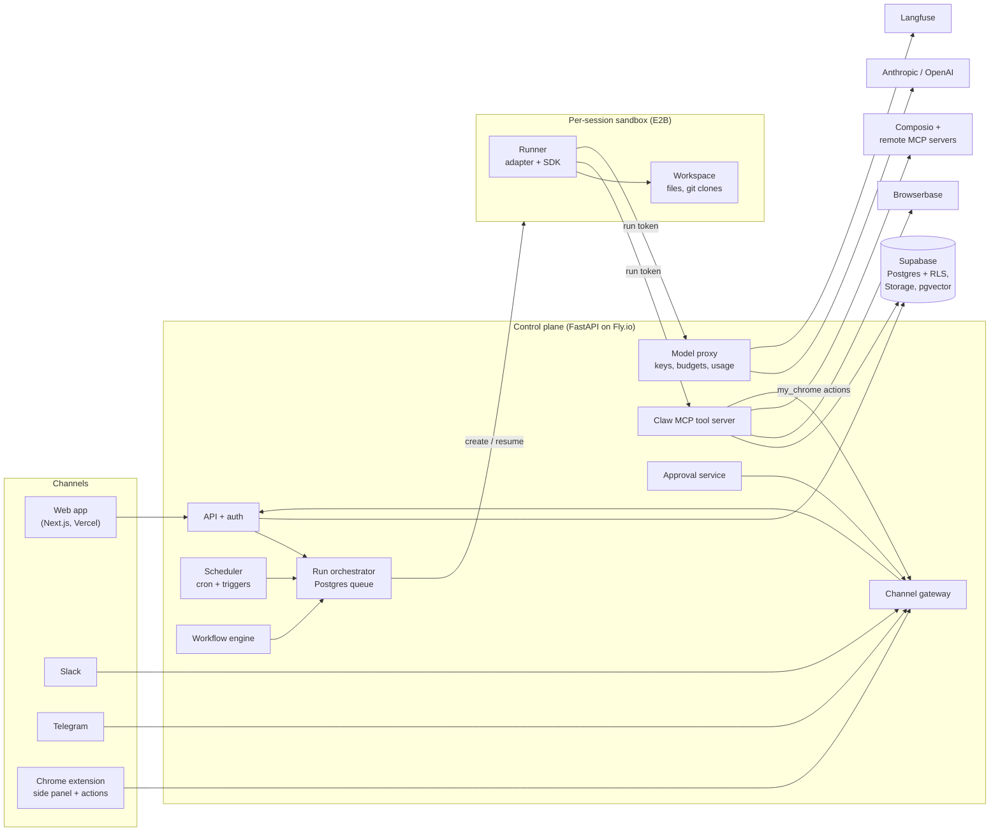
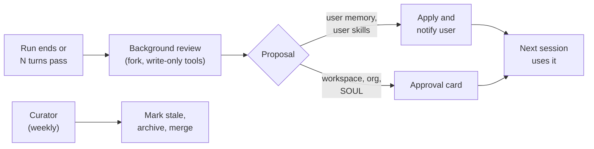

# Nikhil_claw — Architecture and Design

| | |
|---|---|
| Status | Draft v0.2. The owner answered all open questions (Section 22). No code yet. |
| Date | 2026-11-18 |
| Owner | Nikhil Mandhani |
| Companion docs | [`feature-map.md`](feature-map.md) (every Hermes feature and our plan for it), [`roadmap.md`](roadmap.md) (milestones and backlog) |

## Contents

1. [Summary](#1-summary)
2. [Goals, non-goals, and terms](#2-goals-non-goals-and-terms)
3. [Decisions](#3-decisions)
4. [System overview](#4-system-overview)
5. [Runtime adapter layer](#5-runtime-adapter-layer)
6. [Prompt assembly and context management](#6-prompt-assembly-and-context-management)
7. [Sessions](#7-sessions)
8. [Memory](#8-memory)
9. [Skills and the self-improvement loop](#9-skills-and-the-self-improvement-loop)
10. [Tools, toolsets, and integrations](#10-tools-toolsets-and-integrations)
11. [Channels: web, Slack, Telegram, Chrome](#11-channels-web-slack-telegram-chrome)
12. [Scheduler, cron jobs, and workflows](#12-scheduler-cron-jobs-and-workflows)
13. [Sub-agents and multi-agent work](#13-sub-agents-and-multi-agent-work)
14. [Browser use and the Chrome extension](#14-browser-use-and-the-chrome-extension)
15. [Code editing and self-modification](#15-code-editing-and-self-modification)
16. [Safety: approvals, sandbox, secrets](#16-safety-approvals-sandbox-secrets)
17. [Users, teams, and tenants](#17-users-teams-and-tenants)
18. [Observability and cost](#18-observability-and-cost)
19. [Technology stack and repository layout](#19-technology-stack-and-repository-layout)
20. [Milestones](#20-milestones)
21. [Risks](#21-risks)
22. [Resolved questions](#22-resolved-questions)
23. [References](#23-references)

---

## 1. Summary

Nikhil_claw ("claw") is a **cloud agent engine**. It gives an assistant the features of
[Hermes Agent](https://github.com/NousResearch/hermes-agent): skills, tools, memory, sessions,
context management, cron jobs, Slack and Telegram, sub-agents, code editing, and a
self-improvement loop. It adds browser control through a cloud browser and a Chrome extension.

Claw does not have its own agent loop. It runs two agent SDKs behind one contract:

- **Claude Agent SDK** (default). It is the Claude Code loop as a Python library: file edits,
  shell, search, sub-agents, compaction, session resume, hooks, and a permission callback.
- **OpenAI Agents SDK** (second). It gives handoffs, guardrails, `needs_approval` tools, a
  `SandboxAgent` with shell, file, skills, and compaction capabilities, and tracing.

Everything that makes the assistant "Hermes-like" lives **above** that contract, in claw:
memory, skills, session search, scheduling, channels, approvals, budgets, and audit. So each
feature works the same on both SDKs, and a third SDK needs only one more adapter.

Claw is the **core engine**. Our team uses it first. Customers use it later. Other products
build on top of it. The first planned product is
[vorflux](https://github.com/nikhilllmno/vorflux), the hotel agent harness. vorflux adds
hotel-specific parts (hotel repos, eval gate, hotel operations) and uses claw for the rest.

Five rules shape the design:

1. **Cloud only.** The API, channels, scheduler, and memory run 24/7 on Fly.io. Every session
   runs in its own **E2B** cloud sandbox. Browsers run in **Browserbase**. Nothing needs a
   local install. The Chrome extension is optional and connects out to the cloud.
2. **The sandbox is the security boundary.** The SDK loop, shell, files, and code run inside
   the sandbox. The sandbox holds no long-lived secrets. Model calls go through the claw
   **model proxy**, and claw tools go through the claw **MCP tool server**. Both accept only a
   short-lived run token.
3. **State is in Postgres** (Supabase), not in files. Every row has an `org_id`. Row-level
   security is on from the first table, so customers later need no data migration.
4. **The prompt prefix is frozen per session** (a Hermes rule). The system prompt, tool list,
   memory snapshot, and skill index do not change during a session. This keeps prompt caching
   cheap. Prompt changes apply from the next session. Compaction is the only exception.
   Authority is not frozen: a revoked permission or a lower budget applies at once.
5. **Self-improvement is bounded and reversible.** The agent can write memory, skills, cron
   jobs, and workflows. Each write is versioned. Changes to claw's own code go through a pull
   request that a human merges. The agent never changes the running service directly.

---

## 2. Goals, non-goals, and terms

### 2.1 Goals

- Give one assistant all the Hermes features listed in [`feature-map.md`](feature-map.md).
- Run on the Claude Agent SDK by default and on the OpenAI Agents SDK as a second runtime,
  with the same features on both.
- Talk to users in a web app, Slack, Telegram, and a Chrome side panel.
- Control a browser: a cloud browser for unattended work, and the user's own Chrome (through
  the extension) for sites where the user is logged in.
- Run scheduled jobs and multi-step workflows without a human present, and deliver results to
  any channel.
- Learn from use: curated memory, agent-written skills, and session search.
- Edit code in a sandbox and open pull requests, including pull requests to claw itself.
- Serve a team now and many customers later, with no change to the data model.
- Be a library and service that other products (vorflux first) build on.

### 2.2 Non-goals for v1

- No local install, terminal UI, or desktop app. (Hermes has these. Our users are in the
  cloud surfaces above.)
- No model providers other than Anthropic and OpenAI. (Owner decision for vorflux, kept here.)
- No own agent loop. We use the two SDKs.
- No third-party plugin code inside the control plane. Extensions come as MCP servers, skills,
  or Composio toolkits.
- No model training pipeline (Hermes batch trajectories). We keep transcripts so that we can
  add this later.
- No public skill marketplace in v1. We curate built-in skills in this repo.

### 2.3 Terms

| Term | Meaning |
|---|---|
| Org | A tenant: our team now, one customer account later. The billing and isolation unit. |
| Workspace | A unit of work inside an org, for example a project or a team. vorflux maps one hotel to one workspace. Memory, skills, jobs, and connections can be workspace-scoped. |
| User | A person in an org, with a role (`owner`, `admin`, `member`). |
| Agent profile | A named assistant configuration: SOUL, default runtime and model, toolsets, skills, approval policy, budgets. Like a Hermes profile, but stored as data. An org can have many profiles. |
| SOUL | The persona and standing instructions of an agent profile (Hermes `SOUL.md`). |
| Session | One conversation with an agent profile: messages, tool calls, and state. It can span many runs and stays on one runtime. |
| Run | One execution of agent turns for a session, in one sandbox, from a trigger to a stop. |
| Trigger | What starts a run: a user message, a cron job, a workflow step, a webhook, or a delegated task. |
| Runtime | An agent SDK that executes a run: `claude_agent_sdk` or `openai_agents_sdk`. |
| Adapter | Claw code that maps one runtime to the claw runtime contract (Section 5). |
| Runner | The claw process inside the sandbox that hosts the adapter and the runtime. |
| Sandbox | An isolated E2B microVM that holds the workspace files, the runner, and the shell for one session. |
| Toolset | A named group of tools. An agent profile enables toolsets. |
| Claw tools | Tools that claw implements once for both runtimes (memory, skills, cron, delegation, browser, connectors). They reach the runtime through the claw MCP tool server. |
| Native tools | Tools that a runtime ships (for example Claude `Read`, `Edit`, `Bash`). They run inside the sandbox. |
| Integration | An external app that the agent can use as tools: a Composio toolkit or a remote MCP server. |
| Channel | A surface where users talk to the agent: web, Slack, Telegram, Chrome side panel. |
| Skill | A versioned folder with a `SKILL.md` (agentskills.io format) that tells the agent how to do a task. |
| Memory | Small, curated notes that claw puts in every new session (Section 8). |
| Job | A scheduled trigger (cron expression or one time) with a prompt, skills, and a delivery target. |
| Workflow | A saved, versioned multi-step process with triggers, agent steps, tool steps, and approval steps (Section 12.3). |
| Approval | A human decision on one paused tool call. |

---

## 3. Decisions

### 3.1 Owner answers (2026-11-18)

| Question | Answer | Effect on the design |
|---|---|---|
| How does Nikhil_claw relate to vorflux and `hermes_like_agent`? | Claw is the core engine. We build products on top of it later. | Claw is domain-neutral and has a public Python API and HTTP API. Hotel parts stay in vorflux. |
| Who uses it? | Our team now, customers later. | Multi-user from day one. `org_id` on every row and RLS. Sign-up and billing come later (M6). |
| Where does it run? | Only in the cloud. | Fly.io control plane, E2B sandboxes, Browserbase browsers. The Chrome extension connects out to the cloud. |
| Language? | Python core. TypeScript only for the Chrome extension and the web UI. | Python 3.12, uv, FastAPI. Next.js web UI. |
| First pull request? | Design doc only. | This document, the feature map, and the roadmap. |
| Runtimes? | Claude Agent SDK default, OpenAI Agents SDK second. | Two adapters behind one contract (D2). |

### 3.2 Key decisions

| # | Decision | Reason |
|---|---|---|
| D1 | Write our own Python code. Do not fork or embed Hermes. Copy ideas, prompts, and limits from Hermes with attribution (`THIRD_PARTY_NOTICES.md`). | Hermes is a single-user app with file-based state and its own agent loop. We need multi-user state and two SDK loops. Hermes uses the MIT license, so we may reuse small parts with the notice. |
| D2 | One runtime contract (`AgentRuntime`) with two adapters: `claude_agent_sdk` (default) and `openai_agents_sdk`. A `fake` runtime exists for tests. | The owner uses only Anthropic and OpenAI models. One contract keeps every claw feature runtime-neutral and makes a third runtime cheap. |
| D3 | Claw tools reach both runtimes through **one MCP server per run** (streamable HTTP), scoped by a run token. | Both SDKs are MCP clients. One implementation serves both. Tenant scope, approvals, and audit happen in one place. |
| D4 | The runner (adapter plus SDK) runs **inside the sandbox**, not in the API process. | The Claude Agent SDK starts the Claude Code CLI as a subprocess, and its native tools run where the CLI runs. The OpenAI `SandboxAgent` needs a sandbox too. The OS boundary is the only real boundary against a model that misbehaves (Hermes security policy). |
| D5 | **E2B** is the sandbox provider, behind a `SandboxProvider` interface. One sandbox per session. E2B pause and resume keep the workspace between runs. Docker is for local development and CI. | Owner chose cloud sandboxes with E2B. The OpenAI Agents SDK has an E2B sandbox client. The interface keeps a path to Fly Machines, which vorflux chose. Owner decision: E2B now, Fly Machines later only if needed (Q1). |
| D6 | **No long-lived secrets in the sandbox.** Model calls go to the claw **model proxy** (`ANTHROPIC_BASE_URL` / OpenAI `base_url`) with a run token. Integration calls go through claw tools on the control plane. | A prompt-injected agent cannot leak a key that it cannot read. The proxy also meters cost, enforces budgets, and sends traces. |
| D7 | **Supabase** is the system of record: Postgres with RLS, Auth, Storage, and pgvector. | Already in the owner's stack. RLS is a second tenant guard under the API. pgvector covers session search and memory recall. |
| D8 | **Postgres is the job queue** (`FOR UPDATE SKIP LOCKED` with leases) for runs, cron fires, workflow steps, and deliveries. No separate workflow engine in v1. | Fewer moving parts. vorflux made the same choice. The queue sits behind an interface. |
| D9 | The **prompt prefix is frozen per session**: SOUL, context files, tool list, memory snapshot, skill index. New memory and skills apply from the next session. A short note on the next user message tells the agent about new skills. | Hermes rule. It keeps prompt caching valid on both SDKs and makes runs reproducible (`RunConfig.fingerprint()`). |
| D10 | **Integrations come from Composio and remote MCP servers.** Connections are per user or per workspace, with OAuth tokens in the claw vault. Rare tools sit behind `tool_search`. | The owner has Composio and any MCP server. This gives hundreds of apps without our own connector code, and keeps the tool list short. |
| D11 | **Channels** are adapters in one gateway: web (first-party), Slack (Bolt, Events API), Telegram (Bot API webhook), and the Chrome extension (WebSocket). Email and WhatsApp later. Chats bind to a user and an agent profile through pairing. | Same shape as the Hermes gateway: normalise inbound, send outbound, render approvals, map slash commands. Unpaired chats get no agent access. |
| D12 | **Browser control has one tool contract with two targets**: `cloud` (Browserbase) and `my_chrome` (the extension). The tools work on page snapshots with element refs, and a vision mode uses screenshots and coordinates. | The agent learns one set of tools. Unattended jobs use the cloud browser. Logged-in personal sites use the user's own Chrome with consent. |
| D13 | **Approvals fail closed.** Each tool call gets `allow`, `ask`, or `deny` from a policy. `ask` pauses the run and sends an approval card to the user's channel. Unattended runs (cron, workflows, webhooks) turn `ask` into `deny`, unless a human approved a pre-approval for that tool in that job version. A hardline deny list cannot be overridden. | Hermes three-layer model. A human is not present for unattended runs. |
| D14 | **Self-improvement writes are versioned data.** Memory, skills, cron jobs, workflows, and SOUL changes are rows with history and provenance. Changes to claw's own code are pull requests that a human merges. | The agent can learn and change its stack, but every change can be reviewed and reverted. |
| D15 | **Langfuse** traces both runtimes. The model proxy records tokens and cost per run. | One trace view for both SDKs. Both SDKs have Langfuse integrations. The proxy is the source of truth for cost. |
| D16 | **Claw is a library plus services.** Products import `claw` and register extra tools, skills, toolsets, channels, and policies through extension points. They do not patch claw code. | vorflux and later products build on the engine without a fork (Hermes rule: plugins never touch core). |

---

## 4. System overview



### 4.1 Components

| Component | Responsibility |
|---|---|
| **API** | Auth (Supabase JWT, API keys for services), REST and streaming endpoints, admin endpoints for profiles, skills, memory, jobs, workflows, and connections. The only holder of the database service key. |
| **Channel gateway** | Receives Slack, Telegram, and extension events. Checks pairing and access. Maps each chat or thread to a user, an agent profile, and a session. Streams replies, renders approval cards, and handles slash commands. Also routes `my_chrome` browser actions to the right extension connection. |
| **Run orchestrator** | Queues runs. Enforces per-org concurrency, budgets, and rate limits. Creates or resumes the session sandbox, starts the runner, streams events, and handles cancel, timeout, and resume after approval. |
| **Scheduler** | Fires cron jobs and one-time jobs. Receives webhooks and Composio triggers. Creates runs or workflow instances. One leader at a time through a Postgres lease. |
| **Workflow engine** | Runs workflow instances step by step as queue items. Stores each step result. Pauses on approval steps. |
| **Claw MCP tool server** | The claw tools for both runtimes: memory, skills, session search, cron, workflows, delegation, browser, connectors (Composio and MCP proxy), todo, clarify, approvals, and change proposals. Each call carries the run token. |
| **Model proxy** | Holds the Anthropic and OpenAI keys. Accepts the run token, checks the model allowlist and budget, forwards the call, records usage and cost, and sends the trace. |
| **Approval service** | Stores pending approvals, routes them to the user's channel, records the decision, and resumes the run. |
| **Sandbox** | Runs the runner, the native shell and file tools, and code. Has no database access and no long-lived secrets. Egress is limited to the claw endpoints and an allowlist. |

### 4.2 A run, end to end

1. **Receive.** A user writes "Every Monday 9:00, send me a summary of open GitHub issues"
   in Telegram.
2. **Resolve.** The gateway finds the paired user, the default agent profile, and the
   session bound to this chat. It creates a session if none is open.
3. **Queue.** The API stores the message and queues a run.
4. **Prepare.** The orchestrator builds the frozen `RunConfig` for a new session: SOUL,
   context files, memory snapshot, skill index, toolsets, runtime, and model. For an open
   session it reuses the stored `RunConfig`.
5. **Provision.** The orchestrator resumes the session sandbox (or creates one from the claw
   E2B template) and issues a run token. The token is bound to `org_id`, `user_id`,
   `session_id`, and `run_id`, and expires after the run.
6. **Execute.** The runner starts the adapter. The SDK calls the model through the model
   proxy and calls claw tools through the MCP server. Here the agent calls
   `cronjob_manage(action="create", ...)`.
7. **Gate.** The tool gate checks the policy. Creating a job without pre-approved tools is
   `allow` for the owner of the chat, so the call runs. If the job asks for pre-approved
   tools, those tools stay off until the user approves them (Section 12.1). A risky call (send an email to a customer, push code) gets `ask`:
   the run pauses with `ApprovalRequired`, and an approval card goes to Telegram.
8. **Finish.** The run ends with `RunCompleted` or `RunFailed`. The sandbox pauses.
9. **Learn.** A background review may propose memory or skill updates (Section 9.4).
10. **Record.** Transcript, tool calls, usage, cost, and approvals are in Postgres. The trace
    is in Langfuse.

---

## 5. Runtime adapter layer

### 5.1 The contract

The contract lives in `src/claw/runtime/contract.py` (M1). It reuses the design of the runtime
contract v2 from `hermes_like_agent` and vorflux:

```python
class RuntimeKind(StrEnum):
    CLAUDE_AGENT_SDK = "claude_agent_sdk"   # default
    OPENAI_AGENTS_SDK = "openai_agents_sdk"
    FAKE = "fake"                            # scripted, for tests

class AgentRuntime(Protocol):
    kind: RuntimeKind
    def capabilities(self) -> Capabilities: ...       # native_subagents, native_compaction, native_skills, ...
    def run(self, req: RunRequest) -> AsyncIterator[RunEvent]: ...
    def resume(self, req: ResumeRequest) -> AsyncIterator[RunEvent]: ...   # after an approval decision
    async def cancel(self, run_id: str) -> None: ...

RunEvent = (TextDelta | ToolCallStarted | ToolCallFinished | ApprovalRequired
            | Compacted | SubagentEvent | RunCompleted | RunFailed)
```

- `RunRequest` holds the `RunScope` (org, workspace, user, session, run), the user input, and
  the frozen `RunConfig`.
- `RunConfig` is frozen per session. It holds only what the model sees and what the cache
  needs: runtime, model, SOUL, context files, memory snapshot, skill index, tool schemas, and
  MCP server configs. It has `fingerprint()` and `render_prefix()`. Remote MCP configs hide
  their bearer token in `repr`.
- **Authority is not frozen.** The control plane checks membership, connection access,
  approval policy, budgets, and revocations again at every tool call, model call, and
  approval resume. A newer `deny` or a lower budget applies at once, also to long-lived
  sessions. A tool that is still in the frozen schema but is no longer allowed gets `deny`
  from the tool gate.
- Every event carries running `Usage`. The stream ends with exactly one of
  `ApprovalRequired`, `RunCompleted`, or `RunFailed` (with a `FailureCode`).
- The adapter saves the runtime's own resumable state as an opaque blob. The orchestrator
  stores it with the run.

### 5.2 What claw owns and what the runtime owns

| Concern | Owner | Notes |
|---|---|---|
| Model calls, the tool loop, native compaction | Runtime | Claw does not write an agent loop. |
| Native shell and file tools | Runtime | Inside the sandbox only. |
| Claw tools (memory, skills, search, cron, workflows, delegation, browser, connectors) | Claw, through MCP | One implementation for both runtimes. |
| Approval policy and decisions | Claw | Adapters map SDK permission hooks to `ApprovalRequired`. |
| Prompt prefix (SOUL, memory, skill index) | Claw | Built once per session (Section 6). |
| Canonical transcript | Claw | Stored in Postgres. The runtime's own session state is a blob. |
| Tenant scope, budgets, audit | Claw | Enforced in the orchestrator, model proxy, and MCP server. |
| Sandbox lifecycle | Claw | The OpenAI `SandboxAgent` gets a client for the session sandbox. |

### 5.3 Mapping per runtime

| | Claude Agent SDK (default) | OpenAI Agents SDK (second) |
|---|---|---|
| Package | `claude-agent-sdk` (Python). It drives the bundled Claude Code CLI as a subprocess, so the sandbox image needs the CLI. | `openai-agents` (Python), in process. |
| Turn API | `ClaudeSDKClient.query()` and `receive_response()` | `Runner.run_streamed()` |
| Model routing | `ANTHROPIC_BASE_URL` points at the claw model proxy; the run token is the API key. | `AsyncOpenAI(base_url=<proxy>, api_key=<run token>)` |
| System prompt | `system_prompt` preset `claude_code` with the claw prefix appended, or a full custom prompt for non-coding profiles | `Agent.instructions` |
| Claw tools | `mcp_servers` with the claw MCP server (HTTP); `strict_mcp_config=True` | `MCPServerStreamableHttp` in `Agent.mcp_servers` |
| Approvals | `PreToolUse` hook calls the claw tool gate. `ask` returns a defer and the run pauses. Fallback: `can_use_tool` deny plus interrupt. | `needs_approval` on tools. `result.interruptions` become `ApprovalRequired`. `RunState.approve()` or `reject()` on resume. |
| Resume | `resume` with the SDK session id; `session_store` mirrors the transcript to claw. | Serialised `RunState` plus a claw `Session` (a `SessionABC` that reads and writes items through the control-plane API with the run token). The runner has no database credentials, so `SQLAlchemySession` is not used in the sandbox. |
| Sub-agents | `agents` option (`AgentDefinition`: prompt, tools, model, skills, MCP servers) | Agents as tools and handoffs |
| Skills | Native: claw writes the session's skills to `.claude/skills/` and sets the `skills` option. | `SandboxAgent` `Skills` capability with a claw skill source, or the claw `skill_view` tool. |
| Compaction | Native auto-compaction. The `PreCompact` hook lets claw archive the full transcript first. | `Compaction` capability or `OpenAIResponsesCompactionSession`. |
| Shell and files | Native `Bash`, `Read`, `Edit`, `Write`, `Glob`, `Grep` | `SandboxAgent` with `Shell` and `Filesystem` capabilities (with `apply_patch`). The runner is already inside the E2B sandbox, so it uses the local client (`UnixLocalSandboxClient`). The orchestrator owns the E2B lifecycle. The runner has no E2B API key. |
| Limits | `max_turns`, `max_budget_usd`, `task_budget` | `max_turns`; claw budget in the model proxy |
| Checkpoints | `enable_file_checkpointing` and `rewind_files()` | Claw git snapshot of the workspace (Section 15.3) |
| Tracing | Langfuse integration plus proxy usage | Agents SDK tracing processor to Langfuse plus proxy usage |
| Main risks | CLI subprocess and Node in the image. Fast option changes. Claude models only. | Fast-moving API surface (`SandboxAgent` is new). OpenAI models only. |

Versions at the time of writing: `claude-agent-sdk==0.2.184` and `openai-agents==0.25.0`.
Each adapter pins its SDK version in its own dependency group (`runtime-claude`,
`runtime-openai`). Exact option names are checked again when each adapter is built.

### 5.4 Choosing a runtime

- Each agent profile has a default runtime. The org default is `claude_agent_sdk`.
- A session keeps one runtime for its life (prompt cache rule). A different runtime means a
  new session or a delegated child run.
- Use the OpenAI Agents SDK when a task needs an OpenAI model, OpenAI hosted tools, or
  OpenAI-native patterns such as handoffs.

### 5.5 Conformance suite

Both adapters must pass one shared test suite before a profile can use them:

- Streams text and ends with exactly one terminal event.
- Calls a claw MCP tool and gets the result.
- Turns a gated tool call into `ApprovalRequired`, then resumes correctly on approve and on
  reject.
- Resumes a session after the sandbox paused and resumed.
- Honours `cancel()` within 10 seconds.
- Loads a skill and follows it.
- Reports token usage that matches the model proxy record.
- Makes no network call outside the sandbox egress allowlist.

CI runs the suite against a scripted model. A nightly job runs a small live suite with real
models and a low budget.

---

## 6. Prompt assembly and context management

### 6.1 Prompt tiers

Claw builds the prompt prefix once per session, in three tiers, so that the longest part is
stable and cacheable (Hermes `agent/system_prompt.py`):

| Tier | Content | Changes |
|---|---|---|
| Stable | Claw identity and tool-use guidance, the agent profile SOUL, pinned skills | Only when the profile changes, from the next session |
| Context | Context files: workspace `AGENTS.md` / `CLAUDE.md` chain from cloned repos, profile instructions, channel formatting hints | Per session |
| Volatile | Skill index (name and description), memory snapshot, user profile block, date and time zone, environment hints | Per session |

Rules:

- Nothing in the prefix changes during a session. Compaction is the only exception.
- New skills or memory writes during a session appear as a one-line note on the next user
  message, not as a prompt change.
- Context files are capped (20,000 characters each, as in Hermes) and scanned for prompt
  injection patterns before use.

### 6.2 Context management

| Mechanism | How |
|---|---|
| Compaction | Native in both SDKs (Section 5.3). Before compaction, claw archives the full transcript and links the compacted session to its parent (session lineage). |
| Tool output limits | Claw tools return at most 50 KB (head and tail kept). Larger output is written to a file in the sandbox, and the tool returns a preview plus the path (Hermes "spill"). |
| Tool search | Rare tools (most integrations, cron admin, image generation, TTS) are deferred. The model sees `tool_search`, `tool_describe`, and `tool_call` instead of their schemas. |
| Progressive skills | Only the skill index is in the prompt. The agent loads a full skill when it needs it. |
| Context pins | A user can pin a message or file so that compaction keeps it. |
| `@` references | `@file`, `@url`, and `@session` in a message attach that content (M4). |
| Budgets | Per run: max turns, max tokens, max cost, and wall time. Near the limit, claw tells the agent to wrap up. |

---

## 7. Sessions

- Tables: `sessions`, `messages`, `tool_calls`, `runs`, `run_events`, `session_bindings`.
  Every row has `org_id`.
- A **session binding** maps a channel thread to a session: a Telegram chat, a Slack thread,
  a web chat, or an extension tab. `/new` starts a new session in the same binding.
- **Resume** uses the runtime's resume (Section 5.3) and the session sandbox.
- **Lineage**: compaction, `/branch`, `/retry`, and delegation create child sessions linked to
  the parent. Nothing is overwritten.
- **Cross-channel continuity**: a user can continue a session from another channel with
  `/resume <id>` or a session link.
- **Search**: `session_search` uses Postgres full-text search plus pgvector embeddings,
  filtered to sessions that the user can see. It returns redacted snippets with links and
  makes no LLM call (Hermes design). The agent can then load one session summary.
- **Titles and summaries**: a small model writes a title after the first turn and a summary
  when the session goes idle. Summaries feed session search and the background review.
- **Retention**: per-org setting. Default: keep everything. Delete removes rows and sandbox
  data.

---

## 8. Memory

Claw copies the Hermes memory model, because the small caps force curation and keep the
prompt cheap.

| Store | Scope | Cap | Content |
|---|---|---|---|
| `agent` notes | Agent profile in a workspace | 2,200 characters | Facts about the environment, conventions, lessons, completed work |
| `user` profile | One user (across profiles in the org) | 1,375 characters | Preferences, role, style, recurring needs |
| `workspace` notes | Workspace | 2,200 characters | Shared team facts. Writes need `admin` or an approval. |

- **Tool**: one `memory` tool with `target` (`agent`, `user`, `workspace`) and actions `add`,
  `patch` (replace a unique substring), and `remove`. Batch form with `operations`. No `read`
  action, because the content is in the prompt.
- **Over the cap**: the write fails and returns the current entries and the characters to
  free. The agent must consolidate in one batch. Memory never compacts itself.
- **Frozen snapshot**: claw renders memory into the volatile tier at session start.
- **History**: every write is a row in `memory_revisions` with session, run, and author.
  Users can see, edit, and revert memory in the web app.
- **Long-term recall**: session search (Section 7) covers what does not fit in memory. A
  memory provider interface allows an external store (for example Mem0) later. Postgres plus
  pgvector is the default.
- **Safety**: delegated children and webhook-triggered runs cannot write memory. Memory
  content is scanned for secrets before it is saved.

---

## 9. Skills and the self-improvement loop

### 9.1 Format

A skill is a folder with `SKILL.md` (YAML frontmatter and Markdown) and optional
`references/`, `templates/`, `scripts/`, and `assets/`. This is the agentskills.io format
that both Claude and Hermes use. Frontmatter: `name`, `description` (one sentence, at most
60 characters, as in Hermes), `version`, `tags`, `requires_toolsets`, `requires_integrations`,
and `config` (settings that the user fills in once).

### 9.2 Library and scopes

| Scope | Who writes | Where |
|---|---|---|
| `builtin` | Our team, through pull requests to this repo | `skills/` in this repo, synced at deploy |
| `org` | Org admins; promotion from a lower scope | Postgres plus Supabase Storage |
| `workspace` | Members and the agent | Postgres plus Supabase Storage |
| `user` | The user and the agent | Postgres plus Supabase Storage |

- Every change is a new version with provenance (author, session, run). Old versions stay.
- A narrower scope overrides a wider scope with the same name.
- An agent profile chooses which skills and categories are on. The session gets the index
  of these skills.

### 9.3 Progressive disclosure and tools

- Level 0: the index (name and description) is in the prompt.
- Level 1: the agent loads `SKILL.md` (native Skill tool on Claude, `skill_view` or the
  Skills capability on OpenAI).
- Level 2: the agent reads a linked file or runs a script from the skill folder. Claw writes
  the session's skills into the sandbox at start, so scripts can run.
- `skills_list`, `skill_view`, and `skill_manage` (`create`, `patch`, `edit`, `write_file`,
  `remove_file`, `archive`) are claw tools. All writes go through `skill_manage`, so every
  write is versioned and scanned.
- Slash command per skill (`/<skill-name>`) in every channel.

### 9.4 Self-improvement loop



1. **Nudge.** Claw counts user turns and tool iterations per session. When a run ends, claw
   checks the counters. If either counter reached 10 since the last review (Hermes defaults),
   claw queues one **background review** and resets both counters. A session has at most
   one review running and one queued.
2. **Review.** A forked run reads the transcript with the Hermes review prompts ("should a
   skill or memory be saved or updated?"). It has only `memory` and `skill_manage`, and its
   own nudges are off, so it cannot recurse.
3. **Apply.** Writes to `user` scope apply at once, and the user sees a short note. Writes
   to `workspace` scope and SOUL changes need an approval from a workspace `admin` or the
   org `owner`. Writes to `org` scope need the org `owner` (Q5).
4. **Curate.** A weekly curator job tracks skill usage (views, uses, patches). It marks
   unused agent-written skills `stale`, then `archived`. It merges near-duplicates with an
   approval. It never deletes. Pinned skills and skills that jobs or workflows use are exempt.
5. **Check.** Every new or changed skill passes a linter (frontmatter, length, tool names)
   and a scan (secrets, network calls to unknown hosts, prompt-injection patterns) before it
   becomes active.
6. **Learn on request.** `/learn <url or topic>` makes the agent read sources and write a
   skill.

---

## 10. Tools, toolsets, and integrations

### 10.1 Rules

- Keep the core tool list short, because every tool schema is in every model call (Hermes
  "narrow waist"). Prefer, in this order: a skill, an integration behind `tool_search`, a
  claw tool that a service gates, a core tool.
- Tools that need a missing service or credential are hidden, not broken.
- There is no agent-callable "send a message to anyone" tool. Replies go to the trigger's
  channel. Outbound messages to other people go through integrations and need approval.

### 10.2 Tool catalog

| Toolset | Tools | Where they run |
|---|---|---|
| `core` (native) | Shell, read, write, edit, search files, web fetch | Runtime, in the sandbox |
| `todo` | `todo` (read and write the session task list). On Claude, the adapter also maps native `TodoWrite` calls to the same list with a `PostToolUse` hook. | Claw MCP |
| `web` | `web_search`, `web_extract` | Claw MCP (search provider key on the control plane) |
| `memory` | `memory` | Claw MCP |
| `skills` | `skills_list`, `skill_view`, `skill_manage` | Claw MCP |
| `sessions` | `session_search`, `session_read` | Claw MCP |
| `clarify` | `clarify` (1 to 5 questions, choices or free text, rendered per channel) | Claw MCP |
| `code_exec` | `execute_code` (Python that calls claw tools through a local RPC stub) | Sandbox, tools through MCP |
| `delegation` | `delegate_task`, `delegate_status` | Claw MCP |
| `cron` | `cronjob_manage` (create, list, update, pause, resume, remove, run, cancel) | Claw MCP |
| `workflows` | `workflow_manage`, `workflow_run` | Claw MCP |
| `browser` | `browser_open`, `browser_snapshot`, `browser_act`, `browser_screenshot`, `browser_extract`, `browser_tabs`, `browser_vault` (Section 14) | Claw MCP to Browserbase or the extension |
| `media` | `vision_analyze`, `image_generate`, `text_to_speech`, `transcribe` | Claw MCP |
| `connections` | `connections_list`, `connection_request` (sends the user an OAuth link) | Claw MCP |
| `integrations` | Composio toolkit tools and remote MCP server tools, behind `tool_search` | Claw MCP (Composio and MCP proxy) |
| `github` | `repo_clone`, `pr_create`, `pr_comment` through the claw GitHub App | Claw MCP plus sandbox git |
| `self` | `change_propose` (SOUL, profile, toolsets), `claw_pr` (code change to claw, Section 15) | Claw MCP |
| `tool_search` | `tool_search`, `tool_describe`, `tool_call` | Claw MCP |

Agent profiles combine toolsets. Built-in presets: `assistant` (everything except `self`),
`coding` (core, web, skills, memory, sessions, github, delegation), `safe` (web, vision,
clarify; for webhook triggers), and `cron` (like `assistant` but no `cron` and no `clarify`).

### 10.3 Integrations: Composio and MCP

- **Composio** gives toolkits for hundreds of apps (Gmail, Google Calendar, GitHub, Linear,
  Notion, HubSpot, and more), managed OAuth, and triggers. Claw uses one Composio entity per
  claw user (personal accounts) and one per workspace (shared accounts).
- **Remote MCP servers**: an org admin adds a server URL from a curated catalog or by hand.
  OAuth or bearer tokens go to the claw vault. Claw proxies the calls, so the sandbox never
  sees the token.
- **Exposure**: integration tools are deferred behind `tool_search` by default. An agent
  profile can pin a few integrations so that their tools are always visible.
- **Approval defaults**: read actions `allow`, write actions `ask`, destructive actions
  `ask` with a stronger warning. Admins can change this per tool.
- **Triggers**: Composio triggers (for example "new email", "new GitHub issue") and webhooks
  can start runs or workflows (Section 12).

---

## 11. Channels: web, Slack, Telegram, Chrome

### 11.1 Gateway

One gateway service hosts all channel adapters. Each adapter does five things:

1. **Inbound**: verify the request signature, normalise the event (text, files, voice notes,
   thread, sender), and drop duplicates.
2. **Access**: find the paired claw user. Unknown senders get a pairing prompt or nothing.
3. **Route**: find or create the session binding and queue a run.
4. **Outbound**: stream the reply (edit one message as text arrives), send files and images,
   and split long text by the channel's limits.
5. **Controls**: render approval cards and `clarify` questions as buttons, and map slash
   commands (`/new`, `/stop`, `/resume`, `/model`, `/skills`, `/memory`, `/cron`, `/approve`,
   `/deny`, `/<skill-name>`).

### 11.2 Adapters

| Channel | Transport | Notes |
|---|---|---|
| Web app | REST and server-sent events from the API | Full features: chat, approvals, settings, memory and skill editors, jobs, workflows, connections, run traces. |
| Slack | Slack Bolt for Python, Events API over HTTP, interactive components | One Slack app per org install (OAuth). DMs and mentions. A thread is a session. Approval buttons through Block Kit. |
| Telegram | Bot API webhook | One shared claw bot for our team now. One bot per org for customers later, with its token in the org vault (Q3). DMs and groups (mention or reply only in groups). Voice notes are transcribed. Inline keyboards for approvals. |
| Chrome extension | WebSocket from the extension to the gateway | Side panel chat bound to the current tab. Also the `my_chrome` browser target (Section 14). |
| Later | Email (inbound address per agent), WhatsApp, Discord, Microsoft Teams | Same adapter shape. |

### 11.3 Pairing and access

- A user links a Telegram or Slack identity from the web app. The app shows a short code,
  and the user sends it to the bot. Codes are single-use and expire after 10 minutes. Rate
  limits and lockout follow Hermes `gateway/pairing.py` (5 failed tries lock the identity for
  1 hour). Codes are never logged.
- A Slack workspace or Telegram group can bind to a workspace and an agent profile. Only
  paired members can start runs there.
- Group messages are untrusted input. In groups the agent uses the profile's group toolset
  (default: no shell, no code edits, no outbound writes).
- **Audience and principal.** Each session has an audience: `private` (one user, for
  example a DM) or `shared` (a Slack channel or thread, a Telegram group). A private session
  runs as its user. A shared session runs as the workspace and uses only shared context:
  SOUL, `agent` and `workspace` memory, workspace skills, and workspace connections. It does
  not load `user` memory, user skills, or personal connections. A user who wants personal
  data uses a private session, or shares one item on purpose with an approval.
- The same audience rule applies to `session_search`, `session_read`, resume, and delivery.
  A user finds only sessions whose audience includes the user. A job delivers to a shared
  target only output from a shared-audience run.

---

## 12. Scheduler, cron jobs, and workflows

### 12.1 Jobs

| Field | Meaning |
|---|---|
| `schedule` | Cron expression with a time zone, an interval, or one time. The agent turns natural language ("every weekday 9am") into this form, and claw validates it. |
| `prompt`, `skills` | What the run does. |
| `agent_profile`, `model` | Pins. The default is the profile default when the job fires. |
| `deliver` | `origin` (the chat that created it), a channel target (`slack:#ops`, `telegram:<chat>`, `email:<address>`), or `none`. Plus `failure_deliver`. |
| `mode` | `agent` (an LLM run) or `script` (run a script in the sandbox and deliver its output, no LLM). |
| `preapproved_tools` | Tools that may run without a human in this job, each bound to a connection and optional argument limits (for example "Slack post to `#eng` only"). Everything else that needs `ask` is denied. Adding or widening a pre-approval needs a human approval, which is bound to that job version. A change to the job's prompt, schedule, or target creates a new version, and write pre-approvals then need approval again. |
| `attach_to_session` | Run inside one long-lived session (heartbeat) instead of a fresh session. |

Execution:

- The scheduler ticks every 60 seconds (as in Hermes) with a leader lease and claims due fires with
  `FOR UPDATE SKIP LOCKED`. Each fire has a unique id, so a fire runs once.
- Each fire is a run with the `cron` toolset. **A job run cannot create jobs** (Hermes
  recursion guard).
- Deliveries have receipts. A delivery with an unknown result is not retried, so a message is
  never sent twice.
- Repeated failures pause the job and alert the owner once.
- The `cronjob_manage` tool, `/cron` commands, and the web app all edit the same rows.

### 12.2 Event triggers

Webhooks (signed, one URL per trigger), Composio triggers, and channel events (for example "a
message in #support that matches a pattern") can start a run or a workflow. Event payloads
are untrusted. Event-triggered runs use the `safe` toolset unless the trigger says otherwise.

### 12.3 Workflows

A workflow is a saved, versioned definition of steps. It turns a task that works into a
repeatable process.

```yaml
name: weekly-github-digest
triggers:
  - cron: "0 9 * * MON"
    tz: Asia/Kolkata
steps:
  - id: fetch
    tool: composio.GITHUB_LIST_REPOSITORY_ISSUES   # tool step: no LLM
    args: { owner: nikhilllmno, repo: Nikhil_claw, state: open }
  - id: summarise
    agent: { profile: assistant, prompt: "Summarise {{steps.fetch.output}} by priority." }
  - id: approve
    approval: { prompt: "Post this digest to #eng?", approvers: [owner] }
  - id: post
    tool: composio.SLACK_SEND_MESSAGE
    args: { channel: "#eng", text: "{{steps.summarise.output}}" }
```

- Step types: `tool` (one tool call, no LLM), `agent` (a run with a prompt and skills),
  `approval`, `branch` (a condition), `parallel` (fan out), `wait` (time or event), and
  `workflow` (a sub-workflow).
- The workflow engine runs each step as a queue item and stores its output. A crash
  resumes from the last finished step.
- Each step has a stable operation id. Claw passes it as an idempotency key where the
  provider supports one, and writes a receipt before and after the external call.
- A step that failed for sure (for example a 4xx response) retries with backoff. A
  non-idempotent write with an unknown result (for example a crash after the call) is not
  retried. Claw tries to check the result (reconcile). If it cannot, the instance waits for
  a human.
- The agent can write workflows with `workflow_manage`. "Turn this session into a workflow"
  is a built-in skill. New or changed workflows that write to external systems need an
  approval before their first run.
- The web app shows each workflow instance with its steps, outputs, and approvals.

### 12.4 Task board

For multi-agent work, a `tasks` table holds cards with a status, an assignee (an agent
profile or a human), dependencies, and comments (Hermes kanban). A dispatcher turns ready
cards into runs. Agents use `task_*` tools to complete, block, comment, and create child
cards. This is M4.

---

## 13. Sub-agents and multi-agent work

| Kind | When | How |
|---|---|---|
| Native sub-agents | Short side tasks inside one run (search a codebase, review a diff) | Claude `agents` option. OpenAI agents as tools or handoffs. Same sandbox, same run. |
| `delegate_task` | Parallel or long tasks, a different runtime or model, or a clean context | Claw creates a child session and run, in its own sandbox, linked to the parent. Only the child's summary (and file paths) return to the parent. |
| Task board | Multi-step projects with many agents and humans | Section 12.4. |

Limits for `delegate_task` (Hermes defaults): depth 1 unless the profile allows more, at most
10 children at a time per run, a turn and cost budget per child, and blocked tools for
children (`delegate_task`, `memory` writes, `cronjob_manage`, `clarify`, and outbound
messages). Children inherit the parent's approval policy and can only narrow it.

---

## 14. Browser use and the Chrome extension

### 14.1 One tool contract, two targets

| Target | Engine | Use |
|---|---|---|
| `cloud` (default) | Browserbase session controlled with Playwright over CDP from the claw MCP server | Unattended work, research, forms, scraping. Each user has a Browserbase context, so logins persist. |
| `my_chrome` | The claw Chrome extension in the user's own browser | Sites where the user is logged in, and tasks where the user wants to watch. Needs the extension to be online. |

Tools:

- `browser_open(url, target)` and `browser_tabs` manage tabs.
- `browser_snapshot` returns an accessibility-tree snapshot with element refs (`e12`), not raw
  HTML. This is cheap and reliable.
- `browser_act(action, ref | x,y, text)` performs `click`, `type`, `select`, `hover`,
  `scroll`, `press`, `drag`, `upload`.
- `browser_screenshot` returns an image. **Vision mode**: when a page has no usable
  accessibility tree (canvas apps), the agent uses screenshots and coordinates, like
  computer use.
- `browser_extract(schema)` returns structured data from the page.
- `browser_vault(action)` lists saved logins and fills a login form. The model never sees the
  password.
- Optional `browser_task(goal)` hands a whole goal to a browser sub-agent (for example the
  `browser-use` library on the cloud target) and returns the result.

### 14.2 Chrome extension

- Manifest V3, TypeScript. A side panel for chat, a background service worker, and content
  scripts.
- **Connection**: the user signs in once. The extension opens a WebSocket to the gateway.
  The gateway routes `my_chrome` tool calls for that user to this connection.
- **Actions**: the `chrome.debugger` API (CDP `Input.dispatchMouseEvent` and
  `Input.insertText`) gives real clicks and typing. A visible overlay shows the agent cursor
  and the element it acts on.
- **Context**: "Ask about this page" sends the page text and a screenshot to the session.
- **Consent**: per-site permission (ask, allow for this site, never). Sensitive actions
  (submit a form, purchase, send, delete) always need a click from the user. The user can
  stop the agent at any time, and the agent pauses when the user takes over.
- **Limits**: no access to `chrome://` pages or other extensions. Banking and password
  manager sites are blocked by default.

---

## 15. Code editing and self-modification

### 15.1 Editing code

- The sandbox has no GitHub token. Git traffic goes through the **claw git proxy** on the
  control plane, which holds the GitHub App installation tokens. The sandbox authenticates
  to the proxy with the run token. The org allowlist decides which repos.
- The agent clones with `repo_clone`, edits with native tools (Claude `Edit`, OpenAI
  `apply_patch`), runs tests in the sandbox, commits to a `claw/<slug>` branch, pushes
  through the proxy, and opens a pull request with `pr_create`.
- The proxy checks every push: the target repo is on the allowlist, every ref is a
  `claw/*` branch, there is no force-push and no ref delete, and changed protected paths
  (for example `.github/workflows`) have an approval.
- The agent never merges. Claw has no merge tool, and no GitHub token reaches the sandbox.
  A GitHub App with `contents: write` can merge through the API, so the permission alone
  does not stop a merge. Repos also need branch rules (rulesets) on the default branch that
  require a reviewed pull request and give the claw App no bypass.
- Repo `AGENTS.md` and `CLAUDE.md` load as context files for that session.

### 15.2 Changing its own stack

"Make changes to the current agent stack" has two levels:

| Level | What | How it applies |
|---|---|---|
| Configuration (data) | SOUL, agent profiles, toolsets, approval rules, skills, memory, jobs, workflows, connections | Through claw tools and the web app. Versioned rows. Low-risk changes apply at once (user skills, user memory). Others create a `change_propose` card and apply after approval. Prompt content (SOUL, memory, skills) applies from the next session. Restrictions (deny rules, removed tools, revoked connections, lower budgets) apply at once (Section 5.1). Every change can be reverted from the history view. |
| Code | Claw itself (and later products such as vorflux) | The agent uses `claw_pr`: it clones the claw repo in its sandbox, makes the change, runs the tests, and opens a pull request. A human reviews and merges. CI deploys. Changes to protected paths (auth, tenancy, approvals, model proxy, sandbox, CI) need the owner's review. |

The agent never edits the running service, its database schema, or its secrets directly.

### 15.3 Checkpoints

Before file changes in a session workspace, claw takes a git snapshot in a shadow repository
inside the sandbox (Hermes checkpoints), or uses Claude file checkpointing. `/undo` and
`/rollback` are channel commands for the user, not model tools, so the agent cannot roll
back the user's view of its own work.

---

## 16. Safety: approvals, sandbox, secrets

### 16.1 Tool gate

Every tool call passes one gate, in this order. Each tool call id gets exactly one verdict.

1. **Toolset**: the tool must be in the run's toolsets. Otherwise `deny`.
2. **Hardline**: a fixed deny list that nothing overrides (for example `rm -rf /`, fork
   bombs, disk wipes, piping a remote script to a shell as root).
3. **Recorded decision**: a one-time human decision for this call id, if any.
4. **Policy**: rules per org, profile, and tool give `allow`, `ask`, or `deny`. An optional
   classifier (a small model) can approve low-risk shell commands, as in Hermes `smart`
   mode. The default for unknown tools is `ask`.
5. **Context**: in unattended runs, `ask` becomes `deny` unless a human approved a
   pre-approval for this tool in this job version, and the call fits its connection and
   argument limits (Section 12.1).

Approvals time out after 24 hours (configurable) and then count as `deny`. Decisions are in
the audit log. A user can choose "always allow this tool for me", which writes a policy rule.

### 16.2 Sandbox

- One E2B sandbox per session, from a claw template (Python, Node for the Claude Code CLI,
  git, ripgrep, Playwright client). It pauses when idle and resumes on the next run.
- Default limits: 2 vCPU, 4 GB RAM, 1 hour per run, 24 hours of idle before the workspace is
  archived to Supabase Storage.
- Egress: the claw API endpoints, package registries, GitHub, and a per-org allowlist. Other
  hosts are blocked where E2B network controls allow it. Otherwise the runner logs every
  connection, and we track this as a risk (R4).
- The sandbox has no database credentials, no provider keys, and no integration tokens. It
  has only the run token. Git goes through the claw git proxy (Section 15.1).

### 16.3 Secrets

- The **claw vault** holds provider keys, integration tokens, bot tokens, and browser
  logins. It uses encrypted columns in Postgres (Supabase Vault or envelope encryption with a
  KMS key).
- Secrets never enter prompts, transcripts, or tool output. Claw redacts known secret
  patterns from tool output and logs.
- Each org can bring its own Anthropic and OpenAI keys later. Our keys are the default for
  our team.

### 16.4 Outbound requests from the control plane

Some requests start on the control plane, not in the sandbox: `web_extract`, remote MCP
discovery and calls, OAuth flows, skill imports, webhook deliveries, and browser
navigation. Sandbox egress rules do not cover them. One outbound HTTP client enforces a URL
policy for all of them:

- Only `https` (and `http` where the org allows it) to public addresses.
- Claw resolves the host, checks every resolved address, and connects to the checked
  address, so DNS rebinding cannot change the target. It blocks private, loopback,
  link-local, and cloud metadata addresses.
- Claw checks every redirect hop again, with a limit on the number of hops.
- Org allowlists and block lists apply. Response size and time limits apply.

### 16.5 Untrusted content

- Content from the web, email, webhooks, other people in groups, and files is untrusted.
  Claw marks it as untrusted in tool results.
- A run triggered by untrusted input uses a narrow toolset by default.
- Context files and skills are scanned for prompt-injection patterns before use.

---

## 17. Users, teams, and tenants

| Table | Purpose |
|---|---|
| `orgs` | Tenant, plan, limits, region |
| `workspaces` | Units inside an org |
| `users`, `memberships` | Users and their role per org and workspace (`owner`, `admin`, `member`) |
| `agent_profiles` | SOUL, runtime, model, toolsets, skills, policy, budgets |
| `channel_identities`, `session_bindings` | Paired Slack and Telegram identities, chat-to-session bindings |
| `vault_secrets`, `connections` | Encrypted secrets, Composio and MCP connections |

- Every table has `org_id`, and most have `workspace_id`. RLS policies check membership from
  the Supabase JWT. The API also checks scope in code (two guards).
- **Now (team)**: one org for our team, invite-only sign-up.
- **Later (customers, M6)**: self-serve sign-up, plans and usage billing (Stripe), quotas,
  org-level keys, data export and delete, and a region per org.
- **Products on top**: vorflux creates one claw workspace per hotel and adds its own tables
  and tools through the extension points (D16).

---

## 18. Observability and cost

- **Traces**: Langfuse for both runtimes, one trace per run, with session and user ids.
- **Usage**: the model proxy records input, output, and cache tokens and the cost per call.
  Runs, sessions, users, and orgs roll this up.
- **Budgets**: hard limits per run, per user per day, and per org per month. The proxy
  rejects calls over the limit, and the run ends with `RunFailed(budget_exceeded)`.
- **Audit log**: append-only rows for tool calls with side effects, approvals, configuration
  changes, logins, and admin actions.
- **Health**: structured logs, metrics (queue depth, run latency, sandbox start time, error
  rate), and alerts to a Slack channel.

---

## 19. Technology stack and repository layout

| Layer | Choice |
|---|---|
| Language | Python 3.12, uv, Ruff, mypy (strict), pytest |
| API and services | FastAPI, Pydantic v2, SQLAlchemy 2 (async) with asyncpg, Alembic |
| Runtimes | `claude-agent-sdk`, `openai-agents` (separate dependency groups) |
| MCP | Official `mcp` Python SDK (streamable HTTP server) |
| Database and storage | Supabase: Postgres, RLS, pgvector, Storage, Auth |
| Hosting | Fly.io: `api`, `gateway`, `worker`, `scheduler` process groups |
| Sandboxes | E2B (custom template), Docker for local development |
| Browser | Browserbase plus Playwright; Chrome extension (TypeScript, MV3) |
| Integrations | Composio, remote MCP servers |
| Channels | Slack Bolt for Python, Telegram Bot API |
| Web UI | Next.js on Vercel |
| Observability | Langfuse, OpenTelemetry |

Repository layout (planned):

```text
src/claw/
  api/            # FastAPI routers
  gateway/        # channel adapters: web, slack, telegram, extension
  orchestrator/   # run queue, sandbox lifecycle, events
  runtime/        # contract, claude adapter, openai adapter, fake, runner entry point
  tools/          # claw MCP server and tool packs
  memory/  skills/  sessions/  scheduler/  workflows/  browser/  approvals/
  modelproxy/  vault/  tenancy/  observability/
skills/           # builtin skills (SKILL.md folders)
extension/        # Chrome extension (TypeScript)
web/              # Next.js app
sandbox/          # E2B template definition
migrations/       # Alembic
tests/            # unit, conformance, integration
docs/
```

---

## 20. Milestones

[`roadmap.md`](roadmap.md) has the backlog with acceptance criteria. Summary:

| Milestone | Outcome |
|---|---|
| M0 | This design (doc only). |
| M1 Core engine | Repo foundations and CI. Runtime contract, Claude adapter, fake runtime, conformance suite. E2B sandbox and runner. Model proxy. Sessions in Postgres. SOUL and context files. Vault and redaction. Claw MCP tool server with output caps and spill. Outbound URL policy. Tool gate with approvals in the web chat and Telegram. HTTP chat API and a minimal web chat page. Telegram. Langfuse. Code editing in the sandbox (no pull requests yet). |
| M2 Learning loop | Memory, skills library and tools, session search, background review, context management (tool search, pins). |
| M3 Reach | Slack with shared-session rules. Approver rules per role. Composio and MCP connections. OpenAI Agents SDK adapter passes the conformance suite. GitHub pull request flow. Web app v1 for the team. |
| M4 Automation | Cron jobs and delivery, event triggers, workflows, `delegate_task`, task board, `@` references. |
| M5 Browser | Cloud browser tools, vision mode, browser vault, Chrome extension. |
| M6 Self-change and customers | `change_propose` and `claw_pr`, curator, checkpoints, customer sign-up, billing, quotas, org keys, regions, customer-ready web app. |

---

## 21. Risks

| # | Risk | Mitigation |
|---|---|---|
| R1 | The two SDKs change fast and break adapters. | Pin versions. Conformance suite in CI. Nightly live suite. Upgrade on purpose, one SDK at a time. |
| R2 | Sandbox start time makes chat feel slow. | Pause and resume per session. Keep a small pool of warm sandboxes. Measure the start time from M1. A "lite" run mode without a sandbox for chat-only profiles is a later option. |
| R3 | Feature parity between runtimes drifts. | Claw tools carry the features. Capabilities flags show the gaps. The feature map tracks parity. |
| R4 | E2B egress controls are not strict enough for an allowlist. | Secrets stay out of the sandbox (D6), so leaks are limited. Log connections. Keep the `SandboxProvider` path to Fly Machines. |
| R5 | Prompt injection through web pages, email, or skills makes the agent act against the user. | Untrusted-content marking, narrow toolsets for untrusted triggers, approvals for writes, skill and context scans. |
| R6 | Self-improvement makes the agent worse over time (bad skills, noisy memory). | Caps, versioning, approvals for shared scopes, curator, and easy revert. |
| R7 | The Chrome extension can act on sensitive sites. | Per-site consent, user click for sensitive actions, block list, visible overlay, stop button. |
| R8 | Cost grows with background reviews, sub-agents, and jobs. | Budgets at every level, cheap models for reviews and titles, prompt caching. |
| R9 | Scope is very large. | Milestones deliver a usable assistant at M1 and add features in order of value. |

---

## 22. Resolved questions

The owner answered these questions on 2026-11-18. The answers are binding for M1. Section
3.1 lists the earlier owner answers.

| # | Question | Decision |
|---|---|---|
| Q1 | vorflux chose Fly Machines for sandboxes. Claw uses E2B. Should claw support both? | Claw uses E2B now, behind the `SandboxProvider` interface (D5). Claw adds a Fly Machines provider later only if a product needs it. vorflux decides when it adopts claw. |
| Q2 | Python package and service name? | Package `claw`. Services `claw-api`, `claw-gateway`, `claw-worker`, and `claw-scheduler`. |
| Q3 | Telegram: one shared bot or one bot per org? | One shared claw bot for our team now. One bot per org for customers later (M6), with its token in the org vault. |
| Q4 | Which region? | Supabase in `ap-south-1` (Mumbai), the same as vorflux. Fly.io in the region nearest to it. |
| Q5 | Who may approve changes to workspace memory, workspace skills, and SOUL? | Workspace `admin` and org `owner`. Org-scope changes need the org `owner`. |
| Q6 | When do we build the web app? | A minimal web chat and approvals page in M1. Web app v1 for the team in M3. The customer-ready web app in M6. |

No questions are open now.

---

## 23. References

- Hermes Agent: https://github.com/NousResearch/hermes-agent (MIT). Reviewed at commit
  `0e8e4216`. Docs: https://hermes-agent.nousresearch.com/docs/
- Hermes learning path: https://hermes-agent.nousresearch.com/docs/getting-started/learning-path
- Claude Agent SDK: https://docs.claude.com/en/api/agent-sdk/overview and
  https://github.com/anthropics/claude-agent-sdk-python
- OpenAI Agents SDK: https://openai.github.io/openai-agents-python/ and
  https://github.com/openai/openai-agents-python
- Agent Skills format: https://agentskills.io
- Model Context Protocol: https://modelcontextprotocol.io
- E2B: https://e2b.dev/docs
- Browserbase: https://docs.browserbase.com
- Composio: https://docs.composio.dev
- Langfuse: https://langfuse.com/docs
- vorflux architecture (hotel harness on top of claw): https://github.com/nikhilllmno/vorflux/blob/main/docs/architecture.md
