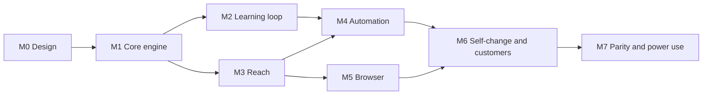

# Sama — Roadmap and Backlog

| | |
|---|---|
| Status | Draft v0.3, 2026-11-18 |
| Design | [`architecture.md`](architecture.md) |
| Feature map | [`feature-map.md`](feature-map.md) |

Each milestone ends with a usable assistant. Each backlog item is about one pull request.
An item is done when its acceptance criteria pass in CI or in a recorded demo.

## Overview

| Milestone | Goal | Demo at the end |
|---|---|---|
| M0 | Design | This pull request: architecture, feature map, roadmap. |
| M1 | Core engine | Chat from Telegram and a web page. The agent runs code in an E2B sandbox on the Claude Agent SDK, asks for approval, and keeps the session. |
| M2 | Learning loop | The agent remembers facts, writes and improves skills, and finds old sessions. |
| M3 | Reach | Slack, connections (Composio, remote MCP, PostgreSQL), the OpenAI Agents SDK runtime, GitHub pull requests, web app v1. |
| M4 | Automation | Cron jobs, triggers, workflows, `delegate_task`, task board. |
| M5 | Browser | Cloud browser tools and the Chrome extension with click, type, and cursor. |
| M6 | Self-change and customers | `change_propose`, `sama_pr`, curator, checkpoints, customer sign-up and billing. |
| M7 | Parity and power use | Parallel requests, coding agent connectors, custom tools and sub-agents, Hermes parity, settings console, end-to-end tests. |

M2 and M3 can run in parallel after M1.

---

## M1 — Core engine

Done: M1.1 to M1.19, M2.1 to M2.6, M3.5, M3.6, M3.11, M4.1 to M4.3, M4.13, M6.1, M6.2, M6.3, M6.4, M6.5, M6.9, M7.1, M7.9 (below the list of M1 notes).

- M1.2: migrations in `migrations/`, models in `src/sama/db/`, RLS tests in `tests/db/`. The
  Supabase project `sama` (`ap-south-1`) has the migrations. The tenancy check through the
  Supabase Data API is in `tests/db/test_supabase_live.py`. The sama HTTP API repeats it
  (M1.12, `tests/api/`).
- M1.3: contract in `src/sama/runtime/contract.py`, fake runtime in `src/sama/runtime/fake.py`.
- M1.4: Claude adapter in `src/sama/runtime/claude.py` (architecture Section 5.3). Live tests
  of the adapter run with `SAMA_LIVE_TESTS=1 uv run --all-groups pytest -m live`.
- M1.5: conformance suite in `tests/conformance/` (architecture Section 5.5). CI runs the
  `fake` and `claude-scripted` targets. `.github/workflows/nightly-live.yml` runs the
  `claude-live` target every night. It needs the repository secret `ANTHROPIC_API_KEY`.
- M1.6: providers in `src/sama/sandbox/`, run tokens in `src/sama/tenancy/run_token.py`, the
  runner in `src/sama/runtime/runner.py`, and `SandboxedRuntime` in `src/sama/orchestrator/`
  (architecture Section 16.2). The image is `sandbox/Dockerfile`. CI builds it and runs the
  Docker provider tests and the `claude-docker` conformance target. The nightly job builds the
  E2B template `sama-runner` and runs the E2B tests. It needs the repository secret
  `E2B_API_KEY`. Each deploy builds the template of its sandbox files,
  `sama-runner-<content hash>`, and sets `SAMA_SANDBOX_TEMPLATE` to it (architecture Section
  19.3).
- M1.7: the model proxy in `src/sama/modelproxy/` (architecture Section 16.6), with the price
  table `prices.toml` and the `model_calls` table (migration `0002`). The `claude-runner` and
  `claude-docker` conformance targets send their model calls through the proxy. A live Claude
  run in E2B needs a proxy URL that the sandbox can reach, so it waits for the deploy (M1.15).
- M1.8: the sama MCP tool server in `src/sama/tools/` (architecture Section 16.7), with the
  outbound URL policy (Section 16.4) and the `session_todos` table (migration `0003`).
  `web_search` uses the Brave Search API. The clarify broker is in memory (see Later). The
  Claude `TodoWrite` mapping to `todo` comes later.
- M1.9: the tool gate in `src/sama/gate/` (architecture Section 16.1), with the `approvals`
  and `tool_policies` tables and `runs.unattended` (migration `0004`). The runner asks the
  control plane for each call (`POST /gate`). The API and the channels call
  `GateService.decide_approval` (M1.12, M1.13). The worker calls `GateService.expire()`
  (M1.10). Job pre-approvals come with jobs (M3).
- M1.10: the run queue and the worker in `src/sama/orchestrator/queue.py` and
  `src/sama/orchestrator/worker.py` (architecture Section 4.3), with the queue columns of
  `runs` and `sessions.sandbox_id` (migration `0005`). `PostgresSandboxDirectory` stores the
  sandbox of each session. A crashed run starts again only if the worker did not start the
  runner (`runs.dispatched_at`). The deploy (M1.15) applies migrations `0004` to `0009` to
  Supabase.
- M1.11: prompt assembly in `src/sama/prompt/` (architecture Section 6.1). The first run of a
  session builds the `RunConfig` and stores it in `sessions.run_config` (migration `0006`).
  Later runs reuse it. Context files come from the table `context_files`, with the injection
  scan and the 20,000-character cap. Channel hints come with M1.13, repo `AGENTS.md` files
  with M1.16 (in the `repo_clone` result, not in the prefix), and memory and skills later.
- M1.12: the HTTP API and the minimal web page in `src/sama/api/` (architecture Section 11.4).
  It checks Supabase Auth tokens (legacy secret or JWKS), reads with RLS and checks access in
  code (`src/sama/tenancy/access.py`), streams run events as server-sent events, and decides
  approvals. The per-org running and message limits are in `orgs.limits` (Section 4.3,
  migration `0007`). The page at `/` has no build step. The Next.js app replaces it in M3.
  The deploy (M1.15) runs the API, the worker, and the tool server in one process, so that the
  API answers `clarify` questions.
- M1.13: the Telegram gateway in `src/sama/gateway/` (architecture Section 11.5), with the
  tables `channel_identities`, `channel_groups`, and `pairing_codes` (migration `0008`).
  `python -m sama.gateway` runs it. The web page makes pairing codes. Not in M1.13: `clarify`
  buttons in Telegram and followers that survive a restart. The group toolset and the approver
  rule of shared sessions came later (Section 11.3, migration `0017`).
  The deploy (M1.15) runs the gateway and sets the webhook.
- M1.14: observability in `src/sama/observability/` (architecture Section 18.1 to 18.3).
  Each service writes JSON logs with the run ids. `python -m sama.observability` (the
  monitor) sends one Langfuse trace per ended run over OTLP and posts error rate alerts to
  Slack. Migration `0009` adds `runs.trace_exported_at`. The traces come from the stored
  rows, so they work for both runtimes. Not in M1.14: tool arguments and results in traces
  (M1.17 adds them, redacted), metrics such as queue depth, and a dashboard. The deploy
  (M1.15) runs the monitor next to the worker and sets the Langfuse and Slack secrets.
- M1.15: the deploy (architecture Section 19.1 to 19.4, decision D18). `python -m
  sama.controlplane` runs the API, the tool server, the model proxy, the worker, the monitor,
  and the Telegram gateway in one process, so the Fly.io apps are `sama-staging` and
  `sama-production` with one machine each, not separate `api`, `gateway`, and `worker` apps.
  CI deploys `main` to staging. The `Deploy` workflow promotes a staging image to production by
  hand. The release command applies the migrations. `python -m sama.admin bootstrap` creates
  the first org. Not in M1.15: the Telegram bot and the Slack alerts in the deployed apps (no
  valid bot token or Slack webhook exists yet; the settings turn them on when they are set), a
  custom domain, and more than one machine.
- M1.16: code editing in the sandbox (architecture Section 15.1). The `github` toolset has
  `repo_clone`, which clones a public GitHub repo into the session sandbox and returns the
  repo `AGENTS.md` and `CLAUDE.md` as untrusted data. The agent edits and runs tests with
  native tools. The sandbox can reach GitHub, PyPI, and npm by default. Not in M1.16: private
  repos, push, `pr_create`, and the git proxy (M2). See the exfiltration risk in architecture
  Section 16.2.
- M1.17: vault and redaction in `src/sama/vault/` (architecture Section 16.3). Migration
  `0010` adds `vault_secrets` (envelope encryption with `SAMA_VAULT_KEY`, RLS for org
  admins). The model proxy and `web_search` use the org key first and the environment key
  second. `python -m sama.admin secret` sets, lists, and deletes entries. One redactor removes
  known secrets and secret patterns from logs, stored transcripts, run events, tool arguments,
  approval reasons, tool server output, and traces. Traces now have the tool arguments and
  output. A test plants a secret and checks every stored table, the trace, and the logs. Not in
  M1.17: an HTTP API for secrets (M3), key rotation, org Telegram bots and org keys for voice
  notes (both in M1.19), and redaction of native tool output in the sandbox.
- M1.18: live authority in `src/sama/tenancy/authority.py` (architecture Sections 5.1 and
  16.1). The tool gate and the model proxy read the run status, the access of the run user,
  and the run budget again at each call. The live budget is the lower of the run budget and
  the profile budget. A deny rule wins over an approval. Before a resume, the worker checks
  the approved call again (`GateService.reconfirm`), and a deny turns the resume into a
  reject. The allowed call becomes a ticket, and the tool server runs an `ask` sama tool only
  with an unused ticket for the same tool and arguments. No migration. Not in M1.18: live
  checks of connection access (connections come in M3.4) and a live check of the worker
  limits `max_turns` and `max_wall_time_s`, which stay frozen for the run.
- M1.19: integrations in `src/sama/integrations/` (architecture Section 11.6). Migration `0011`
  adds `integrations` and puts `integration_id` on the Telegram links and codes. An org admin
  connects the Telegram bot of the org on the web page with a BotFather token. The vault keeps
  the token, and the hub serves one webhook for each bot. The shared bot and its
  `SAMA_TELEGRAM_*` settings are gone, and migration `0011` deletes its links. Voice notes use
  the OpenAI key of the org. Not in M1.19: Slack (M3.1).
- M3.1 (moved ahead of M2): the Slack integration in `src/sama/gateway/slack.py` and
  `src/sama/integrations/slack_hub.py` (architecture Section 11.6). An org admin starts the
  setup on the web page, makes the Slack app from the manifest link, and pastes the bot token
  and the signing secret. Direct messages are private sessions; each thread of a linked channel
  is a shared session. Streaming edits, Block Kit approval buttons, and `/sama new|stop|pair|help`
  work. The Telegram and Slack gateways share `src/sama/gateway/sessions.py`. Not in M3.1:
  Slack OAuth distribution, voice notes, and `/model` in Slack. Approver rules per role stay in
  M3.2.
- M3.2: approvals over chat (architecture Section 9.4.2). Migration `0021` adds
  `review_proposals.origin` and the proposal kind `soul`. In an attended chat run, a workspace
  memory or workspace skill write of a user who is not a workspace admin, and an org skill write
  of a user who is not the org owner, is a chat proposal. The new tool `change_propose` (toolset
  `self`) proposes a new SOUL; a SOUL change is always a proposal. A workspace admin or the org
  owner decides a workspace proposal, and only the org owner decides an org proposal (the gate
  checks the role). Slack and Telegram cards have "Always allow for me", which writes a user
  policy rule; a proposal card does not have it. A click after the timeout counts as deny and
  shows "Expired". A decided proposal applies at once and in the worker sweep. Not in M3.2: the
  `change_propose` targets profile, toolsets, and policy (done in M6.1), and copies of a proposal
  card in the direct messages of the admins.
- M3.3: shared sessions in Slack (architecture Section 11.6). A channel thread is a shared
  session; its run has no user, so it gets no `user` memory, and `session_search` sees only the
  shared sessions of the workspace. Delivery checks the link of the channel (or the worker bot)
  before each send. `tests/gateway/test_slack_m3.py` shows that the `user` memory of a member is
  in the direct message and not in a channel thread.
- M3.10: worker bots in `src/sama/workerbots.py` (architecture Section 11.6). Migration `0021`
  adds `worker_bots` (RLS: a user who can see the workspace reads them) and
  `sessions.worker_bot_id`. A workspace admin, the org owner, or an org admin manages the bots
  with `/workspaces/{id}/worker-bots`. A mention in the channel of a bot starts a shared session
  with the profile of the bot. The gateway does not start a run after the bot spent its daily
  budget (UTC day), and the live authority limits a running run to the rest of the budget. Not
  in M3.10: a web page for the bots, and bots in Telegram.
- M4.4: event triggers in `src/sama/triggers/` (architecture Section 12.2). Migration `0028`
  adds `triggers` and `trigger_events` with RLS, `runs.toolsets`, and the vault names
  `trigger:<uuid>` and `composio_webhook_secret`. A webhook trigger has its own URL and secret
  and uses the Standard Webhooks signature. A Composio trigger is a Composio trigger instance on
  the account of a connection. Sama checks the signature, rejects a replay (one row per
  delivery id), and reads at most 1 MiB. Each event starts an unattended run in a new private
  session of the trigger owner, with the `safe` toolsets unless an admin gave more. Not in
  M4.4: delivery of the answer to a channel (M4.3), channel events, and a web page for
  triggers. M4.5 added workflows as targets.
- M3.5: remote MCP connections in `src/sama/connectors/mcp_remote.py`, `oauth.py`, and
  `mcp_driver.py` (architecture Section 10.3, "What M3.5 builds"). The catalog has `deepwiki`,
  `neon-mcp`, `stripe`, `sentry`, and `supabase-mcp` (`neon` and `supabase` are the M3.11
  database connectors). A workspace admin or the org owner adds a server by
  URL (`POST /workspaces/{id}/connections/mcp`). Auth: OAuth 2.1 with dynamic client
  registration, PKCE, and the `resource` parameter; a bearer token; a header; or none. The
  OAuth answer goes through the web app to `POST /connections/oauth/callback`. The tools are
  `mcp_<connection>_<tool>` in `tool_search`, read for each run, so a new server needs no new
  session. `tool_cache` keeps the tool list, a check is the health check, and a list older than
  6 hours is read again in the background. `PUT /connections/{id}/tools` sets the include and
  exclude filters. Every request uses the outbound client without redirects. Remote tool text is
  redacted and goes in untrusted content blocks. OAuth tokens are bound to the server URL and
  the client id, and one callback claims the row. A tool name that two connections give is
  hidden. Not in M3.5:
  `policy_overrides` in the gate, MCP resources and prompts, a refresh lock across processes,
  and an MCP `listChanged` notice (sama reads the list again at a check or after 6 hours).
- M4.5: durable workflows in `src/sama/workflows/` (architecture Section 12.3). Migration
  `0029` adds `workflows`, `workflow_versions`, `workflow_instances`, `workflow_steps`, and
  `workflow_receipts` with RLS (only the owner reads them), the toolset `workflows` in the
  default profile, and the trigger target `workflow` (`triggers.workflow_id`,
  `trigger_events.workflow_instance_id`, `workflow_instances.toolsets`). A YAML definition
  has the steps `tool`, `agent`, `approval`, `branch`, `parallel`, `wait`, and `workflow`, and
  each change makes a new version. The engine is a control-plane loop. Tool steps have stable
  operation ids and receipts. A write that is not idempotent and has an unknown result waits
  for a reconcile or the owner, and sama does not write it again. A version that writes
  externally needs the approval of its owner before it runs. The tools are `workflow_manage`
  and `workflow_run`, and the skill `session-to-workflow` turns a session into a workflow.
  Not in M4.5: a web page for workflows, and a reconcile check for connector tools (the owner
  resolves such a step).
- M3.4: connections in `src/sama/connectors/` and `connectors/catalog/` (architecture Section
  10.3). Migration `0022` adds `connections` with RLS, the vault names `composio_api_key` and
  `connection:<uuid>`, and the toolsets `connections` and `integrations` in the default
  profile. The catalog has five Composio connectors (Gmail, Google Calendar, GitHub, Slack,
  Linear) and one `http_api` connector (Notion, with a form). A Composio connection uses the
  Composio link flow and the entity `sama-<org>-u-<user>` or `sama-<org>-w-<workspace>`. Only a
  backend check sets `connected`. The Connections page of the web app starts, checks, fills,
  disables, and removes connections. `/connect <name>` (Telegram) and `/sama connect <name>`
  (Slack) give a link to that page and never take a secret. `connections_list`,
  `connection_request`, and `connection_test` are default allow tools. The connector tools are
  deferred tools in `integrations`: `tool_search` shows them only with a connected connection
  that the run can use, and a shared session uses only workspace connections. Read tools are
  `allow`, write tools `ask`. The `http_api` driver uses the outbound client (public addresses
  only, no redirects), and a check never overwrites a `disable` that happens during it. Not in
  M3.4: `mcp_remote`, `mcp_hosted`, `database`, and
  `plugin` connectors, tool discovery and `tool_cache`, `policy_overrides` in the gate,
  Composio triggers, custom connections, and per-tool filters.
- M3.6: the OpenAI Agents SDK adapter in `src/sama/runtime/openai_agents.py` (architecture
  Section 5.3). A run is a `SandboxAgent` with the `Shell` and `Compaction` capabilities and the
  local sandbox client, so the runner needs no E2B key. The model is the Responses API through
  the model proxy (`/openai/v1`, and `/openai/v1/responses/compact` for a manual compaction).
  The SDK `Session` is a sama store over `POST /session-items` of the tool server, so the runner
  needs no database credential. Migration `0025` adds `runtime_session_items` with RLS that
  follows the session. Each tool has `needs_approval`, which asks the sama gate. A pause saves
  the SDK `RunState`, and a resume calls `approve()` or `reject()`. The adapter archives the
  items that a compaction drops. The conformance targets `openai-scripted` and `openai-runner`
  pass the suite, and an OpenAI run has the same Langfuse trace shape. An admin can switch the
  runtime of a profile in the API and the web app; the switch applies to new sessions. The
  sandbox image and the default `uv sync` install the group `runtime-openai`. Not in M3.6: native
  sub-agents (agents as tools and handoffs), native skills, the filesystem capability, and a live
  test against the OpenAI API.
- M3.11: the database gateway in `src/sama/connectors/database.py`, `postgres.py`, and
  `sql.py` (architecture Section 10.4). No migration: a database connection is a row of
  `connections` (M3.4). The catalog has `postgres`, `supabase`, and `neon` (kind `database`).
  Each connection has the tools `db_<conn>_schema`, `sample`, `query`, `export`, and `execute`.
  The SQL check (`sqlglot`) allows one statement, rejects a write in `query`, and denies DDL
  unless the connection allows it. Reads run in a read-only transaction. Each statement has a
  30-second timeout. The model gets at most 1,000 rows and 48,000 bytes of rows, and the full
  result goes to a CSV file in the session sandbox. Hidden columns do not show in any tool.
  `execute` asks a person for each call, also with an `allow` rule, and the card shows the
  full SQL. `tool_search` shows it only when the connection has writes on. The gateway connects only to public addresses, with TLS. Not in
  M3.11: Parquet export, the estimated row count in the card, a static egress address (an
  operator allocates it, architecture Section 10.6), SSH tunnels (M4.13), other engines
  (M4.13), and a policy for each tool of a connection.
- M4.13: more database engines and SSH tunnels in `src/sama/connectors/` (architecture
  Sections 10.4 and 10.6). No migration. The catalog adds `mysql`, `mariadb`, `sqlserver`,
  `clickhouse`, `bigquery`, `snowflake`, and `mongodb`. The engines are in `engines/`, the
  forms in `dbforms.py` and `dbsettings.py`, the MongoDB read check in `mongoquery.py`, and the
  tunnels in `tunnel.py`. The drivers are in the default dependency group `databases`. The SQL
  check has a dialect for each engine, and `query` takes only `SELECT` on every engine.
  BigQuery sets `maximumBytesBilled` (default 1 GB). MongoDB is read only, with `find` and
  `aggregate`. An SSH tunnel listens on `127.0.0.1` for its own connection only, and checks the
  host key of the bastion. A form field can have 8,000 characters. The M3.11 tests run for each
  engine. MySQL, MariaDB, SQL Server, ClickHouse, MongoDB, and the SSH tunnel run against
  docker servers (`scripts/test-databases.sh`, CI job "Database engines (docker)", not a
  required check). BigQuery and Snowflake run against fakes of their REST APIs only. Not in
  M4.13: a static egress address (architecture Section 10.6), `mongodb+srv://` strings,
  MongoDB writes, connection pools for the new engines, the private network relay, Parquet
  export, and live tests against BigQuery and Snowflake.
- M6.2: `sama_pr` in `src/sama/tools/sama_pr.py` and the code owners parser in
  `src/sama/github/codeowners.py` (architecture Section 15.2). No migration. The tool is in
  the toolset `self` and works only on `SAMA_SELF_REPO` (default `nikhilllmno/Nikhil_claw`),
  which must be on the GitHub allowlist of the org. `start` clones the repo through the git
  proxy and makes the branch `sama/<name>`. The agent changes the code, runs the tests,
  commits, and pushes. `open` needs a summary and the tests that the agent ran. It reads the
  code owners file of the base branch, names the owners of each changed path in the pull
  request body, and asks them for a review. `.github/CODEOWNERS` names the owner of the
  protected paths. Sama has no merge tool. Not in M6.2: the real App, its install on the sama
  repo, the ruleset with "Require review from Code Owners" (a person makes them, architecture
  Section 19.5), and a live E2B test of the full flow.
- M3.7: the GitHub App, the git proxy, and pull requests in `src/sama/github/` and
  `src/sama/tools/github.py` (architecture Sections 15.1 and 19.5). Migration `0024` adds
  `github_installations`, `github_repos`, and `github_push_grants` with RLS. An org admin
  installs the App with a signed state, a confirm page, and an OAuth check that the person
  owns the GitHub account. The admin puts repos on the allowlist.
  `repo_clone` clones those repos through the proxy at `/git`, with the run token in a
  credential helper. The proxy refuses pushes to refs that are not `sama/*` branches,
  deletes, and force-pushes, and it refuses a run that ended. A push that changes a protected path needs a
  `repo_push_approval` grant. `pr_create` and `pr_comment` run on the control plane.
  `python -m sama.admin github-app` makes the manifest form and converts the code. Not in
  M3.7: the real App and the rulesets (a person makes them, architecture Section 19.5), a
  live E2B test of `git push` from the agent shell, webhooks, and issue tools.
- M2.1: memory in `src/sama/memory/` (architecture Section 8.1). Migration `0012` adds
  `memories` and `memory_revisions` with RLS. The `memory` tool has the targets `agent`, `user`,
  and `workspace` and the actions `add`, `patch`, `remove`, and `operations`. The caps are 2,200,
  1,375, and 2,200 characters. A write over the cap fails and returns the current entries and
  the characters to free. Secrets and prompt injection are refused. The snapshot is in the frozen
  prefix. The API can list, edit, and revert (`/workspaces/{id}/memory`). A non-admin cannot write
  `workspace` notes, and unattended and delegated runs cannot write. Not in M2.1: approval cards
  for workspace writes (M3.2) and the web editor. The review (M2.4) proposes `agent` and
  `workspace` writes as approvals.
- M2.6: context management in `src/sama/context/`, `src/sama/runtime/archive.py`, and
  `src/sama/tools/deferred.py` (architecture Section 6.3). Migration `0018` adds `session_compactions`
  and `context_pins` (both with RLS that follows the session), the columns `compact` and
  `compact_focus` on `runs`, and the toolset `tool_search` in the default profile. The Claude
  adapter has a `PreCompact` hook that sends the transcript to `POST /archive` of the tool
  server. The control plane stores it as an archive session, a child of the live session with
  the lineage `compaction` and the audience of the live session, and it stores each `Compacted`
  event as a `session_compactions` row. A failed archive does not stop the compaction.
  `/compact` (API, Telegram, and Slack direct messages) queues a compact run. It refuses a busy
  session. Context pins (at most 10 for each session) go in front of the next message and again
  after each compaction. `tool_search`, `tool_describe`, and `tool_call` give access to the
  deferred tools in the `DeferredCatalog`. The gate judges `tool_call` as a call of the tool that
  it names, so a deferred call has the same toolset check, rules, approval, and ticket as a
  direct call. Capability flags `manual_compaction` and `compaction_archive` keep the adapter
  parts apart for the OpenAI adapter. After review: the archive redacts tool inputs as JSON
  values and whole entries (the runner leaves whole entries out and never cuts), it has hard
  limits and a check of the live run authority before the body is read, a pin is reserved until
  a run saves a runtime state, enqueue and compact use one lock order, a compact run without a
  compaction boundary fails, and its tokens come from `model_usage`. After review 2: the entries
  of an archive body are counted without the spelling of the keys, an entry has one size limit in
  UTF-8 bytes, the parser omits one large block or tool name and keeps the other blocks, a failed
  run keeps the token and cost baseline (`RunFailed.runtime_state`), and the review trigger is
  documented as safe for the lock order. Not in M2.6: a live test of `/compact` and of the hook
  against the Claude API, a deferred tool in production (M3.4 is the first), a pin of a file, a pin
  by the agent, pins in a Slack channel, a search of archives, and a web UI.
- M2.5: session search in `src/sama/search/` (architecture Section 7.1). Migration `0014` makes
  the `vector` extension, adds a generated full-text column and `embedded_at` to `messages`, and
  adds `message_embeddings` (HNSW index, RLS). The tools `session_search` and `session_read` are
  in the `sessions` toolset, which is a default toolset and a default allow. The search joins a
  full-text list and a meaning list with reciprocal rank fusion. Each query keeps the audience
  rule: a private run sees shared sessions and its own private sessions in its workspaces, a
  shared run sees only shared sessions of its workspace. A session that the run may not see gives
  the error of a missing session. The embed worker of the control plane needs an OpenAI key.
  Without one, search uses full text only. The database must have pgvector (CI and the README use
  `pgvector/pgvector:pg17`). Migration `0014` rewrites `messages` under a lock (a stored generated
  column), so a large deployment needs a maintenance window. Embedding input and query are
  redacted before they leave the process, snippets are made from redacted text, and the search
  loads grants after the query embedding. Not in M2.5: embeddings in `model_calls`, a search of titles and
  summaries, and a web UI.
- M2.4: background review in `src/sama/review/` (architecture Section 9.4.1). Migration `0016`
  adds the run kind, the review counters and cursor on `sessions`, `background_review` and
  `review_model` on `agent_profiles`, and `review_proposals` (RLS). When a chat run completes and
  10 user turns or 10 tool iterations passed, sama queues one review run and resets the counters.
  One review runs and one waits for each session (database indexes). The review is fresh,
  unattended, and writes no message. It uses a cheap model, has only the `memory` and `skills`
  toolsets, and cannot start a review. A write to `user` scope applies. A write to `agent` or
  `workspace` scope, or a workspace or org skill, makes a proposal and an approval. A workspace
  admin approves `agent` and `workspace` scope, and an org owner approves `org` scope. They do
  not need access to the session, and list the proposals with
  `GET /workspaces/{id}/review-proposals`. The decision applies in the API and in the worker
  sweep, in one transaction with the write. Not in M2.4: summaries, a web card for the
  proposals (M3.2), and notes to the user after an applied write. The assumptions are in
  architecture Section 9.4.1.
- Run latency (not a milestone item): a follow-up chat reply on staging took about 11 seconds,
  and the model calls took about 4 seconds of it. Migration `0020` and `QueueWakeup` wake the
  worker on a new run (architecture Section 4.3). The skill sync checks a digest first and
  writes one archive only when the skills changed (Section 9.3). The warm runner
  (`sama.warm`), the runner lock, and the early `RunCompleted` cut the start and the stop of
  the runner (Section 16.2). After these changes, a warm follow-up run on staging took about
  9 seconds. The queue uses fewer database round trips (Section 4.3), one command checks the
  skills and starts the runner (Section 9.3), and the create or the resume sets the run timeout
  of the sandbox (Section 16.2). The run timing lines, with the step lines of the worker and
  the sandbox, are in Section 18.1. The target is 4 to 5 seconds.
- M4.1 to M4.3: scheduled jobs in `src/sama/scheduler/` (architecture Section 12.1).
  Migration `0026` adds `jobs`, `job_fires`, and `deliveries` (RLS: only the owner reads),
  `runs.model` (the model pin), and the toolset `cron` for profiles with the old default list.
  The scheduler is a loop in the control plane process, with no new Fly.io process. A
  transaction advisory lock is the leader lease, and a unique `(job_id, scheduled_for)` makes
  a fire run once. Interfaces: the `cronjob_manage` tool, `/cron` in a Telegram direct chat and
  `/sama cron` in a Slack DM, the API under `/orgs/{org_id}/jobs`, and the web page `/jobs`.
  A job version that pre-approves tools, runs a script, or sends to another place needs the
  approval of its owner, bound to the version and a digest of its fields. Deliveries go to
  `origin`, Slack, Telegram, email (SendGrid), or `none`, with receipts. An `unknown` result is
  not sent again. Three failed fires in a row pause the job with one alert. Not in M4.1 to
  M4.3: an approval card for a job in a chat, email from a provider other than SendGrid, and
  an admin view of the jobs of other users.
- M6.1: `change_propose` for the soul, the settings (name, runtime, model, sub-agents), the
  toolsets, and the profile policy rules (architecture Sections 9.4.2 and 11.4). Migration `0034`
  adds the proposal kinds `profile`, `toolsets`, and `policy`, `sessions.profile_snapshot`, and
  `profile_changes` (the history, with RLS like `agent_profiles`). The approval card in the web
  app, Telegram, and Slack shows a diff. An approval, an admin edit, and a revert each write a
  history row and the audit row `profile.updated`. A session keeps the toolsets and the profile
  rules of its snapshot, so a new toolset or a looser rule applies from the next session, and a
  removal or a stricter rule applies at once. The settings page of the web app has a History
  section. An org owner or admin reverts a change there; a revert gets `409` when the profile
  changed after the change. Not in M6.1: a history row for `python -m sama.admin subagents set`
  and for a reset of the review model, user policy rules, and a policy rule editor in the web
  app.

| # | Item | Acceptance criteria |
|---|---|---|
| M1.1 | Repo foundations | `pyproject.toml` (Python 3.12, uv), Ruff, mypy strict, pytest, pre-commit. GitHub Actions runs lint, types, and tests on every pull request. Dependency groups `runtime-claude` and `runtime-openai`. |
| M1.2 | Database and tenancy | Supabase project in `ap-south-1`. Alembic migrations for `orgs`, `workspaces`, `users`, `memberships`, `agent_profiles`, `sessions`, `messages`, `tool_calls`, `runs`, `run_events`, `session_bindings`, `audit_log`. RLS policies. A test shows that a user in org A cannot read rows of org B, through the API and through RLS. |
| M1.3 | Runtime contract and fake runtime | `src/sama/runtime/contract.py` as in §5.1. A `fake` runtime that replays scripted events. `RunConfig.fingerprint()` is stable for the same input. |
| M1.4 | Claude Agent SDK adapter | Maps `RunRequest` to `ClaudeAgentOptions` and SDK messages to `RunEvent`s. Streams text. Cancel ends the run within 10 seconds. Session resume works. |
| M1.5 | Conformance suite | Shared tests for every runtime: streaming, tool call through MCP, approval pause and resume, cancel, budget stop, compaction event. The fake and Claude adapters pass. A nightly job runs it against the live Claude API. |
| M1.6 | Sandbox provider and runner | `SandboxProvider` with E2B and Docker. A sama E2B template. One sandbox per session with pause and resume. The runner starts inside the sandbox and talks to the control plane only with a run token. Start time is measured and logged. |
| M1.7 | Model proxy | Anthropic and OpenAI pass-through with run tokens. Records tokens and cost per call. Rejects calls over budget. No provider key exists in the sandbox (a test checks the sandbox environment). |
| M1.8 | Sama MCP tool server | Streamable HTTP MCP server per run, scoped by the run token. Tools: `web_search`, `web_extract`, `clarify`, `todo`. Output cap of 50 KB with spill. `web_extract` uses the outbound URL policy (architecture §16.4): a test shows that private, metadata, and redirect-to-private URLs are blocked. |
| M1.9 | Tool gate and approvals | Order of §16.1: toolset, hardline, recorded decision, policy, context. `ask` pauses the run and creates an approval. Unattended runs turn `ask` into `deny`. Every decision is in the audit log. Tests cover each step. |
| M1.10 | Run orchestrator and queue | Postgres queue with `FOR UPDATE SKIP LOCKED` and leases. A crashed worker's run is marked failed or resumed. One active run per session; new messages queue. |
| M1.11 | Prompt assembly | SOUL per profile, context files (20,000-char cap, injection scan), frozen prefix per session. Prompt changes apply from the next session. |
| M1.12 | HTTP API and minimal web chat | `POST /sessions/{id}/messages`, server-sent events for run events, approve and deny endpoints. Supabase Auth login. A minimal web page for chat and approvals. |
| M1.13 | Telegram channel | One shared sama bot for the team (M1.19 replaces it with one bot per org). Webhook adapter, pairing codes from the web page, streaming edits, inline-keyboard approvals, voice notes transcribed, `/new`, `/stop`, `/model` (starts a child session). DMs are private sessions. Groups are shared sessions without `user` memory or personal connections (architecture §11.3). |
| M1.14 | Observability | Langfuse traces per run for the Claude adapter. Structured logs. Alerts to a Slack channel on error rate. |
| M1.15 | Deploy | Fly.io apps for `api`, `gateway`, `worker`. CI deploys `main` to staging. A manual promote step deploys to production. |
| M1.16 | Code editing in the sandbox | The agent clones a public repo, edits files, and runs tests in the sandbox with native tools. No push yet. |
| M1.17 | Vault and redaction | Encrypted secrets per org for provider, search, and bot keys. Redaction of known secrets in tool output, logs, and traces. A test checks that a planted secret does not appear in a transcript or trace. |
| M1.18 | Live authority checks | The control plane checks membership, policy, budgets, and revocations at every tool call, model call, and approval resume. A test revokes a tool during a session and the next call gets `deny`. |
| M1.19 | Integrations | An org admin connects the Telegram bot of the org from the web page, without the operator. The token is in the vault. Each bot has its own webhook and secret. Members see the integrations; only admins change them. A code pairs only with the bot of its org. |

## M2 — Learning loop

| # | Item | Acceptance criteria |
|---|---|---|
| M2.1 | Memory | `memory` tool with targets `agent`, `user`, `workspace` and actions add, patch, remove. Char caps. Over-limit writes fail and return current entries. `memory_revisions` and revert. Snapshot in the frozen prefix. Done. |
| M2.2 | Skills storage and tools | Skills as versioned rows plus files. Scopes builtin, org, workspace, user. `skills_list`, `skill_view`, `skill_manage`. Skill index (60-char descriptions) in the prefix. Skills sync into the sandbox. Lint and injection scan on every write. Done. |
| M2.3 | Builtin skills | At least 10 builtin skills of our own (for example research, writing, code review, spreadsheet, PDF, meeting notes). `/<skill-name>` works in Telegram and web. Done (Slack too). |
| M2.4 | Background review | When a run ends and 10 user turns or 10 tool iterations passed since the last review, sama queues one review and resets the counters. At most one review runs and one waits per session. The review run with a cheap model may write memory and skills. Recursion is off. User-scope writes apply. Workspace and org writes create an approval. Done. |
| M2.5 | Session search | Full-text plus pgvector index on messages. `session_search` and `session_read`. No LLM call in the tool. Done. |
| M2.6 | Context management | Compaction events from the Claude SDK, transcript archive, session lineage. `tool_search`, `tool_describe`, `tool_call` for deferred tools. Context pins. `/compact`. Done. |
| M2.7 | Native sub-agents | Claude `agents` option configured from the agent profile. Sub-agent events appear in traces. Done. |
| M2.8 | Media tools | `vision_analyze` for images from channels. Telegram photos and Slack files are stored (PNG, JPEG, GIF, WebP, 10 MB), and the tool asks a vision model about one image of the session. Done. |

## M3 — Reach

| # | Item | Acceptance criteria |
|---|---|---|
| M3.1 | Slack channel | A Slack integration per org (architecture §11.6): an org admin installs a Slack app from a manifest and pastes its tokens. DMs and mentions, thread = session, streaming edits, Block Kit approvals, slash commands. Each request is checked with the signing secret of the app. A Slack workspace belongs to one org. Done (ahead of M2). |
| M3.2 | Approvals over chat | Approval cards in Slack (Telegram cards come in M1.13). Approver rules per workspace role: workspace `admin` or org `owner` approve workspace memory, skills, and SOUL; org scope needs the org `owner`. Timeout counts as `deny`. "Always allow for me" writes a policy rule. Done. |
| M3.3 | Shared sessions in Slack | Slack channels and threads are shared sessions (architecture §11.3). `session_search` and delivery follow the audience rule. A test shows that one user's `user` memory does not reach a shared thread. Done. |
| M3.4 | Connection framework and Composio | `connections` table with RLS, states, and the vault reference (architecture §10.3). Catalog of YAML manifests in `connectors/catalog/`. Connections page in the web app and `/connect <name>` in channels; secrets go only into web forms, never into chat. `connections_list`, `connection_request`, `connection_test`. Only the backend can set `connected`. Composio entity per user and per workspace. Connector tools behind `tool_search`. Read tools `allow`, write tools `ask`. A test shows that a `personal` connection is not usable in a shared session. Done. |
| M3.5 | Remote MCP connections | Add a remote MCP server from the catalog or by URL, with OAuth 2.1 (dynamic client registration and PKCE), a bearer token, or a header. Tools proxied by the sama MCP server as `mcp_<connection>_<tool>`. Include and exclude filters, a tool schema cache, and a health check. New tools are usable without a new session. All calls use the outbound URL policy (architecture §16.4). Done. |
| M3.6 | OpenAI Agents SDK adapter | Maps the contract to `SandboxAgent` with the local sandbox client inside the E2B sandbox (no E2B key in the runner), a sama `Session` over the control-plane API (no database credentials in the runner), `needs_approval`, `RunState` approve and reject, sessions, and compaction. Passes the conformance suite. Langfuse traces. A profile can switch runtime. Done. |
| M3.7 | GitHub App, git proxy, and pull requests | Sama GitHub App. Sama git proxy holds the tokens; the sandbox has none. `repo_clone`, `pr_create`, `pr_comment`. Allowlist of repos per org. The proxy rejects pushes to non-`sama/*` refs, force-pushes, and ref deletes, and needs an approval for protected paths. Setup docs require a default-branch ruleset with no bypass for the App. Tests cover each rejected push. Done. A person still creates the real App and the rulesets (architecture §19.5). |
| M3.8 | Web app v1 core | Next.js app in `web/`, hosted on Vercel: sign-in (password and email link), session list, chat with live streaming, approvals and questions, stop, and agent settings (soul, model, toolsets, sub-agents) for org admins. CORS from `SAMA_WEB_ORIGINS`. CI runs lint, typecheck, tests, and build. Done. |
| M3.9 | Busy controls and handoff | Queue, `/stop`, `/steer` while a run is busy. `/handoff` between channels. The controls work in Telegram, Slack, and the web app (architecture §4.3, §11.1). Done. |
| M3.10 | Worker bots | An agent profile bound to a Slack channel with a daily budget. Done. |
| M3.11 | PostgreSQL connections | Database gateway with PostgreSQL (also Supabase and Neon) (architecture §10.4). Tools `db_<conn>_schema`, `sample`, `query`, `export`, and `execute`. Tests show that: `query` runs in a read-only transaction; a write or a second statement in `query` is rejected; DDL is denied by default; a query stops after 30 seconds; the model gets at most 1,000 rows and 50 KB, and the rest spills to a file; hidden columns do not appear in any result; `execute` needs an approval that shows the SQL. Static egress IP addresses are documented for allowlists. Done. The apps have no static egress address yet; architecture §10.6 shows how an operator allocates one. |
| M3.12 | Web app v1 rest | Memory editor, skill editor, connections, sessions with search and export (Markdown and JSON), run traces, settings. Done. |

## M4 — Automation

| # | Item | Acceptance criteria |
|---|---|---|
| M4.1 | Scheduler | `scheduler` service with a 60-second tick and leader lease. A fire runs once, also when two schedulers run. Done. |
| M4.2 | Cron jobs | `jobs` table, `cronjob_manage`, `/cron`, and a web page. Natural language to cron with validation and the next 3 fire times. Model pin, `mode: script`, `preapproved_tools`, `attach_to_session`. A job run cannot create jobs. Adding or widening a pre-approval needs a human approval bound to the job version, connection, and argument limits. A test shows that a job created by the agent cannot run a write tool without that approval. Done. |
| M4.3 | Delivery | Targets `origin`, Slack, Telegram, email, `none`, plus `failure_deliver`. Receipts. An unknown result is not retried. Repeated failures pause the job and alert once. Done. |
| M4.4 | Event triggers | Signed webhooks and Composio triggers start runs or workflows with the `safe` toolset by default. Done. |
| M4.5 | Workflows | YAML definition, versioned. Steps `tool`, `agent`, `approval`, `branch`, `parallel`, `wait`, `workflow`. Durable steps on the queue with resume after a crash. Stable operation ids, idempotency keys where the provider supports them, and receipts. A test crashes a worker after a non-idempotent write, and the step waits for reconcile or a human instead of a second write. `workflow_manage`, `workflow_run`. "Turn this session into a workflow" skill. New workflows that write externally need approval before the first run. Done. |
| M4.6 | `delegate_task` | Child session and run in its own sandbox. Single and batch. Depth 1, 10 children, blocked tools, cost budget per child. `delegate_status`, cancel, steer. Done. |
| M4.7 | Task board | `tasks` table, dispatcher, `task_*` tools, web board view. Done. |
| M4.8 | Code execution | `execute_code` with a stub that calls sama tools over MCP. Only stdout returns to the model. Done (architecture §10.2.1). |
| M4.9 | More media and references | `image_generate`, `text_to_speech` (Telegram voice note), `@file`, `@url`, `@session`. Done (Slack gets the files too; architecture §6.4, §11.8). |
| M4.10 | Skills import and `/learn` | Import a skill from a Git URL with scan and approval. `/learn` creates a draft skill from sources. Done (public GitHub repositories; architecture §9.6). |
| M4.11 | Hosted stdio MCP connections | Connector host per connection in its own E2B sandbox (architecture §10.5). Pinned package from the manifest, egress allowlist, start on first call, pause when idle, restart on memory limit. The agent cannot run commands in the host. A custom command needs the org `owner`. A test shows that the agent sandbox cannot read the host's secrets. Done. |
| M4.12 | HTTP API connections | Import an OpenAPI document or a list of endpoints. One tool per operation as `api_<connection>_<tool>`. Auth by API key, bearer, basic, or OAuth 2 client credentials. `GET` and `HEAD` tools `allow`, other methods `ask`. Done. |
| M4.13 | More databases and SSH tunnels | MySQL and MariaDB, Microsoft SQL Server, BigQuery (with maximum bytes billed), Snowflake, ClickHouse, and MongoDB (read with `find` and `aggregate`) in the database gateway, with the M3.11 tests for each engine. SSH tunnel route per connection (architecture §10.6). A test shows that a tunnel route cannot be used by another connection or by `web_extract`. Done. BigQuery and Snowflake are tested with fakes of their APIs. The apps have no static egress address yet (M3.11). |

## M5 — Browser

| # | Item | Acceptance criteria |
|---|---|---|
| M5.1 | Cloud browser | Browserbase sessions with a persistent context per user. `browser_open`, `browser_snapshot` (refs), `browser_act`, `browser_screenshot`, `browser_extract`, `browser_tabs`. Works from both runtimes. Done (architecture §14.1). The Browserbase key is a setting of the process. The live tests run by hand, not in the nightly job. |
| M5.2 | Vision mode | Screenshot and coordinate actions for pages without a usable accessibility tree. A canvas-app test passes. Done (architecture §14.1, "Vision mode (M5.2)"). `browser_act` takes a point (`x`, `y`) for `click`, `type`, `hover`, `drag`, and `scroll` on the `cloud` target. The canvas-app test runs in CI from both runtimes with a local Chromium. The live tests on Browserbase, also with a real model of each runtime, run by hand. `my_chrome` gets vision mode later (architecture §14.2.2). |
| M5.3 | Browser vault and URL policy | Saved logins fill without entering the transcript. URL policy per org blocks private IPs and listed hosts. Done (architecture §14.1 and §16.4): `browser_vault` fills a saved login of the vault on its own site only, and the results hide the values. The allow list and the block list of each org apply to every navigation, redirect, and WebSocket of the browser. An org admin and each member manage them on the settings page. The `my_chrome` target does not fill logins yet. |
| M5.4 | Chrome extension core | MV3 extension in `extension/`. Sign-in, WebSocket to the gateway, side panel chat bound to the tab, "Ask about this page". Done (architecture §14.2.1; the `my_chrome` design for M5.5 is in §14.2.2). |
| M5.5 | Chrome extension actions | `my_chrome` target: `chrome.debugger` clicks and typing, visible cursor overlay, per-site consent, user click for sensitive actions, stop button, pause on user takeover, blocked site list. Done (architecture §14.2.2). The Chrome Web Store item needs a new review for the `debugger` permission. |
| M5.6 | Browser sub-agent (optional) | `browser_task(goal)` on the cloud target with the `browser-use` library. Done (architecture §14.1, "Browser sub-agent (M5.6)"). `browser-use` cannot run safely in the current design, so sama runs its own sub-agent loop with the typed browser tools: model calls through the model proxy with the run token, the URL policy and a gate check for each step, `ask` by default, step, cost, and time budgets, and progress as `subagent_event` run events. The live test runs by hand. |

## M6 — Self-change and customers

| # | Item | Acceptance criteria |
|---|---|---|
| M6.1 | `change_propose` | The agent proposes changes to SOUL, profile, toolsets, and policy. An approval card shows the diff. Approved changes apply from the next session. History and revert in the web app. The SOUL target is done in M3.2 (no diff on the card). Done. |
| M6.2 | `sama_pr` | The agent clones the sama repo, changes code, runs tests, and opens a pull request with a summary. Changes to protected paths request the owner's review (CODEOWNERS). The agent cannot merge. Done. A person still creates the real App, installs it on the sama repo, and adds the ruleset with "Require review from Code Owners" (architecture §19.5). |
| M6.3 | Curator | Weekly job per workspace. Usage counts, active to stale to archived, pins, report to the owner. Never deletes. Done (memory is report-only; merging near-duplicates is later, Section 9.7). |
| M6.4 | Checkpoints | Shadow git snapshots before file changes in the sandbox. `/undo` and `/rollback` in channels. Done (Telegram, Slack, and web; architecture §15.3). |
| M6.5 | Customer sign-up | Self-serve sign-up, org creation, invites, roles. Done (architecture §17.2): Supabase Auth sign-up, a rate limit and a confirmed-email check on org creation, invite links, and a plan seam per org. |
| M6.6 | Billing and quotas | Stripe plans and usage billing from proxy cost. Quotas per plan. Done (architecture §17.5): Checkout, the customer portal, a signed webhook, a usage meter fed from `model_calls`, model quotas per plan in the queue (`402`) and the proxy, and the `/billing` page. Billing is off without a valid Stripe key. A person still runs the setup script with a real key, sets the staging and live secrets, and tests a real checkout. |
| M6.7 | Org keys, bots, and regions | An org can bring its own Anthropic and OpenAI keys (its own Telegram bot came in M1.19). Region per org. Done: the keys go in the vault, and the model proxy and the media tools use the org key first and record `key_source`. An org admin sets the keys on the settings page. Each org has a region. A deployment serves only its home region (`SAMA_REGION`), and the API sends members of an org in another region to its deployment (`421`). A second region is not deployed: the setting, the routing seam, and the operator steps are in architecture §17.3. |
| M6.8 | Data controls | Export and delete per user and per org. Retention per org, with a seam for the plans of M6.6 (architecture §17.4). Done. |
| M6.9 | Customer-ready web app | Onboarding, billing pages, admin views, and docs. Done (architecture §17.6): a setup guide after sign-up (plan, chat app, agent, first message), the Billing page of M6.6 in the navigation, the admin area (usage, audit log, agent changes, curator reports, org keys and region, data controls), the Slack connect form, new agent profiles, help pages, and one navigation for all pages. |

---

## M7 — Parity and power use

Goal: sama has every Hermes skill and tool that fits a cloud service, works like Claude Code
and Codex for coding, handles a new request while a run is busy, and lets each user add their
own sub-agents, skills, tools, and MCP servers. Admins edit all settings in one console.

| # | Item | Acceptance criteria |
|---|---|---|
| M7.1 | Parallel requests | Busy modes per profile, as in Claude Code: `steer` (default), `parallel`, and `queue`. In `steer`, a message while a run is busy joins the running run at its next step (the model reads it at the next tool call), so one run handles both requests. If the run ends first, the message starts the next run at once. The web chat shows the message as queued into the current run, then as delivered. `/bg TASK`, a "Run in parallel" button, or the mode `parallel` start a second run at the same time in the same session and the same sandbox, with the transcript up to that point, up to a limit of open runs per session (default 3). Both replies arrive in the same thread, in order of completion. `/stop` stops all runs, `/stop NUMBER` one run. Works on both runtimes and in web, Telegram, and Slack. Done (architecture §4.3): migration `0039`, side runs with a new runtime session and the transcript, a catch-up of the side answers for the next main run, `/undo` refuses when parallel runs mixed their file changes (§15.3). |
| M7.2 | Coding agent connectors | `claude_code` and `codex` connectors run the Claude Code CLI or the Codex CLI headless in an E2B sandbox, with the model proxy and the git proxy (no keys in the sandbox). A tool `coding_agent_run(agent, repo, prompt)` and the commands `/claude` and `/codex` send a request to them. Progress streams to the channel. The result has a summary, the diff, and an optional pull request. Approval rules and budgets apply. Also the runtimes `claude_code` and `codex`: a profile or a session (direct mode: `/claude` or `/codex` with no task, until `/sama`) sends each message straight to the CLI, and builtin skills tell the agent when and how to use them. Done: the CLIs (Claude Code 2.1.330, Codex 0.171.0, Node.js 22) are in the sandbox image. `CodingAgentRuntime` drives them on the control plane, and `coding_agent_run` (toolset `coding_agents`, default `ask`) runs them from a run. Telegram, Slack, WhatsApp, email, and the web composer have `/claude`, `/codex`, and `/sama`. The progress of the tool goes to the channel as `SubagentEvent` lines. The model proxy needed no change (live probe). Migration `0041`. Architecture §15.4. |
| M7.3 | Custom tools | A user, workspace, or org adds a tool from the web app or the API: an HTTP request tool or a script tool (Python or Node in the sandbox) with a JSON schema, a description, a policy (`allow`, `ask`, `deny`), and a test button. Versioned, with history. Both runtimes see the tools through `tool_search`. Done: HTTP tools (URL, header, and body templates, vault auth bound to the origin, response mapping) and Python or Node script tools in the session sandbox, scopes like the sub-agent library (any member for themselves, only an admin for workspace and org tools), versions with revert, a test button, and the Tools page and console section (architecture §10.8). |
| M7.4 | Sub-agent library | Personal, workspace, and org sub-agents with a name, a prompt, toolsets, a model, and limits. A profile uses agents from the library. `delegate_task(agent=...)` starts a library agent. Works on both runtimes (OpenAI agents as tools). Editable in the web app. Done (architecture §13.3): the OpenAI adapter has native sub-agents as agents as tools, a member's personal agents apply to the member's private sessions with no approval, and the `/subagents` page has versions, revert, and a test run. |
| M7.5 | Hermes tool parity | `x_search`, `video_analyze`, mixture of agents (`moa`), a cheaper model for children, per-skill settings, and a Mem0 memory provider. The feature map has no Hermes tool left as Defer unless it is desktop-only. Done (architecture §8.2, §9.8, §10.2.2, and §13.2): `x_search` (X API v2 recent search), `video_analyze` (Gemini, YouTube links, `https` files, and sandbox files up to 14 MB), `moa` (three providers and an aggregator, with a cost cap), `delegation_model` per profile, skill settings per workspace with a form in the skill editor, and the `mem0` memory provider (`memory_recall`, a run-end sync, and delete through the purge worker). The X API account of staging has no credits, so a person must add credits before `x_search` returns posts. `video_generate` stays deferred (architecture §10.2.2, A4). |
| M7.6 | Sama as a server | Sama as an MCP server for other agents, and an OpenAI-compatible chat endpoint, with org API keys and the same policy and budgets. Done (architecture §10.7): org API keys (made, listed, and revoked by an org admin in the web app and the API; only the SHA-256 hash is kept), the MCP server at `/mcp` (streamable HTTP; `send_message`, `run_get`, `session_read`, `session_search`, `skills_list`, and the workflow tools), and `POST /v1/chat/completions` (also as a stream) and `GET /v1/models`, mapped to an agent profile and a session. Runs of a key use the queue, the gate, the quotas, and the profile budget. A key with `approvals = deny` makes unattended runs (`ask` becomes `deny`); a key with `pending` waits for a person in the web app. |
| M7.7 | Builtin skill library | Sama-written builtin skills that cover the categories of the Hermes bundled skills (no copied text). Each skill passes the lint and the injection scan and has a test. Done. 68 builtin skills, each with a category tag, `requires_toolsets`, and its own test. |
| M7.8 | More channels | Email (inbound and outbound) and WhatsApp channels with the same adapter shape as Telegram and Slack: pairing, sessions, approvals, and media. Discord if a bot token exists. Done: WhatsApp through Meta, Twilio, or Gupshup (the org picks one), and email through SendGrid (architecture §11.9). Discord is not in it: no bot token exists. |
| M7.9 | Coding mode | A session can attach a repo. Plan mode: the agent proposes a plan, a person approves it, then the agent works. The web app shows the file changes of the sandbox as diffs, the test runs, and the checkpoints, and opens a pull request. Done (architecture §15.5): attach a repo (git proxy or public URL) that clones before the next run, plan mode in the gate with `plan_propose` and `/plan` (approve, edit, reject) in the web, Telegram, and Slack, the Code page (diffs from the checkpoints, commands and test runs, checkpoints with undo, pull requests), sub-agent progress in the chat, and the same clone, checkpoint, and plan mode for the `claude_code` and `codex` runtimes of M7.2, also in their direct mode. |
| M7.10 | Settings console | One editable console in the web app with these sections: Setup, Slack, Roles, Tools, Webhooks, Triggers, Sessions, Schedules, Workflows, MCP servers, Sub-agents, Skills, and Harness (runtime, model, reasoning, busy mode, budgets). Each section reads and writes the API, with audit entries. Done (architecture §17.7): `/console/<section>` with a left navigation; role permissions per org (10 keys, checked in the API and in the agent tools); a policy per tool for each agent and for the org; the budget and the reasoning effort of an agent; a trigger delivery log and a signed test send; rename, archive, and restore of sessions; a test of a chat app; and the enable of a connection. The Slack section also has the WhatsApp and email apps of M7.8. The busy mode (M7.1), custom tools (M7.3), and the sub-agent library (M7.4) show a "Not available yet" card until they land. |
| M7.11 | End-to-end tests | A Playwright suite runs the main flows of M1 to M7 against staging every night and on demand. A full manual pass on staging has a test report. Done (architecture §19.6): `e2e/` and the workflow `End-to-end (staging)`. Each run makes and removes its own test users and org, and a sweep removes what an old run left. The suite covers the flows of M1 to M6 and the M7 items on main; each later M7 item adds its flows. |
| M8.2 | Web app like Claude Code and Codex | The web chat feels like Claude Code and Codex: compact tool-call rows that stream in order with the text, a working line with the phase and the time, Esc to stop, approval cards with keys and a session scope, the plan decision in the chat, a composer with slash commands, `@`-mentions, images, a model and harness picker, and history; the coding flow (repo, branch, diffs, tests, pull request) in one view next to the chat; a sessions sidebar with search, status dots, rename, and archive; the first visible activity in under 3 s. Part A (chat and tool calls, `GET /sessions/{id}/activity`) is done (architecture §17.8). |

---

## Later (not planned)

- Microsoft Teams and other channels after M7.8.
- Fly Machines as a second sandbox provider, only if a product needs it (architecture Q1).
- Desktop control beyond the browser.
- ACP adapter for editors.
- A private network relay that customers run inside their network (architecture §10.6).
- Clarify questions in Postgres, so the API, the tool server, and the workers can run in
  separate processes (architecture §16.7).
- A durable queue for model proxy records that wait for a write (architecture §16.6).
