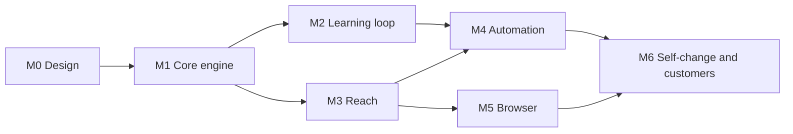

# Nikhil_claw — Roadmap and Backlog

| | |
|---|---|
| Status | Draft v0.1, 2026-11-18 |
| Design | [`architecture.md`](architecture.md) |
| Feature map | [`feature-map.md`](feature-map.md) |

Each milestone ends with a usable assistant. Each backlog item is about one pull request.
An item is done when its acceptance criteria pass in CI or in a recorded demo.

## Overview

| Milestone | Goal | Demo at the end |
|---|---|---|
| M0 | Design | This pull request: architecture, feature map, roadmap. |
| M1 | Core engine | Chat from Telegram and a web page. The agent runs code in an E2B sandbox on the Claude Agent SDK, asks for approval, and keeps the session. |
| M2 | Learning loop | The agent remembers facts, writes and improves skills, and finds old sessions. |
| M3 | Reach | Slack, Composio and MCP connections, the OpenAI Agents SDK runtime, GitHub pull requests, web app v1. |
| M4 | Automation | Cron jobs, triggers, workflows, `delegate_task`, task board. |
| M5 | Browser | Cloud browser tools and the Chrome extension with click, type, and cursor. |
| M6 | Self-change and customers | `change_propose`, `claw_pr`, curator, checkpoints, customer sign-up and billing. |

M2 and M3 can run in parallel after M1.

---

## M1 — Core engine

| # | Item | Acceptance criteria |
|---|---|---|
| M1.1 | Repo foundations | `pyproject.toml` (Python 3.12, uv), Ruff, mypy strict, pytest, pre-commit. GitHub Actions runs lint, types, and tests on every pull request. Dependency groups `runtime-claude` and `runtime-openai`. |
| M1.2 | Database and tenancy | Supabase project in `ap-south-1`. Alembic migrations for `orgs`, `workspaces`, `users`, `memberships`, `agent_profiles`, `sessions`, `messages`, `tool_calls`, `runs`, `run_events`, `session_bindings`, `audit_log`. RLS policies. A test shows that a user in org A cannot read rows of org B, through the API and through RLS. |
| M1.3 | Runtime contract and fake runtime | `src/claw/runtime/contract.py` as in §5.1. A `fake` runtime that replays scripted events. `RunConfig.fingerprint()` is stable for the same input. |
| M1.4 | Claude Agent SDK adapter | Maps `RunRequest` to `ClaudeAgentOptions` and SDK messages to `RunEvent`s. Streams text. Cancel ends the run within 10 seconds. Session resume works. |
| M1.5 | Conformance suite | Shared tests for every runtime: streaming, tool call through MCP, approval pause and resume, cancel, budget stop, compaction event. The fake and Claude adapters pass. A nightly job runs it against the live Claude API. |
| M1.6 | Sandbox provider and runner | `SandboxProvider` with E2B and Docker. A claw E2B template. One sandbox per session with pause and resume. The runner starts inside the sandbox and talks to the control plane only with a run token. Start time is measured and logged. |
| M1.7 | Model proxy | Anthropic and OpenAI pass-through with run tokens. Records tokens and cost per call. Rejects calls over budget. No provider key exists in the sandbox (a test checks the sandbox environment). |
| M1.8 | Claw MCP tool server | Streamable HTTP MCP server per run, scoped by the run token. Tools: `web_search`, `web_extract`, `clarify`, `todo`. Output cap of 50 KB with spill. `web_extract` uses the outbound URL policy (architecture §16.4): a test shows that private, metadata, and redirect-to-private URLs are blocked. |
| M1.9 | Tool gate and approvals | Order of §16.1: toolset, hardline, recorded decision, policy, context. `ask` pauses the run and creates an approval. Unattended runs turn `ask` into `deny`. Every decision is in the audit log. Tests cover each step. |
| M1.10 | Run orchestrator and queue | Postgres queue with `FOR UPDATE SKIP LOCKED` and leases. A crashed worker's run is marked failed or resumed. One active run per session; new messages queue. |
| M1.11 | Prompt assembly | SOUL per profile, context files (20,000-char cap, injection scan), frozen prefix per session. Prompt changes apply from the next session. |
| M1.12 | HTTP API and minimal web chat | `POST /sessions/{id}/messages`, server-sent events for run events, approve and deny endpoints. Supabase Auth login. A minimal web page for chat and approvals. |
| M1.13 | Telegram channel | Webhook adapter, pairing codes from the web page, streaming edits, inline-keyboard approvals, voice notes transcribed, `/new`, `/stop`, `/model` (starts a child session). DMs are private sessions. Groups are shared sessions without `user` memory or personal connections (architecture §11.3). |
| M1.14 | Observability | Langfuse traces per run for the Claude adapter. Structured logs. Alerts to a Slack channel on error rate. |
| M1.15 | Deploy | Fly.io apps for `api`, `gateway`, `worker`. CI deploys `main` to staging. A manual promote step deploys to production. |
| M1.16 | Code editing in the sandbox | The agent clones a public repo, edits files, and runs tests in the sandbox with native tools. No push yet. |
| M1.17 | Vault and redaction | Encrypted secrets per org for provider, search, and bot keys. Redaction of known secrets in tool output, logs, and traces. A test checks that a planted secret does not appear in a transcript or trace. |
| M1.18 | Live authority checks | The control plane checks membership, policy, budgets, and revocations at every tool call, model call, and approval resume. A test revokes a tool during a session and the next call gets `deny`. |

## M2 — Learning loop

| # | Item | Acceptance criteria |
|---|---|---|
| M2.1 | Memory | `memory` tool with targets `agent`, `user`, `workspace` and actions add, patch, remove. Char caps. Over-limit writes fail and return current entries. `memory_revisions` and revert. Snapshot in the frozen prefix. |
| M2.2 | Skills storage and tools | Skills as versioned rows plus files. Scopes builtin, org, workspace, user. `skills_list`, `skill_view`, `skill_manage`. Skill index (60-char descriptions) in the prefix. Skills sync into the sandbox. Lint and injection scan on every write. |
| M2.3 | Builtin skills | At least 10 builtin skills of our own (for example research, writing, code review, spreadsheet, PDF, meeting notes). `/<skill-name>` works in Telegram and web. |
| M2.4 | Background review | When a run ends and 10 user turns or 10 tool iterations passed since the last review, claw queues one review and resets the counters. At most one review runs and one waits per session. The review run with a cheap model may write memory and skills. Recursion is off. User-scope writes apply. Workspace and org writes create an approval. |
| M2.5 | Session search | Full-text plus pgvector index on messages. `session_search` and `session_read`. No LLM call in the tool. |
| M2.6 | Context management | Compaction events from the Claude SDK, transcript archive, session lineage. `tool_search`, `tool_describe`, `tool_call` for deferred tools. Context pins. `/compact`. |
| M2.7 | Native sub-agents | Claude `agents` option configured from the agent profile. Sub-agent events appear in traces. |
| M2.8 | Media tools | `vision_analyze` for images from channels. |

## M3 — Reach

| # | Item | Acceptance criteria |
|---|---|---|
| M3.1 | Slack channel | Slack app with OAuth install, DMs and mentions, thread = session, streaming edits, Block Kit approvals, slash commands. |
| M3.2 | Approvals over chat | Approval cards in Slack (Telegram cards come in M1.13). Approver rules per workspace role. Timeout counts as `deny`. "Always allow for me" writes a policy rule. |
| M3.3 | Shared sessions in Slack | Slack channels and threads are shared sessions (architecture §11.3). `session_search` and delivery follow the audience rule. A test shows that one user's `user` memory does not reach a shared thread. |
| M3.4 | Composio connections | Composio entity per user and per workspace. `connections_list`, `connection_request`. Composio tools behind `tool_search`. Read actions `allow`, write actions `ask`. |
| M3.5 | Remote MCP servers | Add a remote MCP server with OAuth per workspace. Tools proxied by the claw MCP server as `mcp_<server>_<tool>`. |
| M3.6 | OpenAI Agents SDK adapter | Maps the contract to `SandboxAgent` with the local sandbox client inside the E2B sandbox (no E2B key in the runner), a claw `Session` over the control-plane API (no database credentials in the runner), `needs_approval`, `RunState` approve and reject, sessions, and compaction. Passes the conformance suite. Langfuse traces. A profile can switch runtime. |
| M3.7 | GitHub App, git proxy, and pull requests | Claw GitHub App. Claw git proxy holds the tokens; the sandbox has none. `repo_clone`, `pr_create`, `pr_comment`. Allowlist of repos per org. The proxy rejects pushes to non-`claw/*` refs, force-pushes, and ref deletes, and needs an approval for protected paths. Setup docs require a default-branch ruleset with no bypass for the App. Tests cover each rejected push. |
| M3.8 | Web app v1 | Next.js app: chat, approvals, memory editor, skill editor, connections, sessions with search and export (Markdown and JSON), run traces, settings. |
| M3.9 | Busy controls and handoff | Queue, `/stop`, `/steer` while a run is busy. `/handoff` between channels. |
| M3.10 | Worker bots | An agent profile bound to a Slack channel with a daily budget. |

## M4 — Automation

| # | Item | Acceptance criteria |
|---|---|---|
| M4.1 | Scheduler | `scheduler` service with a 60-second tick and leader lease. A fire runs once, also when two schedulers run. |
| M4.2 | Cron jobs | `jobs` table, `cronjob_manage`, `/cron`, and a web page. Natural language to cron with validation and the next 3 fire times. Model pin, `mode: script`, `preapproved_tools`, `attach_to_session`. A job run cannot create jobs. Adding or widening a pre-approval needs a human approval bound to the job version, connection, and argument limits. A test shows that a job created by the agent cannot run a write tool without that approval. |
| M4.3 | Delivery | Targets `origin`, Slack, Telegram, email, `none`, plus `failure_deliver`. Receipts. An unknown result is not retried. Repeated failures pause the job and alert once. |
| M4.4 | Event triggers | Signed webhooks and Composio triggers start runs or workflows with the `safe` toolset by default. |
| M4.5 | Workflows | YAML definition, versioned. Steps `tool`, `agent`, `approval`, `branch`, `parallel`, `wait`, `workflow`. Durable steps on the queue with resume after a crash. Stable operation ids, idempotency keys where the provider supports them, and receipts. A test crashes a worker after a non-idempotent write, and the step waits for reconcile or a human instead of a second write. `workflow_manage`, `workflow_run`. "Turn this session into a workflow" skill. New workflows that write externally need approval before the first run. |
| M4.6 | `delegate_task` | Child session and run in its own sandbox. Single and batch. Depth 1, 10 children, blocked tools, cost budget per child. `delegate_status`, cancel, steer. |
| M4.7 | Task board | `tasks` table, dispatcher, `task_*` tools, web board view. |
| M4.8 | Code execution | `execute_code` with a stub that calls claw tools over MCP. Only stdout returns to the model. |
| M4.9 | More media and references | `image_generate`, `text_to_speech` (Telegram voice note), `@file`, `@url`, `@session`. |
| M4.10 | Skills import and `/learn` | Import a skill from a Git URL with scan and approval. `/learn` creates a draft skill from sources. |

## M5 — Browser

| # | Item | Acceptance criteria |
|---|---|---|
| M5.1 | Cloud browser | Browserbase sessions with a persistent context per user. `browser_open`, `browser_snapshot` (refs), `browser_act`, `browser_screenshot`, `browser_extract`, `browser_tabs`. Works from both runtimes. |
| M5.2 | Vision mode | Screenshot and coordinate actions for pages without a usable accessibility tree. A canvas-app test passes. |
| M5.3 | Browser vault and URL policy | Saved logins fill without entering the transcript. URL policy per org blocks private IPs and listed hosts. |
| M5.4 | Chrome extension core | MV3 extension in `extension/`. Sign-in, WebSocket to the gateway, side panel chat bound to the tab, "Ask about this page". |
| M5.5 | Chrome extension actions | `my_chrome` target: `chrome.debugger` clicks and typing, visible cursor overlay, per-site consent, user click for sensitive actions, stop button, pause on user takeover, blocked site list. |
| M5.6 | Browser sub-agent (optional) | `browser_task(goal)` on the cloud target with the `browser-use` library. |

## M6 — Self-change and customers

| # | Item | Acceptance criteria |
|---|---|---|
| M6.1 | `change_propose` | The agent proposes changes to SOUL, profile, toolsets, and policy. An approval card shows the diff. Approved changes apply from the next session. History and revert in the web app. |
| M6.2 | `claw_pr` | The agent clones the claw repo, changes code, runs tests, and opens a pull request with a summary. Changes to protected paths request the owner's review (CODEOWNERS). The agent cannot merge. |
| M6.3 | Curator | Weekly job per workspace. Usage counts, active to stale to archived, pins, report to the owner. Never deletes. |
| M6.4 | Checkpoints | Shadow git snapshots before file changes in the sandbox. `/undo` and `/rollback` in channels. |
| M6.5 | Customer sign-up | Self-serve sign-up, org creation, invites, roles. |
| M6.6 | Billing and quotas | Stripe plans and usage billing from proxy cost. Quotas per plan. |
| M6.7 | Org keys and regions | An org can bring its own Anthropic and OpenAI keys. Region per org. |
| M6.8 | Data controls | Export and delete per user and per org. Retention per plan. |
| M6.9 | Customer-ready web app | Onboarding, billing pages, admin views, and docs. |

---

## Later (not planned)

- More channels: email, WhatsApp, Discord, Microsoft Teams.
- Mem0 as a memory provider.
- Fly Machines as a second sandbox provider (Q1).
- Desktop control beyond the browser.
- ACP adapter for editors.
- An OpenAI-compatible chat endpoint.
